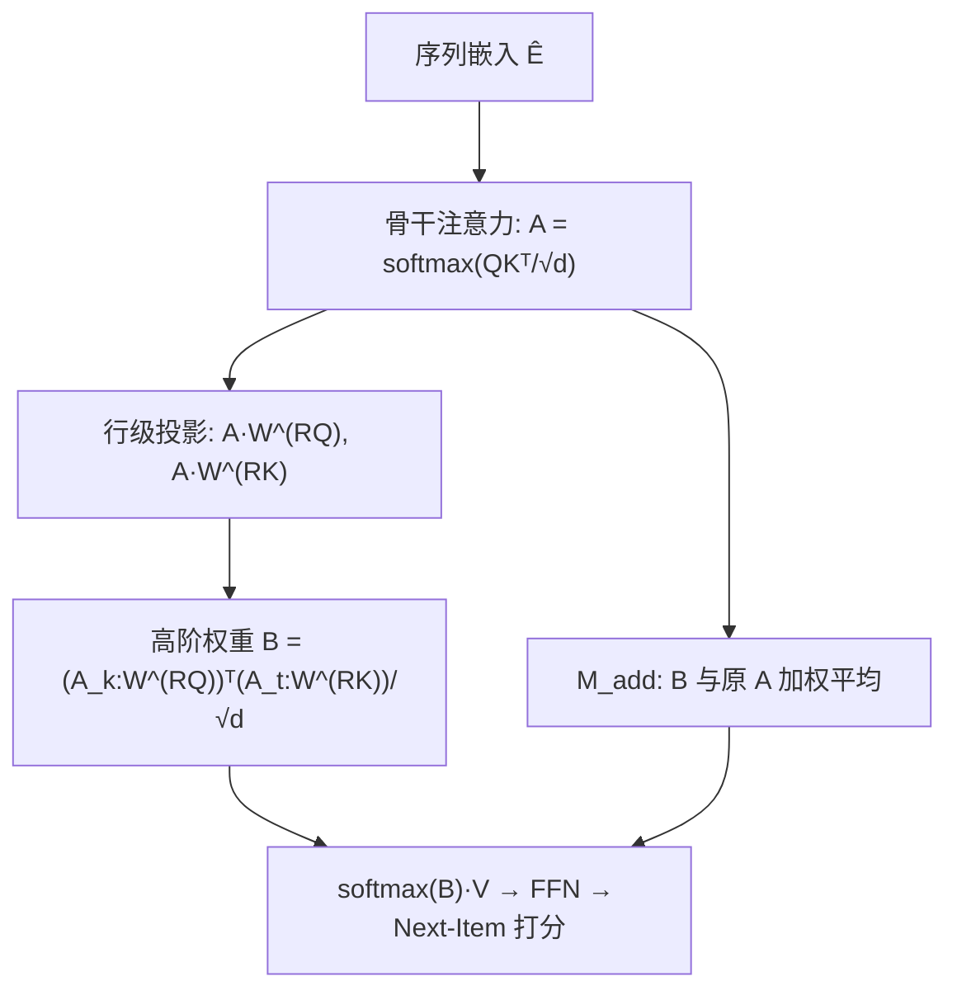
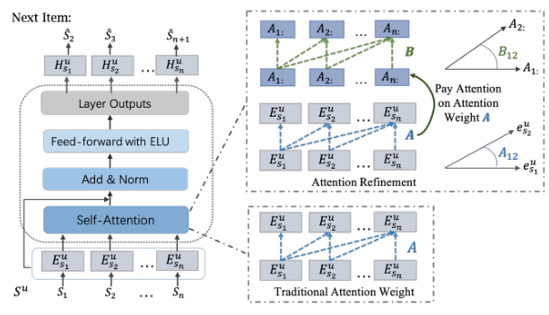

# Pay Attention to Attention for Sequential Recommendation (为序列推荐"注意"注意力本身)

- **会议/期刊**: RecSys 2024 (18th ACM Conference on Recommender Systems)
- **作者与机构**: Yuli Liu, Min Liu, Xiaojing Liu（青海大学 青海省智能计算与应用重点实验室）
- **推荐链路定位**: 召回（Next-Item 序列编码器，可直接替换 SASRec/STOSA 的注意力层）
- **研究方向**: 序列与会话推荐 / 自注意力结构改进
- **论文原文**: [https://arxiv.org/abs/2410.21048v1](https://arxiv.org/abs/2410.21048v1)
- **开源代码**: 暂未开源

## TL;DR (1分钟核心速览)

现有 Transformer 序列推荐只把注意力权重 $\mathbf{A}$当作"加权求和用的系数"，一次性消耗掉，从未把$\mathbf{A}$的行向量当作**表征**去挖掘 item 之间的高阶关联。本文提出 AWRSR：用可学习矩阵把$\mathbf{A}$的行投影成新的 Query/Key，再算一层"注意力上的注意力"得到细化矩阵$\mathbf{B}$，并以加法机制与原权重融合。在 Beauty/ML-1M/Anime 三数据集、Leave-One-Out 协议下，仅一层注意力即可让 SASRec 的 NDCG@5 最高 +8.42%、STOSA 的 Recall@1 最高 +14.44%（$p<0.01$），额外开销仅$O(n^2)$ 空间。

## Background & Motivation (背景与核心矛盾)

- **主流范式**: SASRec/BERT4Rec 类模型以缩放点积（或 STOSA 的负 2-Wasserstein 距离）计算 $\mathbf{A}=\text{softmax}(\mathbf{Q}\mathbf{K}^\top/\sqrt{d})$，随后直接$\mathbf{A}\mathbf{V}$ 输出，堆叠多层/多头来提升表达能力。
- **前人局限**: ① 注意力权重被"一次性消费"，$\mathbf{A}_{k:}$中蕴含的"item$k$ 与全序列各位置的关联模式"未被二次利用；② 建模高阶 item 转移只能靠加深层数、加 GCN 或高阶马尔可夫链，参数与算力代价高。
- **核心洞察 (Key Insight)**: 若把 $\mathbf{A}$的每一行视为一个$n$ 维"关联表征"，那么行与行之间的相似度即刻画了**位置的关联模式之间的关联**——这正是高阶转移的天然载体，且已在第一层算好、可免费复用。
- **本文切入点**: 不新增注意力层，而是对已有 $\mathbf{A}$施加一组$n\times n$可学习变换，得到细化权重$\mathbf{B}$，实现"pay attention to attention"。

## Method (核心方法设计)

### 1. 整体框架 (Overall Architecture)

输入用户序列的 item 嵌入 $\hat{\mathbf{E}}_{S_u}$，先按骨干模型（SASRec 点积 / STOSA 随机嵌入 Wasserstein 距离）算出原始注意力矩阵$\mathbf{A}\in\mathbb{R}^{n\times n}$；随后 AWRSR 模块把$\mathbf{A}$的行当作 token 表征，用$\mathbf{W}^{(RQ)},\mathbf{W}^{(RK)}$（及$\mathbf{W}^{(RV)}$）投影并二次计算相似度，得到高阶注意力$\mathbf{B}$；最后$\text{softmax}(\mathbf{B})\mathbf{V}$与原分支（视机制而定）融合，接 FFN 与预测层，用交叉熵 +$\ell_2$ 训练，推理时对全库 item 嵌入做内积 top-N。整个细化层与骨干同构、可多层堆叠。

<figure class="paper-figure" markdown="span">
  <figcaption>图 1：用于 SR 的注意力权重细化。</figcaption>
</figure>

### 2. 关键设计拆解 (Key Designs)

1. **简单细化 $M_{simp}$（最稳的基线级改进）**：痛点是把$\mathbf{A}$当一次性系数浪费了行间结构$\to$用两组$n\times n$矩阵把$\mathbf{A}$ 的行投影为新 Q/K，再算一次缩放点积得高阶权重：
$B_{kt}=\dfrac{\left(\mathbf{A}_{k:}\mathbf{W}^{(RQ)}\right)^{\top}\left(\mathbf{A}_{t:}\mathbf{W}^{(RK)}\right)}{\sqrt{d}}$直觉：$\mathbf{A}_{k:}$与$\mathbf{A}_{t:}$分别编码位置$k,t$的"全序列关联画像"，其内积衡量两位置在**关联模式**上的相似性，从而把一阶共现升级为二阶模式匹配；且$d\gg n$时该式是低秩$n\times n$ 变换，几乎不增加主项算力。

2. **值加权细化 $M_{value}$与加法融合$M_{add}$（表达力与稳定性的取舍）**：$M_{value}$进一步用$\mathbf{W}^{(RV)}\mathbf{A}$ 对权重做值域重表达：
$\mathbf{B}=\mathbf{W}^{(RV)}\mathbf{A}\cdot\text{softmax}\left(\left(\mathbf{W}^{(RK)}\mathbf{A}\right)^{\top}\mathbf{W}^{(RQ)}\mathbf{A}\right)$但纯高阶化会丢掉原始一阶相关性，$M_{add}$ 因此将两阶权重取均值融合：
$B_{kt}=\dfrac{1}{2}\left[\dfrac{\left(\mathbf{A}_{k:}\mathbf{W}^{(RK)}\right)^{\top}\left(\mathbf{A}_{t:}\mathbf{W}^{(RQ)}\right)}{\sqrt{d}}+A_{kt}\right]$该"高低阶平衡"使其在层数加深时收益递增（见消融）。另有面向 STOSA 的$M_{stoc}$，把$\mathbf{A}_{k:}\mathbf{W}^{(R)}_{\mu}$、$\mathbf{A}_{k:}\mathbf{W}^{(R)}_{\Sigma}$ 变换为新的高斯分布参数并保持协方差正定。

3. **训练目标与开销**：损失为标准的下一项交叉熵（$-\log\hat{y}_{s_{|S|}}$）+$\ell_2$正则，广播式负采样沿用 SASRec/STOSA 官方实现（每个正样本配一个目标 item，无显式 hard negative 挖掘）。空间额外$O(n^2)$（三张$n\times n$矩阵），时间额外$O(n^3)$；但实测最优配置$d=128\gg n\in\{20,30\}$，主导项仍是原注意力的$O(nd^2)$，且无需重算完整新注意力层。

## Experimental Setup & Evaluation Protocol (实验设置与评估协议)

- **数据集与预处理**:

| 数据集 | #Users | #Items | #Interactions | 稀疏度/密度 | 特征/场景说明 |
| :--- | :---: | :---: | :---: | :---: | :--- |
| Beauty | 52.0k | 57.2k | 0.4M | 极稀疏（Amazon 评论） | 美妆电商，5-core 过滤 |
| ML-1M | 6.0k | 3.4k | 1.0M | 高密度 | 电影评分，稠密基准 |
| Anime | 73.5k | 12.2k | 1.0M | 中等 | 动漫评分，长序列 |

- **数据划分与防穿越 (Splitting Strategy)**: `Leave-One-Out`——最后 1 次交互作测试、倒数第 2 次作验证、其余全部训练，全库 5-core 过滤掉交互 <5 的用户，严格保证测试项不进入训练。
- **排名评测协议 (Ranking Protocol)**: 报告 Recall@{1,5} 与 NDCG@{1,5}；候选集沿用 SASRec/STOSA 官方代码的采样排序（每正样本配 1 个目标负样本的训练式评测），原文未显式声明 Full-Ranking 与负样本比例，也未报告方差/置信区间，仅声明相对提升在 $p<0.01$ 下显著。
- **对比基线与超参设置**: 基线即 **SASRec** 与 **STOSA** 原始版本（本文的核心主张是"插件式增益"，故未纳入 GRU4Rec/BERT4Rec 等第三方模型）；嵌入维度 $\{64,128\}$（STOSA 均值/协方差各$\{32,64\}$），最大序列长$\{20,30,50,100\}$，学习率$\{10^{-3},10^{-4}\}$，$\ell_2\in\{10^{-1},10^{-2},10^{-3}\}$，dropout$\{0.3,0.5,0.7\}$，头数/层数各$\{1,2,3,4\}$，early stopping 以验证 NDCG@5 连续 20 epoch 不升为准；细化模块与骨干共用同一套调优超参以保证公平。

## Key Experimental Results (实验关键数据)

### 1. 主实验对比 (Main Results)

| 骨干/机制 | Beauty R@1 | Beauty R@5 | Beauty N@5 | ML-1M R@1 | ML-1M R@5 | ML-1M N@5 | Anime R@1 | Anime R@5 | Anime N@5 |
| :--- | :---: | :---: | :---: | :---: | :---: | :---: | :---: | :---: | :---: |
| SASRec (Original) | 0.0097 | 0.0371 | 0.0234 | 0.0265 | 0.0959 | 0.0616 | 0.1209 | 0.2978 | 0.2112 |
| SASRec + $M_{simp}$ | 0.0104 | 0.0376 | 0.0243 | 0.0291 | 0.1004 | 0.0649 | 0.1237 | **0.3247** | 0.2274 |
| SASRec + $M_{value}$ | **0.0116** | 0.0376 | **0.0251** | 0.0267 | 0.0976 | 0.0642 | **0.1269** | 0.3083 | 0.2165 |
| SASRec + $M_{add}$ | 0.0108 | **0.0380** | 0.0239 | **0.0289** | **0.1013** | **0.0654** | 0.1211 | 0.3225 | **0.2290** |
| STOSA (Original) | 0.0150 | 0.0422 | 0.0285 | 0.0218 | 0.0720 | 0.0475 | 0.1101 | 0.2716 | 0.1934 |
| STOSA + $M_{simp}$ | 0.0153 | **0.0453** | 0.0304 | 0.0221 | 0.0756 | 0.0489 | 0.1220 | 0.3018 | 0.2143 |
| STOSA + $M_{value}$ | **0.0162** | 0.0428 | 0.0286 | **0.0246** | **0.0789** | **0.0516** | **0.1260** | **0.3029** | **0.2171** |
| STOSA + $M_{add}$ | 0.0154 | 0.0442 | **0.0305** | 0.0223 | 0.0750 | 0.0481 | 0.1222 | 0.2987 | 0.2147 |
| *Improv.% (最优)* | *+8.00* | *+7.35* | *+7.02* | *+12.84* | *+9.58* | *+8.63* | *+14.44* | *+11.50* | *+12.27* |

### 2. 消融实验 (Ablation Study)

Beauty 上按注意力层数的 NDCG@5（相对原始骨干的提升%）：

| Layers | SASRec | +$M_{simp}$| +$M_{value}$| +$M_{add}$| STOSA | +$M_{simp}$| +$M_{value}$| +$M_{add}$| +$M_{stoc}$ |
| :--- | :---: | :---: | :---: | :---: | :---: | :---: | :---: | :---: | :---: |
| 1 | 0.0234 | 0.0243 (+3.85) | **0.0251** (+7.26) | 0.0239 (+2.14) | 0.0285 | **0.0304** (+6.67) | 0.0286 (+0.35) | 0.0305 (+7.02) | 0.0276 (−3.16) |
| 2 | 0.0242 | **0.0255** (+5.37) | 0.0250 (+3.31) | 0.0254 (+4.96) | 0.0271 | 0.0286 (+5.54) | 0.0278 (+2.58) | **0.0289** (+6.64) | 0.0273 (+0.74) |
| 3 | 0.0265 | 0.0274 (+3.40) | 0.0270 (+1.88) | **0.0278** (+4.91) | 0.0257 | 0.0265 (+3.11) | 0.0260 (+1.17) | **0.0277** (+7.78) | 0.0261 (+1.56) |
| 4 | 0.0247 | 0.0262 (+6.07) | 0.0255 (+3.24) | **0.0267** (+8.10) | 0.0260 | 0.0267 (+2.69) | 0.0265 (+1.92) | **0.0284** (+9.23) | 0.0270 (+3.85) |

### 3. 关键实验发现 (Key Findings)

1. **"注意力上的注意力"是跨骨干的通用增益而非调参运气**：$M_{simp}$在 3 数据集 × 2 骨干共 6 组设置下**无一例外**为正增益（最小 +1.35%，ML-1M R@1 达 +9.81%），说明$\mathbf{A}$ 的行间相关性确实承载了被原模型丢弃的高阶信号——这是全文最有力的因果证据。
2. **高阶与一阶的"配比"决定层数收益方向**：纯高阶化的 $M_{value}$在 1 层最强（Beauty N@5 +7.26%），但到 4 层反而只剩 +3.24%；而融合原始权重的$M_{add}$ 随层数单调走强（SASRec 4 层 +8.10%，STOSA 4 层 +9.23%），证明深层网络中必须保留一阶注意力锚点以防高阶细化过平滑。
3. **随机注意力无法被"再细化"**：为 STOSA 定制的 $M_{stoc}$ 在 Beauty 单层出现 **−3.16%** 的负增益，其余配置也仅 +0.63%~+3.85%；作者归因于把权重矩阵强行映射回高斯参数空间会破坏其分布语义，说明细化机制的有效性依赖于骨干注意力权重的**可加性/内积结构**，而非任意权重。

## Highlights & Limitations (亮点、对比与审稿批判)

- **与代表作对比 (vs. Prior Work)**: ①对比 SASRec/BERT4Rec 的"多层多头"路线——它们靠增加完整注意力层换取表达力，AWRSR 只复用已有 $\mathbf{A}$做$n\times n$ 再投影，参数量与算力显著更低；②对比 STOSA 只改进**权重计算方式**（点积→Wasserstein 距离），AWRSR 不改计算、只改**权重的再消费方式**，二者正交可叠加（实验已证）；③对比 GCN/高阶马尔可夫链类方法需要外部图结构，本文完全序列内生。
- **可迁移亮点**: ①把注意力矩阵的行作为"关联画像"做二阶匹配的思路可直接移植到多模态序列、跨域序列或 CTR 中的行为序列编码器；②$M_{add}$ 的"高阶 + 一阶残差式融合"是深层注意力网络的通用稳定化技巧，可类比残差连接使用。
- **审稿级局限批判**: ①**基线过窄**——主实验仅与 SASRec、STOSA 两个原始版本对比（本质上是自消融），缺少 GRU4Rec、BERT4Rec、FDSA、DIF-SR 等公认 SOTA，也没有误差棒与多随机种子；②**评测协议交代不清**——未说明是 Full-Ranking 还是采样排序、负样本比例多少，跨模型数值可比性存疑；③$M_{stoc}$的失败缺乏理论解释，且时间复杂度写为$O(n^3)$却在复杂度分析里只论证$O(n^2 n)$一项，与$d\gg n$ 的假设耦合较紧，序列变长的短视频场景下收益/开销比需重估。

## Rating (四维评分)

- **方法创新性 (Novelty)**: ⭐⭐⭐⭐ （把注意力权重升格为表征再做二阶注意力的视角新颖且简洁，但仍是启发式算子设计，缺乏谱分析或信息论层面的理论支撑）
- **评估协议与实验扎实度 (Protocol & Experiments)**: ⭐⭐⭐ （三数据集 + 跨两骨干 + 多层消融与收敛曲线较完整，但基线仅两个、候选集协议未明示、无显著性检验细节与方差报告）
- **写作与数学规范度 (Clarity & Rigor)**: ⭐⭐⭐ （四种机制公式表达清晰且统一在 $\mathbf{A}$上操作，但$M_{add}$是否再过 softmax、$M_{stoc}$ 的随机矩阵维度等关键细节表述含糊）
- **工业落地与复现价值 (Industrial & Practical Value)**: ⭐⭐⭐⭐ （纯插件式改造、无需重训新层、额外仅 $O(n^2)$参数，工程接入成本极低；但代码未开源且$n^3$ 项在长序列场景的延迟需实测）

