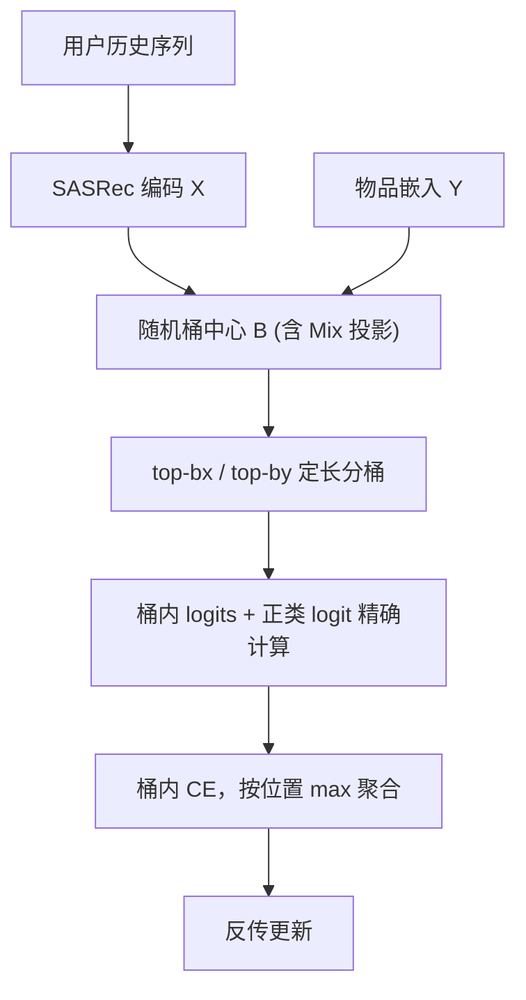
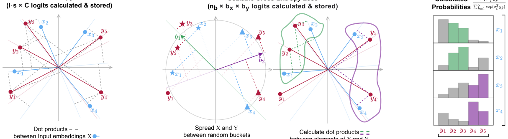
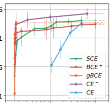

# Scalable Cross-Entropy Loss for Sequential Recommendations with Large Item Catalogs (面向大物品目录序列推荐的可扩展交叉熵损失)

- **会议/期刊**: RecSys 2024
- **作者与机构**: Gleb Mezentsev, Danil Gusak, Ivan Oseledets, Evgeny Frolov (Skoltech / AIRI / HSE)
- **推荐链路定位**: 召回（Next-Item 预测的训练目标与损失函数层）
- **研究方向**: 序列与会话推荐 / 协同过滤与双塔召回
- **论文原文**: [https://arxiv.org/abs/2409.18721v2](https://arxiv.org/abs/2409.18721v2)
- **开源代码**: [https://github.com/AIRI-Institute/Scalable-SASRec](https://github.com/AIRI-Institute/Scalable-SASRec)

## TL;DR (1分钟核心速览)

序列推荐中全库 Cross-Entropy (CE) 精度最优，但 logits 张量尺寸为 $s\cdot l\cdot C$（128×200×10⁶ 即约 100GB），几乎不可训练；BCE/采样 CE 虽省显存却因随机负样本缺乏信息量而掉点。本文提出 SCE：用少量随机桶中心把模型输出与物品嵌入各自 top-k 分桶，仅在等长桶内计算 CE，理论上等价于对 CE 梯度最大项做 MIPS 检索。在 5 个数据集、严格全局时间戳切分 + Full-Ranking 协议下，SCE 以最多 100 倍更低的峰值显存、2.5–6.7 倍更快的训练达到或超过全库 CE（NDCG@10 最高 +17.6%）。

## Background & Motivation (背景与核心矛盾)

- **主流范式**: SASRec/BERT4Rec 类 Transformer 序列模型；已有工作证明 BERT4Rec 的增益主要来自全库 CE 而非双向注意力，但工业界因显存只能退回 BCE 或采样 CE（BCE+ / $g$BCE / CE−）。
- **前人局限**: ① 随机/流行度/In-batch 负采样几乎采不到 hard negative，模型对高排名物品过度自信，无法区分唯一正类；② 基于 LSH、球聚类、Gumbel-MIPS 的近似 softmax 方法检索集合大小不一，无法批处理，作者指出这些工作**几乎都没有 GPU 实验**。
- **核心洞察 (Key Insight)**: CE 对 logit 的梯度为 $\partial\mathcal{L}/\partial \text{logit}_{i,k}=\mathrm{softmax}_k-\mathbb{I}[k=z_{i+1}]\in[-1,1]$，只有两类项真正驱动更新——正类 logit 被压低（标签已知，可直接算）与负类 logit 被抬高（即"最可能被误判为正"的假阳性），后者本质是一个 MIPS 问题。
- **本文切入点**: 用随机桶中心把 MIPS 变成**定长 top-k 分桶**，从而既有选择性地只算信息量最大的 logits，又能整批在 GPU 上做稠密矩阵乘。

## Method (核心方法设计)

### 1. 整体框架 (Overall Architecture)

输入为用户历史序列，经 SASRec 编码得每个位置的输出 $\boldsymbol{x}_i\in\mathbb{R}^{d}$；对每个 batch 重新采样桶中心矩阵$B$，分别对$\boldsymbol{X}$与物品表$\boldsymbol{Y}$做投影取 top-$b_x$/ top-$b_y$，把输出与物品"撒"进$n_b$个定长桶；仅在桶内做$b_x\times b_y$ 的 logits 与 softmax，正类 logit 单独精确计算并屏蔽桶内误入的正类项，最后按输出位置做 max 聚合回传。推理阶段完全不变，仍用全库内积 + ANN 检索。

<figure class="paper-figure" markdown="span">
  <figcaption>图 1：序列长度 𝑙=4、批大小 𝑠=1、目录规模 𝐶=5、桶数 𝑛𝑏=2 且桶大小 𝑏𝑥=2、𝑏𝑦=2 时，交叉熵损失与可扩展交叉熵损失的 logits 计算示意图。</figcaption>
</figure>

### 2. 关键设计拆解 (Key Designs)

1. **桶化 Softmax 近似（核心算子）**：痛点是把 $s\cdot l\times C$的 logits 全存下来。做法是采样$B=\text{randn}(n_b,d)$，取$I_b=\mathrm{top}_{b_x}(BX^{\top})$、$J_b=\mathrm{top}_{b_y}(BY^{\top})$，仅计算桶内$\boldsymbol{S}_b=\boldsymbol{X}_{I_b}\boldsymbol{Y}_{J_b}^{\top}\in\mathbb{R}^{b_x\times b_y}$。直觉是"若$\boldsymbol{x}_i,\boldsymbol{y}_j$都与某个随机$\boldsymbol{b}$高内积，则二者大概率也高内积"，而定长桶保证可批处理，最大张量由$s\cdot l\cdot C$降为$n_b b_x b_y$。
2. **Mix 投影缓解桶塌缩**：随机 $B$可能让同一输出被多个桶重复选中，而 max 聚合只保留一个，导致浪费。作者借鉴随机化范围寻找器，令$B=\Omega\boldsymbol{X}$，$\Omega\in\mathbb{R}^{n_b\times s\cdot l}$：方向由数据自身线性组合而成，必然"指"向信息量大的方向，同时随机性保证多样性。实测唯一入选比例从 17.4%→39.8%（Behance）、37.1%→54.0%（Kindle），成本仅是额外一个$n_b\times s\cdot l$ 小矩阵。
3. **损失聚合与超参、开销**：对每个至少进桶一次的输出 $k$，取其所有桶内损失的最大值（最接近全库部分和）：
$\mathcal{L}_{SCE}=\frac{1}{|\{k:L_k\neq\varnothing\}|}\sum_{k:\,L_k\neq\varnothing}\max_{(b,i)\in L_k}\Big[-\log\frac{e^{\boldsymbol{x}_k^{\top}\boldsymbol{y}_{z_{k+1}}}}{e^{\boldsymbol{x}_k^{\top}\boldsymbol{y}_{z_{k+1}}}+\sum_{j=1}^{b_y}e^{\boldsymbol{x}_k^{\top}\boldsymbol{y}_{J_{b,j}}}}\Big]$超参取参数化$b_x=\alpha\sqrt{s\cdot l\cdot\beta}$、$n_b=\alpha\sqrt{s\cdot l/\beta}$（固定$\alpha=2,\beta=1$），$\beta$ 控制"多小桶"与"少大桶"的取舍。**无任何负采样器、无额外难负样本缓存**，桶划分全在 no-grad 下完成，开销可忽略。

## Experimental Setup & Evaluation Protocol (实验设置与评估协议)

- **数据集与预处理**: 移除交互数 <5 的物品与 <20 条记录的用户（等价 5-core + 用户过滤）：

| 数据集 | #Users | #Items | #Interactions | 密度 |
| :--- | :---: | :---: | :---: | :---: |
| BeerAdvocate | 7,606 | 22,307 | 1,409,494 | 0.83% |
| Behance | 8,097 | 32,434 | 546,284 | 0.21% |
| Kindle Store | 23,684 | 96,830 | 1,256,065 | 0.05% |
| Yelp | 42,429 | 137,039 | 2,294,804 | 0.04% |
| Gowalla | 27,516 | 173,511 | 2,627,663 | 0.06% |

- **数据划分与防穿越**: 取全部交互 0.95 分位为**全局时间戳**，之前为训练集；之后有交互的用户作测试用户并从训练集剔除，对其做 Leave-One-Out（最后一条测试、倒数第二条验证 + early stopping），显式规避 "recommendations from future" 泄漏。
- **排名评测协议**: **无偏 Full-Ranking**（全库未交互物品排序），报告 NDCG@{1,5,10}、HR@{1,5,10} 与 COV@{1,5,10}；同时记录峰值显存与训练时长。
- **对比基线与超参**: backbone 统一为 PyTorch 版 SASRec（2 层 Transformer），对手为 SASRec-BCE+（多负样本）、gSASRec（$g$BCE 校准）、SASRec-CE−（采样 CE）与全库 CE；硬件 NVIDIA Tesla V100 16GB，各方法在"负样本数 / 桶内物品数 / batch size"网格上取 NDCG@10–显存的 Pareto 前沿比较。

## Key Experimental Results (实验关键数据)

### 1. 主实验对比 (Main Results)

各方法在最优配置下的表现（加粗为最优，括号为 SCE 相对最强非 SCE 基线）：

| 数据集 | 指标 | BCE+ | gBCE | CE− | CE (全库) | **SCE** | Improv. |
| :--- | :--- | :---: | :---: | :---: | :---: | :---: | :---: |
| BeerAdvocate | NDCG@10 | 0.0160 | 0.0152 | 0.0202 | 0.0181 | **0.0209** | +3.34% |
| Behance | NDCG@10 | 0.0543 | 0.0547 | 0.0567 | 0.0546 | **0.0663** | +16.9% |
| Kindle Store | NDCG@10 | 0.0712 | 0.0647 | 0.0638 | 0.0694 | **0.0782** | +9.97% |
| Yelp | NDCG@10 | 0.0136 | 0.0138 | 0.0149 | 0.0136 | **0.0140** | −6.21% |
| Gowalla | NDCG@10 | 0.0405 | 0.0404 | 0.0396 | 0.0367 | **0.0476** | +17.6% |
| Gowalla | HR@10 | 0.0730 | 0.0731 | 0.0715 | 0.0657 | **0.0831** | +13.8% |
| Kindle Store | COV@10 | 0.1830 | 0.1647 | 0.1850 | 0.1641 | **0.2380** | +28.4% |
| BeerAdvocate | COV@10 | 0.0943 | 0.1036 | 0.1182 | 0.1149 | **0.1900** | +60.1% |

Amazon Beauty 上与近年 SOTA 对比（Leave-One-Out 协议）：SASRec-SCE NDCG@10 **0.0544** / HR@10 **0.0935**，优于 CBiT (0.0537/0.0905)、SASRec-RECE (0.0525/0.0897)、FEARec、DuoRec 与 CL4SRec。

<figure class="paper-figure" markdown="span">
  <figcaption>图 6：(a)-(e) 给定内存预算下关于 NDCG@10 的 Pareto 前沿曲线。(f)-(j) 相同数据点在训练时间–NDCG@10 坐标轴上的表示，点的大小对应相应 (a)-(e) 图中的内存值。</figcaption>
</figure>

### 2. 消融实验 (Ablation Study)

| 数据集 | 指标 | w/o Mix | + Mix | 相对提升 |
| :--- | :--- | :---: | :---: | :---: |
| Behance | NDCG@10 | 0.0632 | **0.0667** | +5.5% |
| Behance | HR@10 | 0.1110 | **0.1166** | +5.0% |
| Behance | COV@10 | 0.215 | **0.253** | +17.8% |
| Kindle Store | NDCG@10 | 0.0748 | **0.0780** | +4.3% |
| Kindle Store | HR@10 | 0.1012 | **0.1043** | +3.1% |
| Kindle Store | COV@10 | 0.214 | **0.237** | +10.9% |

### 3. 关键实验发现 (Key Findings)

1. **"近似优于精确"在小目录也成立**：BeerAdvocate/Behance 上全库 CE 并未触及显存上限（可达质量平台），但 SCE 的 NDCG@10 仍分别 +3.34% 与 +16.9%。作者归因于 SCE 同时选择了序列中信息量最大的状态，且随机化桶划分起到正则作用（未严格验证）。
2. **负采样在中小目录反而更费显存**：目录 ≤40K 时（ML-1M 3K、Behance 32K），全库 CE 比 BCE+/$g$BCE 分别省 71.9% 与 13.8% 显存；而 SCE 相对 BCE+/$g$BCE 在 ML-1M/Behance 上省 88.4%/88.0%，在 Gowalla（174K）上省 93.7%——"采样必然更省"的工程直觉被推翻。
3. **显存-质量 Pareto 前沿整体外推**：在 4/5 数据集上，SCE 用 7.8–100.2 倍更少显存达到最强对手同等质量且训练快 2.5–6.7 倍；同显存预算下 NDCG@10 提升 3.3%–17.6%。唯一例外 Yelp（最稀疏）NDCG@10 落后最好模型 6.2%，仅比同质量最快方法快 1.9 倍，说明超参启发式在极稀疏场景不稳。

## Highlights & Limitations (亮点、对比与审稿批判)

- **与代表作对比**: 相比 BCE+/$g$BCE（Klenitskiy & Vasilev、Petrov & Macdonald），SCE 不做分布校准而是直接改采样算子，把"采负样本"变成"采 logits 子块"；相比 SASRec-RECE（LSH 近似 CE），SCE 的桶定长、桶内无冗余、无需 chunk 混桶，因此可批处理并在 Amazon Beauty 上高出约 3.6% NDCG@10。
- **可迁移亮点**: "定长 top-k 分桶 + max 聚合"这一模式可无痛移植到大词表 LM 的 softmax 训练、双塔召回的全库 softmax、以及任何"类别数 >> 显存"的多分类目标，且只需一次矩阵乘与 argsort。
- **审稿级局限批判**: ① 桶划分与 Mix 的收益仅有经验证据，缺少对"近似误差 vs 全库 CE"的理论界；② 关键超参 $b_y$需按数据集与显存预算调，Yelp 上的掉点暴露了$\alpha/\beta$ 启发式的脆弱性；③ 只测到 17 万物品量级、单一 backbone（SASRec），未验证 BERT4Rec/线性注意力或百万级目录下的实际加速比。

## Rating (四维评分)

- **方法创新性 (Novelty)**: ⭐⭐⭐⭐ （把 CE 梯度主导项转化为 MIPS、再转化为定长分桶，思路简洁且与 GPU 批处理天然契合）
- **评估协议与实验扎实度 (Protocol & Experiments)**: ⭐⭐⭐⭐⭐ （全局时间戳防泄漏 + Full-Ranking + Pareto 前沿 + 显存/时间双维度，实验设计与近年评测批判高度一致）
- **写作与数学规范度 (Clarity & Rigor)**: ⭐⭐⭐⭐ （算法伪码与张量形状交代清晰，但近似误差缺乏理论分析，部分提升归因停留在推测）
- **工业落地与复现价值 (Industrial & Practical Value)**: ⭐⭐⭐⭐⭐ （开源完整、即插即用的损失替换、训练显存降两个数量级，对大目录工业召回训练直接可用）

