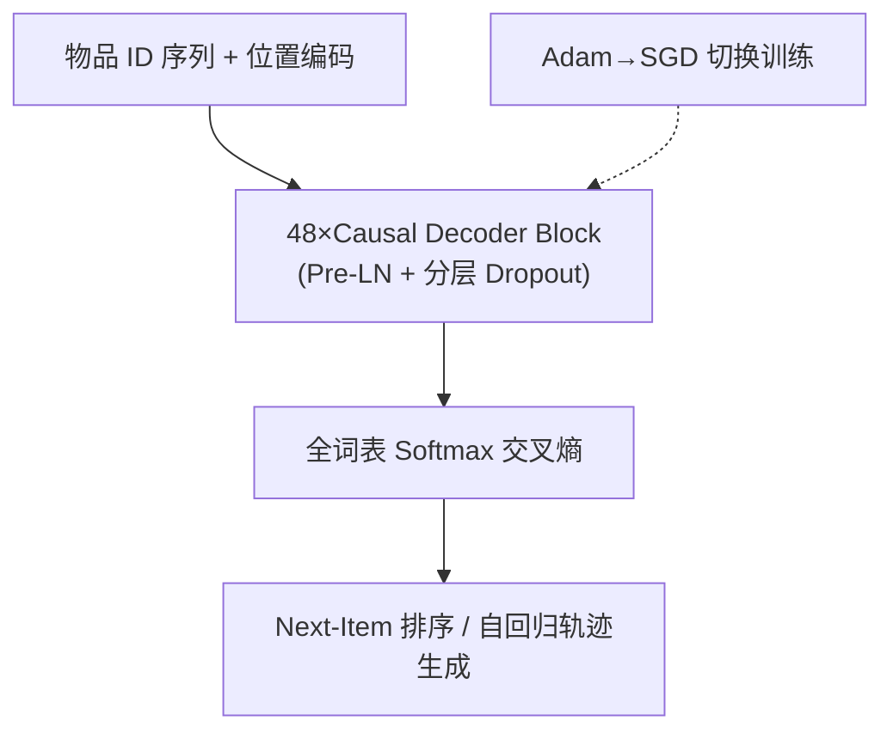
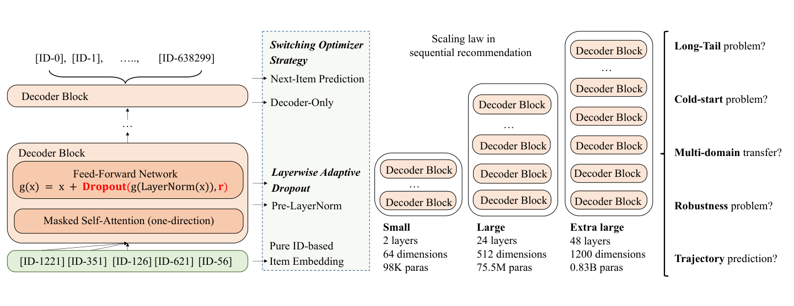
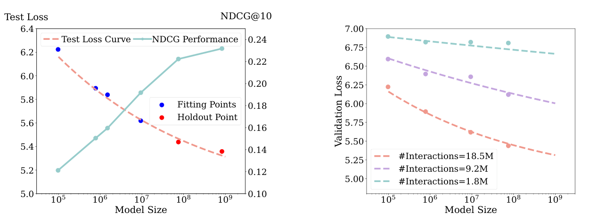

# Scaling Law of Large Sequential Recommendation Models (大序列推荐模型的缩放律)

- **会议/期刊**: RecSys 2024
- **作者与机构**: Gaowei Zhang, Wayne Xin Zhao, Ji-Rong Wen (中国人民大学高瓴人工智能学院)；Yu Chen, Hongyu Lu (腾讯微信)；Yupeng Hou (UCSD)
- **推荐链路定位**: 端到端生成式（Next-Item 自回归预测）
- **研究方向**: 序列与会话推荐 / 生成式推荐
- **论文原文**: [论文原文链接](https://arxiv.org/abs/2311.11351v1)
- **开源代码**: 暂未开源

## TL;DR (1分钟核心速览)

本文追问一个被忽视的问题：在**纯 ID、无任何侧信息**的序列推荐上，LLM 式的缩放律是否依然成立？作者用 decoder-only Transformer 把模型从 98.3K 训到 0.8B 参数，提出分层自适应 Dropout 与 Adam→SGD 优化器切换解决大模型训练不稳定，成功拟合出 $L(N)=E_N+(N_0/N)^{\alpha_N}$ 幂律并用小模型精准预测 0.8B 模型 loss。在 Leave-One-Out 全库排序协议下，MovieLens-20M 上 NDCG@10 由 0.1281 提升至 0.2319（+81.0%），且在长尾、冷启动、跨域、鲁棒、长轨迹五类难任务上全面占优。

## Background & Motivation (背景与核心矛盾)

- **主流范式**: SASRec/BERT4Rec 等序列推荐模型长期停留在 2 层、64 维的"小模型"体量，研究重心在改结构（GNN/MLP/CNN）而非扩规模。
- **前人局限**: 其一，CTR 缩放研究（Guo et al., Ardalani et al.）依赖稠密特征，文本推荐缩放（Shin et al.）依赖 item text，**纯 ID 场景（工业界最常见格式）仍是空白**；其二，推荐交互极度稀疏——本文最大模型 0.8B 参数却只有 18.5M 交互，而同等规模 LLM 需 >10B tokens，属极端 data-constrained 情形，幂律是否被破坏未知。
- **核心洞察 (Key Insight)**: 若把物品全集当词表、把下一物品预测当自回归语言建模，则 loss 对规模的响应应服从幂律；数据稀疏只会压缩缩放指数 $\alpha_N$（拟合得$\alpha_N=0.121$，反而大于 NLP 的 0.07），而不会改变幂律的函数形式。
- **本文切入点**: 用统一的纯 ID decoder 架构横向扫过六个数量级的模型规模，先解决"训得动"的问题，再定量刻画缩放规律与下游任务收益。

## Method (核心方法设计)

### 1. 整体框架 (Overall Architecture)

输入为物品 ID 序列（最大长度 50，超截短补），经 item embedding 与可学习位置 embedding 相加后送入多层 **pre-LayerNorm 因果 decoder**（单向掩码自注意力 + GeLU FFN + 残差），最后一层隐状态对整个物品词表做 softmax，直接以交叉熵预测 $t+1$位置物品。模型缩放仅通过加深加宽实现：2 层/64 维/98.3K 非嵌入参数 → 48 层/1200 维/24 头/0.83B 参数（嵌入参数固定约 31.77M）。训练全程使用 layer-wise 自适应 dropout、Adam 预热后切 SGD、cosine 学习率与仅$1\times10^{-8}$ 的极小权重衰减（大权重衰减在稀疏推荐数据上直接导致欠拟合）。推理为逐位置 argmax/排序，无额外解码结构。

<figure class="paper-figure" markdown="span">
  <figcaption>图1：模型架构及其缩放版本的示意图。</figcaption>
</figure>

### 2. 关键设计拆解 (Key Designs)

1. **可预测的幂律缩放 (Predictable Scaling)**：前人无法回答"再放大 10 倍值不值"。本文将非嵌入参数 $N$ 作为自变量拟合
$L(N)=E_N+(N_0/N)^{\alpha_N}$其中$E_N$为不可约损失、$\alpha_N$为数据相关的缩放指数。MovieLens-20M 上拟合得$E_N=4.9,\ N_0=6.8\times10^{5},\ \alpha_N=0.121$，仅用 4 个$<10$M 的模型即可准确预测 75.5M 与 0.8B 模型的单轮测试损失（图 2(a)）。物理直觉：$\alpha_N$ 越大意味着单位参数带来的损失下降越快，故推荐任务在数据充足时"扩规模"的边际收益理论上高于 NLP；而数据量从 18.5M 降到 1.8M 时曲线明显变平，说明稀疏性主要惩罚的是指数而非上限。

<figure class="paper-figure" markdown="span">
  <figcaption>图2：MovieLens数据集上模型规模与数据规模的缩放曲线。</figcaption>
</figure>

2. **分层自适应 Dropout + 优化器切换 (LAD & SO)**：大模型训练不稳的根源在于固定 dropout 无法同时压制低层过拟合与高层欠拟合。作者对**低层设大 dropout**（直接处理原始 ID，易记住高频共现）、**高层设小 dropout**（承载抽象语义，压制会丢信息），缓解欠/过拟合两难；优化器上发现 Adam 初期收敛快但终值劣于 SGD，故在 **Adam 收敛点直接切换 SGD**，且实验证明切换点位置对结果几乎无影响，省去显式学习切换点。消融显示该组合把 24 层模型 loss 从 4.7504 降到 4.7182（-0.68%），而 2 层小模型几乎不受影响（5.6013→5.6249，甚至略升），印证"稳定化技巧只对大模型是刚需"。

3. **训练目标、负采样与推理开销**：总损失即全词表 softmax 交叉熵 $\mathcal{L}=-\sum_{t}\log\frac{\exp(\mathbf{h}_t^\top \mathbf{e}_{v_{t+1}})}{\sum_{v'\in\mathcal{I}}\exp(\mathbf{h}_t^\top \mathbf{e}_{v'})}$，**免负采样**（Amazon 词表 24 万，全 softmax 天然等价于 Full-Ranking，无采样偏差）。时间与空间复杂度分别为$O(n^2dL)$与$O(|\mathcal{I}|d+nd+d^2)$，作者指出低比特量化是落地关键，但本文未做。

## Experimental Setup & Evaluation Protocol (实验设置与评估协议)

- **数据集与预处理**: Amazon 采用 `30-core` 双向过滤，29 个域按用户与时间戳混合排序成单一序列（模拟真实多域场景）；仅保留 ID，丢弃标题/类目。

| 数据集 | #Users | #Items | #Interactions | 稀疏度(密度) | 特征/场景说明 |
| :--- | :---: | :---: | :---: | :---: | :--- |
| MovieLens-20M | 138,493 | 26,427 | 18,476,840 | 0.505% | 纯 ID，单域 |
| Amazon (mix) | 367,710 | 240,320 | 21,787,957 | 0.0247% | 纯 ID，29 域混合 |

- **数据划分与防穿越**: `Leave-One-Out`（末位为测试、倒数第二位为验证、其余训练），并过滤未在训练/验证出现的测试物品；缩放律分析使用单轮（single-epoch）测试 loss，下游任务模型则重复训练至验证 loss 不再下降。
- **排名评测协议**: `Full-Ranking`（对全部物品打分排序，因输出层即全词表 softmax），指标 HR@{5,10,50}、NDCG@{5,10,50}，另用 Coverage@10 衡量多样性；缩放律以交叉熵 loss 为主指标。
- **对比基线与超参设置**: SASRec、GRU4Rec、FMLP、Caser 四个同量级 SOTA 序列模型，对比 LSRM_wide（仅加宽）与 LSRM_deep（加深）；全局 batch 256，嵌入维度 64→1200，训练 12–30 epoch，8×A100 40GB。

## Key Experimental Results (实验关键数据)

### 1. 主实验对比 (Main Results)

| 模型 | 结构 (层/维) | 非嵌入参数 | HR@5 | NDCG@5 | HR@10 | NDCG@10 | NDCG@50 |
| :--- | :---: | :---: | :---: | :---: | :---: | :---: | :---: |
| SASRec | 2/64 | 98.3K | 0.1463 | 0.0930 | 0.2337 | 0.1212 | 0.1834 |
| GRU4Rec | 2/64 | 180.3K | 0.1559 | 0.1007 | 0.2466 | 0.1281 | 0.1965 |
| FMLP | 2/64 | 167.6K | 0.1498 | 0.0978 | 0.2427 | 0.1255 | 0.1918 |
| Caser | 2/64 | 703.7K | 0.1407 | 0.0877 | 0.2219 | 0.1140 | 0.1793 |
| LSRM_wide | 2/1200 | 34.56M | 0.0595 | 0.0384 | 0.0976 | 0.0506 | 0.0865 |
| **LSRM_deep** | **48/1200** | **0.83B** | **0.2794** | **0.1827** | **0.3786** | **0.2319** | **0.2794** |

> 相对最强基线 GRU4Rec：HR@5 **+79.2%**，NDCG@5 **+81.4%**，HR@10 **+53.5%**，NDCG@10 **+81.0%**，NDCG@50 **+42.2%**。

### 2. 消融实验 (Ablation Study)

MovieLens-20M，指标为测试交叉熵 LCE↓（越低越好）：

| 配置 | LSRM_l2 | LSRM_l24 |
| :--- | :---: | :---: |
| Both (LAD + SO) | 5.6249 | **4.7182** |
| w/o LAD | 5.6127 | 4.7296 (+0.24%) |
| w/o SO | 5.6281 | 4.7230 (+0.10%) |
| None | **5.6013** | 4.7504 (+0.68%) |

### 3. 关键实验发现 (Key Findings)

1. **缩放律在数据受限下依然成立且可外推**：即使用户-物品交互降到全量的 10%（1.8M），幂律曲线仍完美拟合；用小模型拟合的曲线预测 0.8B 模型 loss，误差肉眼不可辨，意味着工业界可用万级参数的试验成本预判十亿级模型的收益。
2. **"加宽"是陷阱，"加深"才是收益来源**：同为 31.77M 嵌入参数，LSRM_wide 的 NDCG@10 只有 0.0506（甚至低于 SASRec 的 0.1212），而 LSRM_deep 达 0.2319，直接复现了 CTR 领域的 embedding collapse；同时模型形状（宽高比 $R=d_{model}/n_{layer}$ 在 2~128 变动）引起的损失波动仅 1%–2% 量级，说明"扩规模优先于调形状"，可省下大量超参搜索。
3. **规模越大，难任务上的相对增益越大**：长尾最低流行度组 G4 上 48 层模型性能约为 2 层模型的 **3 倍**（高频组 G1 仅 2 倍）；冷启动 5 次交互用户上 Coverage@10 从 0.1362 升至 0.2046（多样性换准确率匹配）；跨域 Diff-domain 的提升幅度远超 Mix-domain；噪声扰动下的性能跌幅随规模单调收窄；自回归轨迹预测（TR@k）中规模越大衰减越缓慢。

## Highlights & Limitations (亮点、对比与审稿批判)

- **与代表作对比 (vs. Prior Work)**: 相较 Guo et al./Ardalani et al. 的 CTR 缩放研究，本文剥离全部特征、只留 ID，证明"行为语义本身"就足以支撑幂律；相较 Shin et al. 依赖文本行为日志，本文的设定更贴近无法获得文本的工业推荐场景；相较 SASRec 只堆 2 层，本文给出"该堆多深、堆多深才回本"的定量答案。
- **可迁移亮点**: (1) LAD+SO 组合可直接迁移到任何大规模 Transformer 排序模型以救训练不稳定；(2) 用小模型幂律曲线外推大模型精度，可作为算力预算与上线决策的廉价代理指标。
- **审稿级局限批判**: 其一，仅两个数据集、且 0.8B 模型的 loss 曲线已在 NDCG 上出现低回报区，说明数据量仍是硬瓶颈，幂律外推在更大规模下的可信度未验证；其二，48 层/1200 维模型的内存与延迟（$O(|\mathcal{I}|d+nd+d^2)$）在工业毫秒级召回链路上难以承受，作者仅把量化列为 future work；其三，训练不稳定性的解决方案偏经验性，缺乏理论解释。

## Rating (四维评分)

- **方法创新性 (Novelty)**: ⭐⭐⭐⭐ （首次在纯 ID 序列推荐上系统验证缩放律并给出 $\alpha_N$ 与 NLP 的定量差异，机制本身不新但问题定位精准）
- **评估协议与实验扎实度 (Protocol & Experiments)**: ⭐⭐⭐⭐ （Leave-One-Out + Full-Ranking 免采样偏差，六档规模 + 三档数据量 + 五类难任务覆盖充分，缺显著性检验与更多数据集）
- **写作与数学规范度 (Clarity & Rigor)**: ⭐⭐⭐⭐ （幂律与 TR@k 公式定义清晰、拟合参数完整披露，但稳定化技巧仅有消融而无论证）
- **工业落地与复现价值 (Industrial & Practical Value)**: ⭐⭐⭐ （幂律预测对小模型试错极具价值，但 0.8B 模型的延迟/显存与未开源于工程侧仍是大门槛）

