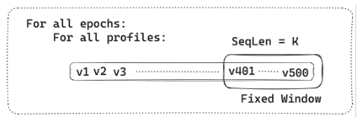
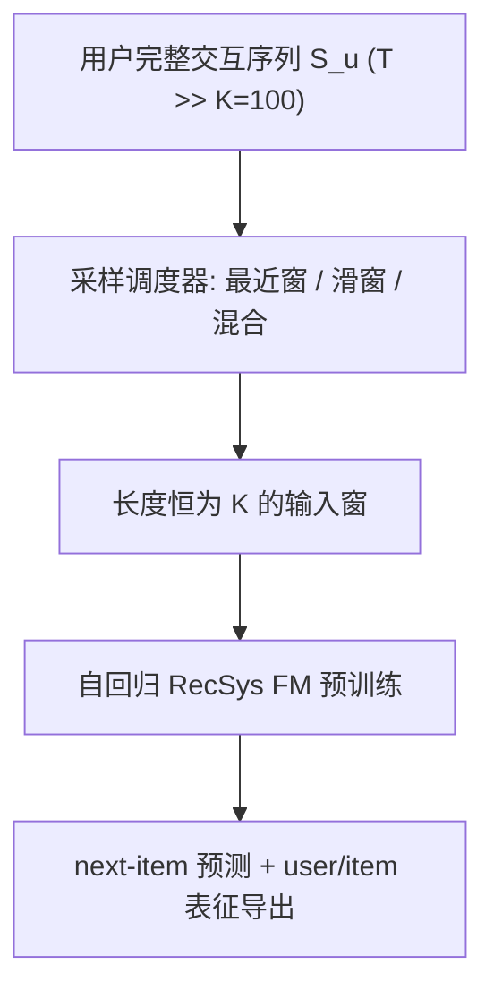
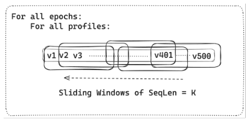

# Sliding Window Training - Utilizing Historical Recommender Systems Data for Foundation Models (滑窗训练：把推荐系统历史数据喂给基础模型)

- **会议/期刊**: RecSys 2024（18th ACM Conference on Recommender Systems, Bari, Italy，短文/工业实践 3 页）
- **作者与机构**: Swanand Joshi, Yesu Feng, Ko-Jen Hsiao, Zhe Zhang, Sudarshan Lamkhede（Netflix Research, Los Gatos, USA）
- **推荐链路定位**: 预训练表征（自回归 next-item 目标）→ 服务于下游召回/排序
- **研究方向**: 序列与会话推荐 / 生成式推荐（自回归）
- **论文原文**: [https://arxiv.org/abs/2409.14517v1](https://arxiv.org/abs/2409.14517v1)
- **开源代码**: 暂未开源

## TL;DR (1分钟核心速览)

长寿命工业推荐系统（Netflix 250M 用户，交互跨度数月至数年）在训练推荐基础模型时，受线上内存与延迟约束，输入窗口被迫固定为 $K=100$，只能截断到最近 100 条交互，长尾与长期兴趣信息被丢弃。本文不改模型、不改上下文长度，只在**数据采样层**引入滑窗训练循环：把每个用户的完整历史按$K$ 切窗、逐 epoch 轮换采样；并进一步提出「最近窗 epoch + 历史滑窗 epoch」的混合调度。在最近交互、随机旧序列、训练期后未来留出三组测试集上，Mixed-1000 使 Perplexity 相对降 2.43%、MRR 提升 8.82%，item 表征侧 mAP +14.04%、Recall +14.41%。

## Background & Motivation (背景与核心矛盾)

- **主流范式**: 用自回归（next-item 预测）的推荐基础模型在大规模用户-物品交互序列上预训练，再把预训练表征用于下游召回/排序（序列推荐 + 生成式预训练主流路线）。
- **前人局限**: 其一，工业侧有硬性 serving 内存/延迟预算，模型输入维度无法随之膨胀，因此只能截断历史；其二，固定截断到最近 $K$ 条使**每个 epoch 看到的是同一段序列**，用户旅程与长尾物品在预训练中几乎零曝光，item 侧表征欠拟合。
- **核心洞察 (Key Insight)**: 现有「加长上下文」路线（扩大上下文窗口）与本文目标正交——瓶颈不在模型能读多长，而在**训练时到底喂了些什么**。作者假设：预训练阶段应尽可能吃满交互序列，靠"训练期曝光"而非"推理期输入"来编码长期兴趣。
- **本文切入点**: 用滑窗采样器 + epoch 级混合调度，在输入维度恒为 $K$ 的前提下提高历史覆盖率与物品覆盖度。

<figure class="paper-figure" markdown="span">
  <figcaption>图1：对照训练循环</figcaption>
</figure>

## Method (核心方法设计)

### 1. 整体框架 (Overall Architecture)

输入是用户 $u$的完整交互序列$S_u=(i_1,\dots,i_T)$（播放、点赞、加入片单、打开详情页等异构行为，$T\gg K=100$）。模型本体沿用 Netflix 线上已有的自回归推荐基础模型（$K=100$输入上限），本文**完全不动网络结构**，只替换 batch 内的序列采样器：控制循环取最近$K$条；滑窗循环在$S_u$ 上按连续区段取窗，并随 epoch 轮换；混合循环则按 epoch 数在「最近窗」与「历史滑窗」之间切换。训练仍是标准 next-item 自回归解码，推理时输入维度、显存与延迟与基线**完全一致**。

### 2. 关键设计拆解 (Key Designs)

1. **滑窗采样器 (Sliding Window Sampler)**：把"历史信息丢失"从模型侧问题转为数据侧问题。对 $T>K$的用户，第$e$ 个 epoch 在合法起点集合上取窗：
$\mathcal{W}_u^{(e)}=\{i_{s_e},\,i_{s_e+1},\dots,i_{s_e+K-1}\},\quad s_e\in[1,\,T-L+1]$其中$L$为允许回看的最大历史深度（Mixed-500 取$L=500$，Mixed-1000 取$L=1000$）。直觉：$N$个 epoch 后模型累计"见过"的历史长度从$K$扩到$\approx\min(T, N\cdot K)$，相当于用**时间维度换上下文维度**，且不增加单步算力。

2. **混合调度 (Mixed Recency–Long-Term Schedule)**：纯滑窗会让最新交互曝光不足，损害"预测下一个新物品"这一核心任务。作者在 $N$个 epoch 中分配$X$个 epoch 用固定最近窗（保 recency），$N-X$个 epoch 用滑窗（保长期兴趣），并通过扫描确定$X$：
$\text{epoch }e\le X:\ \mathcal{W}^{(e)}=\{i_{T-K+1},\dots,i_T\};\quad e>X:\ \mathcal{W}^{(e)}\sim \text{Sliding}(L)$
该调度显式解耦了"近期偏好对齐"与"长期兴趣/物品表征丰富度"两个相互冲突的目标，是本文相对 All-Sliding 的关键增益来源。

3. **训练目标、负采样与推理效率**：训练目标为标准自回归交叉熵
$\mathcal{L}(\theta)=-\sum_{t}\log p_\theta\!\left(i_{t+1}\mid i_{s:t}\right)$全库 softmax/采样 softmax 的具体形式原文未披露；无显式 hard negative 构造，item 表征质量由 mAP/Recall 在内部 item 相似度数据集上间接验证。推理侧开销**零增加**（输入维度仍为$K$）；训练侧因需回读更长历史、且在时间上滑窗，作者将训练时间与内存效率优化列为后续工作。

<figure class="paper-figure" markdown="span">
  <figcaption>图2：滑动窗口训练循环</figcaption>
</figure>

## Experimental Setup & Evaluation Protocol (实验设置与评估协议)

- **数据集与预处理**: 唯一数据集为 Netflix 内部大规模交互日志，量级约 2.5 亿用户；交互类型含 play / like / add-to-watchlist / open-detail。原文**未给出 #Items、序列长度分布、k-core 过滤等统计**，仅声明序列时间跨度从数周到数月。

| 数据集 | #Users | #Items | #Interactions | 稀疏度/密度 | 特征/场景说明 |
| :--- | :---: | :---: | :---: | :---: | :--- |
| Netflix 内部交互日志 | ~250M | 未披露 | 未披露（多行为混合） | 未披露 | 播放/点赞/加片单/详情页；序列跨度数周–数月 |

- **数据划分与防穿越 (Splitting Strategy)**: 采用**混合测试集**：①最近交互序列；②随机抽取的旧物品序列；③训练截止日期之后、未见过的未来留出交互（时间切分，防穿越）。三组评测分别检验 recency 适配与长期兴趣泛化。
- **排名评测协议 (Ranking Protocol)**: 原文未明确标注 Full-Ranking 还是 Sampled Ranking（next-item 的 MRR 计算候选集规模/负样本比例未给出）；Perplexity 为全库归一化困惑度指标，item 侧 mAP/Recall 基于内部 item-to-item 相似度数据集测评。
- **对比基线与超参设置**: 基线为 Netflix 线上控制循环（固定最近 $K=100$，table 中以相对变化呈现，绝对值为 "-"）；3 个 treatment：All-Sliding、Mixed-500、Mixed-1000。窗口$K=100$固定；$X$（最近窗 epoch 数）经 sweep 取最优但具体值未公开；无显著性检验报告。

## Key Experimental Results (实验关键数据)

### 1. 主实验对比 (Main Results)

原表仅给相对变化（Control 为参照，%为相对基线的变化率；负 PPL 越低越好）：

| 方法 | Perplexity ↓ | MRR ↑ | mAP ↑ | Recall ↑ |
| :--- | :---: | :---: | :---: | :---: |
| Control（固定最近 $K=100$） | 基线 | 基线 | 基线 | 基线 |
| All-Sliding（全滑窗） | **-3.10%** | -1.20% | +1.50% | +7.01% |
| Mixed-500 | -1.66% | +6.30% | **+18.29%** | +13.87% |
| Mixed-1000 | **-2.43%** | **+8.82%** | +14.04% | **+14.41%** |

### 2. 消融实验 (Ablation Study)

本文未提供组件级消融表，仅以三个 treatment 构成隐式的「滑窗范围 × 调度方式」扫描：

| 配置 | 滑窗回看深度 $L$| 最近窗 epoch 配额$X$ | Perplexity | MRR | mAP | Recall |
| :--- | :---: | :---: | :---: | :---: | :---: | :---: |
| Control | 0（仅最近窗） | $X=N$ | 基线 | 基线 | 基线 | 基线 |
| w/o recency（All-Sliding） | 全历史 | $X=0$ | -3.10% | -1.20% | +1.50% | +7.01% |
| Mixed-500 | 500 | $0<X<N$（最优） | -1.66% | +6.30% | +18.29% | +13.87% |
| Mixed-1000 | 1000 | $0<X<N$（最优） | -2.43% | +8.82% | +14.04% | +14.41% |

### 3. 关键实验发现 (Key Findings)

1. **recency 配额是不可省的正则项**：All-Sliding 虽把 Recall 抬到 +7.01%、Perplexity 降 3.10%，但 MRR **反向下降 1.20%**——证明单纯扩大历史曝光会冲淡"预测下一个新物品"的时序对齐；加回最近窗后 MRR 立刻从 -1.2% 翻正到 +6.3%~+8.8%，混合调度是必要条件而非调参细节。
2. **滑窗深度与目标任务呈非单调关系**：mAP 在 $L=500$时达到峰值 +18.29%，加深到 1000 反降至 +14.04%；而 MRR（+8.82%）与 Recall（+14.41%）在$L=1000$ 最优。说明**物品相似度结构在中程历史上学得最好，过深历史引入噪声**，而 next-item 与物品覆盖率仍能从更深窗口中获益。
3. **不改模型的"白捡"收益**：所有 treatment 的输入维度恒为 $K=100$、推理开销与基线完全一致；收益完全来自训练期数据曝光（每 epoch 覆盖历史长度从$K$扩至约$L$）。这为受 serving 预算硬约束的工业 FM 提供了一条与"扩上下文/加模型"正交的增益路径。

## Highlights & Limitations (亮点、对比与审稿批判)

- **与代表作对比 (vs. Prior Work)**: 与"加长上下文窗口"类工作（如长上下文 LLM 扩展）本质区别在于——本文**不扩模型、只扩数据曝光**，二者正交互补；与利用"时间重复行为做人工稀疏化"的长序列学习工作 [10] 方向相反：前者压缩序列，本文做数据增广以在固定窗口下提高表征丰富度。相较 TIGER 类语义 ID 生成式检索，本文在目标与架构层均无创新，属纯训练范式工程。
- **可迁移亮点**: ①「按 epoch 轮换采样窗口」这一 trick 可零成本移植到任何有长序列截断的序列推荐/召回双塔训练中，作为免费的数据增广；②「近期固定窗 + 历史滑窗」的 epoch 级配比思想可直接推广到多场景/多目标训练的 curriculum 调度。
- **审稿级局限批判**: ① 作为 3 页短文，实验仅给**相对百分比、无绝对值、无方差与显著性检验**，MRR 的候选集规模与是否 Full-Ranking 均未交代，可复现性与结论强度受限；② 关键超参 $X$（最近窗 epoch 数）与$N$ 未公开，Mixed-500/1000 的优劣（mAP 与 MRR 的此消彼长）无法判断是否为调参噪声；③ 训练成本（滑窗带来的额外 I/O 与显存）完全未量化，缺少线上 A/B 或下游排序链路的端到端收益证据。

## Rating (四维评分)

- **方法创新性 (Novelty)**: ⭐⭐⭐ （思想朴素但切中工业痛点，"滑窗采样 + 混合调度"是无理论包装却实用的训练范式增量）
- **评估协议与实验扎实度 (Protocol & Experiments)**: ⭐⭐ （仅 4 组相对数字、3 组混合测试集，缺绝对值、显著性检验与消融细节，排名协议未明示）
- **写作与数学规范度 (Clarity & Rigor)**: ⭐⭐⭐ （动机与两条训练循环讲得极清楚，但公式与超参符号化程度低，复杂度/训练开销分析缺失）
- **工业落地与复现价值 (Industrial & Practical Value)**: ⭐⭐⭐⭐ （不改模型、推理零开销、直接可插拔到现有 FM 预训练流水线，唯缺开源实现与线上收益披露）

