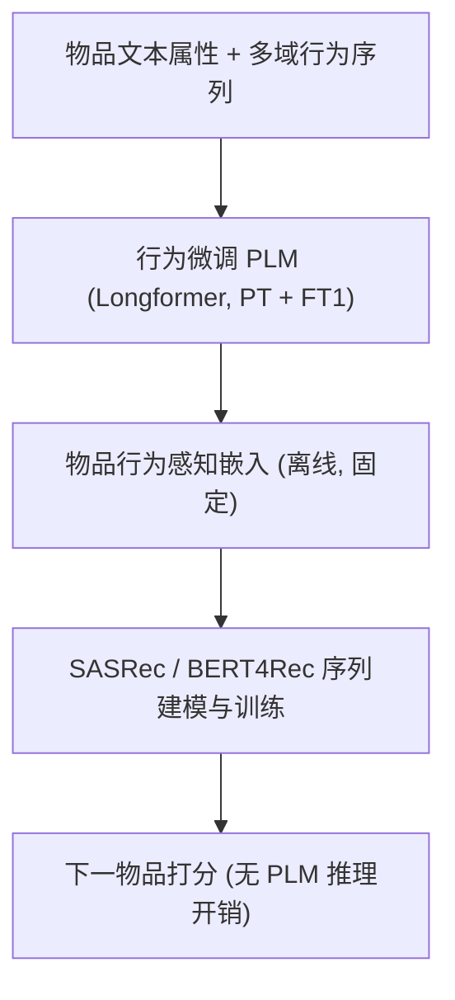

# The Elephant in the Room: Rethinking the Usage of Pre-trained Language Model in Sequential Recommendation (房间里的大象：重思预训练语言模型在序列推荐中的用法)

- **会议/期刊**: RecSys 2024
- **作者与机构**: Zekai Qu, Ruobing Xie, Chaojun Xiao, Xingwu Sun, Zhanhui Kang（中国地质大学·北京 / 腾讯 / 清华大学）
- **推荐链路定位**: 召回（物品表征初始化 + 序列编码）
- **研究方向**: 序列与会话推荐 / 大语言模型推荐
- **论文原文**: [论文原文链接](https://arxiv.org/abs/2404.08796v3)
- **开源代码**: [开源代码仓库链接](https://github.com/777pomingzi/Rethinking-PLM-in-RS)

## TL;DR (1分钟核心速览)

本文质疑“用 PLM 编码用户行为文本序列”这一主流范式：通过注意力可视化与层冻结实验证明 PLM 在行为序列建模中存在**功能分层与严重参数冗余**（仅调 3/11 层即可持平全量微调）；因此作者反其道而行，让 PLM 只负责**离线初始化物品嵌入**、序列建模交还给 SASRec/BERT4Rec。在 5 个 Amazon 数据集上，随机负采样与 Full-Ranking 两种协议下均稳定超越 RECFORMER，NDCG@10 相对提升 12%–32% 且**推理零额外开销**。

## Background & Motivation (背景与核心矛盾)

- **主流范式**: PLM-based SR 将物品属性拼成文本序列，用 Longformer 等模型端到端微调以获取用户表征（如 RECFORMER 的 PT→FT1→FT2 三阶段），并在跨域场景取得 SOTA。
- **前人局限 (1)**: 语言序列强调语法连贯与全局语义，行为序列强调**近期物品的强 recency 偏好**，两者模式根本错位；PLM 的 12 层 12 头能力远超 SR 只需 2 层 1 头（SASRec）的需求。
- **前人局限 (2)**: PLM 的直接语义知识与个性化行为偏好之间存在巨大鸿沟——用**原始 Longformer** 初始化物品嵌入反而使 SASRec 性能从 31.80 掉到 31.37（H@5, Pantry），说明引入的是噪声而非知识。
- **核心洞察 (Key Insight)**: RECFORMER 的注意力呈现 0-3/4-7/8-11 三段分层：4-7 层负责"物品边界建模"，8-11 层才类似 SASRec 的近期高亮；同层不同头、相邻层的注意力图近乎同构 $\Rightarrow$ 关键能力只是"物品表征"，而非"序列建模"。
- **本文切入点**: 把 PLM 从"序列编码器"降级为"物品嵌入初始化器"，序列建模交还经典 ID 模型，一举兼顾效果与效率。

<figure class="paper-figure" markdown="span">
  ![图1：Longformer和RECFORMER中\[CLS\]的注意力图。横轴表示条目的token，纵轴表示注意力头。它们具有不同的序列建模模式。](../../../../assets/papers/2404.08796v3/figure_1.png)<figcaption>图1：Longformer和RECFORMER中[CLS]的注意力图。横轴表示条目的token，纵轴表示注意力头。它们具有不同的序列建模模式。</figcaption>
</figure>

## Method (核心方法设计)

### 1. 整体框架 (Overall Architecture)

框架极简：离线阶段用行为数据（多域预训练 + 目标域 FT1）微调 Longformer，得到每个物品的行为感知嵌入并**固定为 ID 模型的嵌入表**；在线阶段只运行 SASRec/BERT4Rec 这类单/双向 Transformer 做行为序列编码与下一物品打分。PLM 在后续训练与在线服务中**完全不参与**，因此推理成本与原 ID 模型完全一致。作者据此提出 8 个变体，分三类：`embedding-init (freeze)`（嵌入冻结）、`embedding-init (trainable)`（嵌入与序列模型联合训练）、`further-train`（在已预热序列模型上只微调 All 或仅 Emb）。

### 2. 关键设计拆解 (Key Designs)

1. **行为感知物品初始化（把 PLM 用在它擅长的地方）**：痛点是以往把 PLM 当序列编码器导致能力错配。核心算子为 $\mathbf{E}^{(0)}_{i} = \mathrm{PLM}_{\theta^{\star}}\big(\mathcal{T}(i)\big)$，其中$\theta^{\star}$为在行为数据上微调后的参数、$\mathcal{T}(i)$为物品属性文本；随后冻结$\mathbf{E}^{(0)}$ 交由 ID 序列模型训练。直觉：PLM 的强项是把"文本语义"映射为"可用向量"，一旦映射完成，序列动态无需再借道语言模型。

2. **分层冗余诊断与选择性微调**：作者用注意力相似度 $\mathrm{sim}(\mathbf{A}^{l,h},\mathbf{A}^{l',h'})$ 在层/头维度上量化同构程度，发现同一功能分层内部几乎重合。因此只微调每层分层的代表层（第 3、7、11 层）即可让 Pantry 上 H@5 从全量微调的 31.37 升到 32.55、N@10 从 27.54 升到 28.42——这既是冗余证据，也是"PLM 序列建模能力未被激活"的反证。

3. **训练目标、负采样与推理效率**：序列模型沿用标准下一物品交叉熵 $\mathcal{L}=-\sum_{u}\log\frac{\exp(\mathbf{s}_u^{\top}\mathbf{e}_{i^{+}})}{\sum_{j\in\mathcal{C}}\exp(\mathbf{s}_u^{\top}\mathbf{e}_{j})}$，训练采用 100 个随机负样本（另做 Full-Ranking 验证），无额外对比/去噪损失；初始化嵌入在最佳配置下仅对 Emb 做进一步微调，训练更稳定。推理复杂度与 SASRec 相同，$O(L^2 d)$，相比 RECFORMER 节省整条 PLM 前向。

## Experimental Setup & Evaluation Protocol (实验设置与评估协议)

- **数据集与预处理**: 7 个 Amazon 域，4 个源域（Books/Clothing/Sports/Movies）用于预训练，3 个新域（Arts/Instruments/Pantry）与 2 个源域用于评测；源域 `5-core` 过滤，新域仅过滤交互数 $<4$ 的用户。

| 数据集 | #Users | #Items | #Interactions | Avg.len | 说明 |
| :--- | :---: | :---: | :---: | :---: | :--- |
| Books | 197,891 | 504,085 | 1,990,164 | 10.1 | 预训练源域 |
| Clothing | 135,041 | 294,788 | 1,004,679 | 7.4 | 预训练源域 |
| Sports | 39,477 | 87,235 | 262,998 | 6.7 | 预训练+评测 |
| Movies | 30,570 | 44,410 | 289,176 | 9.5 | 预训练+评测 |
| Arts | 131,149 | 138,116 | 718,628 | 5.5 | 新域评测 |
| Instruments | 62,691 | 53,899 | 403,135 | 6.4 | 新域评测 |
| Pantry | 22,601 | 8,249 | 179,735 | 8.0 | 新域评测（最稀疏） |

- **数据划分与防穿越**: 按时间戳排序 + `Leave-One-Out`（末位测试、倒数第二验证）；**剔除验证/测试中出现未训练物品的样本**，以隔断 PLM 世界知识带来的零样本泄漏。
- **排名评测协议**: 主表为 `Sampled Ranking`（1 正 : 100 随机负）；另设 `Full-Ranking`（全库未交互排序）验证鲁棒性，指标 HR@{5,10}、NDCG@{5,10}（全排序额外报 @50）。
- **对比基线与超参**: SASRec、BERT4Rec、RECFORMER（SOTA PLM-based SR）及 8 个初始化/微调变体；嵌入维度统一 $d=768$以对齐 Longformer；batch 256/128，学习率网格$\{3\text{e-}4,1\text{e-}3,3\text{e-}3,1\text{e-}2\}$，early stopping 耐心 10 轮，指标 NDCG@10。

## Key Experimental Results (实验关键数据)

### 1. 主实验对比 (Main Results)

NDCG@10（随机负采样，%），Ours 取 further-train 最优变体：

| 数据集 | SASRec | BERT4Rec | RECFORMER | Ours (NDCG@10) | Improv.(vs SAS) |
| :--- | :---: | :---: | :---: | :---: | :---: |
| Arts | 51.59 | 46.43 | 52.48 | **62.78** | +21.7% |
| Instruments | 51.74 | 48.54 | 47.46 | **59.68** | +15.4% |
| Pantry | 27.40 | 25.03 | 27.54 | **32.56** | +18.8% |
| Sports | 36.84 | 27.78 | 40.53 | **48.50** | +31.7% |
| Movies | 54.30 | 50.35 | 48.42 | **60.81** | +12.0% |

Full-Ranking（Arts / Pantry / Sports 的 H@50）：Ours 24.69 / 18.31 / 17.36，相对 RECFORMER +17.5% / +16.2% / +7.2%，相对原 SASRec +20.7% / +38.2% / +30.8%；对手 BERT4Rec 的 HR@5 提升最高达 +40.8%（Sports）。

### 2. 消融实验 (Ablation Study)

Pantry 上的两组关键消融（%）：

| 配置 | HR@5 | NDCG@10 | 说明 |
| :--- | :---: | :---: | :--- |
| RECFORMER 不做行为微调 (LF) | 23.61 | 20.92 | 纯语言能力无益 |
| RECFORMER 全量微调 (All) | 31.37 | 27.54 | 基线 SOTA |
| 仅调 {3,7,11} 三层 | **32.55** | **28.42** | 三层即超越全量 |
| 仅调第 7 层 / 第 11 层 | 29.76 / 30.76 | 26.26 / 27.07 | 深层更关键 |
| SASRec + LF 初始化（冻结） | 31.37 | 27.29 | 不如随机初始化 |
| SASRec + PT 初始化（冻结） | 31.78 | 26.35 | 跨域行为知识可用 |
| SASRec + FT 初始化（可训练） | 49.81 | 32.56 | 全场最优 |

### 3. 关键实验发现 (Key Findings)

1. **"行为微调"是收益的唯一来源，而非"语言知识"**：同为冻结初始化，原始 Longformer 让 Arts 的 NDCG@10 从 51.59 崩到 37.32（$-27.7\%$），而 FT 初始化后升至 50.97；预训练数据仅用 0.01%（数千用户）即能带来明显增益，说明只需极少量行为信号即可把 PLM 对齐到推荐。
2. **序列建模能力被证明是"过度配置"**：冻结 FT 嵌入 + 轻量 SASRec 已在 Arts/Instruments 上追平甚至超过完整 RECFORMER（69.00 vs 68.72 HR@10），而 RECFORMER 在多个数据集上反而不如 BERT4Rec（Instruments NDCG@10 47.46 vs 48.54），印证 PLM 序列分支的冗余。
3. **嵌入仍需"二次适应"**：从 freeze → trainable → further-train 单调上升（Arts NDCG@10：50.97 → 62.01 → 62.78），且"只训嵌入、冻结序列模型"（Emb）在 Sports/Movies 上最优，说明行为信息应从物品侧注入，而非继续堆叠序列侧容量。

## Highlights & Limitations (亮点、对比与审稿批判)

- **与代表作对比 (vs. Prior Work)**: 相比 UniSRec/IDA-SR 仅把 PLM 当文本编码器，本文进一步要求 PLM **在行为数据上微调后再初始化**；相比 RECFORMER 的端到端 PLM 序列建模，本文以 1/4 参数与零推理增量取得更优效果；相比 LLM-as-Rec 的 in-context 路线，本文明确否定"语言序列能力可直接迁移到行为序列"。
- **可迁移亮点**: (1) "冻结/选择性微调 PLM 层 → 观察性能平台"可作为判断某任务是否需要大模型容量的低成本探针；(2) 把大模型输出当作**可训练嵌入的初始化**（而非固定表征）在工业冷启动与跨域场景极具性价比。
- **审稿级局限批判**: (1) 仅验证 Longformer + 两个 ID 序列骨干，未讨论更大规模 LLM 或生成式语义 ID 框架下的结论是否成立；(2) 收益依赖离线行为微调 PLM 的一次性成本与多域预训练数据，新域冷启动物品若完全无文本/行为覆盖，初始化仍会退化；采样排序占主表，全排序下相对提升明显收窄。

## Rating (四维评分)

- **方法创新性 (Novelty)**: ⭐⭐⭐⭐ （以注意力分层+层冻结实验给出"PLM 序列建模冗余"的实证证据链，"大模型做初始化、小模型做序列"的范式反转简洁且有反直觉价值）
- **评估协议与实验扎实度 (Protocol & Experiments)**: ⭐⭐⭐⭐ （5 域 × 10 变体 × 采样/全排序双协议，并主动剔除零样本泄漏样本；但缺显著性检验与线上 A/B 验证）
- **写作与数学规范度 (Clarity & Rigor)**: ⭐⭐⭐⭐ （分析—假设—验证链条清晰，公式克制；分层/冗余仅用可视化与相似度定性描述，缺定量复杂度分析）
- **工业落地与复现价值 (Industrial & Practical Value)**: ⭐⭐⭐⭐⭐ （推理零增量、代码开源、与现有 SASRec 服务可无缝替换，是少数"改一行初始化即可上线"的 PLM 落地路径）

