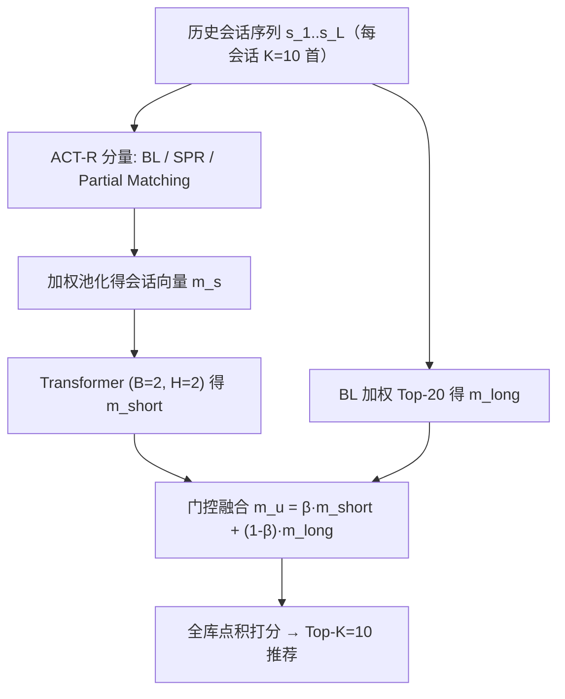
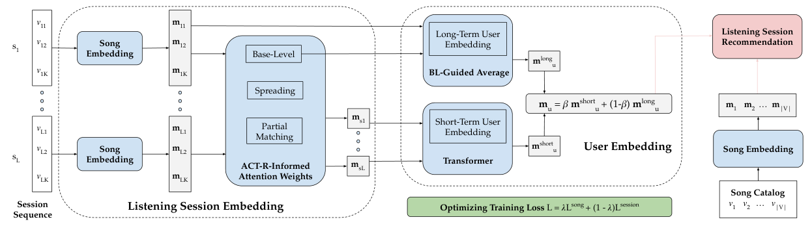

# Transformers Meet ACT-R: Repeat-Aware and Sequential Listening Session Recommendation（当 Transformer 遇上 ACT-R：重听感知的序列化收听会话推荐）

- **会议/期刊**: RecSys 2024 (Full Paper)
- **作者与机构**: Viet-Anh Tran, Guillaume Salha-Galvan, Bruno Sguerra, Romain Hennequin（Deezer Research）
- **推荐链路定位**: 召回（会话级 Next-Basket 候选生成）
- **研究方向**: 序列与会话推荐 / 去偏公平与工业架构
- **论文原文**: [https://arxiv.org/abs/2408.16578v1](https://arxiv.org/abs/2408.16578v1)
- **开源代码**: [https://github.com/deezer/recsys24-pisa](https://github.com/deezer/recsys24-pisa)（TensorFlow 实现 + Deezer 匿名化会话数据集）

## TL;DR (1分钟核心速览)

音乐流媒体中"重听"是常态（Deezer 测试会话里 89.1% 的歌曲是历史听过的），但主流序列推荐（SASRec/BERT4Rec 系）以及会话推荐 CoSeRNN 都用均值池化表征会话，系统性低估重复消费，而纯 ACT-R 方法只做推理后处理、只能推荐老歌。本文提出 PISA：用 ACT-R 声明性记忆模块的三个激活分量（基级 BL、扩散 SPR、部分匹配 P）生成注意力权重来**加权池化会话**，再由 Transformer 学习会话序列的短期漂移，与 BL 加权的长期用户向量做门控融合。在 Last.fm 与 Deezer 上采用全库 Top-10 排序评测，NDCG 相对最优基线提升 32.5%（Last.fm）与 9.6%（Deezer），同时探索类指标 NDCG_Exp 提升 52.7%–70.8%。

## Background & Motivation (背景与核心矛盾)

- **主流范式**: 把收听会话视为 bag，用 RNN/Attention 序列模型（SASRec、CoSeRNN、Sets2Sets、BRL 超图）建模 basket 间转移，预测下一 basket；重听建模则多用频率类（P-Top）、近邻类（TIFU-KNN、UP-CF@r）或 LSTM（ReCANet）。
- **前人局限**: ① 多数序列模型把会话用 average/max pooling 压成向量，重复模式这一关键信号在池化中丢失；② 已有的 ACT-R 工作（Reiter-Haas、Moscati）把 ACT-R 仅用于推理阶段打分修正，不参与训练，且搭配的是静态 CF/BPR，完全不建模偏好动态演化。
- **核心洞察 (Key Insight)**: 人类对音乐的偏好由"记忆可及性"驱动——越常听、越近期听（BL），越常与当前上下文共现（SPR），越与当前歌曲相似（P），该曲越容易被再次想起。作者统计证实测试会话的重复率高达 72.37%（Last.fm）/89.10%（Deezer），而现有模型 RepBias 普遍偏负（SASRec 为 −23.99/−3.45），即严重低估重听。
- **本文切入点**: 把 ACT-R 激活值直接转成会话内部的注意力权重，让心理学先验**进入前向计算与端到端训练**，与 Transformer 动态建模同处一个框架。

## Method (核心方法设计)

### 1. 整体框架 (Overall Architecture)

输入是用户 $u$的$L$个历史会话$S^{(u)}=(s^{(u)}_1,\dots,s^{(u)}_L)$，每个会话含$K=10$首歌。第一层：对每个会话内的每首歌计算 ACT-R 三分量并归一化为注意力权重，加权得到会话向量$\mathbf{m}_{s^{(u)}}$；第二层：会话向量序列加位置编码后送入$B=2$层、$H=2$头的 Transformer，取末位输出作为短期兴趣$\mathbf{m}^{short}_u$；第三层：用 BL 激活在用户历史中筛 Top-20 歌曲加权得到长期兴趣$\mathbf{m}^{long}_u$，经单层 FFN 学到的$\beta$融合为用户向量$\mathbf{m}_u$；最后以$\mathbf{m}_u^\top\mathbf{m}_v$对全库打分取 Top-$K$ 作为下一会话推荐。整个模型以 BPR 歌曲损失 + 会话级损失的加权和端到端训练。

<figure class="paper-figure" markdown="span">
  <figcaption>图2：第3节所述PISA系统架构，用于重复感知的序列收听会话推荐。</figcaption>
</figure>

### 2. 关键设计拆解 (Key Designs)

1. **ACT-R 引导的会话注意力池化（替代 mean/max pooling）**：痛点是用均值池化抹平了"哪首歌正在被反复消费"。作者令会话向量为 $\mathbf{m}_{s^{(u)}}=\sum_{v\in s^{(u)}}w_v\mathbf{m}_v$，权重由三个分量线性组合后归一化：$w_v=w_{BL}BL^{(u)}_v+w_{SPR}SPR^{(u)}_v+w_{P}P^{(u)}_v$。其中基级分量$BL^{(u)}_v=\mathrm{softmax}_{s^{(u)}}\big(\sum_k (t_{ref}-t^{(uv)}_k)^{-\alpha}\big)$（$\alpha=1/2$）以幂律遗忘曲线同时编码**频次与近因性**，直觉上让"最近狂刷的热歌"主导会话表征；$SPR^{(u)}_v=\sum_{v'\in s^{(u)},v'\neq v}C_{vv'}$用共现矩阵$C=D^{-1/2}FD^{-1/2}$的归一化共听强度捕捉上下文共振；$P^{(u)}_v=\sum_{v'\neq v}\mathbf{m}_v^\top\mathbf{m}_{v'}$用嵌入内积引入内容相似度。三个$w$ 全局共享、由单层 FFN 学习，即注意力权重本身可训练。

2. **长期-短期用户表征的门控融合**：$\mathbf{m}_u=\beta\mathbf{m}^{short}_u+(1-\beta)\mathbf{m}^{long}_u$，$\beta$由$[\mathbf{m}^{short}_u;\mathbf{m}^{long}_u]$经 FFN 输出。短期分支接 Transformer（位置编码 + 多头自注意力，$d=128$），负责兴趣漂移；长期分支$\mathbf{m}^{long}_u=\sum_{v\in \text{Top-BL}(u)}BL^u_v\mathbf{m}_v$ 只保留 BL 最高的 20 首，起到**隐式去噪**作用——把偶发、低激活的噪声收听剔除，只保留最能代表稳定品味的"高激活曲目"。这解释了为何 PISA 在探索指标上不塌陷：重听信号只调制用户向量的位置，并不硬性限制候选集。

3. **训练目标、负采样与推理效率**：$\mathcal{L}(\Theta)=\lambda\mathcal{L}_{song}+(1-\lambda)\mathcal{L}_{session}$，其中$\mathcal{L}_{song}$为逐子序列的 BPR 成对损失$\ln\big(1+e^{-(\mathbf{m}_{u,l}^\top\mathbf{m}_v-\mathbf{m}_{u,l}^\top\mathbf{m}_{v'})}\big)$（$v\in s^{(u)}_{l+1}$，$v'\in o^{(u)}_{l+1}$为$K$个负样本），$\mathcal{L}_{session}=1-\mathbf{m}_{u,l}^\top\mathbf{m}_{s^{(u)}_{l+1}}$对齐会话级语义。负采样分两版：PISA-U 均匀采样，PISA-P 按$f(v)^{1/2}$（听众人数）的流行度采样，使负样本更"难"。推理为纯内积检索，离线 ANN 可直接复用，开销与 SASRec 同级。

## Experimental Setup & Evaluation Protocol (实验设置与评估协议)

- **数据集与预处理**: 会话按 ≥20 分钟不活跃切分，每会话仅取前 $K=10$ 首（长会话尾部的相关性弱）；Last.fm 取最近一年、保留 ≥1k 收听行为的 15.7k 首歌；Deezer 为 2022 年 3–8 月法国区 340 万用户、50k 首热门歌。

| 数据集 | #Users | #Items | #Sessions | 过滤/序列构造 | 特征/场景说明 |
| :--- | :---: | :---: | :---: | :---: | :--- |
| Last.fm | 15.7k 歌为约束 | 15.7k | ≈465k | 用户 ≥50 会话；滑窗 21 会话、步长 5；$L=20$ | 公开、含时间戳的收听事件 |
| Deezer | 3.4M（法国区） | 50k | ≈2.1M | 用户 ≥250 会话；滑窗 31 会话、步长 20；$L=30$ | 工业私有，≥30s 播放计一次 |

- **数据划分与防穿越 (Splitting Strategy)**: **全局时间戳/序列顺序切分**——每个用户最后 10 条序列为测试集、紧邻的前 5 条为验证集，观测前 $L$个会话预测第$L+1$ 个会话，未来会话绝不参与训练。
- **排名评测协议 (Ranking Protocol)**: **Full-Ranking（全库未交互歌曲排序）**——模型对全集 $V$ 逐曲打分取 Top-10，无负采样候选集缩水；指标为 Recall@10、NDCG@10 及按真实会话构成拆分的 Rep/Exp 变体，外加 beyond-accuracy 的 RepRatio（与 GT 比 72.37%/89.10%）、RepBias、MR（中位置信度越低越不流行）。
- **对比基线与超参设置**: 10 个基线覆盖流行度（G-Top/P-Top）、非重听序列（SASRec、CoSeRNN）、重听序列（RepeatNet、Sets2Sets、TIFU-KNN、UP-CF@r）与 ACT-R 系（ACT-R-Repeat、ACT-R-BPR）；$d=128$、$\alpha=1/2$、$B=2$、$H=2$、Adam、batch 512、最多 100 epoch，$\lambda$在$\{0,0.3,0.5,0.8,0.9,1.0\}$ 网格搜索；结果 5 次运行取均值 ± 标准差（未报告显著性检验）。

## Key Experimental Results (实验关键数据)

### 1. 主实验对比 (Main Results)

| 数据集 / 模型 | NDCG | Recall | NDCG_Rep | NDCG_Exp | RepBias | MR |
| :--- | :---: | :---: | :---: | :---: | :---: | :---: |
| **Last.fm**（RepRatio-GT=72.37%） | | | | | | |
| G-Top | 1.36 | 1.29 | 1.50 | 0.62 | −51.15 | 40.20 |
| SASRec | 5.36 | 5.15 | 5.65 | 1.90 | −23.99 | 18.71 |
| CoSeRNN | 6.99 | 6.65 | 6.55 | 3.22 | −30.32 | 7.44 |
| P-Top | 8.34 | 8.10 | 11.32 | 0.00 | +27.63 | 10.75 |
| TIFU-KNN | 9.05 | 8.71 | 12.33 | 0.07 | +26.67 | 15.95 |
| Sets2Sets | 6.90 | 6.75 | 7.55 | 2.11 | +4.76 | 11.14 |
| ACT-R-Repeat | 9.18 | 9.12 | **13.94** | 0.00 | +27.63 | 8.29 |
| ACT-R-BPR | 3.07 | 3.02 | 4.11 | 0.38 | +7.28 | 7.85 |
| PISA-U | 12.09 | 11.59 | 11.51 | 5.45 | −11.14 | 9.35 |
| **PISA-P** | **12.16** | **11.77** | 11.49 | **5.50** | −10.74 | 8.24 |
| Improv.% vs best baseline | **+32.46%** | **+29.06%** | −17.6% | **+70.81%** | — | — |
| **Deezer**（RepRatio-GT=89.10%） | | | | | | |
| SASRec | 6.05 | 5.89 | 6.47 | 0.60 | −3.45 | 67.56 |
| CoSeRNN | 2.57 | 2.46 | 2.69 | 0.44 | −17.62 | 49.14 |
| P-Top | 7.83 | 7.51 | 8.37 | 0.00 | +10.90 | 45.33 |
| TIFU-KNN | 10.22 | 9.64 | **11.07** | 0.22 | +5.70 | 88.33 |
| Sets2Sets | 7.84 | 7.40 | 8.03 | 1.43 | +2.19 | 31.94 |
| ACT-R-Repeat | 7.93 | 7.95 | 8.88 | 0.00 | +10.90 | 31.45 |
| ACT-R-BPR | 2.38 | 2.36 | 2.51 | 0.42 | −9.00 | 38.13 |
| PISA-U | 10.27 | 9.54 | 10.46 | 2.06 | −0.83 | 55.95 |
| **PISA-P** | **11.20** | **10.40** | 11.08 | **3.13** | −3.94 | 39.45 |
| Improv.% vs best baseline | **+9.59%** | **+7.89%** | +0.09% | **+52.68%** | — | — |

### 2. 消融实验 (Ablation Study)

原文未做逐组件的严格消融，仅报告负采样变体对比与一个"权重塌缩"式组件分析：

| 配置 | Last.fm NDCG | Last.fm NDCG_Exp | Last.fm MR | Deezer NDCG | Deezer NDCG_Exp | Deezer MR |
| :--- | :---: | :---: | :---: | :---: | :---: | :---: |
| PISA-U（均匀负采样） | 12.09 | 5.45 | 9.35 | 10.27 | 2.06 | 55.95 |
| PISA-P（流行度负采样） | **12.16** | **5.50** | **8.24** | **11.20** | **3.13** | **39.45** |
| w/o 部分匹配 $P^{(u)}_v$| 权重$\to 0$，等效于退化（作者自述） | — | — | — | — | — |
| w/o 短期 Transformer（仅 $m^{long}$） | 未报告，需自行复现验证 | — | — | — | — | — |

### 3. 关键实验发现 (Key Findings)

1. **重听建模是收益主引擎，且必须"可训练+序列化"**：所有 ×（非重听）模型的 NDCG 普遍低于 ✓ 模型；而纯推理阶段的 ACT-R-BPR 仅 3.07/2.38，远低于把 ACT-R 写进前向与损失的 PISA-P（12.16/11.20），说明"心理先验进入训练"比"推理期打分修正"高出一个量级（Last.fm NDCG 约 4×）。
2. **只有 PISA 同时不牺牲探索**：PISA-P 在 Last.fm 拿到 NDCG 12.16 的同时 NDCG_Exp 达 5.50（优于 CoSeRNN 的 3.22，提升 70.8%），而重听专用基线（P-Top、ACT-R-Repeat、TIFU-KNN）在 Exp 上几乎为 0.00–0.07——它们是靠"只推老歌"换来的 Rep 高分，属于结构性缺陷。
3. **流行度负采样同时改善精度与去偏**：从 PISA-U 换到 PISA-P，Deezer NDCG 10.27→11.20、NDCG_Exp 2.06→3.13，且 MR（流行度偏置）从 55.95 降至 39.45，优于几乎全部基线；同时 RepBias 收敛到 −0.83%（Last.fm −10.74%），是少数既不过度重复也不过度的模型。

## Highlights & Limitations (亮点、对比与审稿批判)

- **与代表作对比 (vs. Prior Work)**: 相对 SASRec / CoSeRNN，PISA 不改序列主干，只替换会话池化算子与用户长期向量的构造方式，增量极小但收益显著；相对 Reiter-Haas 的 ACT-R-Repeat 与 Moscati 的 ACT-R-BPR，本质区别是把 ACT-R 从"推理期分数重排"搬到"表征学习内部"，从而继承了 Transformer 的动态建模能力；相对 TIFU-KNN / UP-CF@r 等重听 NBR，PISA 不做"只推历史曲"的硬约束，因此探索指标不塌陷。
- **可迁移亮点**: ① 用幂律遗忘曲线 $\sum_k (t_{ref}-t_k)^{-\alpha}$ 生成可学习的注意力先验，可平移到新闻/短视频等强近因性场景的池化层；② 用"最高激活 Top-N"截断构造长期用户向量，是一种廉价且无需额外网络的隐式历史去噪手段。
- **审稿级局限批判**: ① 缺严格逐组件消融与显著性检验，$P$分量权重收敛为 0 说明三分量实为两分量，设计冗余；$w$与$\beta$的可学习性对数据规模敏感，小数据集上可能过拟合。② 端到端仍需逐会话计算 BL/SPR（涉及共现矩阵$C$ 与每首候选歌的激活），且 Deezer 场景下 MR 39.45 仍偏流行，冷启动新歌与新用户（无历史 BL）完全未被评估，作者亦承认未建模"好奇心"这一反向动力。

## Rating (四维评分)

- **方法创新性 (Novelty)**: ⭐⭐⭐⭐ （用认知架构激活函数重定义注意力池化，把心理学先验变成可训练算子，思路新颖但数学增量偏轻）
- **评估协议与实验扎实度 (Protocol & Experiments)**: ⭐⭐⭐⭐ （双数据集 + 全库 Top-10 排序 + Rep/Exp 拆分指标与 beyond-accuracy 分析很完备，扣分在无显著性检验与无严格消融）
- **写作与数学规范度 (Clarity & Rigor)**: ⭐⭐⭐⭐ （三分量公式与训练流程交代清晰，但 $P$ 分量失效未深究，部分超参与复杂度分析缺失）
- **工业落地与复现价值 (Industrial & Practical Value)**: ⭐⭐⭐⭐⭐ （Deezer 真实场景验证 + 开源代码与匿名数据集发布，推理与 SASRec 同级，工程可即插即用）

