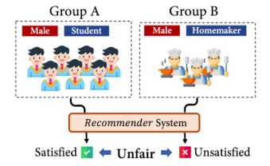
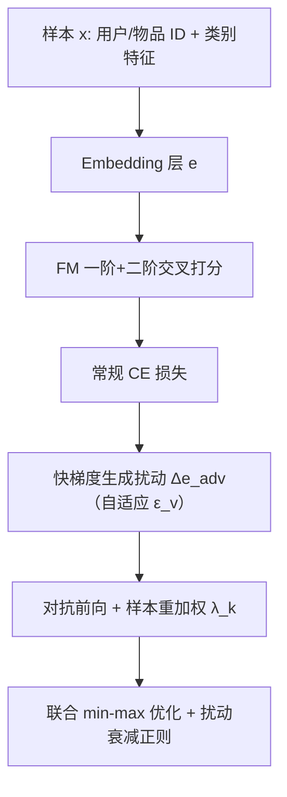
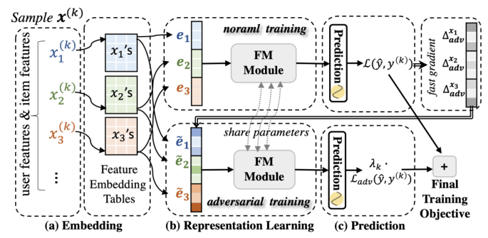

# Automatic Feature Fairness in Recommendation via Adversaries (基于对抗扰动的推荐自动特征公平性)

- **会议/期刊**: SIGIR-AP 2023
- **作者与机构**: Hengchang Hu, Yiming Cao, Zhankui He, Samson Tan, Min-Yen Kan（新加坡国立大学 / 南洋理工 / UCSD / AWS AI）
- **推荐链路定位**: 精排（CTR/评分预估训练阶段的无偏学习方法）
- **研究方向**: 去偏公平、可信隐私与工业架构 / CTR 预估与特征交叉
- **论文原文**: [https://arxiv.org/abs/2309.15418v1](https://arxiv.org/abs/2309.15418v1)
- **开源代码**: [https://github.com/HoldenHu/AdvFM](https://github.com/HoldenHu/AdvFM)

## TL;DR (1分钟核心速览)

现有公平推荐必须**预先指定**敏感特征（用户侧或物品侧），且加约束往往掉点。本文提出更基础的「**特征公平**」目标：不区分用户/物品，直接在特征域-特征值粒度上要求各组误差接近。方法 AAFM 用 FGSM 式对抗扰动增强特征表征，并让扰动强度 $\epsilon_{v}$随特征值的**组合多样性**反向缩放、对抗权重$\lambda_k$随样本**特征频率**反向提升，再加一项扰动衰减正则防止$\epsilon$ 塌缩。在 ML-100K/Yelp/Pinterest 的 Leave-One-Out + AUC/Logloss 协议下，AUC 最高相对最优基线提升 5.95%（Pinterest），组间 STD 最多下降 47.4%，且精度与公平性基本同向。

## Background & Motivation (背景与核心矛盾)

- **主流范式**: 公平推荐分两条路——重排后处理（约束曝光/排序）与训练期无偏学习（IPS 重加权、因果嵌入、MACR 等），二者均以「预先选定的用户/物品敏感特征」为分组依据。
- **前人局限**: (1) 分组维度被写死，一旦要换到另一侧（如从用户性别换成物品类别）就要重训，扩展性差；(2) 施加公平约束通常以牺牲整体准确率为代价，工业上难以接受。
- **核心洞察 (Key Insight)**: 作者在 MovieLens 上观察到，FM 训练中「男性+学生」（占 21.09%）组 AUC 稳定高于均值，而「男性+家庭主妇」（占 0.1%）组长期低于均值且剧烈震荡；`图 1` 显示这种不平衡来自两种独立的统计偏差——特征值**频率** $\alpha_v$与**组合多样性**$\beta_v$（该特征值与其它特征共现的多样性）。`图 2` 进一步证明二者并不对齐：按频率分桶与按多样性分桶的性能排序显著不同，因此必须分别建模。
- **本文切入点**: 既然不公平源于「低频 + 低多样性特征的表征泛化不足」，那就用对抗扰动强制模型对这些表征鲁棒，并且**按偏差程度自动调节扰动力度与权重**。

<figure class="paper-figure" markdown="span">
  <figcaption>图1：（左）具有敏感特征的两个群体之间的不公平性。（右）Factorization Machine 训练期间两个数据组之间带有偏差的验证准确率。</figcaption>
</figure>

## Method (核心方法设计)

### 1. 整体框架 (Overall Architecture)

输入为一条样本 $x=\{x_1,\dots,x_n\}$（用户/物品 ID + 类别属性），先经嵌入层得到拼接表征$e$，送入 FM 做一阶 + 二阶特征交叉打分。每个 epoch 先做一次常规训练，随后单独开启一轮对抗训练：以反向传播得到的快梯度方向对嵌入参数加噪，构造「最坏情况」表征$\tilde{e}$再前向一次，形成 min–max 交替优化。AAFM 在 AdvFM 之上引入两个自适应算子：组合多样性决定每个特征值的扰动半径$\epsilon_{v}$，样本级频率决定对抗损失权重$\lambda_k$；另加衰减正则$\mathcal{L}_{decay}$防止$\epsilon$ 在优化中被「学到 0」而退化回普通训练。推理阶段与普通 FM 完全一致，无额外开销。

<figure class="paper-figure" markdown="span">
  <figcaption>图3：adversarial factorization machine 在样本 x(𝑘) 上的训练过程。</figcaption>
</figure>

### 2. 关键设计拆解 (Key Designs)

1. **自适应扰动强度（Auto-Strengthening）**：统一 $\epsilon$会让低多样性特征依旧欠拟合。作者令扰动半径与特征值组合多样性$\beta_{v_i}$成反比，交由可学习系数$\omega_i$ 与 SoftPlus 映射：

$$\epsilon_{v_i}=\psi\left(\omega_i\cdot \beta_{v_i}^{-1}\right)$$

直觉是：共现模式越单一的特征值，其表征越「孤立」，需要更强的对抗噪声才能逼出可泛化的方向；SoftPlus 保证不改变梯度符号且在实数域梯度非零，避免 $\epsilon$ 直接被截断为 0。

2. **样本级对抗重加权（Re-Weighting）**：固定 $\lambda$无法纠正长尾样本的训练不足。作者用样本内所有特征频率之积的负值作为权重输入，并用手工缩放因子$t$映射到$[1,t]$：

$$\lambda_k=\Phi\Big(-\prod_{x\in x^{(k)}}\alpha_x,\; t\Big)$$

低频样本获得更大对抗损失权重，使对抗分支真正作用于少数群体；用 $t$而非可学习参数是为了防止$\lambda$ 被外层 min 目标直接优化掉。

3. **训练目标、负采样与推理效率**：总目标为

$$\min_{\Theta}\max_{\Delta_{adv}}\Big[\mathcal{L}(\hat{y}(x|\Theta),y)+\lambda_k\mathcal{L}(\hat{y}(x|\Theta+\Delta_{adv}),y)\Big]+\alpha\big(\tau\|\omega\|\big)^{-1}$$

其中扰动取 $l_2$归一化的快梯度$\Delta e_i^{adv}=\epsilon\cdot\frac{\partial\mathcal{L}/\partial e_i}{\|\partial\mathcal{L}/\partial e_i\|}$，第三项为随 epoch 数$\tau$ 递增的衰减正则——早期强扰动、后期自动收敛，实测「扰动过度持续」会显著伤精度。负采样沿用随机负采样（作者在结论中承认这会偏向高频群体，列为未来工作）。

## Experimental Setup & Evaluation Protocol (实验设置与评估协议)

- **数据集与预处理**: 三个公开数据集，按「用户特征丰富」与「物品特征丰富」两种视角各取子集；连续特征（如年龄）分箱转类别，用户/物品 ID 亦作为额外特征域。

| 数据集 | #Users | #Items | #Interactions | 稀疏度/密度 | 特征/场景说明 |
| :--- | :---: | :---: | :---: | :---: | :--- |
| ML-100K (user) | 943 | 1,682 | 100,000 | 6.30% | 用户性别/职业/邮编，user-centric |
| ML-100K (item) | 943 | 1,682 | 100,000 | 6.30% | 电影类别/上映时间，item-centric |
| Yelp | — | — | — | — | 过滤交互 >20 的用户；商户城市/星级，item-centric |
| Pinterest | 6,000 | — | — | — | 随机抽 6,000 用户；用户偏好类别，user-centric |

- **数据划分与防穿越 (Splitting Strategy)**: 标准 `Leave-One-Out`（每用户留最后一条交互作测试）。
- **排名评测协议 (Ranking Protocol)**: 采用 `Sampled` 式二分类评估——以 `AUC` 与 `Logloss` 衡量排序/校准质量，未做全库 Full-Ranking；公平性则先将样本按联合统计量 $\prod_x(\alpha_x\cdot\beta_x)$ 排序、等分 6 桶，用 **EFGD**（前 10% 与后 10% 桶的 AUC 差）与 **STD**（6 桶 AUC 标准差）度量。
- **对比基线与超参设置**: 精度基线 FM/NFM/CFM/DeepFM/ONCF；去偏基线 IPS、M-Match、MACR、DecRS；嵌入维度 $d$与$t\in\{2,10,50,100,200,500\}$调参，$\epsilon$默认 0.5、$\lambda$ 默认 1 用于消融对照。

## Key Experimental Results (实验关键数据)

### 1. 主实验对比 (Main Results)

| Dataset | Metric | FM | NFM | CFM | DeepFM | ONCF | AdvFM | **AAFM** | **D-AAFM** | Improv.(AUC) |
| :--- | :--- | :---: | :---: | :---: | :---: | :---: | :---: | :---: | :---: | :---: |
| ML_i | LL↓ | 0.4093 | 0.3688 | 0.3635 | 0.3597 | 0.3641 | 0.3730 | 0.3352 | **0.3248** | — |
| ML_i | AUC↑ | 0.9154 | 0.9203 | 0.9257 | 0.9381 | 0.9243 | 0.9337 | 0.9408 | **0.9431** | +0.53% |
| Yelp | LL↓ | 0.1934 | 0.1895 | 0.0963 | 0.1584 | 0.1527 | 0.1692 | **0.0731** | 0.0742 | — |
| Yelp | AUC↑ | 0.9474 | 0.9569 | 0.9732 | 0.9665 | 0.9668 | 0.9653 | **0.9813** | 0.9795 | +0.83% |
| ML_u | LL↓ | 0.4493 | 0.4297 | 0.3876 | 0.3109 | 0.3721 | 0.4325 | 0.3072 | **0.2996** | — |
| ML_u | AUC↑ | 0.8796 | 0.8908 | 0.9172 | 0.9319 | 0.9012 | 0.8810 | 0.9323 | **0.9357** | +0.41% |
| Pinterest | LL↓ | 0.5647 | 0.3865 | 0.3577 | 0.3541 | 0.4026 | 0.3859 | 0.3447 | **0.3042** | — |
| Pinterest | AUC↑ | 0.5700 | 0.7430 | 0.7356 | 0.7580 | 0.7251 | 0.7432 | 0.7756 | **0.8031** | +5.95% |

公平性对比（STD/EFGD 越小越公平）：

| Dataset | Metric↓ | FM | IPS | M-Match | MACR | DecRS | AdvFM | **AAFM** | **D-AAFM** |
| :--- | :--- | :---: | :---: | :---: | :---: | :---: | :---: | :---: | :---: |
| ML_i | EFGD | 0.0713 | 0.0336 | 0.0381 | 0.0282 | 0.0589 | 0.0401 | 0.0110 | **0.0105** |
| ML_i | STD | 0.0257 | 0.0237 | 0.0236 | 0.0171 | 0.0246 | 0.0235 | 0.0091 | **0.0069** |
| Yelp | STD | 0.0131 | 0.0114 | 0.0153 | 0.0082 | 0.0122 | 0.0086 | **0.0064** | 0.0068 |
| ML_u | STD | 0.0280 | 0.0198 | 0.0208 | 0.0199 | 0.0230 | 0.0225 | 0.0195 | 0.0220 |
| Pinterest | EFGD | 0.1068 | 0.0682 | 0.0726 | 0.0558 | 0.0545 | 0.0853 | 0.0193 | **0.0132** |
| Pinterest | STD | 0.0307 | 0.0277 | 0.0299 | 0.0275 | 0.0265 | 0.0300 | 0.0195 | **0.0178** |

### 2. 消融实验 (Ablation Study)

| 变体 | ML_i AUC | Yelp AUC | ML_u AUC | Pin. AUC | 平均 AUC | 平均 STD↓ |
| :--- | :---: | :---: | :---: | :---: | :---: | :---: |
| AdvFM（无自适应） | 0.9337 | 0.9653 | 0.8810 | 0.7432 | 0.8808 | 0.02115 |
| AAFM$_\lambda$（仅自适应权重） | 0.9406 | 0.9790 | 0.9249 | 0.7695 | 0.9035 | 0.01633 |
| AAFM$_\epsilon$（仅自适应扰动） | 0.9308 | 0.9619 | 0.9323 | 0.7756 | 0.9002 | 0.01988 |
| AAFM（两者合并） | 0.9408 | **0.9813** | 0.9323 | 0.7756 | 0.9075 | 0.01363 |
| D-AAFM（+衰减正则） | **0.9431** | 0.9795 | **0.9357** | **0.8031** | **0.9154** | **0.01338** |

### 3. 关键实验发现 (Key Findings)

1. **公平与精度基本同向，而非此消彼长**：AAFM 在 ML_i 上将 STD 从 MACR 的 0.0171 压到 0.0091（-47.4%）的同时，AUC 从 0.9381 提升到 0.9408；Pinterest 上 EFGD 从 0.0558 降到 0.0193（-65.4%）。说明增益来自少数群体表征改善，而不是靠牺牲大组换取均衡。
2. **两个自适应组件互补且缺一不可**：只加 $\lambda$使平均 AUC 从 0.8808 升到 0.9035，但 STD 仍为 0.0163；只加$\epsilon$反而在 ML_i/Yelp 上掉点（0.9308/0.9619，低于 DeepFM 与 AAFM$_\lambda$），因为$\epsilon$ 在优化中极易被压回 0；两者叠加后平均 STD 降至 0.0136，证实「强扰动必须有配套的样本重加权才生效」。
3. **扰动必须衰减，抗噪能力才是泛化来源**：外部加噪 1.0 时 Yelp AUC 跌幅为 FM -12.7%、AdvFM -6.79%、AAFM -3.03%；D-AAFM 相比 AAFM 平均 AUC 再涨 0.79pt 而 STD 略降，说明长期持续扰动会在后期阻碍收敛。案例研究中小群体（male entertainment，占 0.2%）的验证 AUC 曲线由剧烈震荡转为平滑上升。

## Highlights & Limitations (亮点、对比与审稿批判)

- **与代表作对比 (vs. Prior Work)**: 相较 MACR（在损失中对用户/物品 ID 曝光偏差建模）与 DecRS（因果表征解耦），AAFM 不做任何分组先验，而是在**特征值**粒度上自动定位偏差并调节扰动，因此天然支持「用户+物品」多特征域同时公平；相较图对比学习中的对抗去偏（Yu et al.），本文首次给出与公平基线的系统性对照及特征选择灵活性。
- **可迁移亮点**: (1) 用「组合多样性取倒数」直接生成逐特征超参，可迁移到任意 Embedding 表的自适应正则/增广强度调度；(2) 样本级重加权 + 手工缩放因子 $t$ 的设计，可用于任意对抗/对比辅助损失，避免权重被主目标吞掉。
- **审稿级局限批判**: (1) 评测停留在 `AUC/Logloss` 的二分类协议，未做 Full-Ranking 或 top-K 公平性（如曝光均等）评估，且 ML_u 上 STD 仅从 0.0199 降到 0.0195，收益微弱；(2) 组合多样性 $\beta_v$需在全量训练集上预统计，动态增量场景需重新计算，且随机负采样本身偏向高频群体（作者自述），对抗扰动的公平收益可能被负采样偏差部分抵消；$t$ 在 ML-100K 上最优精度(50)与最优公平(100)不一致，超参敏感。

## Rating (四维评分)

- **方法创新性 (Novelty)**: ⭐⭐⭐⭐ （把公平性下沉到特征值粒度，并用两种统计偏差自动生成扰动强度与权重，机制简洁且有明确物理直觉）
- **评估协议与实验扎实度 (Protocol & Experiments)**: ⭐⭐⭐ （覆盖用户/物品双视角、四数据集、EFGD/STD 双指标与抗噪实验，但仅二分类 AUC 协议、缺少 top-K 与显著性检验）
- **写作与数学规范度 (Clarity & Rigor)**: ⭐⭐⭐⭐ （FGSM 扰动在 FM 上的闭式梯度推导完整，min–max 目标与衰减正则动机交代清楚，部分符号在正文与附录间略有不一致）
- **工业落地与复现价值 (Industrial & Practical Value)**: ⭐⭐⭐⭐ （仅训练期加噪、推理零额外开销，代码已开源，可直接套在现有 FM/DCN 类精排模型上做长尾群体兜底）

