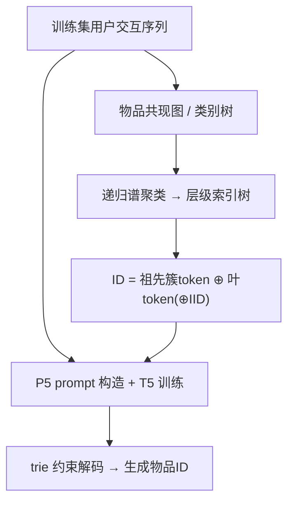
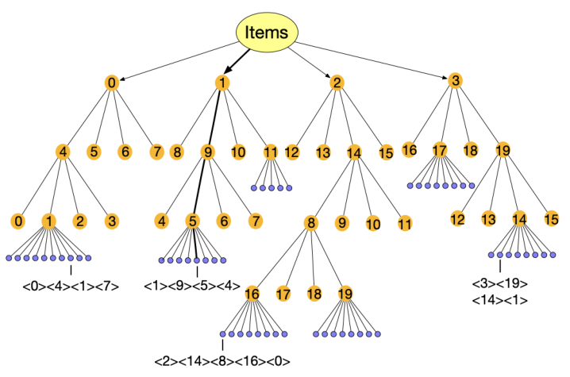

# How to Index Item IDs for Recommendation Foundation Models (推荐基础模型的物品 ID 该如何索引)

- **会议/期刊**: SIGIR-AP 2023 (Full Paper)
- **作者与机构**: Wenyue Hua, Shuyuan Xu, Yingqiang Ge, Yongfeng Zhang (Rutgers University)
- **推荐链路定位**: 端到端生成式（单阶段生成式检索，替代多阶段过滤）
- **研究方向**: 生成式推荐与离散语义 ID / 大语言模型推荐
- **论文原文**: [https://arxiv.org/abs/2305.06569v6](https://arxiv.org/abs/2305.06569v6)
- **开源代码**: [https://github.com/Wenyueh/LLM-RecSys-ID](https://github.com/Wenyueh/LLM-RecSys-ID)

## TL;DR (1分钟核心速览)

生成式推荐（P5/T5）必须把物品映射为短 token 序列，否则生成完整标题既冗长又易幻觉。本文系统检验 7 类物品索引方案，提出用**物品共现图上的递归谱聚类树生成协同索引 CID**，并拼上独立令牌构成 CID+IID。在 Amazon Sports/Beauty/Yelp 的 Leave-One-Out 序列推荐协议下，CID+IID 相对 SASRec 的 HR@10 分别提升 30.3%/21.0%/64.8%，相对强基线 S3-Rec 亦提升 18.4%/13.1%/37.2%。

## Background & Motivation (背景与核心矛盾)

- **主流范式**: P5 类推荐基础模型把序列推荐、评分预测等统一改写为自然语言 seq2seq 任务，物品由其 ID 的 token 序列表示，模型直接"生成"下一个物品。
- **前人局限**: ① 若用物品标题作 ID，T5 需记忆并生成数十至上千 token，且标题共享词（"The Lord of..."）注入强烈语言偏见；② 若用随机数字 ID，SentencePiece 分词后 4332 与 4389 共享前缀 token "43"，在无关联物品间制造结构性伪相关，且无法通过训练消除。
- **核心洞察 (Key Insight)**: 优秀物品 ID 应同时满足两点——**长度可控**（缓解长文本生成与幻觉）与**携带先验**（相似物品最大程度共享 token、不相似物品尽量不共享），把传统 IR 的索引原则注入 LLM 词表。
- **本文切入点**: 把"如何给物品分配 token 序列"作为一等研究问题，以 P5 为骨干逐一对比 3 种朴素方案与 4 种非平凡方案。

## Method (核心方法设计)

### 1. 整体框架 (Overall Framework)

所有方案共享同一 P5 训练/推理闭环，唯一变量是"物品 ID 构造函数 $\phi: i \mapsto \langle t_1\rangle\cdots\langle t_L\rangle$"。训练时把用户历史物品的 ID 序列填入个性化 prompt，让 T5 生成目标物品 ID；推理时为保证输出对应真实物品，用全部合法 ID 构建前缀树 trie，解码时把非存在前缀的概率置零（约束解码）。所有新增 OOV token（尖括号$\langle\cdot\rangle$ 标记）随机初始化，唯独 TID 使用 T5 预训练词嵌入——作者发现预训练数字语义反而损害物品语义学习。

<figure class="paper-figure" markdown="span">
  <figcaption>图2：基于谱聚类树的协同索引（𝑁= 4，𝑘= 20）。</figcaption>
</figure>

### 2. 关键设计拆解 (Key Designs)

1. **协同索引 CID（谱聚类树编码共现频次）**：顺序索引 SID 只能让"相邻编号"共享 token，无法表达共现强度，且对用户排序敏感。CID 在训练集上建物品共现图，邻接矩阵权重为共现次数，对拉普拉斯矩阵做谱分解后递归 $N$路聚类，直到簇内物品数$\le k$，形成层级树。非叶节点按层序循环分配$\langle0\rangle\ldots\langle k-1\rangle$（须满足$N\le k$以保证同父兄弟 token 互异），叶节点在簇内再分配独立 token，物品 ID 为根到叶路径拼接：$\text{ID}(i)=\langle c_1\rangle\langle c_2\rangle\cdots\langle c_{d}\rangle\langle leaf_i\rangle$。共现越频繁的物品在树上共享越深的祖先路径，token 重叠度即相似度。
2. **语义索引 SemID（类别树 + 强制树化）**：利用物品类目层级，$\text{ID}(i)=\langle\text{Makeup}\rangle\langle\text{Lips}\rangle\langle\text{Lip\_Liners}\rangle\langle 5\rangle$。关键工程细节：真实类目常是 DAG 而非树（"Eyes" 同属 Skin Care 与 Makeup Remover），必须为同名类目在不同父路径下创建**不同** OOV token（$\langle\text{Eyes}_1\rangle$vs$\langle\text{Eyes}_2\rangle$），否则索引无法唯一还原物品、搜索空间爆炸。
3. **混合索引与训练目标**：HID 把上述 ID 拼接，最佳组合为 CID+IID / SemID+IID——先删去 CID/SemID 的叶 token，再拼上唯一 OOV token $\langle\text{IID}_j\rangle$，使 ID 长度几乎不变却获得全局可区分性：$\text{ID}_{\text{CID+IID}}(i)=\langle c_1\rangle\langle c_2\rangle\langle c_3\rangle\langle\text{IID}_{28}\rangle$。训练目标即标准 seq2seq 负对数似然$\mathcal{L}=-\sum\log p_\theta(\text{ID}(y)\mid \text{prompt}(u))$，无显式负采样（softmax 隐式对比）；推理开销由 trie 约束解码控制，每步仅在合法前缀子集上归一化。

## Experimental Setup & Evaluation Protocol (实验设置与评估协议)

- **数据集与预处理**: 沿用 P5 的 2019 年交易记录与 `5-core` 风格过滤：

| 数据集 | #Users | #Items | #Interactions | 稀疏度 | 场景说明 |
| :--- | :---: | :---: | :---: | :---: | :--- |
| Amazon Sports | 35,598 | 18,357 | 296,337 | 99.955% | 体育户外商品 |
| Amazon Beauty | 22,363 | 12,101 | 198,502 | 99.927% | 美妆个护商品 |
| Yelp | 30,431 | 20,033 | 316,354 | 99.948% | 本地商户 POI |

- **数据划分与防穿越**: `Leave-One-Out`——每用户序列倒数第二项作验证、最后一项作测试；**索引构建只用训练集序列**，验证/测试物品复用已建立 ID，严格避免未来信息泄漏。
- **排名评测协议**: 采用 P5 的生成式全库排序（对全部物品 ID 计算生成概率排序），报告 HR@5/10 与 NDCG@5/10；未使用采样负例。显著性采用配对 Student's t 检验，$p<0.05$。
- **对比基线与超参**: 序列推荐基线 Caser/HGN/GRU4Rec/BERT4Rec/FDSA/SASRec/S3-Rec；骨干为 6 层编码 + 6 层解码 T5，$d=512$、8 头注意力、SentencePiece 词表 32,128，AdamW、batch 64、峰值学习率 1e-3、20 epoch。

## Key Experimental Results (实验关键数据)

### 1. 主实验对比 (Main Results)

| 方法 | Sports HR@10 | Sports N@10 | Beauty HR@10 | Beauty N@10 | Yelp HR@10 | Yelp N@10 |
| :--- | :---: | :---: | :---: | :---: | :---: | :---: |
| SASRec | 0.0350 | 0.0192 | 0.0605 | 0.0318 | 0.0284 | 0.0147 |
| S3-Rec | 0.0385 | 0.0204 | 0.0647 | 0.0327 | 0.0341 | 0.0168 |
| IID（独立token） | 0.0386 | 0.0195 | 0.0615 | 0.0341 | 0.0393 | 0.0197 |
| SID（顺序索引） | 0.0358 | 0.0216 | 0.0602 | 0.0368 | 0.0486 | 0.0287 |
| CID（协同谱聚类） | 0.0431 | 0.0262 | 0.0680 | 0.0357 | 0.0428 | 0.0225 |
| SemID（语义类别） | 0.0406 | 0.0235 | 0.0652 | 0.0370 | 0.0324 | 0.0170 |
| SemID+IID | 0.0436 | 0.0242 | 0.0724 | 0.0411 | 0.0382 | 0.0199 |
| **CID+IID** | **0.0456** | **0.0270** | **0.0732** | **0.0427** | **0.0468** | **0.0254** |
| Improv. vs SASRec | +30.3% | +40.6% | +21.0% | +34.3% | +64.8% | +72.8% |

### 2. 消融实验 (Ablation Study)

| 组件/设置 | Sports HR@10 | Beauty HR@10 | Yelp HR@10 | 结论 |
| :--- | :---: | :---: | :---: | :--- |
| 随机索引 RID | 0.0288 | 0.0479 | 0.0329 | 分词前缀伪相关，低于基线 |
| 标题索引 TID | 0.0000 | 0.0432 | 0.0086 | 长文本生成崩溃/严重偏见 |
| IID（无先验） | 0.0386 | 0.0615 | 0.0393 | 仅靠唯一 token，增益有限 |
| SemID 非树结构 | 0.0410 | 0.0632 | 0.0050 | Yelp 崩塌（$-84.6\%$） |
| SemID 强制树结构 | 0.0406 | 0.0652 | 0.0324 | 层级化是关键 |
| SID-随机用户序 (RO) | 0.0291 | 0.0512 | 0.0461 | 排序敏感 |
| SID-时间序 (TSO) | 0.0358 | 0.0602 | 0.0486 | 时间序最优 |
| SemID+CID 拼接 | 0.0070 | 0.0545 | 0.0056 | 过长且破坏层级，反而崩溃 |

### 3. 关键实验发现 (Key Findings)

1. **协同信息 > 元数据信息**：CID 在三数据集上普遍优于 SemID（Sports 0.0431 vs 0.0406，Yelp 0.0428 vs 0.0324），说明"群体共现智慧"比类目层级更能刻画真实偏好邻近性；而 CID+IID 的叠加又稳定优于任一单方案，验证"层级先验 + 全局唯一"是互补而非冗余。
2. **ID 平均长度存在 3~4 token 的甜点区**：Beauty 上 $k=50$时 CID HR@10 跌破 4.5%（逊于基线），$k\ge 100$后回升；表 6/表 7 交叉显示最优配置（Sports$k{=}1000,N{=}10$得 0.0435、Beauty$k{=}500$ 得 0.0680）对应的平均 ID 长度恰为 3.31/3.80，过短则表达力不足、过长则生成难度陡增。
3. **结构合法性决定语义索引生死**：Yelp 类目为 DAG，非树化 SemID 的 HR@10 仅 0.0050，强制树化后升至 0.0324（约 6.5 倍），显著优于 SASRec；同时 SID 的用户排序效应为 TSO > {L2SO, S2LO} > RO（Sports 0.0358 vs 0.0291），表明时间相邻交互的物品本身更具可共享的协同语义。

## Highlights & Limitations (亮点、对比与审稿批判)

- **与代表作对比 (vs. Prior Work)**: P5 直接用随机数字 ID、M6Rec 用属性嵌入、LMRecSys 用电影标题，三者均未把索引当独立变量研究；本文首次把 CID（谱聚类）与 SemID（类目树）引入词表构造，并用 trie 约束解码系统性替代不可行的长文本约束生成，属于"IR 索引原则 × LLM 词表"的交叉贡献。
- **可迁移亮点**: ① "平均 ID 长度控制在 3~4" 可作为 RQ-VAE / 语义 ID 生成式检索的通用调参先验；② 树化去重（同名类目多 token）与 trie 掩码解码可直接搬到任何码本式生成推荐的合法性保障。
- **审稿级局限批判**: ① 仅单一骨干（T5-small 规模、6+6 层）与单一任务（序列推荐），未验证在更大 LLM、RQ-VAE 学习式码本或 SASRec 式非生成模型上的可迁移性，也未报告训练/推理时延与显存开销；② 谱聚类需在训练集全量建模 $O(|\mathcal{I}|^2)$共现矩阵与递归分解，且对$N,k$、用户排序敏感（SID 甚至 0.0291~0.0358 波动），缺少物品冷启动与增量上新时 ID 稳定性的讨论。

## Rating (四维评分)

- **方法创新性 (Novelty)**: ⭐⭐⭐⭐ （把物品索引提升为独立研究问题，谱聚类树编码共现、树化类别编码语义，思路朴素但切中生成式推荐命门）
- **评估协议与实验扎实度 (Protocol & Experiments)**: ⭐⭐⭐⭐ （三数据集 × 7 基线 × 4 指标 + 配对 t 检验 + N/k、排序、树结构多维消融，但缺时延与冷启动评估）
- **写作与数学规范度 (Clarity & Rigor)**: ⭐⭐⭐⭐ （七种方案定义清晰、举例可复现，公式偏少、理论分析以直觉为主，缺乏长度-性能的解析刻画）
- **工业落地与复现价值 (Industrial & Practical Value)**: ⭐⭐⭐⭐⭐ （代码数据全开源，CID+IID 与 trie 约束解码可直接落地，唯一额外成本是离线谱聚类与词表扩容）

