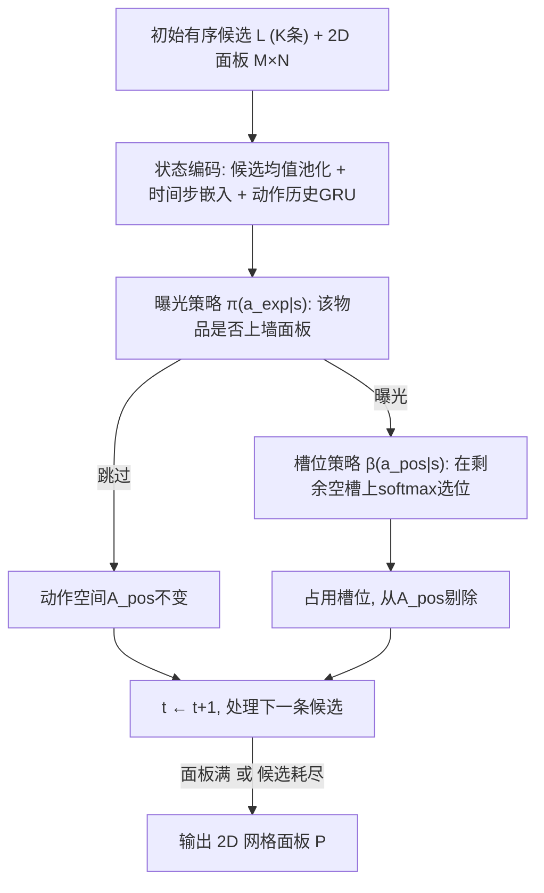

# Reinforcement Re-ranking with 2D Grid-based Recommendation Panels (基于 2D 网格面板的强化重排)

- **会议/期刊**: SIGIR-AP 2023 (arXiv:2204.04954v3)
- **作者与机构**: Sirui Chen, Xiao Zhang, Xu Chen, Jun Xu (中国人民大学高瓴人工智能学院) ; Zhiyu Li, Yuan Wang, Quan Lin (阿里巴巴/淘宝)
- **推荐链路定位**: 重排 (Final-stage Re-ranking)
- **研究方向**: 多任务学习与列表级重排 / 强化学习与动态探索推荐
- **论文原文**: [https://arxiv.org/abs/2204.04954v3](https://arxiv.org/abs/2204.04954v3)
- **开源代码**: 暂未开源

## TL;DR (1分钟核心速览)

电商结果页正从 1D 流式列表转向 2D 网格面板，但网格槽位无显式顺序，直接“左→右、上→下”展开会违背用户在网格上特有的中间偏置与跳行浏览模式。本文提出 Panel-MDP：把 **MDP 的时间步定义为初始列表的排名**、把 **动作定义为「是否曝光该物品 + 选哪个面板槽位」** 的二元组，用 PPO 的 Actor-Critic 训练。在淘宝真实请求数据（20k 训练 / 1k 测试，2×3 面板）上，平均奖励 0.0179、Selection 任务 AUC 0.7980，较最优基线 miDNN/PDQN 的 0.7524 **相对提升 6.06%**（$p<0.05$）。

## Background & Motivation (背景与核心矛盾)

- **主流范式**: 末端推荐长期以 1D 有序列表输出，重排模型（miDNN 监督式、DDPG/PDQN 强化式）直接在“排名槽位”上做序列决策，把高分物品放在前列即可。
- **前人局限**: ① 2D 面板槽位本身无全序，把 1D 排名硬映射为格子顺序丢掉了“槽位—偏好”的用户相关对应；② 网格下用户是**浏览完整页后才给反馈**，偏好分数与曝光位置解耦，注意力呈中间偏置 (middle bias)、跳行 (row skipping)、随行号缓慢衰减而非单调骤降。
- **核心洞察 (Key Insight)**: 决定体验的不再是“物品排第几”，而是“哪件物品落在哪个格子”——这是一个需要同时学习 **曝光选择** 与 **空间布局** 的双因子决策问题。
- **本文切入点**: 反转既有 MDP 配置：时间步绑在**输入候选序列**上（保证遍历确定性、便于信用分配），让**动作**去承担槽位分配，从而天然产出网格面板。

## Method (核心方法设计)

### 1. 整体框架 (Overall Architecture)

输入是上游召粗精给的 $K$条有序候选$\mathcal{L}=[i_1,\dots,i_K]$与一个$M\times N$面板$\mathbf{P}$（$M\times N\le K$）。模型从$t=0$起按序处理$\mathcal{L}$中的物品：状态$s_t=[\mathcal{L}_t,t,\mathcal{H}_t]$由未处理候选均值池化、时间步嵌入与历史动作 GRU 编码拼接而成；策略头先判定该物品是否值得曝光（$a^{exp}$），若曝光再由 softmax 策略在剩余空槽中选位（$a^{pos}$），否则跳过。槽位被占用后从动作空间剔除。轨迹收齐后用 PPO-clip + GAE 更新四个 MLP、GRU 及时间步/槽位/动作嵌入；在线阶段取策略 argmax 贪心填充面板，直到面板满或候选耗尽。

### 2. 关键设计拆解 (Key Designs)

1. **逆序 MDP 配置（时间步=输入排名，动作=槽位）**: 既有 RL 重排把时间步设为输出排名、动作为选物品，时间步本身构成序列因而只能产出列表。本文改为遍历输入列表，动作空间随曝光决定动态收缩：$\mathcal{A}^{pos}_{t+1}=\mathcal{A}^{pos}_{t}\setminus\{a^{pos}_t\}$当$a^{exp}_t=1$，否则保持。直觉上，输入列表的顺序是上游置信度的先验，沿其遍历使每步只需判断“要不要”与“放哪里”，把布局问题降解为逐件的局部决策，显著降低搜索空间。

2. **双头解耦策略与状态表征**: 曝光头 $\pi(a^{exp}=1\mid s)=\sigma(\mathrm{MLP}_3(\mathbf{h}))$与槽位头$\beta(a^{pos}=p\mid s)=\frac{\exp(\mathbf{h}^{\top}\mathbf{e}_p)}{\sum_{p'\in\mathcal{A}^{pos}_t}\exp(\mathbf{h}^{\top}\mathbf{e}_{p'})}$共享$\mathbf{h}=\mathrm{MLP}_2(\mathbf{e}_s)$但各自采样，$\mathbf{e}_s=\mathrm{concat}(\mathbf{e}_L,\mathbf{e}_t,\mathbf{e}_H)$。这让“选择”与“布局”两个因子在策略层显式分离，槽位嵌入$\mathbf{e}_p$ 可自动学到中间偏置等位置先验，无需人工注入位置偏置。

3. **训练目标、采样与推理效率**: 回报取整页反馈（购买=1），$R_t=\sum_{k=t}^{|\tau|-1}\gamma^{k-t}r_k$，总损失$\mathcal{L}=\mathcal{L}_{Actor}+\lambda_1\mathcal{L}_{Critic}+\lambda_2\mathcal{L}_{Entropy}$，其中$\mathcal{L}_{Actor}$对两个子动作分别做 clip 比率$\min(wA,\ \mathrm{clip}(w,1-\epsilon,1+\epsilon)A)$，且槽位项仅在$a^{exp}=1$时计入；$\mathcal{L}_{Entropy}$只在$\beta$上加熵，鼓励探索不同空格。**无需负采样**，奖励即隐式正负信号；推理为单次前向贪心，复杂度$O(K\cdot MN)$，无束搜索开销。

## Experimental Setup & Evaluation Protocol (实验设置与评估协议)

- **数据集与预处理**: 淘宝某电商 App 2021 年 10 月线上日志，结果页为 $2\times 3$ 网格。

| 数据集 | #Users | #Items | #Interactions | 稀疏度/密度 | 特征/场景说明 |
| :--- | :---: | :---: | :---: | :---: | :--- |
| 电商 App 日志（论文未披露用户/物品数） | 未披露 | 未披露 | 20,000 训练请求 + 1,000 测试请求 | 未披露 | 用户画像（哈希 ID、非敏感特征）+ 物品画像（类目、价格）；上游给 16 条候选，取 6 条填 $2\times 3$ 面板 |

- **数据划分与防穿越 (Splitting Strategy)**: **请求级比例划分**（20,000 / 1,000），论文未说明是否按全局时间戳切分，存在轻微穿越风险。
- **排名评测协议 (Ranking Protocol)**: **非全库 Full-Ranking**。真实反馈稀疏，故以大规模交互训练出的**用户模拟器**输出购买概率作为奖励，报告平均奖励；Selection 任务另报 AUC。Re-org 任务无法计算 AUC（6 条候选全视为正例）。显著性用 t-test，$p<0.05$标$*$。
- **对比基线与超参设置**: 因无同任务公开模型，基线均为“输出列表→按预设顺序铺格子”的迁移版本：监督重排 miDNN、RL 重排 DDPG、PDQN。网格 $2\times3$（真实）/$4\times3$（仿真），候选 16 条（仿真 20 条）；嵌入维度与 PPO 超参论文未详列。

## Key Experimental Results (实验关键数据)

### 1. 主实验对比 (Main Results)

| 模型 | Task 1: Re-org 平均奖励 | Task 2: Select&Re-org 平均奖励 | Task 2 AUC |
| :--- | :---: | :---: | :---: |
| miDNN (监督重排) | 0.0177 | 0.0178 | 0.7524 |
| DDPG (RL 重排) | 0.0175 | 0.0145 | 0.6613 |
| PDQN (RL 重排) | 0.0177 | 0.0163 | 0.7524 |
| **Panel-MDP (Ours)** | **0.0179*** | **0.0179*** | **0.7980*** |
| Improv.% (vs 最优基线) | +1.13% | +0.56% | **+6.06%** |

### 2. 消融实验 (Ablation Study)

论文未设传统 `w/o` 模块消融，此处以**任务配置切换（固定 $a^{exp}\equiv1$的 Re-org → 需学习$a^{exp}$ 的 Select&Re-org）**作为“曝光选择子动作”的隐式消融，并辅以仿真环境收敛曲线对比：

| 变体 / 配置 | Re-org | Select&Re-org | Δ (相对) |
| :--- | :---: | :---: | :---: |
| miDNN | 0.0177 | 0.0178 | +0.6% |
| DDPG | 0.0175 | 0.0145 | **-17.1%** |
| PDQN | 0.0177 | 0.0163 | -7.9% |
| Panel-MDP (含 $a^{exp}$ 双头) | 0.0179 | 0.0179 | **0.0%** |
| Panel-MDP 去 $a^{exp}$（退化为纯 Re-org） | 0.0179 | — | 无法完成 16→6 选择 |

### 3. 关键实验发现 (Key Findings)

1. **AUC 增益远大于平均奖励增益**：奖励从 0.0178→0.0179（+0.56%）几近饱和，但 AUC 0.7524→0.7980（+6.06%）显著，说明增益主要来自“16 选 6”的**排序判别力**而非整体点击概率抬升——平均奖励在该数据上已接近天花板，是偏钝的指标。
2. **双因子动作是抗退化关键**：任务从 Re-org 切到 Select&Re-org 时 DDPG 崩落 17.1%、PDQN 崩落 7.9%，而 Panel-MDP 保持 0.0179 不变，证明将“是否曝光”显式建模为独立子动作，比让 RL 在纯槽位动作里隐式推断更稳健。
3. **收敛速度优势来自时间步与输入对齐**：图 1/图 2 的累积平均奖励曲线显示 Panel-MDP 在训练极早期即取得最高回报，说明以输入排名为时间步可缓解长视野信用分配难题；GAE + 仅对 $\beta$ 加熵的正则也避免了槽位探索塌缩。

## Highlights & Limitations (亮点、对比与审稿批判)

- **与代表作对比 (vs. Prior Work)**: 相较 miDNN（监督式列表重排，只看物品间互信息）与 DDPG/PDQN（RL 但以输出排名为时间步、隐式处理位置），本文的核心差别是**把槽位从“状态的一部分”提升为“动作的一部分”**；相较 Zhao 等的 page-wise RL 推荐（同页多物品但仍是列表式曝光），本文显式建模 2D 空间布局与中间偏置。与 Xie 等对 2D 图像搜索页的**行为学分析**相比，本文把观察结论转化为可学习的位置嵌入，是“分析→模型”的闭环。
- **可迁移亮点**: ① “时间步=输入序、动作=输出位”的逆序 MDP 配置可直接迁移到多坑位广告位分配、瀑布流图文混排、货架多列布局等一切**输出结构非序列**的重排任务；② 将曝光与布局拆成两个子动作头、仅在曝光时计入槽位损失，是一种通用的稀疏动作掩码训练范式。
- **审稿级局限批判**: ① **评估闭环存疑**：奖励全部来自离线用户模拟器，而该模拟器本身即由同类交互训练，缺少线上 A/B 或真实日志反事实校验；② **实验规模过窄**：仅 $2\times3$与$4\times3$两种小网格、单一数据集、单一业务，绝对奖励差异（0.0177 vs 0.0179）极小，$p<0.05$ 的实际业务意义有限；③ 缺失与更多 SOTA 重排（如 PRM、SetRank、Transformer 列表式重排）的对比，也未披露 PPO 超参与显著性检验细节，复现性受限。

## Rating (四维评分)

- **方法创新性 (Novelty)**: ⭐⭐⭐⭐ （“时间步绑输入、动作绑槽位”的逆序 MDP 配置是干净且可迁移的结构创新，双因子动作分解有清晰的行为学动机支撑，但理论/谱分析层面无深入论证）
- **评估协议与实验扎实度 (Protocol & Experiments)**: ⭐⭐ （单一私有数据集、仅两种小网格、依赖用户模拟器奖励、无 Full-Ranking 与真实在线验证，基线也仅 3 个且全部为“硬铺格子”的迁移版本）
- **写作与数学规范度 (Clarity & Rigor)**: ⭐⭐⭐⭐ （MDP 六要素、动作空间收缩、双头策略与 PPO-clip 损失定义完整一致，算法伪代码清晰；扣分在于部分超参与实现细节留白）
- **工业落地与复现价值 (Industrial & Practical Value)**: ⭐⭐⭐ （推理仅需一次前向、$O(KMN)$ 复杂度且无负采样，工程上易落地；但无开源代码、无公开数据，且槽位嵌入与策略需按各业务面板尺寸重训）

