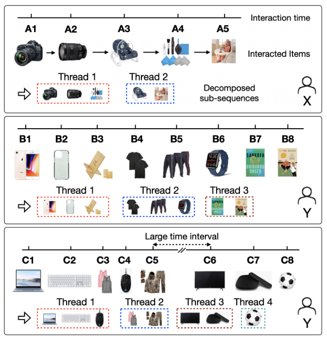
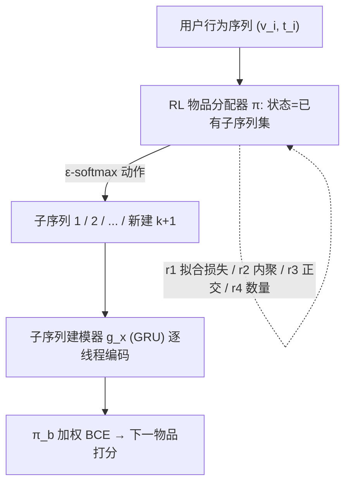

# Sequential Recommendation with User Evolving Preference Decomposition (面向用户演化偏好分解的序列推荐)

- **会议/期刊**: SIGIR-AP 2023（arXiv 2203.16942）
- **作者与机构**: Weiqi Shao, Xu Chen（中国人民大学高瓴人工智能学院 / 大数据管理与分析方法北京市重点实验室）, Long Xia, Jiashu Zhao, Dawei Yin（百度）
- **推荐链路定位**: 召回（下一物品序列预测）
- **研究方向**: 序列与会话推荐 / 强化学习与动态探索推荐
- **论文原文**: [https://arxiv.org/abs/2203.16942v1](https://arxiv.org/abs/2203.16942v1)
- **开源代码**: 暂未开源

## TL;DR (1分钟核心速览)

现有序列推荐默认「一条序列 = 一种连贯偏好」，而真实用户序列混杂数字/母婴/运动等多线程兴趣，且线程数因人因序列而异、兴趣随时间演化、行为在时间轴上分布不均。本文提出 SPLIT：把序列分解建模为马尔可夫决策过程，RL 智能体逐物品决定「归入已有子序列 or 新建子序列」，用 $\epsilon$-softmax 自适应扩张动作空间、用时间衰减核刻画间隔、用四项奖励（拟合损失 / 线程内聚 / 线程正交 / 课程式数量控制）引导分解。在 6 个跨域数据集、Leave-One-Out + 采样排序协议下，Precision/Recall/NDCG/MRR@5 平均相对最优基线提升 8.21%/10.08%/10.32%/9.82%。

## Background & Motivation (背景与核心矛盾)

- **主流范式**: GRU4Rec / NARM / BERT4Rec / TASER 等用一个统一序列编码器压缩全部历史；多兴趣方法（MCPRN、ComiRec、Octopus、PIMI）用胶囊动态路由或注意力头把物品独立分配到若干兴趣向量。
- **前人局限**: ① 单序列假设把「相机→镜头→婴儿椅→镜头清洁剂→挂铃」压成一个混淆表示；② 多兴趣方法多为**逐物品独立分类**，忽略了「买智能手表是因为在运动而非数码」这类**演化依赖**，且兴趣数 $K$ 需预先固定。
- **核心洞察 (Key Insight)**: 真实行为是**多线程偏好并行演化**的结果，且线程数不固定（CH1 不一致）、当前物品归属取决于历史分解状态（CH2 演化性）、时间间隔大则相关性弱（CH3 不均匀性）——三者需统一建模，而非三个独立模块拼装。
- **本文切入点**: 把「序列分解」本身当成一个序贯决策过程，用 RL 智能体的动作序列生成子序列划分。

<figure class="paper-figure" markdown="span">
  <figcaption>图1：用户不一致、演化且不均衡的多线程偏好示例。</figcaption>
</figure>

## Method (核心方法设计)

### 1. 整体框架 (Overall Architecture)

SPLIT = **物品分配器 (Item Allocator)** + **一组子序列建模器 (Sub-sequence Modeler)**。训练时，智能体从 $t=1$走到$T$，每步读取「已生成的子序列集合$\boldsymbol{s}_i$与当前时刻$t_i$」作为状态，输出动作$a_i\in[1,k+1]$（归入第$b$条线程或新建第$k+1$条），据此确定性更新状态并即时计算奖励；轨迹结束后用 REINFORCE（log-trick）更新策略参数，再把分解结果送入$K$个共享架构的序列编码器$g_x$，按动作概率$\pi_b$ 加权 BCE 做下一物品预测。推理时先分解整条历史，再对各子序列打分池化。

### 2. 关键设计拆解 (Key Designs)

1. **$\epsilon$-softmax 动态动作空间（解 CH1 不一致性）**：固定$K$的多兴趣方法在稀疏序列上必然错分。SPLIT 让动作空间随步数增长，用阈值$\epsilon$改造 softmax：当所有已有线程的内聚分$cs_b<\epsilon$时，概率质量被推到「新建线程」；否则退化为普通 softmax 取最大内聚线程。$\pi(a_i=a|(\boldsymbol{s}_i,t_i))=[\mu(cs_1,\dots,cs_k,\epsilon;\zeta)]_a$。直觉：$\epsilon$ 就是「多相似才算同一种兴趣」的可学习门槛，使线程数随样本自适应。

2. **时间衰减内聚分（解 CH3 不均匀性）**：语义相似不足以判定归属，需惩罚大间隔。$cs_b=\mathrm{dist}([\boldsymbol{c}_{i,b};\boldsymbol{e}_i])\cdot\tau(t_i-t_b)$，其中$\tau(t_i-t_b)=e^{-\kappa_3(t_i-t_b)}$（指数优于线性，见后文）。$\boldsymbol{c}_{i,b}=g_s(\boldsymbol{s}_{i,b})$由 GRU 编码、$t_b$ 取线程末次交互时间，从而「久未触碰的线程」难以吸附新物品。

3. **四项奖励 + 课程式数量控制（解 CH2 演化性）**：$r_i=\sum_{j=1}^{4}r_{i,j}$，其中$r_{i,1}$为**延迟奖励**（仅在$i=T$给$-\ell(H_{T+1},v_{T+1})$，因损失须待全序列分解完才可算）、$r_{i,2}$为物品与目标线程的余弦内聚、$r_{i,3}$为负的跨线程余弦正交（防信息泄漏）、$r_{i,4}=\lambda$仅在「新建」时生效且$\lambda=w_1 i+w_2\ (w_1<0)$，即随步数递减——序列早期宽松允许开新线程，后期收紧防止线程碎片化。

4. **训练目标、负采样与推理效率**：$\mathcal{L}=\alpha\mathcal{L}_{IA}(\Theta_\pi,\Theta_e)+(1-\alpha)\mathcal{L}_{SSM}(\Theta_x,\Theta_e)$，$\mathcal{L}_{SSM}$中子序列损失按分配概率加权：$\ell=-\sum_{b=1}^{K+1}\pi_b\,\ell_{ce}(\boldsymbol{x}_b,\boldsymbol{e}_{T+1})$；$\mathcal{L}_{IA}=\sum_u\sum_j R_{uj}\sum_{i\le j}\log\pi(a_i^u|\cdot)$。负样本沿用经典**逐样本均匀负采样** BCE（非全库 softmax），$\alpha=0.5$，$g_s/g_x$用 GRU，推理开销为$K$ 条短序列编码 + 一次加权池化，与序列长度近似线性。

## Experimental Setup & Evaluation Protocol (实验设置与评估协议)

- **数据集与预处理**: 覆盖电商 / 微视频 / LBS 签到三域，密度跨度 0.43%–0.99%（论文未显式声明 $k$-core 过滤，仅给出统计量）：

| 数据集 | #Users | #Items | #Interactions | 稀疏度/密度 | 特征/场景说明 |
| :--- | :---: | :---: | :---: | :---: | :--- |
| Amazon-Garden | 1,687 | 963 | 13,272 | 0.82% | 电商园艺 |
| Amazon-Video | 5,131 | 1,686 | 37,126 | 0.43% | 电商视频 |
| Amazon-Music | 1,430 | 901 | 10,261 | 0.80% | 电商音乐 |
| Wechat | 4,364 | 10,654 | 198,702 | 0.43% | 微视频观看 |
| Foursquare-NY | 1,063 | 3,896 | 40,825 | 0.99% | 纽约签到 |
| Foursquare-TKY | 2,288 | 7,056 | 128,530 | 0.80% | 东京签到 |

- **数据划分与防穿越**: 逐用户 `Leave-One-Out`——最后 1 次交互为测试、倒数第 2 次为验证，其余训练；时间戳仅作模型输入特征，不参与切分。
- **排名评测协议**: **Sampled Ranking**（训练与评测均用均匀负采样构造 $S^-(v)$，未做 Full-Ranking 全库排序），Top-5 推荐，报告 Precision/Recall/NDCG/MRR@5；显著性用 paired t-test（$p<0.05$）。
- **对比基线与超参**: 11 个基线，涵盖通用（BPR、NCF）、序列（GRU4Rec、STAMP、NARM、BERT4Rec、TLSTM、TASER）、多兴趣（MCPRN、PIMI、Octopus）。Embedding 维度 $d\in\{64,128,256\}$，学习率$\{0.01,0.005,0.001\}$，batch$\{256,512,1024\}$，$\epsilon\in[0,0.9]$，$w_1\in[-0.5,-0.1]$、$w_2\in[0.1,0.5]$。

## Key Experimental Results (实验关键数据)

### 1. 主实验对比 (Main Results)

NDCG@5（%）：

| 数据集 | GRU4Rec | NARM | BERT4Rec | TASER | MCPRN | Octopus | **SPLIT** | Improv. |
| :--- | :---: | :---: | :---: | :---: | :---: | :---: | :---: | :---: |
| Amazon-Garden | 4.62 | 5.21 | 2.71 | 4.12 | 5.46 | 3.50 | **5.92** | +8.4% |
| Amazon-Video | 10.37 | 11.22 | 7.87 | 8.01 | 10.07 | 8.11 | **13.23** | +15.6% |
| Amazon-Music | 3.01 | 3.14 | 2.17 | 3.09 | 3.82 | 3.56 | **4.22** | +10.5% |
| Wechat | 1.48 | 1.78 | 1.85 | 1.81 | 1.92 | 1.04 | **2.25** | +17.2% |
| Foursquare-NY | 4.04 | 4.55 | 4.58 | 4.69 | 4.69 | 4.29 | **4.93** | +5.1% |
| Foursquare-TKY | 6.90 | 7.06 | 7.00 | 6.77 | 6.10 | 5.38 | **7.42** | +5.1% |

Recall@5 上 Amazon-Video 由 NARM 的 15.95 提升到 17.13，Wechat 由 TLSTM 的 3.14 提升到 3.67；全指标全数据集一致最优。

### 2. 消融实验 (Ablation Study)

原文消融以柱状图（图 3）给出，另用表 5 报告实现变体（NDCG）：

| 变体 | Garden-Linear | Garden-Exp | Video-Linear | Video-Exp |
| :--- | :---: | :---: | :---: | :---: |
| $g_s$ = LSTM | 8.88 | 6.89 | 2.78 | 3.24 |
| $g_s$ = GRU | **13.00** | **13.32** | **5.40** | **5.92** |
| $g_s$ = Transformer | 11.49 | 13.13 | 5.41 | 5.46 |

（图 3 的 `w/o r1..r4, τ, ε` 变体均低于完整模型，其中 `w/o r1` 在 Amazon-Garden 上甚至劣于多个基线，`w/o ε` 在 Amazon-Video 上为全部变体中最差。）

### 3. 关键实验发现 (Key Findings)

1. **「拟合损失」奖励是命门**：去掉 $r_{i,1}$后 Garden 性能跌至基线以下——说明分解若脱离下游损失信号，纯靠内聚/正交启发式会拆出「语义自洽但预测无用」的线程；奖励必须与最终$\ell$ 对齐（延迟奖励设计必要）。
2. **固定线程数是最贵的偷懒**：`w/o ε`（固定 $K$）在 Amazon-Video 上垫底，而课程式$r_{i,4}$相比「常数$\lambda$」与「完全去掉」均有增益——证明**线程数需要随序列动态决定且增长速度需调度**，而不是调一个全局$K$。
3. **轻量编码器 + 指数时间核更适配稀疏数据**：GRU 在两种 $\tau$下均优于 LSTM/Transformer（Garden 13.32 vs 13.13/6.89），指数核在多数情形优于线性（Video 5.92 vs 5.40）；原因是线性$\tau(t_i-t_b)$可能过大而压过语义相似项，指数核把间隔稳定投影到$[0,1]$。

## Highlights & Limitations (亮点、对比与审稿批判)

- **与代表作对比**: 相较 MCPRN/ComiRec 的「胶囊动态路由 + 逐物品独立归类」，SPLIT 把归属决策写成**状态相关**的序贯动作（CH2）；相较 Octopus 的激活机制，SPLIT 用 $\epsilon$-softmax 而非阈值/门控硬编码实现线程数自适应（CH1）；相较 PIMI 仅在表征层注入时间，SPLIT 让时间直接参与**分配决策**（CH3）。论文自评的范式定位「globally evolving + locally evolving」颇为贴切。
- **可迁移亮点**: ①「下游损失作延迟奖励 + 课程式正则项」这套组合可迁移到任意离散结构学习（如会话切分、兴趣漂移分段、图子图划分）；② 指数衰减核 $\tau$ 与语义分的**乘性耦合**比拼接更稳健，可直接用于时间感知的对比学习正样本筛选。
- **审稿级局限批判**: ① 评测仅用**采样排序**且 Top-5 截断，缺少 Full-Ranking 与更深截断，采样负样本下 NDCG 差异可能被高估；② 训练需为每个样本跑完整 RL 轨迹并对 $K$条子序列分别编码，相比 GRU4Rec 的常数级开销显著上升，论文未给出任何时延/FLOPs 对比，线上可用性存疑；③ 关键超参$\epsilon,w_1,w_2,\kappa$在 Garden 与 Video 上最优区间相反（小$\epsilon$/小$w$vs 大$w$），跨数据集调参成本高；④ 仅用 item ID + 时间，未验证 side-info 融合下的收益边界。

## Rating (四维评分)

- **方法创新性 (Novelty)**: ⭐⭐⭐⭐ （把序列分解建模为 MDP，$\epsilon$-softmax 自适应动作空间 + 延迟损失奖励的组合在 2022 年语境下相当新颖，但 RL 训练稳定性依赖启发式奖励权重）
- **评估协议与实验扎实度 (Protocol & Experiments)**: ⭐⭐⭐ （六数据集三域覆盖较广且显著性检验齐备，但仅采样排序 + Top-5、缺全库排序与效率对比，消融仅以柱状图定性呈现）
- **写作与数学规范度 (Clarity & Rigor)**: ⭐⭐⭐⭐ （CH1–CH3 三挑战与三模块一一对应，公式与 MDP 五元组定义清晰；$\mathrm{dist}(\cdot)$ 输出未保证正值而直接乘衰减核，细节略糙）
- **工业落地与复现价值 (Industrial & Practical Value)**: ⭐⭐⭐ （无开源代码，RL 分配器 + 多子序列编码推理成本高于单塔序列模型，但「分解后再池化」思想易在现有序列召回链路上做离线蒸馏落地）

