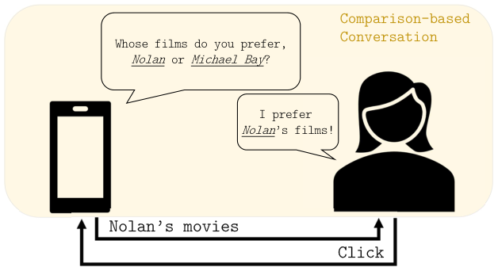
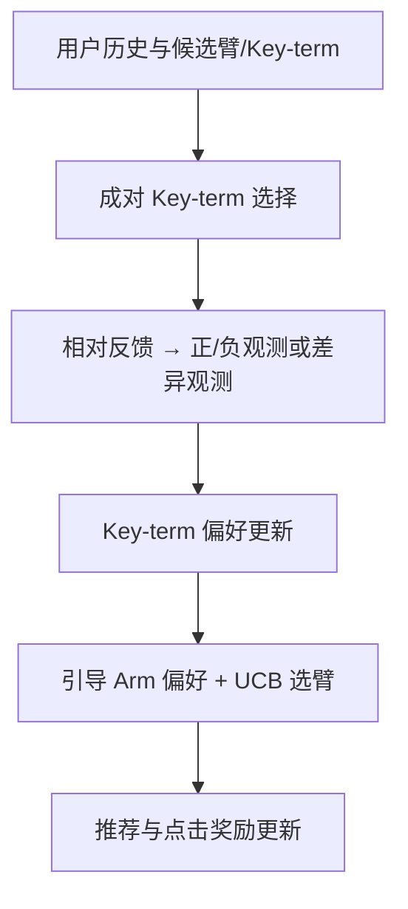

# Comparison-based Conversational Recommender System with Relative Bandit Feedback (基于相对 Bandit 反馈的比较式对话推荐系统)

- **会议/期刊**: SIGIR 2021
- **作者与机构**: Zhihui Xie, Tong Yu, Canzhe Zhao, Shuai Li；上海交通大学、CMU、山东大学
- **推荐链路定位**: 在线推荐 / 候选臂选择（Bandit）
- **研究方向**: 对话推荐与智能体仿真 / 强化学习与动态探索推荐
- **论文原文**: [https://arxiv.org/abs/2208.09837v1](https://arxiv.org/abs/2208.09837v1)
- **开源代码**: [https://github.com/fffffarmer/RelativeConUCB](https://github.com/fffffarmer/RelativeConUCB)

## TL;DR (1分钟核心速览)

针对对话推荐中“绝对反馈有偏且信息量有限”的痛点，本文把用户对 key-term 的**相对偏好**引入 contextual bandit，提出 RelativeConUCB：查询成对 key-term，并用正负观测或成对差异岭回归更新偏好。在合成数据与 Last.FM/Movielens 在线仿真中，以累积遗憾为主指标，差异变体在漂移场景较 ConUCB 降低 44.75%–49.96%。

## Background & Motivation (背景与核心矛盾)

- **主流范式**: 现有对话推荐多基于 contextual bandit，周期性询问用户对某个 key-term（如导演、品类）的绝对偏好，再结合点击奖励做推荐。
- **前人局限**: 绝对反馈在用户态度矛盾或评分尺度不一时会产生偏置；同时“喜欢/不喜欢”的二元回答只提供有限信息，难以区分相近 key-term。
- **核心洞察 (Key Insight)**: 用户偏好本质上是相对的，成对比较比绝对打分更自然、更廉价；比较还能抵消个体偏置，使相似用户的相对偏好更一致。
- **本文切入点**: 将对话问题从“是否喜欢 k”改为“更喜欢 k1 还是 k2”，并设计能消化相对反馈的 bandit 更新机制。

<figure class="paper-figure" markdown="span">
  <figcaption>图1：基于比较的对话推荐系统的示例。</figcaption>
</figure>

## Method (核心方法设计)

### 1. 整体框架 (Overall Architecture)

系统沿用“对话 + 推荐”两阶段在线闭环：每轮先按对话预算 $q_t=b(t)-b(t-1)$决定是否提问；若提问，则从候选 key-term 集合中选择信息量最大的成对问题，接收相对反馈并更新 key-term 级偏好$\tilde{\boldsymbol{\theta}}_u$；随后用$\tilde{\boldsymbol{\theta}}_u$引导 arm 级偏好$\boldsymbol{\theta}_u$，以 UCB 方式从候选臂中选一个物品推荐并接收点击奖励。核心是把相对反馈转成可在线更新的岭回归观测，同时保持探索。

### 2. 关键设计拆解 (Key Designs)

1. **相对反馈建模与成对问题选择**：用户对 key-term 的内部评分为 $\tilde{r}_{k,t}=\tilde{\boldsymbol{x}}_k^\top\boldsymbol{\theta}^*+\epsilon_{k,t}$，反馈为$\tilde{r}_{k1,k2,t}=\mathbb{I}[\tilde{r}_{k1,t}>\tilde{r}_{k2,t}]$。系统选择使推荐误差下降最大的 key-term 对，Difference 变体使用$\Delta\tilde{\boldsymbol{x}}_{k1,k2}=\tilde{\boldsymbol{x}}_{k1}-\tilde{\boldsymbol{x}}_{k2}$最大化$ \frac{\|X_tM_u^{-1}\tilde{M}_u^{-1}\Delta\tilde{\boldsymbol{x}}_{k1,k2}\|_2^2}{1+\Delta\tilde{\boldsymbol{x}}_{k1,k2}^\top\tilde{M}_u^{-1}\Delta\tilde{\boldsymbol{x}}_{k1,k2}}$。直觉是优先问“最能降低当前推荐不确定性”的比较，而非随机问品类。

2. **三种反馈消化机制**：Pos 只把“k1 胜出”当作正观测 $(\tilde{\boldsymbol{x}}_{k1},1)$；Pos&Neg 同时把 k2 当作负观测$(\tilde{\boldsymbol{x}}_{k2},0)$；Difference 则直接把成对反馈视为$(\tilde{\boldsymbol{x}}_{k1}-\tilde{\boldsymbol{x}}_{k2},1)$做岭回归，等价于训练线性比较器。Difference 估计的是归一化方向$\boldsymbol{\theta}^*/\|\boldsymbol{\theta}^*\|_2$，可消除用户绝对评分尺度差异；用户级范数则由 arm 级点击学习补足。

3. **训练目标、更新与推理开销**：key-term 级用 $\tilde{\boldsymbol{\theta}}_u=\tilde{M}_u^{-1}\tilde{\boldsymbol{b}}_u$，arm 级用$\boldsymbol{\theta}_u=M_u^{-1}(\boldsymbol{b}_u+(1-\lambda)\tilde{\boldsymbol{\theta}}_u)$，其中$\lambda$平衡点击与对话知识。选臂为$a_t=\arg\max_{a\in\mathcal{A}_t}\boldsymbol{x}_a^\top\boldsymbol{\theta}_u+\lambda\alpha\|\boldsymbol{x}_a\|_{M_u^{-1}}+(1-\lambda)\tilde{\alpha}\|M_u^{-1}\boldsymbol{x}_a\|_{\tilde{M}_u^{-1}}$。全量 Difference 选对复杂度$O(|\mathcal{K}_t|^2d^2)$，Difference(fast) 先选 k1 再固定 k1 选 k2，降至$O(|\mathcal{K}_t|d^2)$；无负采样，在线仅需闭式更新。

## Experimental Setup & Evaluation Protocol (实验设置与评估协议)

- **数据集与预处理**: 合成数据 $|\mathcal{U}|=200,|\mathcal{A}|=5000,|\mathcal{K}|=500,d=50$；Last.FM 原始 186,479 条、1,892 用户/17,632 artists；Movielens 原始 47,957 条、2,113 用户/10,197 movies。处理后均取 500 用户、2,000 物品，每物品最多保留 20 个 key-term。

| 数据集 | #Users | #Items | #Interactions | 稀疏度/设置 | 特征/场景 |
| :--- | :---: | :---: | :---: | :---: | :--- |
| Synthetic | 200 | 5,000 | 80,000 轮仿真 | 每用户约 400 轮 | 500 key-terms，d=50，Bernoulli 奖励 |
| Last.FM | 500（原始 1,892） | 2,000（原始 17,632） | 186,479 原始 | 原始约 0.56% | 音乐 artist，2,726 key-terms |
| Movielens | 500（原始 2,113） | 2,000（原始 10,197） | 47,957 原始 | 原始约 0.22% | 电影，5,585 key-terms |

- **数据划分与防穿越 (Splitting Strategy)**: 无传统 Leave-One-Out / 比例划分；采用在线长程仿真，$N=400\times|\mathcal{U}|$ 次迭代，用户按均匀分布到达。真实数据先用 100 用户经 one-class MF 构造物品特征，再用自编码器重构其余 400 用户反馈并生成 ground-truth 用户特征。
- **排名评测协议 (Ranking Protocol)**: 不是 Full-Ranking，也不是常规 Sampled Ranking；每轮仅从 50 个候选臂中选 1 个推荐，指标为累积遗憾与平均奖励。相对反馈噪声 $\sigma_g=0.1$，对话频率$b(t)=5\lfloor\log t\rfloor$，结果取 10 次重复运行。
- **对比基线与超参设置**: 对比 LinUCB（无对话）、ConUCB（绝对反馈）、Pos、Pos&Neg、Difference、Difference(fast)。ConUCB/RelativeConUCB 取 $\lambda=0.5,\tilde{\lambda}=1,\sigma=0.05,\alpha=0.25,\tilde{\alpha}=0.25$；LinUCB 取$\lambda=1,\alpha=0.5$。

## Key Experimental Results (实验关键数据)

### 1. 主实验对比 (Main Results)

原文主要以累积遗憾曲线汇报，以下保留可读的最终相对提升；`—` 表示原文未给单一数值或仅以曲线展示。

| 方法 | Last.FM ΔRegret↓ | Movielens ΔRegret↓ | Drift Last.FM ΔRegret↓ | Drift Movielens ΔRegret↓ | 说明 |
| :--- | :---: | :---: | :---: | :---: | :--- |
| LinUCB | — | — | — | — | 无对话，早期明显落后 |
| ConUCB | 0.00% | 0.00% | 0.00% | 0.00% | 绝对反馈主基线 |
| RelativeConUCB-Pos | 无显著增益 | 无显著增益 | — | — | 只用正观测，接近 LinUCB |
| RelativeConUCB-Pos&Neg | **10.93%** | **10.82%** | — | — | 正+负绝对观测 |
| RelativeConUCB-Difference | — | — | 显著最优 | 显著最优 | 成对差异分类 |
| RelativeConUCB-Difference (fast) | **10.12%** | **16.93%** | **49.96%** | **44.75%** | 近似版，综合最优 |

合成数据上，Pos&Neg 与 Difference 均显著优于 ConUCB；Difference(fast) 与全量 Difference 曲线几乎重合，验证近似选对几乎不损性能。

### 2. 消融实验 (Ablation Study)

| 变体/设置 | 关键指标变化 | 结论 |
| :--- | :---: | :--- |
| w/o 相对反馈（ConUCB） | 0 | 绝对反馈受用户偏置污染 |
| Pos（仅正观测） | 与 LinUCB 相当 | 丢弃负信号，信息不足 |
| Pos&Neg | Last.FM -10.93%，Movielens -10.82% | 正负观测均有效 |
| Difference | 漂移场景显著优于其他 | 成对差异可消偏 |
| Difference(fast) | 漂移场景 -49.96% / -44.75% | 二次选对近似几乎无损 |
| 全用户共享相对反馈 | 无优势甚至变差 | 不能盲目跨用户共享 |
| 相似用户共享（漂移） | 最佳 | 偏置相近时共享收益最大 |

### 3. 关键实验发现 (Key Findings)

- 相对反馈确有增益，但“怎么用”比“有没有”更关键：Pos 仅取正观测时几乎退化到 LinUCB，而 Pos&Neg 与 Difference 在真实数据非共享设置下分别较 ConUCB 降低 10.82%–10.93% 与 10.12%–16.93%。
- 在“相似用户、仅偏置不同”的漂移场景中，Difference(fast) 较 ConUCB 降低 49.96%（Last.FM）与 44.75%（Movielens），说明成对比较能抵消个体评分偏置，使相对偏好成为可共享信号。
- 反馈共享不是无条件有效：将相对反馈直接共享给所有用户时相对 ConUCB 无优势，只有面向相似用户共享才显著提升，提示工程上需配合用户聚类/相似度约束。

## Highlights & Limitations (亮点、对比与审稿批判)

- **与代表作对比 (vs. Prior Work)**: 相比 ConUCB 的绝对 key-term 反馈，本文把问题改成成对比较，并用 Difference 将反馈尺度不匹配转化为归一化方向学习；相比 LinUCB，对话提供了额外偏好信号；相比经典 dueling bandits，本文把相对反馈嵌入“对话—推荐”长程闭环并讨论跨用户共享。
- **可迁移亮点**: 成对差异岭回归可直接迁移到偏好 elicitation、列表重排与冷启动问卷；用 key-term 级不确定性引导 arm 级 UCB 的两阶段探索也适合在线推荐冷启动。
- **审稿级局限批判**: 实验仍以仿真反馈为主，缺少真实用户研究；奖励线性、Gaussian 噪声、无弃权等假设较强。全量 Difference 选对为二次复杂度，反馈共享仅做全量/相似用户粗粒度验证，未给出在线聚类与 regret 界。

## Rating (四维评分)

- **方法创新性 (Novelty)**: ⭐⭐⭐⭐ （把相对 bandit 反馈系统化引入比较式对话推荐，Difference 机制有清晰物理直觉）
- **评估协议与实验扎实度 (Protocol & Experiments)**: ⭐⭐⭐⭐ （合成+两个真实数据集、漂移与用户相似度分析完整，但缺少真实用户 A/B 与更多强基线）
- **写作与数学规范度 (Clarity & Rigor)**: ⭐⭐⭐⭐ （公式与算法流程清楚，闭式更新易复现；理论 regret 分析偏少）
- **工业落地与复现价值 (Industrial & Practical Value)**: ⭐⭐⭐⭐ （代码开源，fast 变体可控复杂度；但线上部署仍需解决用户相似度估计与噪声鲁棒性）

