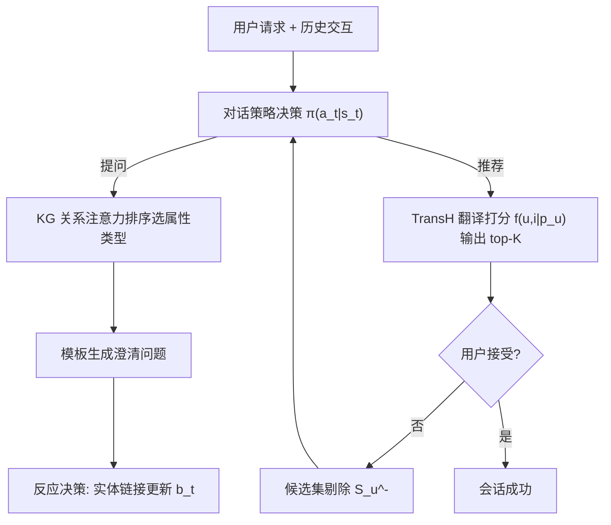
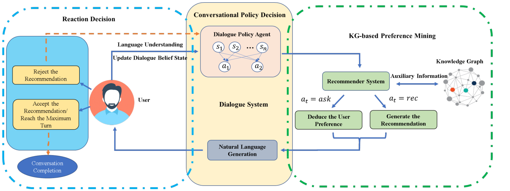

# Learning to Ask Appropriate Questions in Conversational Recommendation (学习在对话推荐中提出恰当问题)

- **会议/期刊**: SIGIR 2021
- **作者与机构**: Xuhui Ren, Hongzhi Yin, Tong Chen, Hao Wang, Zi Huang, Kai Zheng (昆士兰大学、阿里 AI Lab、电子科技大学)
- **推荐链路定位**: 多轮对话交互式推荐（澄清问题 + 推荐）
- **研究方向**: 对话推荐与智能体仿真 / 图神经网络与知识图谱推荐
- **论文原文**: [https://arxiv.org/abs/2105.04774v1](https://arxiv.org/abs/2105.04774v1)
- **开源代码**: [https://github.com/XuhuiRen/KBQG](https://github.com/XuhuiRen/KBQG)

## TL;DR (1分钟核心速览)

本文针对对话推荐中"澄清问题质量差"的痛点——策略网络必须靠庞大对话语料才能训练，且现有模型未能利用学到的潜在用户画像——提出 KBQG：在知识图谱上以**关系（属性类型）注意力**刻画用户细粒度偏好，按注意力权重排序生成个性化澄清问题，并把动作空间简化为"提问 / 推荐"两类。在模拟用户协议下（累计成功率 SR@T 与平均轮次 AT），MovieLens-1M 上 SR 较 CRM 提升 7.2%、AT 从 8.12 降至 7.34；DBbook2014 上 SR 提升 12.9%、AT 从 8.59 降至 8.16。

## Background & Motivation (背景与核心矛盾)

- **主流范式**: 对话推荐分两派——策略型（CRM/EAR，用 task-oriented 对话策略 agent 决定下一步动作）与知识图谱型（SCPR，将推荐转化为"系统问、用户答"的 yes/no 属性值澄清路径搜索）。
- **前人局限**: (1) 策略型依赖海量标注语料训练策略 agent，属性动作空间随属性值数量爆炸，稀疏属性上熵估计失效；(2) SCPR 只关心 KG 节点连通性，忽略关系背后的语义差异，同一节点连多条边时需大量 yes/no 轮次才能命中目标。
- **核心洞察 (Key Insight)**: 用户对不同属性类型（即 KG 关系）的关注度差异巨大——观影决策中 genre 远比 actor/director 关键；直接问"你喜欢哪类题材"比逐个试探"你喜欢爱情片吗"更高效、更自然。
- **本文切入点**: 先用 TransH 超平面翻译 + 关系注意力学出用户对各关系的偏好权重，再据此排序生成属性类型级别的澄清问题，同时把动作空间压缩为二分类。

## Method (核心方法设计)

### 1. 整体框架 (Overall Architecture)

KBQG 采用三阶段闭环：**对话策略决策 $\to$基于 KG 的偏好挖掘$\to$反应决策**。用户发起推荐请求后，策略 agent 依据内部对话状态$\mathbf{s}_t$决定本轮的两种动作之一：提问或推荐。若提问，偏好挖掘模块按关系注意力权重挑选尚未问过的属性类型，套用模板生成个性化问题；若推荐，则用翻译打分$f(u,i\mid p_u)$输出 top-$K$。用户反馈后进入反应决策：对答案做实体链接，把识别出的属性值累加进对话信念状态$\mathbf{b}_t$；若推荐被拒，则把该轮候选存入负集合$\mathcal{S}_u^-$并在下一轮排除，直到用户接受或到达最大轮次$T$。

<figure class="paper-figure" markdown="span">
  <figcaption>图2：KBQG的整体框架图。KBQG通过三阶段流程执行：对话策略决策、基于KG的偏好挖掘和反应决策。</figcaption>
</figure>

### 2. 关键设计拆解 (Key Designs)

1. **关系注意力驱动的偏好挖掘（核心增量）**：常规 TransH 只给用户-物品一条翻译向量，无法回答"哪个属性类型对用户重要"。KBQG 令用户嵌入先经对话信念增强 $\hat{\mathbf{u}}=\mathbf{u}+\mathbf{b}$，再投影到关系超平面$\mathbf{u}_\perp=\hat{\mathbf{u}}-\mathbf{w}_u^\top\hat{\mathbf{u}}\,\mathbf{w}_u$，其偏好翻译向量是所有关系的注意力加权和：
$$\hat{\mathbf{p}}_u=\sum_{r\in\mathcal{R}}\alpha_{r,u}\mathbf{r},\quad \alpha_{r,u}=\frac{\exp\!\big(a(r,u)\big)}{\sum_{r'\in\mathcal{R}}\exp\!\big(a(r',u)\big)}$$
其中 $a(r,u)=\mathbf{h}^\top(\mathrm{ReLU}(\mathbf{W}_3(\mathbf{u}\oplus\mathbf{r})+\mathbf{b}_3))$。直觉：$\alpha_{r,u}$ 越大说明该属性在用户决策中越关键，据此排序即可优先澄清高价值关系。

2. **动作空间简化（策略 agent 轻量化）**：先前工作把每个属性值（如"蓝色"）当作一个动作，动作空间巨大且需熵估计模块。KBQG 只保留两类动作，策略网络为两层 MLP：
$$\pi_\theta(a_t\mid\mathbf{s}_t)=\sigma\big(\mathbf{W}_1\tanh(\mathbf{W}_2\mathbf{s}_t+\mathbf{b}_1)+\mathbf{b}_2\big)$$
状态 $\mathbf{s}_t=\mathbf{b}_t\oplus\mathbf{q}_t\oplus\mathbf{c}_t$，其中$\mathbf{q}_t$标记已澄清属性类型、$\mathbf{c}_t$ 记录候选池占比。用户已澄清足够关系或候选池已足够小时即触发推荐动作。

3. **训练目标、负采样与推理效率**：推荐侧用 BPR 损失 $\mathcal{L}_f=\sum_{(u,i)\in\mathcal{H}^+}\sum_{(u,i')\in\mathcal{H}^-}-\ln\sigma\big(f(u,i'\mid p_u)-f(u,i\mid p_u)\big)$，其中负样本为随机采样；KG 侧用 TransH 三元组 margin 损失$\mathcal{L}_g$；总损失$\mathcal{L}=\lambda\mathcal{L}_f+(1-\lambda)\mathcal{L}_g$。策略 agent 用 deep Q-learning + 规模 100,000 的经验回放训练，奖励设为$r_{t,p}=0.1,r_{t,n}=-0.1,r_{t,a}=1,r_{t,m}=-0.3$。推理时每轮只做一次关系注意力排序与前向打分，$T$ 上限为关系数+1（MovieLens 14、DBbook 10），开销远低于逐属性值试探。

## Experimental Setup & Evaluation Protocol (实验设置与评估协议)

- **数据集与预处理**: 显式评分二值化为隐式反馈（MovieLens-1M 阈值 4，DBbook2014 阈值 1），每正样本采样等量负样本；按 [3] 过滤掉交互少于 10 次的用户与物品；物品映射至 DBPedia 实体构建 KG，剔除 URL 等无法生成问题的关系。

| 数据集 | #Users | #Items | #Interactions | 稀疏度/密度 | 特征/场景说明 |
| :--- | :---: | :---: | :---: | :---: | :--- |
| MovieLens-1M | 6,040 | 3,240 | 998,539 | 均 165 交互/用户 | 影视；KG 13 关系 / 159,492 三元组 |
| DBbook2014 | 5,576 | 2,680 | 65,961 | 均 12 交互/用户 | 图书；KG 9 关系 / 194,710 三元组 |

- **数据划分与防穿越 (Splitting Strategy)**: `比例划分`——训练/验证/测试按 $7:2:1$随机划分；最大对话轮次$T$ 等于关系数+1。
- **排名评测协议 (Ranking Protocol)**: 非标准全库排序，而是对话任务式 `Sampled Ranking`（每正样本等量负样本），指标为累计成功率 **SR@T**（截至 $T$轮成功会话占比，失败返回$T_{\max}$）与平均成功轮次 **AT**；$K=10$输出 top-$K$ 列表。
- **对比基线与超参设置**: 对比策略型 CRM、EAR 与 KG 型 SCPR；嵌入维度 $d=100$，batch 256，Adagrad/Adam 学习率 0.003/0.001，$L_2=10^{-4}$，$\lambda=0.5$（ML）/0.7（DB），置信度阈值$M=0.25$（ML）/0.5（DB），$p<0.01$单样本配对$t$ 检验。

## Key Experimental Results (实验关键数据)

### 1. 主实验对比 (Main Results)

| 方法 | DBbook2014 SR↑ | DBbook2014 AT↓ | MovieLens-1M SR↑ | MovieLens-1M AT↓ |
| :--- | :---: | :---: | :---: | :---: |
| CRM (策略型) | 0.286 | 8.593 | 0.761 | 8.117 |
| EAR (MCR 策略型) | 0.247 | 9.369 | 0.594 | 10.362 |
| SCPR (KG 路径型) | 0.275 | 9.255 | 0.659 | 10.099 |
| **KBQG (本文)** | **0.323** | **8.156** | **0.816** | **7.335** |
| Improv. vs 最强基线 | +12.9% | −5.1% | +7.2% | −9.6% |

### 2. 消融实验 (Ablation Study)

原文以累计成功率曲线（图 5）报告消融，未给单点数值表；下表按图 5 曲线走势概括相对表现：

| 变体 | 核心改动 | 相对 KBQG 表现 |
| :--- | :--- | :--- |
| KBQG (完整) | 二动作策略 + 关系注意力 | 最优 |
| KBQG-P | 换回 $R+1$ 动作的标准策略 agent | 早期轮次明显更差 |
| KBQG-A | 关系聚合改为平均池化（无注意力） | 随机挑关系，效率下降 |
| KBQG-L1 | $\lambda=0.3$（两数据集） | 均劣于默认$\lambda$ |
| KBQG-L2 | $\lambda=0.7$（ML）/$0.5$（DB） | 两数据集上表现反转 |

### 3. 关键实验发现 (Key Findings)

- **KG 路径式方法的属性值动作空间是效率瓶颈**：EAR/SCPR 在属性池膨胀时 SR 反而最低（ML 上 0.594/0.659 vs KBQG 0.816），因为熵估计模块在稀疏属性上不可靠；KBQG 的属性类型级提问直接绕开了这一难题。
- **注意力排序使早期轮次收益显著**：累计成功率曲线显示 KBQG 在前几轮就已明显领先，说明优先澄清高权重关系（如 genre）能快速收敛候选池，从而把 AT 从 8.12 压到 7.34。
- **$\lambda$需按数据稠密度调节**：交互丰富的 MovieLens 更适合加大 KG 三元组损失权重，而稀疏的 DBbook 应偏向推荐损失——同一$\lambda$ 跨数据集并不通用，这与"KG 关系建模在稠密场景收益更大"的直觉一致。

## Highlights & Limitations (亮点、对比与审稿批判)

- **与代表作对比 (vs. Prior Work)**: 与 SCPR 相比，两者都用 KG，但 SCPR 在节点连通性上做 yes/no 试探、忽略关系语义，KBQG 则把关系当作用户决策因子做注意力加权排序；与 CRM/EAR 相比，KBQG 把动作空间从 $O(|\text{属性值}|)$ 压缩到 2，摆脱了对大规模标注对话语料的依赖。
- **可迁移亮点**: (1) 用"关系注意力得分"决定信息获取优先级，可直接迁移到主动学习式用户画像补全或问卷式冷启动；(2) 用最大对话轮次=关系数+1 约束会话终止，避免无效轮次。
- **审稿级局限批判**: (1) 用户模拟器仅依据历史交互判定接受/拒绝，评估环境理想化，真实用户答复的模糊性未被检验，SR 数字可能被高估；(2) 问题生成仍靠模板填充，未做真正的自然语言生成，且对 KG 覆盖度与关系质量高度敏感。

## Rating (四维评分)

- **方法创新性 (Novelty)**: ⭐⭐⭐⭐ （把 TransH 超平面翻译与关系注意力结合生成澄清问题，属首次；但组件本身均为成熟技术组合）
- **评估协议与实验扎实度 (Protocol & Experiments)**: ⭐⭐⭐ （两数据集 + 累计曲线 + 消融曲线齐全，但依赖模拟用户、消融缺单点数值表且显著性检验细节较薄）
- **写作与数学规范度 (Clarity & Rigor)**: ⭐⭐⭐⭐ （三阶段流程表达清楚，公式与符号定义完整，策略与推荐两模块的目标函数交代明确）
- **工业落地与复现价值 (Industrial & Practical Value)**: ⭐⭐⭐⭐ （动作空间简化显著降低策略训练成本，代码已开源；但 KG 构建与实体链接工程量大，模板问题限制真实体验）

