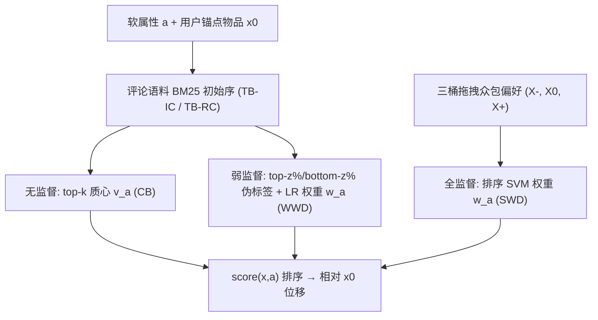

# On Interpretation and Measurement of Soft Attributes for Recommendation (推荐系统中软属性的解释与度量)

- **会议/期刊**: SIGIR 2021
- **作者与机构**: Krisztian Balog (University of Stavanger), Filip Radlinski, Alexandros Karatzoglou (Google)
- **推荐链路定位**: 重排 / 会话内批评式（critiquing）条件排序
- **研究方向**: 对话推荐与智能体仿真 / 去偏公平与可信评估
- **论文原文**: [论文原文链接](https://arxiv.org/abs/2105.09179v1)
- **开源代码**: 暂未开源（数据集公开：goo.gle/soft-attribute-data）

## TL;DR (1分钟核心速览)

会话推荐中用户常说"更暴力一点""少点说教"这类**软属性 (soft attribute)** 批评，而工业界惯用的二值 tag / 知识库属性值对既无"程度"也无"相对序"，且被词表与流行度系统性偏置。本文把软属性重定义为**相对锚点物品的个性化偏序**，用三桶拖拽众包采集去偏真值，提出加权 Gamma $G'$度量，并给出无监督（质心 CB）→ 弱监督（WWD）→ 全监督（SWD）三档打分器。在自建 SoftAttr（60 属性 / 249,863 对偏好）上，全监督$G'$ 从弱监督 0.200 提升到 0.485（+142%），而仅用 tag 的 MovieLens 集合完全无法反映该增益。

## Background & Motivation (背景与核心矛盾)

- **主流范式**: 批评式会话推荐与属性反馈长期依赖**二值 tag**（MovieLens Tag Genome、电影类型）或 keyphrase 共嵌入（把评论关键短语与用户偏好映射到同一隐空间后压制命中项）。
- **前人局限**: 其一，tag 只标记"有/无"，无法回答"这两部都被标 violent 的电影哪个**更**暴力"，对细粒度序完全失明；其二，tag 采集被众包界面与历史标签引导，存在**词汇收敛偏置与流行度偏置**——未被标注不等于不适用。
- **核心洞察**: 软属性本质是**主观且分程度**的（"惊悚"与"无聊"因人而异，甚至相反属性间的一致性也毫不相关）；且约 47% 的软属性在 Tag Genome 中根本无对应 tag。因此真值不应是"客观事实"，而应是**单个评分者相对某个锚点物品的三分类偏序**。
- **本文切入点**: 先建"可度量"的数据与指标（三桶拖拽标注 + 加权 Gamma + 主观度 agree 量化），再在此基础上升级三种打分函数。

## Method (核心方法设计)

### 1. 整体框架 (Overall Architecture)

物品先由 MovieLens-20M 评分矩阵做矩阵分解得到 $d=25$维隐向量（维度刻意压低以抑制小数据过拟合）；软属性$a$则被表示成**隐空间中的一个方向或中心点**，三种监督强度分别对应质心、逻辑回归权重与线性排序 SVM 权重；推理时对候选物品按$score(x,a)$排序，定位锚点$x_0$在序中的位置，沿所需方向移动"一点"或"很多"即可完成 "more/less$a$" 的批评响应。评分器训练数据来自两条通路：评论语料给出的 BM25 弱信号，以及众包 pairwise 偏好给出的显式监督。

### 2. 关键设计拆解 (Key Designs)

1. **三档软属性打分器（从伪相关反馈到显式偏好）**：CB 只取 TB 排序 top-$k$物品嵌入的质心$v_a[i]=\frac{1}{k}\sum_{x\in X_k} x[i]$后算余弦，**只用正例**，因此把"不适用该属性"的物品也拉高；WWD 用 TB 排序 top-$z\%$与 bottom-$z\%$作正负伪标签训练 LR：$p(y_a=1|x)=\frac{1}{1+\exp(-w_a\cdot x)}$，学到的$w_a$即"哪些嵌入维度编码了该属性"的蒸馏权重；SWD 直接把众包序转为$i\succcurlyeq j$的排序 SVM 约束$score(x_i)\ge 1+score(x_j)-\xi_p$（"显著更"用间隔 2）。直觉：**属性 = 隐空间中的一个判别方向，而非一个向量**，故对"程度"天然连续可排序。
2. **去偏三桶众包 + 加权 Gamma $G'$**：让评分者在**已看过的电影**中，把 10 张海报相对锚点拖入$X^-/X^\circ/X^+$；锚点避开两端分箱（否则大量样本落入单桶）、按"被多少人看过"加权采样，候选集按两个基线各分 5 箱分层各取 1，从而最大化可比对数量并剥离流行度与类型上下文偏置。评价用加权秩相关
$G'=\frac{(N_s-N_d)+2(N_{ss}-N_{dd})}{(N_s+N_d)+2(N_{ss}+N_{dd})}$，
其中 $N_s,N_d$只计相邻桶对（$X^-$vs$X^\circ\cup\{x\}$等），跨两端桶（$X^-$vs$X^+$）的"明显更多/更少"对以双倍权重计入$N_{ss},N_{dd}$。$G'$ 度量的是**与单一评分者主观序的一致性**，而非与"普世真值"的一致性——这正是软属性应有的评估语义。
3. **主观度量化与训练配置**：以成对判断方向一致的期望定义
$agree(a,x,x')=p^{a}_{x\prec x'}(p^{a}_{x\prec x'}+p^{a}_{x\approx x'})+p^{a}_{x\succ x'}(p^{a}_{x\succ x'}+p^{a}_{x\approx x'})+p^{a}_{x\approx x'}$，
据此把 60 个属性均分为高/中/低一致性三组。总目标即各打分器的判别/排序损失（LR 交叉熵或 SVM hinge $+\frac{1}{2}w\cdot w+C\sum_p\xi_p$，$C=1$），**无负采样、无 in-batch 技巧**；训练开销极小（线性模型 + 25 维嵌入），在线仅需一次向量内积，可即时响应多轮批评。

## Experimental Setup & Evaluation Protocol (实验设置与评估协议)

- **数据集与预处理**: 语料取 MovieLens-20M 中最热门 300 部电影，经映射挂接 Amazon 评论；两个测试集统计如下：

| 数据集 | 软属性数 | 物品/评分组数 | 偏好对 | 稀疏度/说明 |
| :--- | :---: | :---: | :---: | :---: |
| MovieLens Attribute | 82（原 100 tag，剔除命名实体等） | 238 部电影（≥50 人打标） | 每属性正例 1/5.77/28，负例 144/214.7/234 | 正例阈值为 $\alpha=0.15$ 的保守采样，仅二值 |
| Soft Attribute | 60（源自 CCPE-M 真实对话中"more/less/too"话语，173 候选中按频次采样） | 5,991 组评分 | 249,863（含 52,352 个"差不多"） | 三桶相对锚点序，含主观度标注 |

- **数据划分与防穿越 (Splitting Strategy)**: SWD 采用 **10 折按评分者 (rater) 分组交叉验证**，测试折评分者的偏好完全不参与训练，避免同一评分者风格泄漏；CB/WWD 的弱信号仅来自评论语料，与测试偏好无交集。
- **排名评测协议 (Ranking Protocol)**: 属性内 **Full-Ranking**（对全部 300 部电影打分后与真值比对各桶对），MovieLens 集合用原版 Goodman-Kruskal $G$，SoftAttr 集合用加权$G'$；报告所有属性 × 所有评分者的均值，全桶相同的极端样本剔除。单侧判断 3 桶时报告均值，未做显著性检验（样本量小）。
- **对比基线与超参设置**: 基线即本文自建的五类打分器（TB-IC / TB-RC / CB+TB-IC / CB+TB-RC / WWD+TB-IC / WWD+TB-RC / SWD），无外部 SOTA 可对标；嵌入维度 $d=25$（25–100 实验显示更高维反而过拟合），CB 取$k=5$，WWD 取$z=0.4$（$k\in[1,100]$、$z\in[0.1,0.4]$ 内稳定）。

## Key Experimental Results (实验关键数据)

### 1. 主实验对比 (Main Results)

| 方法 | 监督级别 | MovieLens $G$| SoftAttr$G'$ | 相对 TB-RC 提升 |
| :--- | :---: | :---: | :---: | :---: |
| TB-IC（物品为中心 BM25） | 无 | **0.800** | 0.110 | −19.1% |
| TB-RC（评论为中心 BM25） | 无 | 0.733 | 0.136 | — |
| CB+TB-IC（质心，仅正例） | 无 | 0.404 | 0.087 | −36.0% |
| CB+TB-RC（质心，仅正例） | 无 | 0.471 | 0.101 | −25.7% |
| WWD+TB-IC（LR 加权维度） | 弱 | 0.539 | 0.194 | +42.6% |
| WWD+TB-RC（LR 加权维度） | 弱 | 0.517 | **0.200** | +47.1% |
| SWD（排序 SVM，全监督） | 全 | — | **0.485** | **+256.6%** |

（`—` 表示该集合无对应监督信号数据；加粗为各集合内最优。）

### 2. 消融实验 (Ablation Study)

| 配置变动 | SoftAttr $G'$ | 结论 |
| :--- | :---: | :--- |
| 仅正例证据（CB，$k=5$） | 0.087 / 0.101 | 加入负例是最大单点增益 |
| 加入 bottom-$z\%$负例（WWD，$z=0.4$） | 0.194 / 0.200 | +98% vs CB |
| 加入显式 pairwise 偏好（SWD） | 0.485 | +142% vs WWD |
| 嵌入维度 $d$: 25 → 100 | 下降 | 小数据高维过拟合 |
| $k\in[1,100]$,$z\in[0.1,0.4]$ | 基本平稳 | 超参不敏感 |
| 训练评分者数 ≈20 | 接近最优 | 标注极省（图 4） |
| 换成 GBDT / 非线性打分器 | 无显著提升 | 线性已足够，瓶颈在数据 |

### 3. 关键实验发现 (Key Findings)

1. **两个测试集给出互相矛盾的模型排序**：MovieLens 上 TB-IC (0.800) 碾压 WWD (0.539)，SoftAttr 上恰好反转（0.110 vs 0.200）。这说明基于 tag 的集合只考察"有/无 tag 的二分类可分性"，**对细粒度序改进完全失明**，用它会误判研究进展。
2. **负例证据是弱监督档的关键**：CB 只用正例，在两个集合上分别只到 0.404/0.087，是所有方法中最差；引入 bottom-$z\%$ 负例后 WWD 在 SoftAttr 上翻倍至 0.200，说明"属性方向"必须由正负对比张成，而非由中心点定义。
3. **性能与属性主观度强相关（Pearson $r=0.87$,$p=4.2\times10^{-19}$）**：高一致性属性（scary 0.962、gory 0.952）易学，低一致性属性（overrated 0.766、boring 0.791）显著更难；且每人约 20 组判断即可让 SWD 接近收敛，证明**个性化**而非更多标注才是低一致性属性的出路。

## Highlights & Limitations (亮点、对比与审稿批判)

- **与代表作对比 (vs. Prior Work)**: 相比 Tag Genome 式二值标注与 keyphrase 共嵌入方案（如 [20,24,25,42] 把主观描述与偏好同空间对齐以做端到端压制），本文不做端到端训练，而是**显式输出属性方向的连续打分**并配套可复用的评测协议；相比传统 critiquing（固定 facet 的属性值对），它允许任意自然语言软属性并显式建模主观度。
- **可迁移亮点**: (1) "锚点 + 三桶拖拽"众包模板，可直接迁移到短视频/电商的"更潮一点""更划算"类批评标注；(2) 加权秩相关 $G'$ 把"差不多"当作一致性证据并给跨端桶双倍权重，是任何"相对序"任务（含 LLM 成对偏好评测）都可借用的指标。
- **审稿级局限批判**: 其一，仅电影单一域、300 部热门片，且所有打分器**均未做个性化**（作者亦承认），对"softness"高的属性天花板很低；其二，弱/全监督均依赖 BM25 初始序与线性模型，未与神经打分器或 LLM 语义表征对比，且缺少显著性检验与线上 A/B，工业落地证据不足。

## Rating (四维评分)

- **方法创新性 (Novelty)**: ⭐⭐⭐⭐ （把"软属性"从二值标签重构为相对锚点偏序并形式化主观度，问题定义价值远高于模型本身）
- **评估协议与实验扎实度 (Protocol & Experiments)**: ⭐⭐⭐⭐ （去偏众包 + 按评分者分折交叉验证 + 双集合对照揭示 tag 评测失效，设计严谨；扣分在缺乏显著性检验与外部基线）
- **写作与数学规范度 (Clarity & Rigor)**: ⭐⭐⭐⭐ （$G'$、$agree(a)$ 定义清晰、动机交代充分；不足是打分器推导极简、复杂度分析缺失）
- **工业落地与复现价值 (Industrial & Practical Value)**: ⭐⭐⭐ （数据集公开但无代码，线性打分 + 25 维嵌入延迟极低、易上线；但单域实验与无个性化限制了直接部署）

