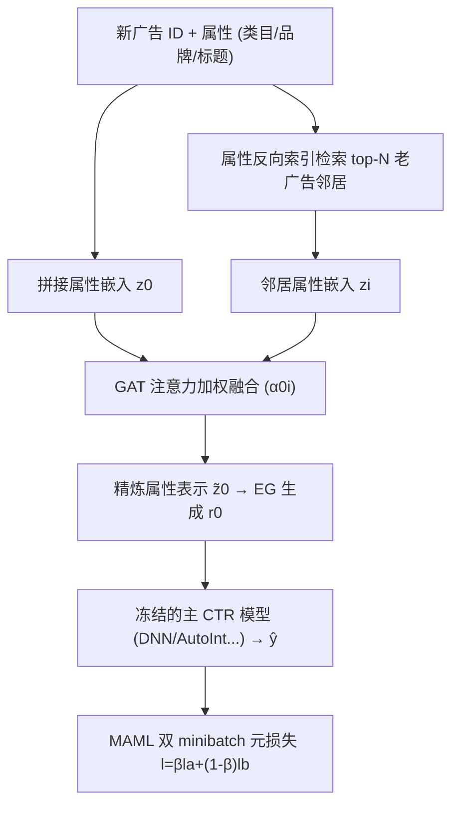
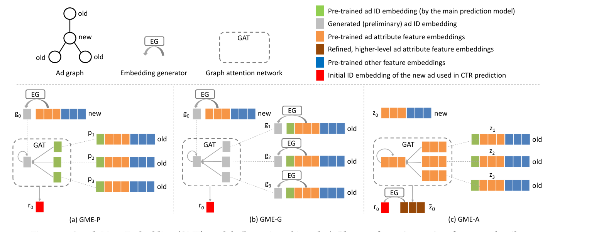
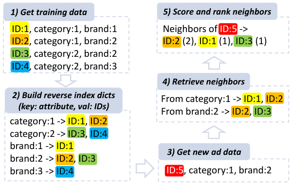

# Learning Graph Meta Embeddings for Cold-Start Ads in Click-Through Rate Prediction (面向 CTR 预估冷启动广告的图元嵌入学习)

- **会议/期刊**: SIGIR 2021 (Alibaba Group 工业实践)
- **作者与机构**: Wentao Ouyang, Xiuwu Zhang, Shukui Ren, Li Li, Kun Zhang, Jinmei Luo, Zhaojie Liu, Yanlong Du（阿里巴巴集团）
- **推荐链路定位**: 精排（CTR/CVR 预估的特征嵌入层，替换新 ID 的随机初始化）
- **研究方向**: 冷启动与长尾推荐 / CTR 预估与特征交叉、图神经网络推荐
- **论文原文**: [https://arxiv.org/abs/2105.08909v1](https://arxiv.org/abs/2105.08909v1)
- **开源代码**: [https://github.com/oywtece/gme](https://github.com/oywtece/gme)

## TL;DR (1分钟核心速览)

深度 CTR 模型强依赖广告 ID 嵌入，但新广告 ID 在训练集中从未出现，只能随机初始化，导致冷启动期预估严重失真；而已有侧信息方法（MetaEmb）只从"新广告自身属性"生成嵌入，浪费了存量老广告中的可用知识。本文提出 GME：以广告固有属性（类目/品牌/标题）建反向索引图，用 GAT 从邻居老广告自适应蒸馏信息，并以 MAML 式元学习训练嵌入生成器，让新 ID 在零样本时就有可用初始嵌入、在少量样本后能快速适应。在 ML-1M/Taobao/News Feed 三个数据集上，GME-A 在 DNN 主干上把冷启动 AUC 从 0.7107 提升到 0.7232（+1.76%），并给出 GME-P/G/G-A 三种信息蒸馏视角的完整对比。

## Background & Motivation (背景与核心矛盾)

- **主流范式**: DNN/PNN/Wide&Deep/DeepFM/AutoInt 统一遵循 Embedding + MLP 范式，广告 ID 嵌入靠海量曝光样本学出；侧信息（用户/广告属性）本已作为特征输入模型。
- **前人局限**: ① 新 ID 嵌入只能随机初始化，且属性到 ID 嵌入之间无任何约束，属性特征无法"替代"ID 语义；② MetaEmb 类方法只看新广告自身属性，完全忽略存量老广告——而这些老广告与新广告共享类目/品牌/标题，天然携带可迁移的 ID 语义。
- **核心洞察 (Key Insight)**: 广告虽无社交图，但可由**固有属性**建立天然的"共享特征图"；只要在新广告与老广告之间建图并做注意力加权蒸馏，就能把老广告已学好的 ID 语义"嫁接"给新 ID——前提是参与注意力的两侧表示**处于同一空间可比**。
- **本文切入点**: 用反向索引秒级构图 + GAT 自适应蒸馏 + 权重冻结的元学习训练生成器，把"新 ID 嵌入"从随机初始化变成"可学习的生成任务"。

## Method (核心方法设计)

### 1. 整体框架 (Overall Architecture)

先在大规模老广告上训练主 CTR 模型并**冻结**其参数 $\Theta$（含词表嵌入与 MLP 权重）；仅当遇到训练集中不存在的广告 ID 时激活 GME：查 ID 嵌入表失败 → 由该广告的属性嵌入拼接向量$\mathbf{z}_0$经嵌入生成器 (EG) 得到初步 ID 嵌入，同时用属性反向索引检索 top-$N$老广告邻居，经 GAT 加权融合得到精炼后的初始 ID 嵌入$\mathbf{r}_0$，再送入冻结的主模型做前向打分。训练阶段以"每个广告 ID 的学习"为一个元任务，用两段互斥 minibatch 的 MAML 式内外循环优化 EG+GAT 参数$\Psi=\{\mathbf{W},\mathbf{V},\mathbf{a}\}$，兼顾冷启动零样本损失与预热期少样本快速适应。

<figure class="paper-figure" markdown="span">
  <figcaption>图5：Graph Meta Embedding (GME) 模型示意图（建议彩色查看）。更多细节请参见§3.3至§3.5。</figcaption>
</figure>

### 2. 关键设计拆解 (Key Designs)

1. **属性反向索引快速构图 (Fast Graph Creation)**：若按邻接矩阵逐对算相似度需反复扫描全量老广告，不可用于线上。本文对每个属性建 `key: 属性值 → val: 广告 ID 集合` 的倒排字典（仅离线建一次），新广告按各属性检索取并集，并以"被检索到的属性个数"作为相似度打分截断 top-$N$（$N=10$）。该打分近似共享属性数，把构图复杂度从$O(|\mathcal{A}_{old}|)$ 全扫描降为按索引桶取并集，线上可直接用于实时新广告。

<figure class="paper-figure" markdown="span">
  <figcaption>图4：快速图构建示意图。</figcaption>
</figure>

2. **三种 GAT 蒸馏视角：GME-P / G / A**：核心矛盾在于"新广告侧表示"与"邻居侧表示"是否同空间可比。GME-P 直接在**预训练**邻居 ID 嵌入 $\mathbf{p}_i$上做注意力，但$\mathbf{p}_i$与属性生成的$\mathbf{g}_0$是两套随机初始化、缺乏约束的空间，注意力系数近乎无意义（实验中仅与 MetaEmb 打平）；GME-G 改为用**同一 EG** 由邻居属性生成$\mathbf{g}_i=\gamma\tanh(\mathbf{W}\mathbf{z}_i)$，保证属性相同即嵌入相同，可比性成立，但 EG 被重复调用$N$ 次会放大生成噪声；GME-A 则调换"生成/精炼"顺序，先**在属性层**做注意力聚合再生成 ID 嵌入：

$$\alpha_{0i}=\frac{\exp\!\big(\text{LeakyReLU}(\mathbf{a}^\top[\mathbf{V}\mathbf{z}_0\|\mathbf{V}\mathbf{z}_i])\big)}{\sum_{j=0}^{N}\exp\!\big(\text{LeakyReLU}(\mathbf{a}^\top[\mathbf{V}\mathbf{z}_0\|\mathbf{V}\mathbf{z}_j])\big)},\quad \tilde{\mathbf{z}}_0=\text{ELU}\Big(\sum_{i=0}^{N}\alpha_{0i}\mathbf{V}\mathbf{z}_i\Big),\quad \mathbf{r}_0=\gamma\tanh(\mathbf{W}\tilde{\mathbf{z}}_0)$$

其中 $i=0$表示新广告自身（自注意力保留自身信息），$\gamma\in(0,1]$ 约束嵌入幅值。GME-A 只调用 EG 一次，既避开不可比问题也避开重复噪声，是三者中最优设计。

3. **元学习训练目标与推理开销**：若把每个广告 ID 的学习视作任务，unique ID 数远小于样本数，普通监督训练难以快速适应。对每个训练老广告采两个互斥 minibatch $\mathcal{D}_a,\mathcal{D}_b$（各$M$条），先在$\mathcal{D}_a$上算$l_a$并对初始嵌入做一步内循环梯度更新$\mathbf{r}'_0=\mathbf{r}_0-\eta\,\partial l_a/\partial\mathbf{r}_0$，再在$\mathcal{D}_b$上算$l_b$，最终$l=\beta l_a+(1-\beta)l_b$（$\beta=0.1$）：$l_a$保证冷启动零样本即低损失，$l_b$ 保证少量样本后少数几步梯度即可拟合。推理时 GME 仅对新 ID 触发，老 ID 仍走查表，额外开销仅为一次 GAT 前向，无负采样需求。

## Experimental Setup & Evaluation Protocol (实验设置与评估协议)

- **数据集与预处理**: 三个真实数据集，标签按点击/转化构造（ML-1M 将评分 ≥4 记为 1，其余为 0）。广告 ID 样本数超过阈值（ML-1M 300 / Taobao 40 / News Feed 100）记为"老广告"，其余为"新广告"。

| 数据集 | #Fields | #老 ID | 主模型训练样本 | 冷启动训练老 ID/样本 | #新 ID | 预热样本 | 测试样本 |
| :--- | :---: | :---: | :---: | :---: | :---: | :---: | :---: |
| ML-1M | 8 | 1,058 | 765,669 | 1,058 / 42,320 | 1,127 | 67,620 | 123,787 |
| Taobao | 23 | 62,209 | 835,450 | 3,177 / 254,160 | 531,593 | 808,806 | 896,615 |
| News Feed | 30 | 5,563 | 3,088,542 | 1,761 / 352,000 | 8,379 | 603,335 | 1,346,504 |

- **数据划分与防穿越 (Splitting Strategy)**: **冷启动划分**——新广告 ID 完全不出现在主模型与 GME 的训练集中；新广告内部再切分为"预热训练（兼作验证）"与"测试"两部分，预热阶段做两轮小样本增量训练。
- **排名评测协议 (Ranking Protocol)**: 非采样排序，直接在全部新广告测试**曝光实例**上计算逐点 **AUC** 与 **LogLoss**（不做负采样、不做候选截断），AUC 反映正例排在负例之前的概率。
- **对比基线与超参设置**: 5 种主模型（DNN/PNN/Wide&Deep/DeepFM/AutoInt）× 6 种嵌入方案（RndEmb / MetaEmb / NgbEmb / GME-P / GME-G / GME-A）；嵌入维度 $d=10$，邻居数$N=10$，$\beta=0.1$，Adam 优化，每个模型跑 3 次取均值。

## Key Experimental Results (实验关键数据)

### 1. 主实验对比 (Main Results)

冷启动阶段（新广告零样本）AUC/LogLoss，主干为 DNN（↓ 为 Loss）：

| 嵌入方案 | ML-1M AUC↑ | ML-1M Loss↓ | Taobao AUC↑ | Taobao Loss↓ | News AUC↑ | News Loss↓ |
| :--- | :---: | :---: | :---: | :---: | :---: | :---: |
| RndEmb | 0.7107 | 0.6491 | 0.6289 | 0.03177 | 0.7350 | 0.03602 |
| MetaEmb (SIGIR'19) | 0.7144 | 0.6439 | 0.6291 | 0.03177 | 0.7362 | 0.03578 |
| NgbEmb (均值聚合) | 0.7131 | 0.6442 | 0.6294 | 0.03177 | 0.7356 | 0.03601 |
| GME-P | 0.7146 | 0.6437 | 0.6295 | 0.03177 | 0.7358 | 0.03602 |
| GME-G | 0.7217 | 0.6389 | 0.6323 | 0.03172 | 0.7371 | 0.03562 |
| **GME-A** | **0.7232** | **0.6368** | **0.6336** | **0.03168** | **0.7389** | **0.03553** |
| Improv. (vs RndEmb) | +1.76% | −1.89% | +0.75% | −0.28% | +0.53% | −1.36% |

主干换为 AutoInt 时趋势一致：ML-1M 上 GME-A 0.7223 vs MetaEmb 0.7167 (+0.78%)、RndEmb 0.7152 (+0.99%)；Taobao 上 GME-A 0.6411 vs GME-G 0.6402、MetaEmb 0.6336（+1.18%）；News Feed 上 GME-A 0.7432 vs MetaEmb 0.7401 (+0.42%)。**GME-A 在 5 种主模型 × 3 个数据集共 15 组中全部最优**，验证其与主模型解耦、可作为插件使用。

### 2. 消融实验 (Ablation Study)

移除 GAT（退化为邻居平均池化，主模型 DNN）的对照：

| 配置 | ML-1M AUC | Taobao AUC | News AUC | 说明 |
| :--- | :---: | :---: | :---: | :--- |
| GME-P \ GAT | 0.7131 | 0.6282 | 0.7343 | 无注意力时不如 MetaEmb |
| GME-P | 0.7146 | 0.6295 | 0.7358 | GAT 带来 +0.21% |
| GME-G \ GAT | 0.7154 | 0.6301 | 0.7355 | — |
| GME-G | 0.7217 | 0.6323 | 0.7371 | GAT 带来 +0.88% |
| GME-A \ GAT | 0.7156 | 0.6304 | 0.7358 | — |
| **GME-A** | **0.7232** | **0.6336** | **0.7389** | GAT 带来 +1.06% |

### 3. 关键实验发现 (Key Findings)

1. **注意力必须有，且必须加在"可比空间"上**：无 GAT 时 GME-A 与 GME-G 几乎重合（0.7156 vs 0.7154），说明属性层聚合本身并不优于 ID 层聚合；一旦接入 GAT，GME-A 跃升至 0.7232，把与 GME-G 的差距从 0.0002 拉大到 0.0015——增益来源是"按邻居重要性加权"而非"换聚合层级"。
2. **预训练邻居 ID 嵌入几乎不可用**：GME-P 虽引入图信息，ML-1M 上仅 0.7146，甚至低于 GME-G 的 0.7217 且与无图的 MetaEmb（0.7144）持平，直接证伪了"直接复用老 ID 嵌入"的直觉，也反向验证了 GME-G/A 共享 EG 的必要性。
3. **邻居数量存在收益饱和与噪声风险**：随 $N$增大各 GME 单调提升，但 Taobao 上$N=6\!\sim\!10$时 GME-G 已趋平；$N=2$时部分 GME 反不如 MetaEmb，说明构图检索质量（当前仅按共享属性计数打分）是下一阶段瓶颈；$\gamma$ 敏感性上 GME-A 在较宽区间稳定，GME-G/P 更依赖调参。

## Highlights & Limitations (亮点、对比与审稿批判)

- **与代表作对比 (vs. Prior Work)**: 相比 MetaEmb（仅用新广告自身属性做属性→ID 的生成），GME 首次把"存量老广告"作为第二信息源并显式建模可比性；相比 NgbEmb 式的邻居嵌入均值池化，GAT 用注意力替代等权平均（ML-1M +1.06%）；相比 MeLU 等用户侧元学习，本文把任务粒度定义在广告 ID 上，任务数远小于样本数，更适配工业 ID 词表规模。
- **可迁移亮点**: ①"反向索引桶取并集 + 共享属性计数截断"的构图方式可零成本移植到任何带层级类目/品牌体系的物品侧冷启动；②三种 GME 变体本质上给出了一个设计准则——**跨源信息融合前必须保证两侧表示同源同空间**，该准则可推广到跨域迁移与多模态对齐；③"冻结主模型 + 只训生成器"的两段式训练极大降低了线上迭代成本。
- **审稿级局限批判**: ① 增益量级偏小（News Feed 仅 +0.37% AUC），且缺少对新广告曝光量分桶的细粒度分析与线上 A/B 结果，工业价值证据偏弱；② 构图仅依赖固有属性、相似度定义为共享属性计数并以随机方式拆平票，未利用共点击/行为信号，也未对邻居做噪声过滤——$N=2$时性能回退正暴露了这一点；③ 元训练要求每个 minibatch 含正样本，正例稀疏时$l_a$方差大、需靠调大$M$与多轮重采样兜底，超参（$\beta,\gamma,N$）敏感度较高；④ 评测为逐点 AUC 而非真实排序指标（如 NDCG/GAUC），未刻画新广告在候选池中的排序收益。

## Rating (四维评分)

- **方法创新性 (Novelty)**: ⭐⭐⭐⭐ （把"属性图 + GAT + MAML"组合用于新广告 ID 嵌入生成，并通过 P/G/A 三视角系统性地回答了"什么信息可比、如何蒸馏"这一真问题，理论深度中等但设计洞察扎实）
- **评估协议与实验扎实度 (Protocol & Experiments)**: ⭐⭐⭐⭐ （3 个真实数据集 × 5 种主干 × 6 种嵌入方案覆盖充分，冷启动与两轮预热双阶段验证、GAT/$\gamma$/$N$ 消融齐全，但缺少排序指标与线上实验、未报告显著性检验）
- **写作与数学规范度 (Clarity & Rigor)**: ⭐⭐⭐⭐⭐ （公式极简且每个变体都配有"为什么这样设计/局限在哪"的分析段，符号表与构图伪代码清晰，复杂度与工程实现说明到位）
- **工业落地与复现价值 (Industrial & Practical Value)**: ⭐⭐⭐⭐ （代码已开源、仅对新 ID 触发推理开销极小、反向索引构图可直接上线，但元训练两段式流程与正例稀疏约束增加工程调参成本）

