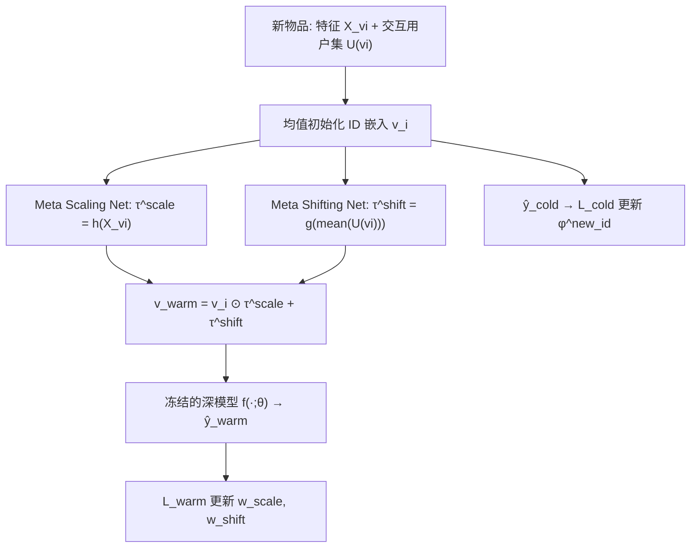
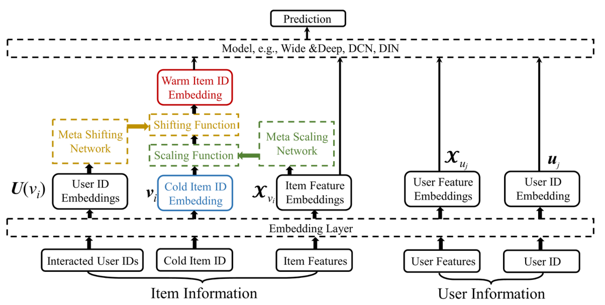

# Learning to Warm Up Cold Item Embeddings for Cold-start Recommendation with Meta Scaling and Shifting Networks (基于元缩放与平移网络的冷物品嵌入热身学习)

- **会议/期刊**: SIGIR 2021
- **作者与机构**: Yongchun Zhu, Ruobing Xie, Fuzhen Zhuang 等 (中科院计算所、腾讯微信搜索应用部、北航)
- **推荐链路定位**: 精排/召回通用模块 (点式 CTR 打分)
- **研究方向**: 冷启动与长尾推荐 / CTR 预估
- **论文原文**: [https://arxiv.org/abs/2105.04790v1](https://arxiv.org/abs/2105.04790v1)
- **开源代码**: 暂未开源

## TL;DR (1分钟核心速览)

冷物品只有少量交互，训练出的 ID 嵌入既**与深模型的特征空间存在 gap**，又**极易被错误点击噪声污染**。本文提出 MWUF：用物品特征生成逐物品的**缩放函数**把冷 ID 嵌入拉进热特征空间，用交互用户均值生成**平移函数**对噪声嵌入做稳定化去偏，并以"全旧物品模拟冷启动 + 基础模型冻结 + 双层损失解耦"训练。在 MovieLens-1M / Taobao Ad / CIKM2019 的时间戳三段热身协议下，MWUF(AFN) 在 Taobao 热身首段 AUC 相对 Wide&Deep 提升 167.5%，并可与 6 种基础模型即插即用。

## Background & Motivation (背景与核心矛盾)

- **主流范式**: 深模型 = Embedding 层（含 item ID embedding）+ 深网络；热物品 ID 嵌入训练充分，冷物品 ID 嵌入几乎随机。
- **前人局限**: MetaEmb 只学一个初始嵌入（生成器），MeLU/MAMO 只个性化深模型参数，DropoutNet 只做输入 dropout 鲁棒化——**没有方法同时处理"空间错位"与"噪声"两个矛盾**；且生成初始嵌入只是热身起点，无法在极少步内让嵌入真正适配已冻结的热模型。
- **核心洞察 (Key Insight)**: (1) 冷/热 ID 嵌入处于**不同特征子空间**，相似物品的"冷→热"映射关系应也相似，而相似性可由**物品侧特征**稳定刻画；(2) 错误点击对 item ID 参数的影响远大于其他参数，而**交互用户嵌入均值**天然抗离群点。
- **本文切入点**: 不做"参数个性化"或"初始化"，而是用一个**元网络为每个物品现场生成变换函数**，把冷嵌入 $\boldsymbol{v}_i$ 直接改写为可用的热嵌入。

## Method (核心方法设计)

### 1. 整体框架 (Overall Architecture)

两阶段解耦训练。**阶段一**：用全部数据预训练基础模型 $f(\cdot;\theta)$与嵌入层$\phi$（含物品 ID 嵌入$\boldsymbol{v}$），此后$\theta,\phi$**永久冻结**，故不对热物品产生任何扰动。**阶段二**：新建一个待学习的 ID 嵌入层$\phi^{new\_id}$，其所有物品嵌入$\hat{\boldsymbol{v}}$统一用旧物品嵌入的均值初始化，从而把所有旧物品"伪装"成冷物品来模拟冷启动；同时训练两个元网络$h(\cdot;\boldsymbol{w}_{scale})$与$g(\cdot;\boldsymbol{w}_{shift})$。每个 batch 前向两次：一次用冷嵌入$\hat{\boldsymbol{v}}_i$算$\mathcal{L}_{cold}$更新$\phi^{new\_id}$，一次用热嵌入$\boldsymbol{v}^{warm}_i$算$\mathcal{L}_{warm}$更新两个元网络。推理时冷物品直接查表得到$\boldsymbol{v}^{warm}_i$，热物品走原路径，**MWUF 对热物品零开销**。

<figure class="paper-figure" markdown="span">
  <figcaption>图1：所提出的 Meta Warm Up Framework 由 Meta Scaling Network 和 Meta Shifting Network 组成，分别生成缩放函数与平移函数。</figcaption>
</figure>

### 2. 关键设计拆解 (Key Designs)

1. **公共初始 ID 嵌入 (Common Initial Embedding)**：随机初始化既无信息又使元网络难以优化；改为取全体旧物品嵌入均值 $\bar{\boldsymbol{v}}=\frac{1}{|\mathcal{V}_{old}|}\sum_{i\in\mathcal{V}_{old}}\boldsymbol{v}_i$ 初始化每个新物品。它同时兜住"零样本冷启动阶段"，并为元网络提供可微的良好起点（消融中 MWUF(init) 已超随机初始化基线）。

2. **Meta Scaling Network（特征空间对齐，加速适配）**：冷热空间错位的根因是交互信号不足，因此改用稳定的物品特征做"条件变换"：
$$\boldsymbol{\tau}^{scale}_{v_i}=h(\mathbf{X}_{v_i};\boldsymbol{w}_{scale}),\qquad \boldsymbol{v}^{warm}_i=\boldsymbol{v}_i\odot\boldsymbol{\tau}^{scale}_{v_i}$$
本质是逐物品的 FiLM 式仿射缩放，让特征相近的物品学到相近的冷→热映射，把嵌入一步推进热特征空间；元网络仅两层 16 维隐藏，几乎不增开销。

3. **Meta Shifting Network 与总目标（噪声稳定化）**：噪声来自少量错误点击，故用交互用户嵌入的无权均值 $\mathrm{G}(\mathbf{U}(v_i))$ 作为抗噪"邻域表征"生成加性偏移：
$$\boldsymbol{\tau}^{shift}_{v_i}=g\big(\mathrm{G}(\mathbf{U}(v_i));\boldsymbol{w}_{shift}\big),\qquad \boldsymbol{v}^{warm}_i=\boldsymbol{v}_i\odot\boldsymbol{\tau}^{scale}_{v_i}+\boldsymbol{\tau}^{shift}_{v_i}$$
两项分离可解释：缩放负责**跨空间迁移**，平移负责**与邻居表征融合**。训练目标为双层最小化 $\min_{\phi^{new\_id}}\mathcal{L}_{cold}$与$\min_{\boldsymbol{w}_{scale},\boldsymbol{w}_{shift}}\mathcal{L}_{warm}$，均用 log-loss，**无负采样**（点式二分类，全量样本训练）；两网络共享结构但参数独立，故框架 model-agnostic。在线仅需对冷物品调用两次小 MLP，热物品不感知。

## Experimental Setup & Evaluation Protocol (实验设置与评估协议)

- **数据集与预处理**:

| 数据集 | #Users | #Items | #Interactions | 说明 |
| :--- | :---: | :---: | :---: | :--- |
| MovieLens-1M | 6,040 | 3,706 | 1.0M | 评分 ≥4→1，否则 0；物品特征=标题/年份/类型 |
| Taobao Display Ad | 1.14M | 广告 | 26M (8 天) | 广告=物品；用户 9 个类别属性 |
| CIKM2019 EComm | — | — | — | 电商行为 (pv/buy/cart/fav) → 是否购买二分类 |

- **数据划分与防穿越**: 按**时间戳**切分：交互数 > $N$为旧物品（$N$=200/2000/350），$3K<$交互数$\le N$为新物品（$K$=20/500/50）；每个新物品按时间排序，前$3K$ 切成 warm-a/-b/-c 三段，其后为测试集，新/旧比≈8:2（模拟长尾分布）。
- **排名评测协议**: 点式 **AUC**（非 Full-Ranking 检索指标），同时报告相对提升 $\text{RelaImpr}=\big(\frac{AUC_{m}-0.5}{AUC_{base}-0.5}-1\big)\times100\%$；十次运行取均值，配对 t-test 检验（$p\le0.05$）。
- **对比基线与超参设置**: 三组基线——CF (FM, Wide&Deep, PNN, DCN, AFN)、冷启动 (DropoutNet, MeLU, MetaEmb)、序列 (GRU4Rec, DIN)；嵌入维度 $d=16$，基础 MLP 三层 64 维，元网络两层 16 维，Adam，lr=1e-3，batch=256，每步仅训 1 epoch 以严格模拟"少步适配"。

## Key Experimental Results (实验关键数据)

### 1. 主实验对比 (Main Results)

| Method | ML-1M cold | ML-1M warm-c | Taobao cold | Taobao warm-c | CIKM cold | CIKM warm-c |
| :--- | :---: | :---: | :---: | :---: | :---: | :---: |
| FM | .5250 | .5525 | .5020 | .5126 | .5386 | .5598 |
| Wide & Deep | .5968 | .6523 | .5233 | .5634 | .6479 | .7010 |
| PNN | .5920 | .6493 | .5156 | .5515 | .6512 | .7022 |
| DCN | .6027 | .6612 | .5206 | .5574 | .6596 | .7008 |
| AFN | .5862 | .7029 | .5241 | .5810 | .6693 | .7363 |
| DropoutNet | .6432 | .6628 | .5214 | .5655 | .6555 | .6980 |
| MeLU | .6434 | .6760 | .5226 | .5360 | .6595 | .7032 |
| MetaEmb | .6369 | .6983 | .5250 | .5633 | .6642 | .7095 |
| DIN | .6077 | .6895 | .5197 | .5580 | .6428 | .7545 |
| MWUF(Wide&Deep) | .6339 | .7273 | .5255 | .5919 | .6637 | .7236 |
| **MWUF(AFN)** | **.6370** | **.7447**\* | **.5302** | **.5965**\* | **.6741** | **.7556**\* |

（\* 表示相对最优基线统计显著；MWUF(Wide&Deep) 在 Taobao warm-a 相对 Wide&Deep 的 RelaImpr 达 **120.2%**，MWUF(AFN) 达 **167.5%**。）

### 2. 消融实验 (Ablation Study)

在 CIKM2019 + Wide & Deep 上逐项拆解（图 3，趋势）：

| 变体 | 组成 | 相对趋势 (cold → warm-c) |
| :--- | :--- | :--- |
| Wide & Deep | 随机初始化 | 最低基线 |
| MWUF(init) | 仅均值初始化 | 明显高于基线 |
| MWUF(shift) | init + 平移网络 | 高于 init |
| MWUF(scale) | init + 缩放网络 | **高于 shift** |
| MWUF | init + 缩放 + 平移 | **最优且各段稳定** |

### 3. 关键实验发现 (Key Findings)

1. **"缩放"比"平移"更关键**：消融中 MWUF(scale) 全面优于 MWUF(shift)，说明把冷嵌入**变换进热特征空间**（空间对齐）带来的收益大于单纯**叠加邻居表征**（信息融合）；这也解释了为何 MWUF 搭在特征交叉能力更强的 AFN 上（Taobao warm-a 0.5872）比搭在 Wide&Deep 上（0.5718）高出约 1.5 个绝对 AUC 点。
2. **MWUF 的增益集中在热身期而非零样本期**：MovieLens cold 段 MWUF(Wide&Deep)=.6339 仍低于 MeLU(.6434)/DropoutNet(.6432)/MetaEmb(.6369)，因为零交互时平移网络无 $\mathbf{U}(v_i)$ 可用、只能靠均值初始化；一旦有少量样本，RelaImpr 迅速爬升至 59.0%→60.3%（warm-a/-b）。
3. **增益随数据增多而衰减**：MWUF(Wide&Deep) 在 ML 上 RelaImpr 从 38.3%(cold) 升至 60.3%(warm-b) 后回落至 49.2%(warm-c)；因冷热嵌入 gap 本身随交互增加而缩小，说明该框架的核心价值是"**加速收敛**"而非"抬升上限"。

## Highlights & Limitations (亮点、对比与审稿批判)

- **与代表作对比**: vs. **MetaEmb**（只学一个初始嵌入，把"热身"当"初始化"）本文直接改写嵌入向量本身、且用用户均值去噪；vs. **MeLU/MeLU 系**（个性化深模型参数，在广告场景失效，Taobao warm-b 仅 .5256）本文冻结基础模型、只动 ID 嵌入，模型无关且不影响热物品；vs. **DropoutNet**（输入 dropout 鲁棒化，Taobao 几乎不涨）本文用"显式去噪 + 显式空间迁移"两条独立通路。
- **可迁移亮点**: (1) "**旧数据伪装冷启动 + 基础模型冻结 + 双损失解耦**"的训练范式可直接复用到任何需要在线快速适配新 ID 的场景（新用户、新广告主、新 Query）；(2) 用侧信息生成 FiLM 式 scale/shift 作为**免梯度几步的嵌入校准器**，可插入双塔召回的 item 塔末端。
- **审稿级局限批判**: (1) **评估口径偏窄**：仅点式 AUC，未做 Full-Ranking/NDCG，也未控制曝光偏差与位置偏差，结论在检索排序任务上未必成立；(2) **零样本段无实质突破**：cold 段仍依赖均值初始化，且论文显式声明"主要关注 warm-up"，对 |U(v)|=0 的平移网络缺失问题未给出方案；(3) **超参敏感**：物品冷/热划分阈值 $N$与段长$K$均为人工设定（200/2000/350 与 20/500/50），增益对$K$ 的稳定性未做敏感性分析。

## Rating (四维评分)

- **方法创新性 (Novelty)**: ⭐⭐⭐⭐ （把 FiLM 式条件缩放/平移引入冷 ID 嵌入热身，两通路分别对应"空间对齐"与"噪声稳定化"，机制清晰且有特征相似性直觉支撑）
- **评估协议与实验扎实度 (Protocol & Experiments)**: ⭐⭐⭐⭐ （三数据集 + 时间戳三段热身 + 十次运行均值 + t 检验 + 六基础模型泛化，但仅 AUC 点式指标、缺全库排序与冷启动零样本对照）
- **写作与数学规范度 (Clarity & Rigor)**: ⭐⭐⭐⭐ （公式极简、两阶段训练与算法伪码交代清楚，双层优化动机解释到位；但缺复杂度与收敛性分析）
- **工业落地与复现价值 (Industrial & Practical Value)**: ⭐⭐⭐⭐ （模型无关、热物品零开销、两小 MLP 易上线，腾讯微信搜索场景验证；可惜未开源，复现依赖冷/热划分细节）

