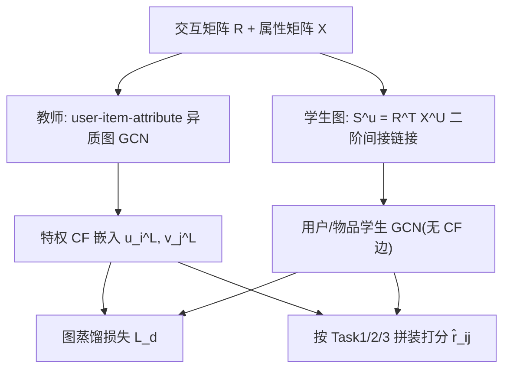

# Privileged Graph Distillation for Cold Start Recommendation (面向冷启动推荐的特权图蒸馏)

- **会议/期刊**: SIGIR 2021
- **作者与机构**: Shuai Wang, Kun Zhang, Le Wu, Haiping Ma, Richang Hong, Meng Wang（合肥工业大学大数据知识工程重点实验室、安徽大学）
- **推荐链路定位**: 召回 / 排序（Top-K 打分）
- **研究方向**: 冷启动与长尾推荐 / 图神经网络与知识图谱推荐
- **论文原文**: [https://arxiv.org/abs/2105.14975v1](https://arxiv.org/abs/2105.14975v1)
- **开源代码**: 暂未开源

## TL;DR (1分钟核心速览)

冷启动用户/物品缺少交互边，而训练期的 CF 链接本质上是"只在离线可见的特权信息"。本文提出 PGD：把用户/物品属性提升为图中节点，构建含 CF 边与属性边的异质图教师模型做高阶传播；再以二阶共现代替直接交互边，构造仅含"物品–用户属性"间接链接的学生图，用逐实体嵌入对齐 + 预测矩阵对齐的图蒸馏把特权 CF 知识注入属性侧。在 Yelp/XING/Amazon 三个数据集、三类冷启动任务上采用全负样本全库排序评测，HR/NDCG 平均分别领先最强基线 2.0%/11.7%/6.0%（Yelp 三任务）、27.8%/7.3%/16.1%（XING）。

## Background & Motivation (背景与核心矛盾)

- **主流范式**: 冷启动补救分三派——CF+社交/属性相似度、content-based 映射函数（CDL、DeepMusic）、hybrid 融合（DropoutNet 随机丢 CF 信号、Heater 训练时预训练 CF 表征作约束、PinSage 归纳式 GCN）。
- **前人局限**: ①基于通用变换函数把属性映射到 CF 空间，忽略了每个用户/物品各自的 CF–属性关联异质性；②图方法依赖 user-item 边，测试期新节点无边即失效，归纳式方法仍无法处理"新用户+新物品"同时出现。
- **核心洞察 (Key Insight)**: CF 链接在训练期可获得、测试期不可获得，天然符合"特权信息 (privileged information)"定义；而属性与交互共同构成异质图，属性节点本身也能传播高阶协同信号。
- **本文切入点**: 用"教师带全部 CF 边、学生只带属性间接边"的蒸馏框架，把 CF 空间的知识压缩进纯属性图，从而在推理时零交互也能打分。

## Method (核心方法设计)

### 1. 整体框架 (Overall Architecture)

模型由三部分组成：教师模型在 user-item-attribute 异质图上做 GCN 传播，输出 warm 用户/物品嵌入；用户学生模型以"物品–用户属性"二部图建模新用户（物品嵌入取自教师初始化，属性嵌入高斯初始化）；物品学生模型对称地以"用户–物品属性"图建模新物品。训练时教师用 BPR 优化，学生用嵌入级 + 预测级的图蒸馏损失对齐教师输出；推理时按任务类型拼装：Task1 用「学生用户属性嵌入 × 教师物品嵌入」，Task2 反之，Task3 两侧均用学生属性嵌入，实现单一模型覆盖三种冷启动场景。

### 2. 关键设计拆解 (Key Designs)

1. **属性即节点的异质图教师传播**：痛点是把属性仅当特征拼接，无法建模"多个用户共享同一属性"的高阶同质关系。本文将属性作为独立节点，邻接矩阵为 $\mathbf{A}=\begin{bmatrix}\mathbf{A}_R & \mathbf{X}\\ \mathbf{X}^{\top} & \mathbf{0}\end{bmatrix}$，四类节点统一按$\begin{bmatrix}\mathbf{U}^{t+1}\\\mathbf{V}^{t+1}\\\mathbf{Y}^{t+1}\end{bmatrix}=\left(\mathbf{I}+\mathbf{D}^{-1}\mathbf{A}\right)\begin{bmatrix}\mathbf{U}^{t}\\\mathbf{V}^{t}\\\mathbf{Y}^{t}\end{bmatrix}$ 传播。直觉：属性节点成为"共享枢纽"，使稀疏实体通过属性邻居获得额外一跳信息，缓解长尾。

2. **二阶共现的学生图构造**：学生模型没有 user-item 边，作者用 $\mathbf{A}_R\mathbf{X}=\begin{bmatrix}\mathbf{0} & \mathbf{S}^{v}\\ \mathbf{S}^{u} & \mathbf{0}\end{bmatrix}$生成"物品–用户属性"链接，$s_{jk}\ge 1$表示点击过物品$j$的用户中拥有属性$k$的计数，权重即共现频次。传播算子退化为$\mathbf{e}_k^{t+1}=\mathbf{e}_k^{t}+\sum_{j\in\mathcal{A}^{S_u}_{k+N}}\mathbf{v}_j^{t}/|\mathcal{A}^{S_u}_{k+N}|$。这样"哪类用户喜欢该物品"的协同结构被编码为属性侧稠密连接，使测试期零交互的新用户仍可聚合出嵌入。

3. **训练目标、负采样与推理开销**：教师用 BPR：$\mathcal{L}_r=\sum_{u}\sum_{(i,j)\in B_u}-\ln\sigma(\hat{r}_{ui}-\hat{r}_{uj})+\gamma\|\boldsymbol{\theta}\|^2$；蒸馏损失$\mathcal{L}_d=\lambda\|\mathbf{u}_i^{L}-\mathbf{u}_i^{U}\|^2+\mu\|\mathbf{v}_j^{L}-\mathbf{v}_j^{I}\|^2+\eta\|\mathbf{U}\mathbf{V}^{\top}-\mathbf{U}^{U}(\mathbf{V}^{I})^{\top}\|^2$，总损失$\mathcal{L}=\mathcal{L}_r+\mathcal{L}_d$。训练每正样本随机采 1 个负样本；推理只需学生图（无 CF 边）与教师共享的自由嵌入，无需重跑教师图，在线开销为一次 2~3 层稀疏邻域聚合。

## Experimental Setup & Evaluation Protocol (实验设置与评估协议)

- **数据集与预处理**: 三个公开数据集按原始隐式反馈使用，连续属性离散化，用户/物品属性做 one-hot。

| 数据集 | #Old Users | #Old Items | #Train Inter. | 密度 | 用户/物品属性数 |
| :--- | :---: | :---: | :---: | :---: | :---: |
| Yelp | 29,777 | 27,737 | 159,857 | 0.019% | 80 / 183 |
| XING | 20,640 | 17,793 | 133,139 | 0.036% | 108 / 81 |
| Amazon-Video Games | 29,129 | 22,547 | 172,089 | 0.026% | — / 76 |

- **数据划分与防穿越 (Splitting Strategy)**: 采用**人工冷启动划分**——从测试集随机抽取 30% 用户，剥离其全部交互作为新用户测试集（Task1）；对物品施加同样操作得到新物品测试集（Task2）；两者交集的交互构成双冷启动测试集（Task3）。训练/验证集只保留剩余 old users 与 old items 的交互，测试期新实体在训练图中完全不可见，无穿越。Amazon 无 Task1/Task3（缺用户属性）。
- **排名评测协议 (Ranking Protocol)**: **Full-Ranking（全库排序，全部未交互样本作候选）**，作者明确指出采样排序会带来不公平；指标为 HR@{10,20,50} 与 NDCG@{10,20,50}。
- **对比基线与超参设置**: 基线含 KNN、LinMap（线性映射）、xDeepFM（高阶特征交叉）、CDL（内容深度模型）、DropoutNet（混合丢 CF）、Heater（随机丢 CF 的混合 SOTA）、PinSage（归纳式 GCN）、PFD（特权特征蒸馏），另设去除蒸馏的 Student 变体。嵌入维度 $d=64$，batch 2048，Adam，lr=1e-3，GCN 层数$L\in\{1,2,3,4\}$；蒸馏权重按任务调优（Yelp:$\lambda=100,\mu=1,\eta=0.01$；XING:$\lambda=1,\mu=100,\eta=0.001$）。

## Key Experimental Results (实验关键数据)

### 1. 主实验对比 (Main Results)

| 模型 | Yelp T1 HR@20 | Yelp T2 HR@20 | Yelp T3 HR@20 | XING T1 HR@20 | XING T2 HR@20 | XING T3 HR@20 | Amazon T2 HR@20 |
| :--- | :---: | :---: | :---: | :---: | :---: | :---: | :---: |
| KNN | 0.03104 | 0.02775 | — | 0.00595 | 0.00225 | — | 0.00190 |
| LinMap | 0.03220 | 0.03436 | 0.02480 | 0.01483 | 0.00369 | 0.00334 | 0.02491 |
| xDeepFM | 0.03234 | 0.03491 | 0.02438 | 0.01530 | 0.00389 | 0.00524 | 0.02498 |
| CDL | 0.03257 | 0.03410 | 0.02001 | 0.01469 | 0.00321 | 0.00458 | 0.02775 |
| DropoutNet | 0.03278 | 0.02821 | 0.02141 | 0.01278 | 0.00378 | 0.00390 | 0.01612 |
| Heater | 0.03365 | 0.04179 | 0.02440 | 0.01524 | 0.00363 | 0.00479 | 0.02659 |
| PinSage | 0.03302 | 0.03704 | 0.02110 | 0.01119 | 0.00369 | 0.00232 | 0.02491 |
| PFD | 0.03318 | 0.04008 | 0.02427 | 0.01552 | 0.00388 | 0.00525 | 0.02745 |
| Student (w/o 蒸馏) | 0.03133 | 0.03984 | 0.02540 | 0.01725 | 0.00373 | 0.00404 | 0.02328 |
| **PGD** | **0.03404** | **0.04712** | **0.02589** | **0.02204** | **0.00422** | **0.00673** | **0.02953** |
| Improv.% (vs 最强基线) | +1.16% | +12.75% | +1.93% | +42.0% | +8.5% | +28.2% | +6.4% |

NDCG@20 趋势一致：Yelp T2 上 PGD 0.02306 对比 Heater 0.02059（+12.0%），XING T1 上 0.00916 对比 PFD 0.00707（+29.5%）。

### 2. 消融实验 (Ablation Study)

| 变体 / 超参 | Yelp T1 HR@20 | Yelp T2 HR@20 | Yelp T3 HR@20 | XING T1 HR@20 | Amazon T2 HR@20 |
| :--- | :---: | :---: | :---: | :---: | :---: |
| w/o 蒸馏（仅 Student） | 0.03133 | 0.03984 | 0.02540 | 0.01725 | 0.02328 |
| w/o 用户嵌入约束 ($\lambda\to0$) | 0.03365 | 0.04606 | 0.02577 | 0.02107 | — |
| w/o 物品嵌入约束 ($\mu\to0$) | 0.03404 | 0.04541 | 0.02580 | 0.02190 | 0.02812 |
| w/o 预测约束 ($\eta\to0$) | 0.03398 | 0.04602 | 0.02533 | 0.02165 | 0.02910 |
| $L=1$/$L=2$/$L=4$ | 0.03365 / **0.03404** / 0.03225 | 0.04541 / 0.04606 / 0.04693 | 0.02467 / **0.02589** / 0.02533 | 0.02071 / 0.02107 / 0.02176 | 0.02946 / **0.02953** / 0.02707 |
| 多层蒸馏替代输出蒸馏 | 0.03415 | 0.04627 | 0.02638 | — | 0.02812 |

### 3. 关键实验发现 (Key Findings)

1. **蒸馏是主要增益来源**：Yelp Task1 上 Student 仅 0.03133，低于 PinSage/PFD，加上图蒸馏后升至 0.03404（+8.6%）；XING Task1 上 Student→PGD 从 0.01725 涨到 0.02204（+27.8%），说明属性图本身可用，但必须靠特权 CF 对齐才能逼近教师空间。
2. **增益强弱由属性信息量决定**：物品属性 183 维的 Yelp Task2/Task3 提升 12.75%/1.93%，而 Yelp Task1（用户属性仅 80 维）仅 +1.16%；对称地 XING 任务 1 提升 42% 而 Task2 仅 8.5%，印证"哪一侧属性稀疏，哪一侧冷启增益就受限"。
3. **层数与蒸馏粒度均存在甜点**：$L$从 1 增至 2/3 提升（XING T1: 0.02071→0.02204），$L=4$ 因过平滑回落（Yelp T1: 0.03404→0.03225）；逐层多层蒸馏反而在多数任务上不如输出层蒸馏（Yelp T1 NDCG@20: 0.02152 vs 0.02323），因学生实体嵌入是属性节点融合结果，与教师中间层非一一对应。

## Highlights & Limitations (亮点、对比与审稿批判)

- **与代表作对比 (vs. Prior Work)**: 相较 Heater 只在训练时把 CF 表征当作正则约束、推理随机择一使用，PGD 把 CF 知识显式蒸馏进属性图分支，推理路径确定；相较 PinSage 依赖测试期仍存在的图结构做归纳，PGD 的学生图由属性二阶共现静态预构建，可完全脱离交互边；相较 PFD 蒸馏特权特征，PGD 蒸馏的是图传播后的高阶协同嵌入与预测矩阵。
- **可迁移亮点**: ①"用 $R^{\top}X$把高阶共现转成属性–实体边"可在任意无交互冷启动场景低成本复用；②预测矩阵级蒸馏$\|\mathbf{U}\mathbf{V}^{\top}-\mathbf{U}^{U}(\mathbf{V}^{I})^{\top}\|^2$ 可迁移到其他蒸馏式召回。
- **审稿级局限批判**: ①学生图是二阶共现稠密图，$R^{\top}X$ 随实体与属性规模增长易膨胀，论文未报告构图与推理的显存/时延开销；②冷启动测试集靠随机抽取 30% 用户人为剥离，与线上真实的新用户到达分布（往往偏向特定渠道/时段）存在偏差，且属性在训练期已完整可见，未考虑属性缺失或属性漂移场景。

## Rating (四维评分)

- **方法创新性 (Novelty)**: ⭐⭐⭐⭐ （把"训练期有边、测试期无边"统一建模为特权信息蒸馏，并用二阶共现代替直接边，思路干净且优雅）
- **评估协议与实验扎实度 (Protocol & Experiments)**: ⭐⭐⭐⭐ （三类冷启动子任务 + 全负样本全库排序 + 8 个基线 + 层数/权重/蒸馏粒度多组消融，但缺显著性检验与在线验证）
- **写作与数学规范度 (Clarity & Rigor)**: ⭐⭐⭐⭐ （教师/学生图与传播公式矩阵化表达清晰，三个任务的推理拼装公式逐一给出；部分矩阵符号与实体嵌入命名略有混用）
- **工业落地与复现价值 (Industrial & Practical Value)**: ⭐⭐⭐⭐ （学生图离线可预构建、推理不依赖教师，易于上线；但二阶稠密图与蒸馏权重逐任务调参增加工程成本，且官方未开源）

