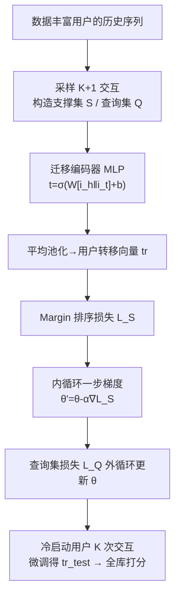
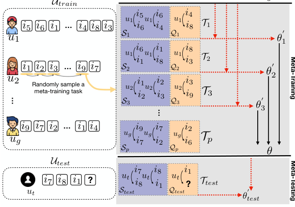
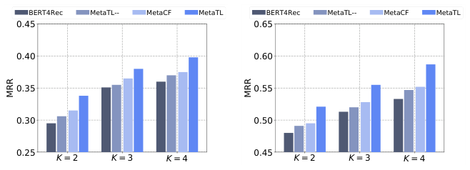

# Sequential Recommendation for Cold-start Users with Meta Transitional Learning (面向冷启动用户的元转移学习序列推荐)

- **会议/期刊**: SIGIR 2021 (Short Paper)
- **作者与机构**: Jianling Wang, James Caverlee (Texas A&M University)；Kaize Ding (Arizona State University)
- **推荐链路定位**: 召回 (Next-Item 序列召回)
- **研究方向**: 冷启动与长尾推荐 / 序列与会话推荐
- **论文原文**: [https://arxiv.org/abs/2107.06427v1](https://arxiv.org/abs/2107.06427v1)
- **开源代码**: 暂未开源

## TL;DR (1分钟核心速览)

针对"新用户仅有 2~4 次点击、序列推荐器彻底失灵"的痛点，本文把冷启动序列推荐重构为**少样本学习**问题：用翻译式（Translation-based）编码器把相邻物品对压成"用户转移向量"，再以 MAML 双层优化学习一个能"一步梯度适配"的初始化参数。在 Electronics/Movie/Book 三个数据集上采用**时间戳冷启动划分**与 `1 正 + 100 随机负` 采样排序，$K=3$ 时 Book 上 Hit@1 相对 MetaCF 提升 5.5%、相对 BERT4Rec 提升约 11.7%，MRR 全面最优。

## Background & Motivation (背景与核心矛盾)

- **主流范式**: 序列推荐以 GRU4Rec / TCN / SASRec / BERT4Rec 为代表，靠 RNN、CNN、Self-Attention 在长行为序列上做表征学习；冷启动侧则以 MeLU、MetaCF 为代表，用 MAML 学用户级快速适配参数。
- **前人局限 (矛盾一)**: 序列模型（尤其 Transformer）依赖足够长的上下文才能估出注意力权重，序列长度降到 $K\!\le\!4$ 时表征退化为噪声，BERT4Rec 反而不如简单翻译模型 TransRec。
- **前人局限 (矛盾二)**: 既有冷启动方法几乎都依赖**辅助信息或跨域知识**（MeLU 需 user/item 属性），且把交互视为**静态**集合，完全忽略"用户偏好随时间在物品间迁移"的序列依赖性；隐私受限场景下这条路走不通。
- **核心洞察 (Key Insight)**: 冷启动用户缺的是"个体序列"，但**转移模式本身是跨用户共享的**——从数据丰富用户中采样大量"$K$步→第$K+1$ 步"的短任务，学到的不是一个用户的偏好，而是"如何从少量转移对中快速读出偏好"的元能力。
- **本文切入点**: 少样本任务构造 + 翻译式转移编码 + MAML，三者拼成一个"可在测试期用几步交互微调"的序列推荐器。

## Method (核心方法设计)

### 1. 整体框架 (Overall Architecture)

MetaTL 分两阶段。**元训练**：从 $U_{train}$中随机抽用户、随机截取$K+1$个按时间排序的交互，前$K-1$个相邻对组成支撑集$\mathcal{S}_n$，第$K$对作为查询集$\mathcal{Q}_n$，即一个"模拟冷启动"的任务$\mathcal{T}_n$；在$\mathcal{S}_n$上算 margin 排序损失并做**一步梯度下降**得到任务专属参数$\boldsymbol{\theta}'_n$，再用$\boldsymbol{\theta}'_n$在$\mathcal{Q}_n$上的损失回传更新全局初始化$\boldsymbol{\theta}$。**元测试**：对新用户仅有的$K$次交互构造$\mathcal{S}_{test}$，一步梯度微调得到$\mathrm{tr}_{test}$，用$-\|\mathbf{i}_o+\mathrm{tr}_{test}-\mathbf{i}_p\|_2$ 对候选物品打分排序。

<figure class="paper-figure" markdown="span">
  <figcaption>图1：所提出的 MetaTL 概览。</figcaption>
</figure>

### 2. 关键设计拆解 (Key Designs)

1. **少样本任务池构造（解决 RQ1：知识如何从富用户迁移）**：直接把"为冷启动用户训练"变成"为大量模拟冷启动任务训练"。给定用户 $u_j$与目标$K$，随机取$K+1$个交互$i_1\!\to\!\cdots\!\to\!i_{K+1}$，$\mathcal{S}=\{i_1\!\to\!i_2,\dots,i_{K-1}\!\to\!i_K\}$，$\mathcal{Q}=\{i_K\!\to\!i_{K+1}\}$。这样每个任务只有 1~3 个样本，与真实冷启动的监督量级严格同分布，避免了"在长序列上训练、在短序列上测试"的分布错配。

2. **翻译式转移编码器（解决 RQ2：如何刻画短程转移动态）**：痛点在于短序列无法训练 RNN/Attention 的序列编码器，而 TransRec 的**每用户一个转移向量**在冷启动下无从更新。本文改为用 MLP 从相邻对**现算**一个任务级（而非用户级）转移向量：$\mathbf{t}_{h,t}=\sigma(\mathbf{W}[\mathbf{i}_h\|\mathbf{i}_t]+\mathbf{b})$，$\mathrm{tr}_n=\frac{1}{|\mathcal{S}_n|}\sum_{(i_h\to i_t)\in\mathcal{S}_n}\mathbf{t}_{h,t}$。打分沿用平移几何$s(i_h\!\to\!i_t)=\|\mathbf{i}_h+\mathrm{tr}_n-\mathbf{i}_t\|_2^2$，支撑集损失为
$$\mathcal{L}_{\mathcal{S}_n}=\sum_{(i_h\to i_t)\in\mathcal{S}_n}\big[\gamma+s(i_h\!\to\!i_t)-s(i_h\!\to\!i'_t)\big]_+$$
其中 $i'_t$为未交互负样本。物理直觉：$\mathrm{tr}_n$ 是"该用户此刻的偏好位移向量"，只要少数几对相邻物品就能被估出来，天然适配极短序列。

3. **元优化与推理开销（解决 RQ3）**：内循环 $\boldsymbol{\theta}'_n=\boldsymbol{\theta}-\alpha\nabla_{\boldsymbol{\theta}}\mathcal{L}_{\mathcal{S}_n}$，外循环$\boldsymbol{\theta}\leftarrow\boldsymbol{\theta}-\beta\nabla_{\boldsymbol{\theta}}\sum_{\mathcal{T}_n\sim p(\mathcal{T})}\mathcal{L}_{\mathcal{Q}_n}(f_{\boldsymbol{\theta}'_n})$。负采样为**任务内随机均匀负样本**（非全库、非 in-batch hard negative）。在线推理只需对测试用户的$K$ 个交互做**一次**支撑集梯度步 + 一次前向，开销近似常数，与 SASRec/BERT4Rec 的全库内积排序同阶。

## Experimental Setup & Evaluation Protocol (实验设置与评估协议)

- **数据集与预处理**: 三个数据集均过滤交互数 $<10$ 的物品；无任何用户/物品辅助信息。

| 数据集 | #Users | #Items | 平均序列长度 | 特征/场景说明 |
| :--- | :---: | :---: | :---: | :--- |
| Electronics | 22,685 | 20,712 | 15.26 | Amazon review 电子产品类，一条评论=一次交互 |
| Movie | 26,933 | 18,855 | 28.97 | Amazon review 电影类 |
| Book | 90,892 | 58,250 | 27.81 | Goodreads 书籍评分/标签/评论 |

- **数据划分与防穿越 (Splitting Strategy)**: **时间戳冷启动划分**——设切分时间点 $T$（Electronics/Movie 为 2014-01-01，Book 为 2017-01-01），$T$之前有交互的用户全部进$U_{train}$，$T$之后才产生首次交互的用户进$U_{test}$，且$U_{train}\cap U_{test}=\varnothing$，是严格意义上的用户级 strict cold-start，而非随机留一。
- **排名评测协议 (Ranking Protocol)**: `Sampled Ranking`——每位测试用户保留 $K$ 次交互作为初始化，仅 1 个 ground-truth 下一物品，与 **100 个随机负样本**共同排序；指标为 Hit@1 与 MRR（文中指出 Hit@1 在该设定下等价于 top-1 recall / NDCG）。
- **对比基线与超参设置**: (i) 传统/序列：BPR-MF、TransRec、GRU4Rec、TCN、SASRec、BERT4Rec（当时序列 SOTA）；(ii) 冷启动：MeLU（去掉辅助信息的改造版）、MetaCF（NGCF 版）。主实验固定 $K=3$，消融扫描$K\in\{2,3,4\}$；显著性检验$p<0.05$（相对次优模型）。论文正文未披露 embedding 维度$d$、margin$\gamma$与学习率$\alpha,\beta$ 的具体取值。

## Key Experimental Results (实验关键数据)

### 1. 主实验对比 (Main Results)

$K=3$ 下（† 为次优）：

| Model | Electronics Hit@1 | Electronics MRR | Movie Hit@1 | Movie MRR | Book Hit@1 | Book MRR |
| :--- | :---: | :---: | :---: | :---: | :---: | :---: |
| BPR-MF | 0.066 | 0.123 | 0.025 | 0.083 | 0.043 | 0.098 |
| TransRec | 0.183 | 0.296 | 0.208 | 0.321 | 0.335 | 0.454 |
| GRU4Rec | 0.185 | 0.301 | 0.189 | 0.309 | 0.330 | 0.466 |
| TCN | 0.182 | 0.303 | 0.186 | 0.314 | 0.349 | 0.489 |
| SASRec | 0.193 | 0.318 | 0.211 | 0.345 | 0.347 | 0.488 |
| BERT4Rec | 0.200 | 0.323 | 0.220 | 0.351 | 0.369 | 0.513 |
| MeLU | 0.172 | 0.265 | 0.168 | 0.289 | 0.318 | 0.423 |
| MetaCF | 0.210† | 0.330† | 0.234† | 0.365† | 0.398† | 0.528† |
| **MetaTL** | **0.224** | **0.352** | **0.258** | **0.380** | **0.420** | **0.555** |
| Improv. vs 次优 | +6.7% | +6.7% | +10.3% | +4.1% | +5.5% | +5.1% |

### 2. 消融实验 (Ablation Study)

原文以 Figure 2 曲线形式给出 $K=2/3/4$ 的对比，**未列表数值**；下表按原文描述给出可确证结论（K=3 列取自 Table 2）：

| 变体 / 基线 | 元学习内循环 | K=2~4 表现 | 结论 |
| :--- | :---: | :--- | :--- |
| BERT4Rec | ✗ | 三档 $K$ 全部垫底 | 极短序列上注意力无法估权 |
| MetaTL–（去 MAML） | ✗ | 全部优于 BERT4Rec，但**低于 MetaCF** | 转移编码器有效，但缺少快速适配 |
| MetaCF | ✓（CF 侧） | 次优 | 证明"快速适配"本身即强增益 |
| **MetaTL** | ✓ | 三档 $K$ **全部最优** | 转移建模 + 元优化叠加生效 |

<figure class="paper-figure" markdown="span">
  <figcaption>图2：不同模型变体在 K 上的比较。</figcaption>
</figure>

### 3. 关键实验发现 (Key Findings)

1. **模型能力与 $K$的单调性被打破**：Transformer 系（SASRec→BERT4Rec）在$K=3$ 仅比 TransRec 高约 1~3 个点（Movie Hit@1 0.208→0.220），说明在冷启动短序列场景，**序列编码器的容量优势几乎完全失效**，瓶颈在监督信号量而非模型结构。
2. **"元学习"带来的是独立于序列建模的第二重增益**：去掉内循环的 MetaTL– 已能超过 BERT4Rec，但仍落后纯 CF 的 MetaCF，说明仅靠转移编码不够；加上 MAML 一步适配后 MetaTL 在所有 $K\in\{2,3,4\}$ 上反超 MetaCF，证明**初始化可塑性**与**转移模式归纳偏置**是两个正交收益来源。
3. **数据越稀疏，相对增益越大**：Electronics 平均序列最短（15.26）且最稀疏，MetaTL 相对 MetaCF 的 MRR 增益最高（+6.7%），而序列最长的 Book（27.81）增益降至 +5.1%；与"数据越充足、冷启动越不冷"的直觉一致，也侧面验证方法收益确由短序列适配能力驱动。

## Highlights & Limitations (亮点、对比与审稿批判)

- **与代表作对比 (vs. Prior Work)**: 相较 BERT4Rec，本文不靠更长的注意力上下文，而是换掉"用户必须拥有长序列"的前提；相较 TransRec，把**每用户独立**的转移向量改成**任务级现场估计**的 $\mathrm{tr}_n$，从而对新用户可算；相较 MetaCF/MeLU，首次把 MAML 与**序列转移几何**结合，且不依赖任何辅助信息，适配隐私受限的工业场景。
- **可迁移亮点**: ① "随机截取 $K+1$前缀构造 few-shot 任务"的采样器可零成本套用到任何 next-item 任务上做冷启动增广；② 用$\|\mathbf{i}_h+\mathrm{tr}-\mathbf{i}_t\|_2$ 的平移一致性作为**辅助自监督信号**，可加在 SASRec 等主干上做正则。
- **审稿级局限批判**: ① 评估仅用 `1 正 + 100 随机负` 的采样排序，负样本极易区分，指标被系统性高估，缺少 Full-Ranking 与 hard negative 验证；② 推理需对每个新用户执行梯度步，虽是常数级但涉及反向传播，与在线毫秒级召回存在工程摩擦，且论文未给出延迟测量；③ 未报告 $\alpha,\beta,\gamma,K_{shot}$的敏感性，也未讨论$K$ 增大后与常规序列模型的性能交叉点，方法适用边界不明。

## Rating (四维评分)

- **方法创新性 (Novelty)**: ⭐⭐⭐⭐ （把冷启动序列推荐显式重构为 few-shot 任务，并用"任务级平移向量"替代用户级嵌入，思路干净且直击分布错配；但 MAML + 翻译几何均为已有积木的组合）
- **评估协议与实验扎实度 (Protocol & Experiments)**: ⭐⭐⭐ （时间戳冷启动划分与 $U_{train}\cap U_{test}=\varnothing$ 设置严谨、基线覆盖序列与冷启动两族，但仅 100 负样本采样排序、消融只有曲线无数值、缺少全库排序与显著性方差报告）
- **写作与数学规范度 (Clarity & Rigor)**: ⭐⭐⭐ （5 页短文公式链条完整、符号统一，但 Eq.3 中"$\mathbf{i}_h+\mathrm{tr}_n$应接近$\mathbf{i}_h$"系笔误应为$\mathbf{i}_t$，且超参与复杂度分析缺失）
- **工业落地与复现价值 (Industrial & Practical Value)**: ⭐⭐⭐ （无需辅助信息、适配隐私合规场景，任务采样器即插即用；但推理期需反向传播、无开源代码，落地需额外做蒸馏或前馈化改造）

