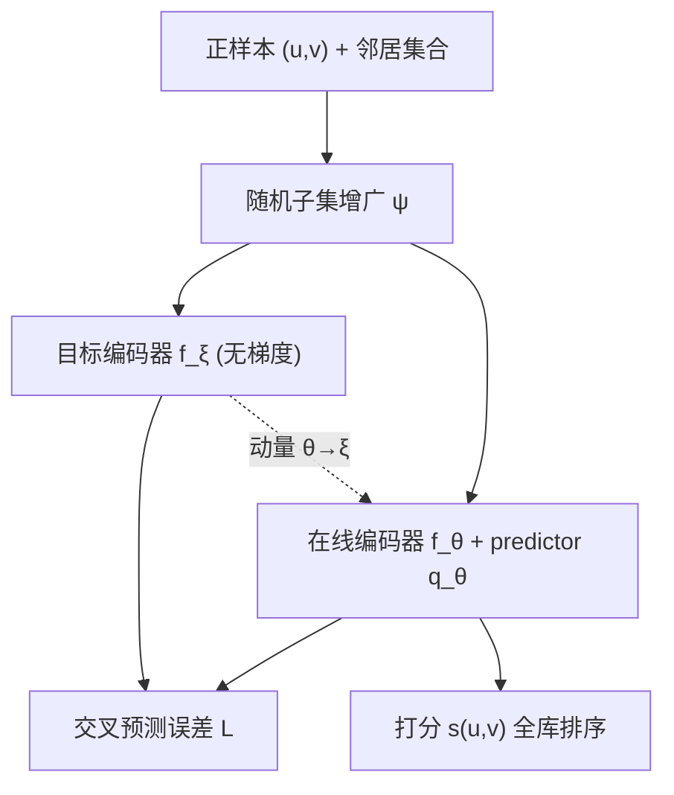

# Bootstrapping User and Item Representations for One-Class Collaborative Filtering (面向单类协同过滤的用户与物品表征自举学习)

- **会议/期刊**: SIGIR 2021
- **作者与机构**: Dongha Lee, SeongKu Kang, Hyunjun Ju, Chanyoung Park, Hwanjo Yu (POSTECH / KAIST)
- **推荐链路定位**: 召回（用户-物品表示学习与 top-K 检索）
- **研究方向**: 协同过滤与双塔召回 / 自监督对比学习与交互去噪
- **论文原文**: [https://arxiv.org/abs/2105.06323v1](https://arxiv.org/abs/2105.06323v1)
- **开源代码**: 暂未开源

## TL;DR (1分钟核心速览)

OCCF 的判别式范式把未观测交互当负例并依赖负采样，交互越稀疏，"正但未观测"被误采为负的概率越高，监督信号越发不可靠。BUIR 彻底抛弃负采样：对每个正样本 $(u,v)$，用在线编码器输出经 predictor 去预测目标编码器给出的对应向量，目标编码器由动量滑动平均缓慢跟随，从而在无负例下避免表征塌缩；再以邻居随机子集采样构造增广视图缓解稀疏。在 CiteULike/Ciao/FourSquare 的 `Full-Ranking` 协议下，P@10 相对最优 ID 类基线提升 12.0%–58.7%，相对最优邻居类基线提升 4.1%–22.8%，且越稀疏增益越大。

## Background & Motivation (背景与核心矛盾)

- **主流范式**: BPR/CML/NeuMF 等判别式方法以内积或欧氏距离定义 $s(u,v)$，用 pointwise 或 pairwise 损失把正例与负例拉开；NGCF/LGCN 引入二部图邻居，M-VAE/CFGAN 用生成式重建用户二值向量。
- **前人局限**: ① 负例只能从未观测对中"假定"而来，稀疏时正负混叠严重，监督本身带噪；② 性能与收敛速度强依赖负采样分布（均匀 / 全局静态 / 自适应上下文），而为每个数据集调采样分布本身开销巨大（图 3 显示 BPR 与 CML 的最优采样策略甚至相反）。
- **核心洞察 (Key Insight)**: 若端到端地只拉近 $f_\theta(u)$与$f_\theta(v)$，因无任何排斥项，编码器必然输出常数向量（塌缩解）；塌缩源于"$u$与$v$ 在同一编码器中被同时优化"。作者借用 BYOL 式自举：让两侧由**不同更新规则**的网络产生，破坏对称性即可绕开塌缩。
- **本文切入点**: 用"跨预测 + 动量目标网络"把正相互作用编码进表示，令负采样从训练流程中消失。

## Method (核心方法设计)

### 1. 整体框架 (Overall Architecture)

BUIR 维护结构相同的在线编码器 $f_\theta$与目标编码器$f_\xi$（最简形式即一张 embedding 表）。每个正样本$(u,v)$经邻居增广$\psi$得到扰动视图后分别送入两支：在线侧再过一层线性 predictor$q_\theta$去回归目标侧的对应向量；目标侧不回传梯度，仅按动量跟踪$\theta$。推理阶段丢弃目标编码器，直接用在线编码器的交叉预测和作为打分排序。框架与任何编码器（ID embedding 或 LGCN）解耦，可整体替换 BPR。

### 2. 关键设计拆解 (Key Designs)

1. **跨预测自举损失（取代负采样）**：归一化向量的 MSE 等价于负内积，双向对称损失写作
$\mathcal{L}_{\theta,\xi}(u,v)=-\frac{q_\theta(f_\theta(u))^{\top} f_\xi(v)}{\|q_\theta(f_\theta(u))\|_2\|f_\xi(v)\|_2}-\frac{q_\theta(f_\theta(v))^{\top} f_\xi(u)}{\|q_\theta(f_\theta(v))\|_2\|f_\xi(u)\|_2}$。
   关键不在损失式而在优化动力学：$\theta\leftarrow\theta-\eta\nabla_\theta\mathcal{L}$，$\xi\leftarrow\tau\xi+(1-\tau)\theta$。在线侧沿负梯度走，目标侧沿$\theta-\xi$方向走，两者更新方向正交化，塌缩解（两侧同时输出常量）不再是联合下降的稳定不动点；$\tau=0.995$ 使目标侧提供"增强但一致"的回归目标。

2. **跨预测打分与非对称建模**：区别于 BPR 直接用 $f(u)^\top f(v)$，评分取
$s(u,v)=q_\theta(f_\theta(u))^{\top}f_\theta(v)+f_\theta(u)^{\top}q_\theta(f_\theta(v))$。
   predictor 使模型能拟合比单纯内积更高阶的用户-物品关系，且消融显示该收益来自学习框架而非打分式本身（仅换打分式的 BPR 反而从 0.1229 掉到 0.0752）。

3. **基于邻居的随机增广 + 训练目标**：把用户/物品表示为 $(u,\mathcal{V}_u)$、$(v,\mathcal{U}_v)$的 one-hot + multi-hot 组合，每次编码前以$\psi(u,\mathcal{V}_u)=(u,\mathcal{V}_u'),\ \mathcal{V}_u'\sim\{S|S\subseteq\mathcal{V}_u\}$抽取邻居子集（丢弃率$p\sim U(0,1)$逐邻居独立采样）。效果等价于从数据自身"造出"更多正样本对，缓解稀疏。总目标即对增广视图最小化$\mathcal{L}_{\theta,\xi}(\psi(u,\mathcal{V}_u),\psi(v,\mathcal{U}_v))$；**无需任何负采样**，推理仅需一次前向（邻居编码可离线缓存）。

## Experimental Setup & Evaluation Protocol (实验设置与评估协议)

- **数据集与预处理**（按各数据集特性做最小交互数过滤，见原文脚注 3）：

| 数据集 | #Users | #Items | #Interactions | 密度 | 特征/场景说明 |
| :--- | :---: | :---: | :---: | :---: | :--- |
| CiteULike | 5,219 | 25,181 | 125,580 | 0.096% | 论文收藏，最稀疏；用户 ≥5、物品 ≥5 |
| Ciao | 7,265 | 11,211 | 149,141 | 0.183% | 商品评论，含 28 类目标签；用户/物品 ≥5 |
| FourSquare | 19,465 | 28,593 | 1,115,108 | 0.200% | POI 签到，含 GPS；用户 ≥20、物品 ≥10 |

- **数据划分与防穿越**: 按**用户随机比例划分**（非全局时间戳），训练集取每用户交互的 $\beta\in\{10\%,20\%,50\%\}$，其余**等分**为验证/测试；5 组随机种子取均值，10% 设定刻意模拟极端稀疏的实践场景。
- **排名评测协议**: 明确批评 leave-one-out 采样评测失真，采用无偏 `Full-Ranking`（对全部**未交互**物品排序），指标 P@K 与 N@K（K=10/20/50）。
- **对比基线与超参**: ID 类 BPR/NeuMF/CML/SML；邻居类 NGCF/LGCN/M-VAE/CFGAN。$D\in\{50,\dots,250\}$，$\lambda\in\{10^{-1},\dots,10^{-5}\}$，学习率、负例数$n\in\{1,\dots,20\}$网格搜索；$\tau=0.995$，predictor 单层；以 P@10 早停（patience=50，≤500 epoch）；对 BUIRnb vs 最优基线做 paired t-test（\*/ \*\*/ \*\*\* 对应$p\le0.05/0.005/0.0005$）。

## Key Experimental Results (实验关键数据)

### 1. 主实验对比 (Main Results)

三数据集 $\beta=10\%$（最稀疏）结果，P@10 / N@10：

| 方法 | CiteULike P@10 | CiteULike N@10 | Ciao P@10 | Ciao N@10 | FourSquare P@10 | FourSquare N@10 |
| :--- | :---: | :---: | :---: | :---: | :---: | :---: |
| BPR | 0.0369 | 0.0310 | 0.0289 | 0.0278 | 0.0561 | 0.0619 |
| NeuMF | 0.0350 | 0.0311 | 0.0302 | 0.0269 | 0.0441 | 0.0476 |
| CML | 0.0327 | 0.0272 | 0.0422 | 0.0369 | 0.0451 | 0.0451 |
| SML | 0.0279 | 0.0222 | 0.0461 | 0.0418 | 0.0317 | 0.0311 |
| NGCF | 0.0387 | 0.0337 | 0.0336 | 0.0313 | 0.0658 | 0.0732 |
| LGCN | 0.0518 | 0.0465 | 0.0582 | 0.0557 | 0.0926 | 0.1080 |
| M-VAE | 0.0330 | 0.0289 | 0.0434 | 0.0391 | 0.0451 | 0.0483 |
| CFGAN | 0.0437 | 0.0382 | 0.0521 | 0.0443 | 0.0519 | 0.0579 |
| BUIRid | 0.0542 | 0.0480 | 0.0598 | 0.0535 | 0.0890 | 0.1023 |
| **BUIRnb** | **0.0637** | **0.0568** | **0.0664** | **0.0628** | **0.0999** | **0.1161** |
| Improv.id | +46.88% | +54.60% | +29.67% | +27.96% | +58.70% | +65.27% |
| Improv.nb | +22.80% | +22.11% | +14.05% | +12.75% | +7.84% | +7.44% |

### 2. 消融实验 (Ablation Study)

CiteULike，$\beta=50\%$，P@10（均值 ± 标准差）：

| 配置 | 框架 | Predictor | 邻居 | 增广 | P@10 |
| :--- | :---: | :---: | :---: | :---: | :---: |
| BPR | BPR | – | – | – | 0.1229 ± 0.0035 |
| BPR + 交叉预测打分 | BPR | ✓ | – | – | 0.0752 ± 0.0027 |
| LGCN | BPR | – | ✓ | – | 0.1561 ± 0.0038 |
| BUIRid | BUIR | ✓ | – | – | 0.1555 ± 0.0029 |
| BUIR(邻居无增广) | BUIR | ✓ | ✓ | – | 0.1592 ± 0.0028 |
| BUIRnb | BUIR | ✓ | ✓ | ✓ | **0.1624 ± 0.0032** |

### 3. 关键实验发现 (Key Findings)

1. **稀疏度越高增益越大**：FourSquare 上 Improv.id 从 $\beta=50\%$的 12.00% 升至$\beta=10\%$ 的 58.70%，CiteULike 从 18.73% 升至 46.88%——正好对应"负例假设随稀疏而失效"的理论预期，说明增益来源是去掉了错误监督而非模型容量。
2. **框架收益 > 打分式收益**：同用交叉预测打分，BPR 框架降至 0.0752（低于原 BPR 0.1229），而换成 BUIR 框架后 LGCN 从 0.1561→0.1592、加增广后达 0.1624；证明动量自举是主因，predictor 打分只是配套。
3. **增广强度与邻居密度正相关**：$P=0$时增广为负收益（即固定邻居输入次优），Ciao（较密）性能随最大丢弃率$P$近线性单调上升，而更稀疏的 CiteULike 在中等$P$ 即饱和；下游物品分类任务（线性/非线性分类器，10 折）中 BUIR 排序与 top-K 排序完全一致，说明隐式反馈学习质量真实反映在语义空间中。

## Highlights & Limitations (亮点、对比与审稿批判)

- **与代表作对比 (vs. Prior Work)**: 与 BPR/CML 相比，BUIR 把"负例从哪来"这一超参从训练流程中删除，无需为数据集调采样分布；与 NGCF/LGCN 相比，它不是换更强的图编码器，而是换**优化范式**，因此能直接套在 LGCN 上再涨一截（0.1561→0.1624）；与 M-VAE/CFGAN 相比，避免 KL annealing 与对抗平衡等不稳定训练技巧。
- **可迁移亮点**: ①"动量目标编码器 + 非对称更新"可作为通用去负采样插件移植到序列推荐/多模态对齐；②邻居子集随机丢弃是一种零额外标注、随训练动态变化的图增广，且丢弃率上界可作为稀疏-密集自适应的调节旋钮。
- **审稿级局限批判**: ① 划分是**按用户随机比例**而非时间戳切分，隐式反馈场景下存在未来交互泄漏风险，线上时序泛化性未被验证；② 缺少与图对比方法（SGL/SimGCL）的直接对比，也未报告训练时长/显存与 BPR 的定量开销对照，"无负采样更省"仅停留在定性论证；③ $\tau$只测到$[0.9,1)$，接近 1 时（$\tau=1$ 直接失效）边界行为敏感，且 10% 设定下基线超参是否同等调优未完全披露。

## Rating (四维评分)

- **方法创新性 (Novelty)**: ⭐⭐⭐⭐ （把 BYOL 式自举首次系统迁移到 OCCF，用"非对称更新规避塌缩"给出了清晰直觉，但理论论证仍以经验观察为主）
- **评估协议与实验扎实度 (Protocol & Experiments)**: ⭐⭐⭐⭐ （坚持 Full-Ranking、5 种子 + paired t-test、三档稀疏度与 8+ 基线齐全；不足是按用户随机划分而非时间切分）
- **写作与数学规范度 (Clarity & Rigor)**: ⭐⭐⭐⭐ （归一化 MSE 与负内积等价、动量更新与塌缩分析交待干净，符号统一，仅缺复杂度/收敛性形式化分析）
- **工业落地与复现价值 (Industrial & Practical Value)**: ⭐⭐⭐⭐ （框架与编码器解耦、超参极少、推理只需在线编码器，工程友好；扣分在无开源代码与缺少线上/时延实测）

