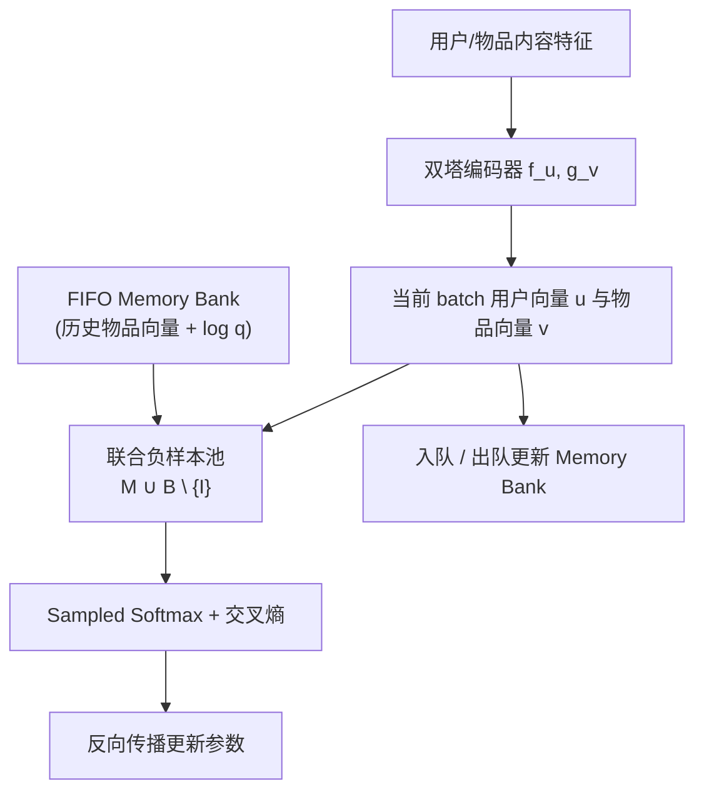

# Cross-Batch Negative Sampling for Training Two-Tower Recommenders (面向双塔推荐模型训练的跨批次负采样)

- **会议/期刊**: SIGIR 2021
- **作者与机构**: Jinpeng Wang (清华大学), Jieming Zhu, Xiuqiang He (华为诺亚方舟实验室)
- **推荐链路定位**: 召回 (双塔召回训练)
- **研究方向**: 协同过滤与双塔召回 / 自监督对比学习与交互去噪
- **论文原文**: [论文原文链接](https://arxiv.org/abs/2110.15154v1)
- **开源代码**: 暂未开源

## TL;DR (1分钟核心速览)

两塔召回模型普遍采用 in-batch 负采样，但可用负样本数被 mini-batch 大小与 GPU 显存线性限制住。本文观察到神经网络 item 编码器在 warm-up 后对同一输入输出近似不变的表示（embedding stability），据此提出 CBNS：用一个 FIFO memory bank 缓存最近若干 mini-batch 的 item 向量，与当前 batch 的 in-batch 负样本组成联合负样本池，不改动编码器前向图即可把负样本数从 128 扩到 2560。在 Amazon-Books 上，YouTubeDNN / GRU4REC / MIND 的 NDCG@50 相对 in-batch 分别提升 3.23% / 12.19% / 11.51%，收敛时间基本持平。

## Background & Motivation (背景与核心矛盾)

- **主流范式**: 大候选池检索被建模为极端多分类问题，用 sampled softmax 训练两塔模型；为省去额外 item 编码开销，业界标准做法是 in-batch 负采样，即把同 batch 内其他用户的 positive item 当作负样本。
- **前人局限**: (1) 负样本数上限等于 batch size，而放大 batch 需要同时缓存大量 item 内容特征并做重复前向，显存与时间成本陡增；(2) MNS 等方法混入全局均匀负样本虽扩大了负样本池，却因分布偏移导致收敛更慢（GRU4REC 上 Conv. Time 从 91.81 min 涨到 464.62 min）。
- **核心洞察 (Key Insight)**: 作者用特征漂移 $D(\mathcal{I},t;\Delta t) \triangleq \sum_{\boldsymbol{I}\in\mathcal{I}}\|\boldsymbol{g}_v(\boldsymbol{I};\boldsymbol{\theta}_g^{t})-\boldsymbol{g}_v(\boldsymbol{I};\boldsymbol{\theta}_g^{t-\Delta t})\|_2$度量编码器输出变化，发现训练约$4\times 10^4$ 次迭代、学习率衰减后，同一 item 的表示趋于稳定——旧 batch 的向量并非“过期垃圾”，而是对当前编码器的良好近似。
- **本文切入点**: 既然旧向量可近似当前编码输出，就直接复用它们当负样本，把“负样本数量”与“batch 大小”解耦。

<figure class="paper-figure" markdown="span">
  ![图 2：YoutubeDNN \[9\] 在 Amazon-Books 数据集 \[15, 22\] 上关于 Δ𝑡s 的特征漂移。](../../../../assets/papers/2110.15154v1/figure_2.png)<figcaption>图 2：YoutubeDNN [9] 在 Amazon-Books 数据集 [15, 22] 上关于 Δ𝑡s 的特征漂移。</figcaption>
</figure>

## Method (核心方法设计)

### 1. 整体框架 (Overall Architecture)

输入仍是用户侧与 item 侧的内容特征。前 $4\times10^4$次迭代用朴素 in-batch 负采样做 warm-up，使模型进入局部最优、编码器输出稳定；此后每个 mini-batch 先照常编码 batch 内的用户与 item 得到$\boldsymbol{u},\boldsymbol{v}$，同时从 FIFO 队列$\mathcal{M}$取出最近$M$个 item 的历史向量与对应采样概率$q(\cdot)$，二者合并构成负样本集合$\mathcal{M}\cup\mathcal{B}\setminus\{\boldsymbol{I}\}$计算 softmax 交叉熵；反向传播只更新当前 batch 参与前向的参数，历史向量作为常量（stop-gradient）；迭代末尾将本 batch 的$(\boldsymbol{v}_i, q(\boldsymbol{I}_i))$ 入队、最早的一批出队。推理时按常规方式构建 ANN 索引做点积检索。

### 2. 关键设计拆解 (Key Designs)

1. **Embedding Stability 与梯度误差上界（复用旧向量的合法性证明）**：此前工作默认历史 embedding 已过期而丢弃，作者改从梯度扰动角度论证可复用性。设旧向量偏差 $\|\hat{\boldsymbol{v}}_j-\boldsymbol{v}_j\|_2^2<\epsilon$，用户塔满足 Lipschitz 连续，则打分的梯度偏差满足$\|\frac{\partial \hat{o}_{ij}}{\partial \boldsymbol{\theta}}-\frac{\partial o_{ij}}{\partial \boldsymbol{\theta}}\|_2^2 \le C\epsilon$，其中$C$为 Lipschitz 常数。直觉上，复用旧负样本等价于给梯度注入一个由$C\epsilon$控制的有界噪声，只要 warm-up 后$\epsilon$ 足够小，训练方向就不会被带偏——这解释了为何必须先 warm-up 再启用队列。

2. **CBNS 联合负采样 softmax（核心算子改动）**：把 in-batch 负采样中分母的 $\mathcal{B}\setminus\{\boldsymbol{I}\}$替换为$\mathcal{M}\cup\mathcal{B}\setminus\{\boldsymbol{I}\}$，并保留 sampled softmax 的 logQ 频率校正：
$$p_{\text{CBNS}}(\boldsymbol{I}|\boldsymbol{U};\Theta)=\frac{e^{s'(\boldsymbol{U},\boldsymbol{I};q)}}{e^{s'(\boldsymbol{U},\boldsymbol{I};q)}+\sum_{\boldsymbol{I}^-\in\mathcal{M}\cup\mathcal{B}\setminus\{\boldsymbol{I}\}}e^{s'(\boldsymbol{U},\boldsymbol{I}^-;q)}},\quad s'(\boldsymbol{U},\boldsymbol{I};q)=\boldsymbol{u}^{\top}\boldsymbol{v}-\log q(\boldsymbol{I})$$
   item 塔的前向计算量完全不变，仅多出 $|\mathcal{M}|$次向量内积；由于队列只存$M\times d$的稠密向量（$M=2432,d=64$），显存占用不到 1 MB，从而可以放心把$M$ 设得远大于 batch size。

3. **训练目标与负采样策略**：总损失即 batch 平均负对数似然 $\mathcal{L}_{\text{CE}}=-\frac{1}{|\mathcal{B}|}\sum_{i\in[|\mathcal{B}|]}\log p_{\text{CBNS}}(\boldsymbol{I}_i|\boldsymbol{U}_i;\Theta)$，负样本分布沿用 unigram（按物品频次），与真实 serving 分布更接近，因此无需偏置修正即可直接上线。免去了 global uniform 采样的额外 item 前向，训练吞吐与纯 in-batch 同量级（每$10^3$ mini-batch 仅多 2–5 s）。

## Experimental Setup & Evaluation Protocol (实验设置与评估协议)

- **数据集与预处理**:

| 数据集 | #Users | #Items | #Interactions | 稀疏度 | 特征/场景说明 |
| :--- | :---: | :---: | :---: | :---: | :--- |
| Amazon-Books | 459,133 | 313,966 | 8,898,041 | ≈ $6.2\times10^{-5}$ | 图书评论 + 元数据，含用户/物品 ID、日志与类型等内容特征 |

- **数据划分与防穿越 (Splitting Strategy)**: 按用户以 8:1:1 划分 train/valid/test（遵循 VAE-CF、MIND 的设定），非全局时间戳切分。
- **排名评测协议 (Ranking Protocol)**: 在验证集上对双塔点积做 Top-K 全库排序，汇报 Recall@20/50 与 NDCG@20/50（未采用采样候选集），另报告收敛时间与每 $10^3$ mini-batch 平均耗时。
- **对比基线与超参设置**: 3 个两塔骨干（YouTubeDNN、GRU4REC、MIND）× 4 种采样策略（Uniform、In-Batch、MNS、CBNS）；embedding 维度 $d=64$，batch size=128，Adam 基础学习率 0.001，$\ell_2$系数在$\{0,10^{-6},\dots,10^{-3}\}$中交叉验证选取，早停 patience=20；Uniform 与 MNS 的全局负样本数分别为 1280 与 1152，CBNS 默认队列$M=2432$。

## Key Experimental Results (实验关键数据)

### 1. 主实验对比 (Main Results)

| 模型 | 采样策略 | Avg. Time (s/1k batch) | Conv. Time (min) | R@20 | NDCG@20 | R@50 | NDCG@50 |
| :--- | :--- | :---: | :---: | :---: | :---: | :---: | :---: |
| YouTubeDNN | Uniform | 26.57 | 135.97 | 4.205 | 7.174 | 7.028 | 11.741 |
| YouTubeDNN | In-Batch | **16.27** | 62.91 | 4.070 | 6.962 | 6.908 | 11.509 |
| YouTubeDNN | MNS | 24.73 | 138.50 | 4.113 | 7.050 | 6.929 | 11.535 |
| YouTubeDNN | **CBNS** | 20.38 | **62.50** | **4.237** | **7.325** | **7.084** | **11.881** |
| GRU4REC | In-Batch | **35.09** | **91.81** | 3.912 | 6.674 | 6.425 | 10.724 |
| GRU4REC | MNS | 58.69 | 464.62 | 4.110 | 7.178 | 6.553 | 11.183 |
| GRU4REC | **CBNS** | 40.15 | 167.31 | **4.257** | **7.479** | **7.044** | **12.032** |
| MIND | In-Batch | **27.87** | **104.50** | 4.140 | 7.009 | 6.894 | 11.363 |
| MIND | MNS | 36.82 | 205.57 | 4.576 | 7.596 | 7.135 | 11.603 |
| MIND | **CBNS** | 31.65 | 146.14 | **4.799** | **8.105** | **7.689** | **12.671** |
| | **Improv. vs In-Batch (NDCG@50)** | | | | | | **+3.23% / +12.19% / +11.51%** |

### 2. 消融实验 (Ablation Study)

以“队列大小 $M$”（等价于负样本总数，batch 固定 128）为控制变量：

| $M$ | #neg | YouTubeDNN R@50 | YouTubeDNN NDCG@50 | GRU4REC R@50 | GRU4REC NDCG@50 | MIND R@50 | MIND NDCG@50 |
| :--- | :---: | :---: | :---: | :---: | :---: | :---: | :---: |
| 0 (纯 In-Batch) | 128 | 6.908 | 11.509 | 6.425 | 10.724 | 6.894 | 11.363 |
| 128 | 256 | 7.032 | 11.877 | 6.518 | 10.993 | 7.003 | 11.431 |
| 512 | 640 | 7.175 | 12.085 | 6.679 | 11.229 | 7.102 | 11.660 |
| 1152 | 1280 | **7.182** | **12.055** | 6.845 | 11.681 | 7.463 | 12.309 |
| 2432 | 2560 | 7.084 | 11.881 | 7.044 | **12.032** | **7.689** | **12.671** |
| 4992 | 5120 | 6.988 | 11.807 | **7.394** | **12.423** | 7.474 | 12.303 |
| 10112 | 10240 | 7.001 | 11.772 | 6.903 | 11.810 | 7.268 | 11.939 |

### 3. 关键实验发现 (Key Findings)

1. **负样本“量”的收益需由稳定性兜底**：负样本从 128 增至 640 时三个模型指标单调上升（YouTubeDNN NDCG@50 11.509→12.085），但 $M$超过各自最优值（YouTubeDNN 512、MIND 2432、GRU4REC 4992）后全面回落——印证引理 3.1 的$C\epsilon$上界：队列越长，队尾向量偏离当前编码器的$\epsilon$ 越大，噪声项反超信息收益。
2. **效率与效果的折中最优**：CBNS 每 $10^3$ mini-batch 仅比 in-batch 多 4–5 s（MIND: 31.65 vs 27.87 s），收敛时间与 in-batch 同档（YouTubeDNN 62.50 vs 62.91 min），却显著优于需要 1280 个全局负样本、收敛慢一倍以上的 Uniform / MNS（GRU4REC 上 464.62 min vs 167.31 min），说明 unigram 分布的负样本池比混合全局分布更易优化。
3. **模型容量决定队列收益上限**：GRU4REC 依赖长序列编码，对负样本数量最敏感（$M{=}4992$时 R@50 达 7.394，比$M{=}0$ 提升 15.1%）；MIND 因多兴趣路由本身表达力强，在中等队列（2432）即触顶，说明 CBNS 的增益与骨干网络的表征瓶颈正相关。

## Highlights & Limitations (亮点、对比与审稿批判)

- **与代表作对比 (vs. Prior Work)**: 与 MNS（Yang et al., WWW'20）相比，本文不引入分布偏移、不增加额外 item 前向，只在时间维度复用向量；与 RocketQA 的 "cross-batch negatives" 相比，本文是跨迭代时序共享而非分布式 GPU 空间共享；与同期 Zhou et al. 的对比学习 memory queue 相比，本文额外给出 embedding stability 的特征漂移实证与梯度误差上界引理。
- **可迁移亮点**: (1) “warm-up 后启用缓存队列”的两阶段训练范式可直接移植到任意使用 sampled softmax 的双塔检索/生成式召回训练；(2) 用特征漂移 $D(\mathcal{I},t;\Delta t)$ 作为队列长度与刷新频率的自动调节信号，比手工网格搜索更可靠。
- **审稿级局限批判**: (1) 仅在单一 Amazon-Books 数据集、单一 batch size（128）下验证，缺少稀疏域、跨域与工业级十亿候选的实证，且未做显著性检验；(2) 推理侧虽无额外开销，但训练时队列需与学习率调度强耦合——$M$ 的最优值随骨干网络剧烈变化（512 vs 2432 vs 4992），实际部署仍需大量调参，且论文未讨论负样本与 batch 内正样本重复导致的假阴性问题。

## Rating (四维评分)

- **方法创新性 (Novelty)**: ⭐⭐⭐⭐ （以“embedding stability”这一可观测现象切入，配 Lipschitz 梯度上界引理，把工程 trick 上升为可解释机制；但 memory bank 本身在 CV/NLP 已有先例，增量偏“迁移 + 论证”）
- **评估协议与实验扎实度 (Protocol & Experiments)**: ⭐⭐⭐ （3 个骨干 × 4 种采样策略的矩阵式对比较完整，但仅 1 个公开数据集、无显著性检验、候选协议未明确说明是否全库排序）
- **写作与数学规范度 (Clarity & Rigor)**: ⭐⭐⭐⭐ （5 页短文，动机—观察—引理—算子的逻辑链非常紧凑，公式与算法伪码清晰；引理证明较简，Lipschitz 常数 $C\le1$ 仅以“实验模型成立”带过）
- **工业落地与复现价值 (Industrial & Practical Value)**: ⭐⭐⭐⭐⭐ （改动仅 20 行级别的队列入队/出队 plus 分母集合替换，显存开销 <1 MB，可直接嵌入现有双塔训练管线，性价比极高）

