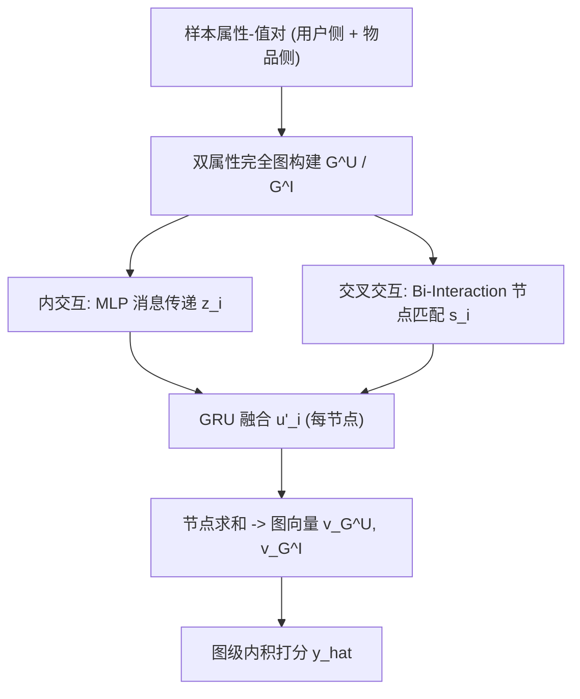
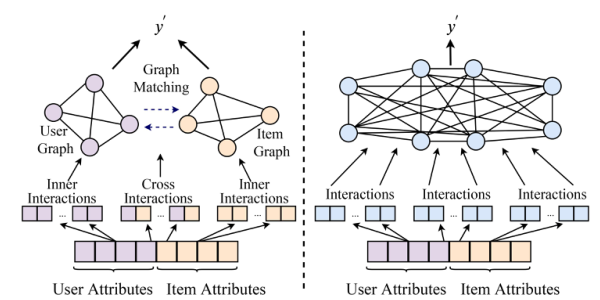

# Neural Graph Matching based Collaborative Filtering (基于神经图匹配的协同过滤)

- **会议/期刊**: SIGIR 2021（10 页，6 图 4 表）
- **作者与机构**: Yixin Su、Sarah M. Erfani、Junhao Gan（墨尔本大学）、Rui Zhang（独立/原墨尔本大学）
- **推荐链路定位**: 精排 / CTR 式点击率预估（非召回，见局限分析）
- **研究方向**: 协同过滤与双塔召回 / 图神经网络与知识图谱推荐
- **论文原文**: [https://arxiv.org/abs/2105.04067v2](https://arxiv.org/abs/2105.04067v2)
- **开源代码**: [GMCF 官方实现](https://github.com/ruizhang-ai/GMCF_Neural_Graph_Matching_based_Collaborative_Filtering)

## TL;DR (1分钟核心速览)

现有属性感知 CF（FM/AFM/NFM/DeepFM/AutoInt/Fi-GNN/$L_0$-SIGN）把所有属性交互一视同仁地在同一空间里建模与聚合，忽略了"用户-用户/物品-物品"的属性交互服务于**刻画自身特征**、而"用户属性-物品属性"的交互服务于**偏好匹配**这一角色差异。GMCF 为每个用户、每个物品各建一张属性完全图：图内边用 MLP 消息传递学特征（inner），跨图节点用 Bi-Interaction 逐节点匹配（cross），再经 GRU 融合、图级内积出分。在 MovieLens 1M / Book-Crossing / Taobao 三点（6:2:2 比例划分、每正例配 1 负例的采样评估）上，AUC 提升 0.6%–2.0%，NDCG@10 提升 3.7%–16.5%（$p<0.05$）。

## Background & Motivation (背景与核心矛盾)

- **主流范式**: 属性感知 CF 把每个样本的属性-值对嵌入为向量，通过 FM 式点积或 MLP/注意力建模成对属性交互并线性聚合（Fi-GNN、$L_0$-SIGN 进一步用 GNN 建模属性图）。
- **前人局限一**: 所有交互共享同一建模函数与同一聚合池，导致"$\langle$male, 18-24$\rangle$"这类刻画用户的交互与"$\langle$18-24, sci-fi$\rangle$"这类表达偏好的交互被同等对待，语义角色被抹平。
- **前人局限二**: 图级信息只在最后一步用一个池化向量比对，用户/物品图内部复杂结构在匹配前就被压扁，难以做到细粒度偏好对齐。
- **核心洞察**: 推荐的本质 = 先各自刻画特征、再做特征间匹配；因此属性交互的作用应当按"是否跨侧"二分，且两类交互的建模算子也应当不同（内交互需要非线性度量、交叉交互需要单调相似度度量）。
- **本文切入点**: 把用户与物品各自表示成一张属性完全图，用"图学习 + 节点级图匹配"的两段式结构显式对应推荐的两个子过程。

## Method (核心方法设计)

### 1. 整体框架 (Overall Architecture)

输入一个样本 $\boldsymbol{x}=C^U\cup C^I$（用户属性-值对与物品属性-值对）。每个属性$att$有共享嵌入$\boldsymbol{v}_{att}$，属性-值对表示为$\boldsymbol{u}_{att}=val\cdot\boldsymbol{v}_{att}$。用户侧与物品侧分别以自身属性为节点、两两内交互为边构成完全图$G^U,G^I$；对每个节点$i$，同时计算图内消息$\boldsymbol{z}_i$（inner）与对侧全图节点匹配$\boldsymbol{s}_i$（cross），用 GRU 融合成$\boldsymbol{u}'_i$，再节点求和得到图表示$\boldsymbol{v}^U_G,\boldsymbol{v}^I_G$，最终以内积$\hat{y}={\boldsymbol{v}^U_G}^{\top}\boldsymbol{v}^I_G$输出预测。训练为逐样本二分类（BCE）+$L_2$ 正则，无 softmax 候选竞争。

<figure class="paper-figure" markdown="span">
  <figcaption>图 1：GMCF（左）与现有工作（右）的差异示意图。GMCF 在图匹配结构中区别对待属性交互，而现有工作同等对待所有属性交互。</figcaption>
</figure>

### 2. 关键设计拆解 (Key Designs)

1. **内交互的神经消息传递（特征学习）**：内交互刻画"这个用户/物品是什么"，其交互强度与相似度**非同调**——两属性强交互不代表嵌入应相近，故不能用点积。改用 MLP 显式建模式 (2)：$\boldsymbol{z}_{ij}=f_{neural}(\boldsymbol{u}_i,\boldsymbol{u}_j)$，节点消息为$\boldsymbol{z}_i=\sum_{j\in N_i}\boldsymbol{z}_{ij}$。MLP 的非线性容量负责吸收高阶语义，求和聚合保证置换不变。
2. **交叉交互的 Bi-Interaction 节点匹配（偏好对齐）**：期望"用户属性 $i$偏好物品属性$j$"时二者嵌入相似，故必须使用**单调递增**的相似度算子。采用$\boldsymbol{s}_{ij}=\boldsymbol{u}_i\odot\hat{\boldsymbol{u}}_j$、$\boldsymbol{s}_i=\sum_{j\in \hat{V}}\boldsymbol{s}_{ij}$，使匹配得分与内积同向；作者证明若把匹配设为线性求和，模型可退化为 FM 的原始预测式$\sum_{i}\mathrm{sum}(\boldsymbol{v}_i)val_i+\sum_{i<j}\boldsymbol{v}_i^{\top}\boldsymbol{v}_j val_ival_j$，说明 GMCF 是 FM 的严格推广。交叉交互在**节点级**发生而非仅图级，这是与 Fi-GNN/$L_0$-SIGN 的关键分野。
3. **GRU 融合、训练目标与开销**：$\boldsymbol{u}'_i=\mathrm{GRU}([\boldsymbol{u}_i,\boldsymbol{z}_i,\boldsymbol{s}_i])$，把"自身-特征-匹配"当作序列逐步门控融合（表 3 显示 SUM/MLP 均劣于 GRU）。目标为$\mathcal{R}(\boldsymbol{\theta})=\frac{1}{N}\sum_n\mathcal{L}(F_{GMCF}(\boldsymbol{x}_n;\boldsymbol{\theta}),y_n)+\lambda\|\boldsymbol{\theta}\|_2$。负采样为每用户随机采等量负例（1:1），无难负例挖掘；完全图结构使单样本复杂度约$O((p+q)^2 d)$，且每个候选物品都需重建其物品图并逐节点过 GRU，**无法预计算物品塔**，故只适用于精排而非全库召回。

## Experimental Setup & Evaluation Protocol (实验设置与评估协议)

- **数据集与预处理**: 显式评分二值化为隐式反馈（ML-1M 评分 >3 为正；Book-Crossing 全部评分视为正），每用户按 1:1 随机采负例；过滤交互数 <10（ML-1M）、<20（Book-Crossing、Taobao）的用户。ML-1M 额外从 IMDB 补齐导演/演员属性，Book-Crossing 用书名分词作物品属性。

| 数据集 | #Users | #Items | #Interactions | 稀疏度/密度 | 特征/场景说明 |
| :--- | :---: | :---: | :---: | :---: | :--- |
| MovieLens 1M | 5,950 | 3,514 | 1,149,238 | 5.5%（含负例） | 30 个用户属性 / 6,944 个物品属性（含 IMDB 导演、演员） |
| Book-Crossing | 4,873 | 53,168 | 1,050,834 | 0.04% | 87 用户属性 / 43,157 物品属性（书名词） |
| Taobao | 4,532 | 371,760 | 2,599,463 | 0.15% | 36 用户属性 / 434,254 广告属性（类目、品牌） |

- **数据划分与防穿越 (Splitting Strategy)**: **比例划分**——按用户 6:2:2 随机切为 train/valid/test，验证集仅调参、测试集仅报数（随机划分而非全局时间戳切分，存在未来信息穿越隐患）。
- **排名评测协议 (Ranking Protocol)**: **Sampled Ranking**——测试候选为真实正例 + 等量随机负例（正负比 1:1），因此 NDCG@5/@10 是在"1 正 + 1 负"的极小候选池上计算，绝对值（如 0.94）显著高于全库 Full-Ranking 场景，不可与全库排序结果直接横比。
- **对比基线与超参设置**: 8 个基线覆盖线性交互族（FM、AFM）、MLP 族（NFM、W&D、DeepFM）、显式注意力/GNN 族（AutoInt、Fi-GNN、$L_0$-SIGN）；嵌入维度$d=64$，MLP 隐层 1 层、4$d$单元，学习率$1\times10^{-3}$，$\lambda=1\times10^{-5}$，Adam + BCE；5 次重复取均值，显著性用 Wilcoxon signed-rank 检验（$\alpha=5\%$）。

## Key Experimental Results (实验关键数据)

### 1. 主实验对比 (Main Results)

| 模型 | ML-1M AUC | ML-1M Logloss | ML-1M NDCG@10 | BC AUC | BC NDCG@10 | Taobao AUC | Taobao NDCG@10 |
| :--- | :---: | :---: | :---: | :---: | :---: | :---: | :---: |
| FM | 0.8761 | 0.4409 | 0.8431 | 0.7417 | 0.8029 | 0.6171 | 0.1120 |
| AFM | 0.8837 | 0.4323 | 0.8676 | 0.7541 | 0.8258 | 0.6282 | 0.1240 |
| NFM | 0.8985 | 0.3996 | 0.8832 | 0.7988 | 0.8326 | 0.6550 | 0.1251 |
| W&D | 0.9043 | 0.3878 | 0.8869 | 0.8105 | 0.8381 | 0.6531 | 0.1242 |
| DeepFM | 0.9049 | 0.3856 | 0.8848 | 0.8127 | 0.8400 | 0.6550 | 0.1243 |
| AutoInt | 0.9034 | 0.3883 | 0.8931 | 0.8130 | 0.8472 | 0.6434 | 0.1206 |
| Fi-GNN | 0.9063 | 0.3871 | 0.9029 | 0.8136 | 0.8522 | 0.6462 | 0.1241 |
| $L_0$-SIGN | 0.9072 | 0.3846 | 0.9094 | 0.8163 | 0.8629 | 0.6547 | 0.1259 |
| **GMCF** | **0.9127** | **0.3789** | **0.9436** | **0.8228** | **0.8951** | **0.6679** | **0.1467** |
| Improv.% | +0.61% | +1.48% | +4.28% | +0.80% | +3.73% | +1.96% | +16.52% |

### 2. 消融实验 (Ablation Study)

| 变体 | 说明 | ML-1M AUC | ML-1M NDCG@10 | BC AUC | Taobao AUC | Taobao NDCG@10 |
| :--- | :--- | :---: | :---: | :---: | :---: | :---: |
| GMCF (GRU 融合) | 完整模型 | **0.9127** | **0.9436** | **0.8228** | **0.6679** | **0.1467** |
| SUM 融合 | 三向量逐元素相加 | 0.9042 | 0.9404 | 0.8190 | 0.6583 | 0.1383 |
| MLP 融合 | 拼接后过 MLP | 0.9022 | 0.9389 | 0.8156 | 0.6636 | 0.1421 |
| GMCF-0 | 内交互仅线性变换 | 0.9025 | 0.9354 | 0.8051 | 0.6608 | 0.1341 |
| GMCF-2 | MLP 2 隐层 | 0.9109 | 0.9429 | 0.8182 | 0.6662 | 0.1429 |
| GMCF-4 | MLP 4 隐层 | 0.9071 | 0.9377 | 0.8153 | 0.6650 | 0.1393 |

另据图 3，交互算子组合 $\langle$MLP, None$\rangle$（去掉节点级交叉匹配）最差，$\langle$Bi, Bi$\rangle$、$\langle$MLP, MLP$\rangle$、$\langle$MLP1, MLP2$\rangle$、$\langle$Bi, MLP$\rangle$均劣于原始的$\langle$MLP, Bi$\rangle$。

### 3. 关键实验发现 (Key Findings)

1. **提升主要来自排序而非绝对校准**：AUC 仅涨 0.6%–2.0%，但 NDCG@10 在 Taobao 上暴涨 16.52%（0.1259→0.1467）、Book-Crossing 涨 3.73%，说明节点级交叉匹配主要改善**头部排序位置**，对整体概率分布校准（Logloss 1.48%）收益有限——这与"细粒度偏好对齐"的设计动机吻合。
2. **两类交互必须用不同算子**：把交叉匹配换成 MLP（$\langle$MLP1, MLP2$\rangle$）或让内交互也用点积（$\langle$Bi, Bi$\rangle$）均下降，说明"非线性度量内交互、单调相似度度量交叉交互"的二分不是工程细节而是性能来源；同时 GRU 融合优于 SUM/MLP（0.9127 vs 0.9042/0.9022），证明两个信息源不可加性叠加。
3. **属性缺失时框架平滑退化、且深度不宜堆叠**：图 4 中，当用户与物品属性均缺失（None）时 GMCF 与 $L_0$-SIGN 接近，但双侧属性齐备时差距拉开，说明增益确实来自属性交互结构；表 4 显示 MLP 从 1 层加到 4 层单调下降（0.9127→0.9071），存在明显过拟合，1 层隐层已足够。

## Highlights & Limitations (亮点、对比与审稿批判)

- **与代表作对比 (vs. Prior Work)**: 相较 **FM/AFM**，GMCF 把"点积 + 线性求和"升级为"两条异构算子树 + 图匹配"；相较 **Fi-GNN/$L_0$-SIGN**，二者仍把用户与物品属性塞进同一张图同等建模，GMCF 则在**节点级**而非仅图级完成跨侧匹配；相较 **AutoInt**，GMCF 的交互结构由属性角色决定而非自注意力隐含学习。
- **可迁移亮点**: (i) "按语义角色拆分交互类型并各配一种算子"的思路可直接移植到多模态/跨域特征交互层；(ii) 用 GRU 逐节点序列融合多源信息（自身 / 邻域 / 对侧匹配）替代简单相加，是一种低成本的门控融合模板；(iii) 属性缺失退化为 ID 单节点的设计让模型天然兼容冷启动与纯 ID 场景。
- **审稿级局限批判**: (i) **评估协议偏弱**——每用户仅 1:1 采样负例、随机 6:2:2 划分而非时间切分，NDCG 绝对值虚高且未做全库 Full-Ranking，无法判断在真实长尾候选下的排序能力；(ii) **推理成本与部署形态受限**——完全图使其复杂度随属性数平方增长，且每候选物品都需重建物品图并逐节点过 GRU，物品塔不可预计算，只能用于精排小候选集，文中未报告任何时延/吞吐数据；(iii) 最终匹配仍是**对称内积**，无法刻画"用户偏好强、物品无对应属性"的非对称性，案例研究（图 5）也仅作定性可视化，缺少可解释性的定量评测。

## Rating (四维评分)

- **方法创新性 (Novelty)**: ⭐⭐⭐⭐ （首次把属性交互按角色二分并映射到"图学习 + 节点级图匹配"结构，理论上有 FM/Fi-GNN 的严格退化关系支撑，但整体仍属结构拼接式创新）
- **评估协议与实验扎实度 (Protocol & Experiments)**: ⭐⭐⭐ （三数据集 + 8 基线 + Wilcoxon 检验较规范，但 1:1 采样排序、随机划分与缺失 Full-Ranking 削弱了结论强度，消融含部分仅图示无数字）
- **写作与数学规范度 (Clarity & Rigor)**: ⭐⭐⭐⭐ （公式简洁、与 FM 的等价推导清晰，复杂度未给出正式分析，图 3/图 4 结果缺具体数值）
- **工业落地与复现价值 (Industrial & Practical Value)**: ⭐⭐⭐ （代码已开源、属性缺失可退化便于落地，但完全图 + 逐候选 GRU 的推理开销限制了其在召回与大规模精排中的可用性）

