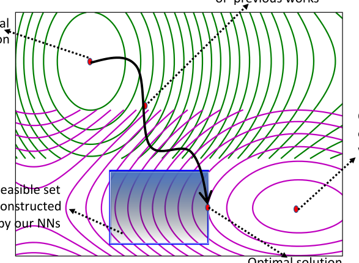
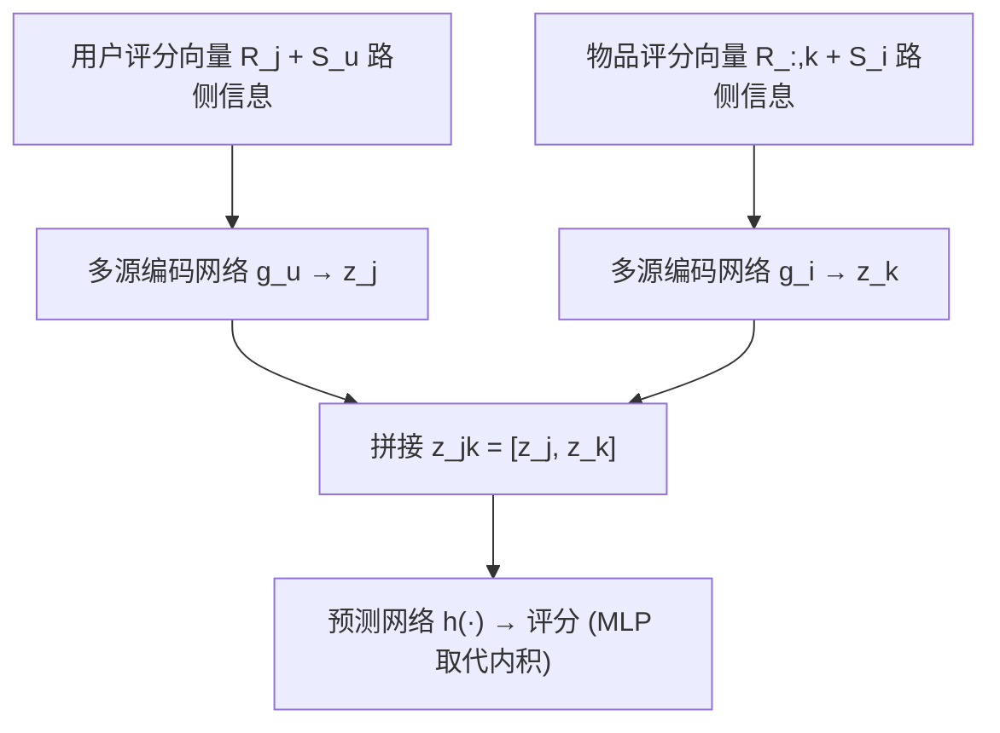
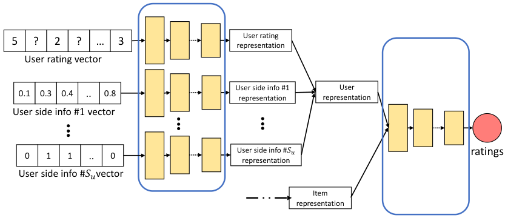

# Neural Representations in Hybrid Recommender Systems: Prediction versus Regularization (混合推荐中的神经表征：预测还是正则化)

- **会议/期刊**: SIGIR 2021 (Short Paper)
- **作者与机构**: Ramin Raziperchikolaei, Tianyu Li, Young-joo Chung（Rakuten Institute of Technology）
- **推荐链路定位**: 精排（评分预测 / Rating Prediction）
- **研究方向**: 协同过滤与双塔召回 / 混合推荐表征学习
- **论文原文**: [https://arxiv.org/abs/2010.06070v1](https://arxiv.org/abs/2010.06070v1)
- **开源代码**: 暂未开源

## TL;DR (1分钟核心速览)

现有混合推荐（aSDAE/DHA 等双自编码器）沿用一个别扭范式：用 MF 学到的 $\mathbf{U},\mathbf{V}$做点积打分，却把编码器输出的神经表征降级为**正则项**。本文定义 NRP 框架，直接令编码器输出（或直连网络的联合表征）承担打分职责，理论上证明原范式仅是$\lambda_2,\lambda_3$ 有限的"半路解"且易病态。在 ml100k/ml1m 随机 80/10/10 划分下，NRP-direct 取得 RMSE 0.899/0.851（较 aSDAE 降 4.8%/3.2%，precision 70.2%），参数量与每 epoch 时间均大幅下降。

## Background & Motivation (背景与核心矛盾)

- **主流范式**: 混合推荐用两个（去噪）自编码器从评分向量 $R$与用户/物品侧信息$X,Y$重建输入，同时另设 MF 潜因子$\mathbf{U},\mathbf{V}$由$\lambda_2\|\mathbf{U}-g_u(R,X)\|^2$ 约束与神经表征"别离太远"。
- **前人局限一**: 神经表征的作用机理不清——它只是把 MF 解拖离其最优点，$\lambda_2,\lambda_3$语义模糊且极难调；$\lambda_2\to\infty$ 时 Hessian 特征值发散、等高线由椭圆变"香蕉形"，一阶法锯齿收敛，交替优化下评分项反被淹没。
- **前人局限二**: 交替优化 + 巨大解码器 + 巨型 $\mathbf{U},\mathbf{V}$ 使训练极慢、显存爆炸（Amazon/Ichiba 规模直接 OOM）。
- **核心洞察 (Key Insight)**: 编码器输出本身就是约束在一个**可行集**内的低维表征；直接在其可行集内最小化预测损失，天然避开 MF 与可行集的折中路径（见图 1）。
- **本文切入点**: 删除 MF 项与 $\mathbf{U},\mathbf{V}$，让神经表征 **for prediction**；再进一步砍掉解码器、用 MLP 替代内积。

<figure class="paper-figure" markdown="span">
  <figcaption>图 1：不同方法最优解的可视化。该图展示了用户表示和物品表示(U 和 V)上的等高线。绿色等高线：MF 的等高线，其通过在式(1)中设置 λ2 = λ2 = 0 得到。品红色等高线：Q(·) 的等高线，即式(3)中本文目标函数的主要项。MF 的最优解与本文方法的最优解之间存在一条路径。先前方法在该路径的中间某处找到解。本文方法的解始终位于编码器所构造的可行集内。</figcaption>
</figure>

## Method (核心方法设计)

### 1. 整体框架 (Overall Architecture)

NRP 把用户侧的多源输入（评分向量 $R_{j,:}$与$S_u$路侧信息，如年龄/性别/职业/标题 BoW）分别经 FC（或 CNN/LSTM）映射为低维子表征并拼接得$\mathbf{z}_j$，物品侧同构得$\mathbf{z}_k$；二者拼接成联合表征$\mathbf{z}_{jk}$后送入预测网络$h(\cdot)$ 输出评分。相比原范式，模型不再需要 MF 潜因子矩阵，也不再需要重建原始高维输入的解码器，整个网络可端到端 SGD 训练、推理仅一次前向。

<figure class="paper-figure" markdown="span">
  <figcaption>图 2：本文直接神经网络结构的示意图。编码神经网络将多源输入映射为低维用户表示。物品表示由相同结构生成。预测神经网络接收联合的(用户,物品)表示并预测评分。</figcaption>
</figure>

### 2. 关键设计拆解 (Key Designs)

1. **神经表征直接打分 (NRP 目标)**：原目标把 $\mathbf{U},\mathbf{V}$与编码器输出解耦、仅靠$\lambda_2,\lambda_3$软连接；NRP 直接把点积项里的$\mathbf{U}_{j,:}^{\top}\mathbf{V}_{k,:}$替换为$g_u(R_{j,:},X_{j,:})^{\top}g_i(R_{:,k},Y_{k,:})$：
$\min_{\theta}\ \mathcal{L}(f_u(g_u(R,X)))+\mathcal{L}(f_i(g_i(R,Y)))+\lambda_1\sum_{j,k}\mathbb{I}(R_{jk}>0)\big(R_{jk}-g_u(R_{j,:},X_{j,:})^{\top}g_i(R_{:,k},Y_{k,:})\big)^2$等价于在原目标上加硬约束$\mathbf{U}=g_u(\cdot),\mathbf{V}=g_i(\cdot)$的$Q(\theta,\mathbf{U},\mathbf{V})$。作者证明：$\lambda_2=\lambda_3\to\infty$ 时两者同最优解，故旧方法的解必落在"MF 最优点—编码器可行集"这条路径的中间，而 NRP 始终停在可行集内——这正是物理直觉所在。
2. **直连结构 (Direct Structure)**：省掉解码器（约省 50% 显存）与内积打分，改用 MLP 提升表达力：
$\min_{\theta}\tfrac{1}{mn}\sum_{j,k}\mathbb{I}(R_{jk}\!>\!0)\big(R_{jk}-h(\mathbf{z}_{jk})\big)^2+\lambda\|\theta\|^2,\ \ \mathbf{z}_{jk}=[\mathbf{z}_j,\mathbf{z}_k]$
内积本质是秩一约束，无法刻画用户—物品表征间的非线性交互；解码器重建的是上万维输入，对预测任务属"无效参数"。
3. **训练目标与推理开销**：纯 MSE 回归，无需负采样；端到端 SGD/RMSprop，无交替迭代。ml100k 上每 epoch 42s、4.7M 参数；而 aSDAE 需 98s、13M 参数 + 0.26M MF 参数。

## Experimental Setup & Evaluation Protocol (实验设置与评估协议)

| 数据集 | #Users | #Items | #Interactions | 稀疏度 | 特征/场景说明 |
| :--- | :---: | :---: | :---: | :---: | :--- |
| ml100k | 1 000 | 1 600 | 100 K | 94% | 用户 879 维（年龄/性别/职业/邮编），物品 2 479 维（标题+类型）BoW |
| ml1m | 6 000 | 4 000 | 1 M | 96% | 同上，物品侧 4 606 维 |
| Amazon Grocery | 86 400 | 108 500 | 508.8 K | 99.994% | 无用户侧信息，物品 36 258 维（标题+类目） |
| Ichiba (Rakuten) | 324 000 | 294 000 | 1.5 M | 99.84% | 用户 121 维（年龄/性别），物品 455 维类目 |

- **数据划分与防穿越**: **随机比例划分** $80\%/10\%/10\%$（train/val/test），重复 3 次取 mean±std；**未采用全局时间戳切分**，因此存在轻度时间泄漏风险。
- **排名评测协议**: 非全库 Full-Ranking。Precision 的候选集限定为**该用户在测试集中已评分的物品集合 $S_j$**，按真实评分取 top$p\%$为 relevant、按预测评分取 top$p\%$为 retrieved（$p=10,25$），即"已交互集合内重排"，指标偏乐观。
- **对比基线与超参**: 基线含 MF、Autorec、NeuMF、DSSM、DHA、aSDAE、HIRE、ACCM 及其 MLP 变体；编码器统一为 $[500,200,100]$（ml1m 为$[1000,500,300,100]$），预测网络$[500,200,100,50,1]$；激活/学习率/优化器网格搜索，报告 3 次均值方差（未做显著性检验）。

## Key Experimental Results (实验关键数据)

### 1. 主实验对比 (Main Results)

| 方法 | ml100k RMSE↓ | ml1m RMSE↓ | Amazon RMSE↓ | Ichiba RMSE↓ | ml1m Pre@10%↑ |
| :--- | :---: | :---: | :---: | :---: | :---: |
| MF | 0.940 | 0.892 | 1.153 | 1.000 | 55.6% |
| Autorec | 0.921 | 0.889 | 2.190 | 2.470 | 57.6% |
| NeuMF | 0.948 | 0.886 | 1.140 | 0.900 | 56.8% |
| DSSM | 0.934 | 0.941 | NA | 0.913 | 54.7% |
| DHA (神经作正则) | 0.939 | 0.865 | OM | OM | 57.4% |
| aSDAE (神经作正则) | 0.946 | 0.879 | OM | OM | 56.4% |
| HIRE | 0.930 | 0.861 | OM | OM | 57.4% |
| ACCM (直连+内积) | 0.928 | 0.856 | — | — | 69.5%* |
| **NRP-direct** | **0.897** | **0.851** | **1.135** | **0.889** | **58.1%** |
| Improv. vs 最强基线 | **−3.6%** | **−1.2%** | −0.4% | **−1.2%** | **+0.9pt** |

*ACCM 的 69.5% 为 ml1m 全集合 precision，与 top-10% 协议不同列，仅示意。

### 2. 消融实验 (Ablation Study)

| 组件阶梯（逐步替换） | ml100k RMSE | ml1m RMSE | ml100k Pre | 参数量 | 每 epoch |
| :--- | :---: | :---: | :---: | :---: | :---: |
| 纯 MF 打分（无神经项） | 0.940 | 0.892 | 68.4% | 0.26M | 15s |
| DHA：神经表征仅作正则 | 0.939 | 0.865 | 68.2% | 8.9M | 85s |
| **NRP-DHA**（去 MF 项） | **0.926** | **0.855** | 68.4% | 8.6M | 68s |
| aSDAE：神经表征仅作正则 | 0.946 | 0.879 | 68.0% | 13.3M | 98s |
| **NRP-aSDAE**（去 MF 项） | **0.910** | 0.877 | 69.0% | 13M | 70s |
| ACCM：直连 + 内积 | 0.928 | 0.856 | 68.2% | 3.1M | 37s |
| **NRP-direct**（直连 + MLP，去解码器） | **0.899** | **0.851** | **70.2%** | 4.7M | 42s |

侧信息消融：ml100k 无侧信息 0.901/69.9% → 有侧信息 0.897/70.2%；Ichiba 0.895/78.9% → 0.889/80.1%。

### 3. 关键实验发现 (Key Findings)

1. **"预测 vs 正则"的因果被干净隔离**：保持编码器/解码器结构完全一致，仅去掉 MF 项，NRP-aSDAE 在 ml100k 从 0.946 降至 0.910（−3.8%），NRP-DHA 在 ml1m 从 0.865 降至 0.855，说明旧范式的性能损失来自 $\lambda_2,\lambda_3$ 把解拖向可行集之外，而非网络容量不足。
2. **解码器与内积是双重冗余**：ACCM→NRP-direct 只改"交互向量输入 + MLP 打分"，ml100k RMSE 0.928→0.899、ml1m Pre@10% 69.5%→70.0%；同时参数从 13M（aSDAE）降到 4.7M、单 epoch 98s→42s，说明重建高维输入对评分预测无增益。
3. **可扩展性差距在超稀疏数据上放大**：Amazon（稀疏度 99.994%）与 Ichiba（99.84%）上所有自编码器基线 OOM，唯 NRP-direct 可训且取得 1.135/0.889，超过 NeuMF 的 1.140/0.900；但侧信息自身增益有限（Ichiba RMSE 仅 −0.006），提示该框架收益主要来自表征耦合方式而非侧信息量。

## Highlights & Limitations (亮点、对比与审稿批判)

- **与代表作对比**: 相比 DHA/aSDAE（神经表征当软正则、交替优化），本文把约束从"软惩罚"变"硬可行域"，去掉了两个不可解释超参；相比 CDL/AutoSVD（仅物品侧用自编码器、仍靠内积），本文双侧均神经化并用 MLP 取代内积；相比 ACCM（同为直连结构），差异在输入用交互向量而非 ID、融合用 MLP 而非加权和。
- **可迁移亮点**: ①"删除辅助潜因子矩阵、把编码器输出直接接入打分头"这一去耦简化可迁移到多模态/跨域混合推荐，直接省显存与交替调参；②用 $\lambda\to\infty$ 的极限等价性论证来定位旧方法解的位置，是一种简洁的可解释性分析范式。
- **审稿级局限批判**: ①评测偏弱：随机划分而非时间切分、precision 仅在用户已评分集合内排序、无显著性检验，且缺少与近年神经协同过滤强基线的对比；②仅做评分回归（explicit feedback），未验证 Top-N 隐式反馈与冷启动场景，且侧信息增益在工业数据上仅 ~0.7%，实际部署收益需线上 A/B 佐证。

## Rating (四维评分)

- **方法创新性 (Novelty)**: ⭐⭐⭐ （"神经表征用于预测而非正则"的框架化 + 极限等价性定理有新意，但直连 MLP 结构本身并非首创，属范式澄清型贡献）
- **评估协议与实验扎实度 (Protocol & Experiments)**: ⭐⭐⭐ （4 个数据集含两个工业级稀疏集、3 次重复报告方差，但随机划分、非全库排序、无显著性检验削弱说服力）
- **写作与数学规范度 (Clarity & Rigor)**: ⭐⭐⭐⭐ （目标函数拆解、定理证明与可行集可视化清晰，超参设置与网络结构在附录完整交代）
- **工业落地与复现价值 (Industrial & Practical Value)**: ⭐⭐⭐⭐ （去解码器与去 MF 矩阵带来 ~50% 显存与 2× 训练加速，工程价值明确；但代码未开源、评测指标与线上 Top-N 场景存在落差）

