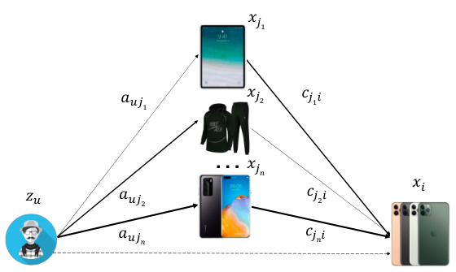
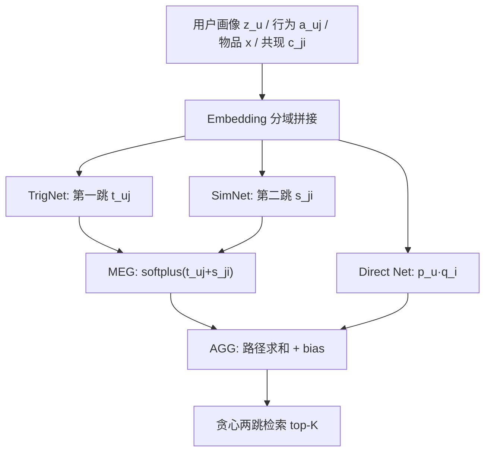
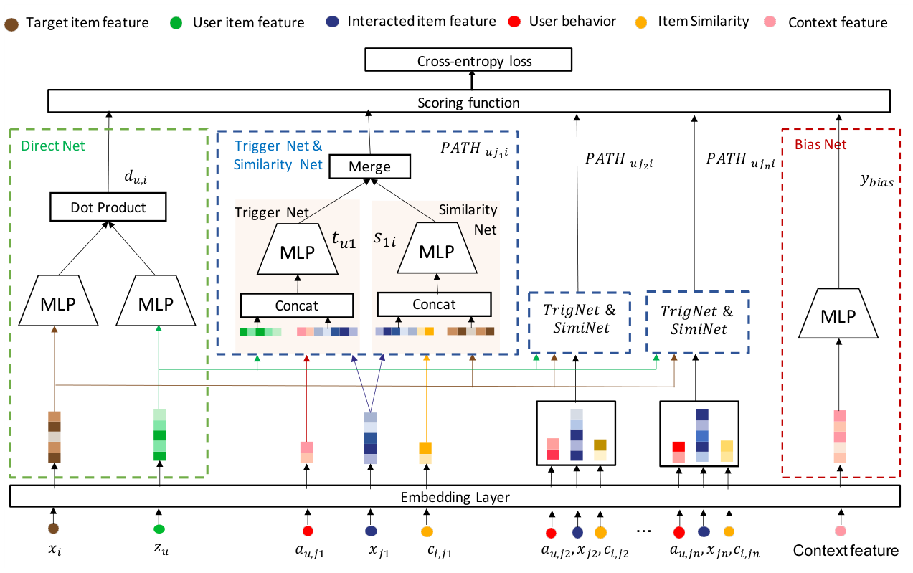

# Path-based Deep Network for Candidate Item Matching in Recommenders (面向召回阶段的路径式深度网络)

- **会议/期刊**: SIGIR 2021
- **作者与机构**: Houyi Li, Zhihong Chen, Chenliang Li, Rong Xiao, Hongbo Deng, Peng Zhang, Yongchao Liu, Haihong Tang（阿里巴巴 / 蚂蚁集团 / 武汉大学）
- **推荐链路定位**: 召回（候选物品生成）
- **研究方向**: 协同过滤与双塔召回 / 图神经网络推荐
- **论文原文**: [https://arxiv.org/abs/2105.08246v1](https://arxiv.org/abs/2105.08246v1)
- **开源代码**: 暂未开源

## TL;DR (1分钟核心速览)

工业召回长期在「item-based CF 够快但不个性化」与「双塔 EBR 个性化但把多兴趣压成单向量、且丢掉共现信号」之间二选一，通常靠多路策略并行再硬融分。PDN 把用户-物品相关性显式拆成 $1+n$ 条路径：TrigNet 给用户对每个历史物品的兴趣权重（第一跳），SimNet 给历史物品与目标物品的相似度（第二跳），两者做正性约束融合后求和。离线在 Leave-One-Out + 全库排序协议下，MovieLens HR@10 较 DIN 提升 4.9%；淘宝线上两周 A/B 将 PCTR 提升 18.04%、多样性提升 19.60%，端到端召回延迟仅 6.75 ms。

## Background & Motivation (背景与核心矛盾)

- **主流范式**: 工业召回由 item-based CF（倒排索引，快但只利用共现）与 EBR 双塔（DSSM/YoutubeDNN/BST，利用画像但用户侧压缩为定长向量）两路并行承担，再由多策略融合。
- **前人局限一**: 双塔的定长用户向量把性别、消费力、多品类兴趣混在一维空间里，无法编码"兴趣多样性"；同时双塔为保并行性，塔间不可交互，item-item 共现信息难以显式注入。
- **前人局限二**: DIN 虽用 target attention 建模了用户-历史物品-目标物品的关系，但需要为每个目标物品重算用户表示，复杂度不允许用于召回；且它忽略了"用户对历史物品本身的兴趣权重"这一维度。
- **核心洞察 (Key Insight)**: 若把打分写成 $\hat{y}_{ui}=f(\boldsymbol{z}_u,\boldsymbol{x}_i,\{\boldsymbol{x}_j\},\{\boldsymbol{a}_{uj}\},\{\boldsymbol{c}_{ji}\})$，则 item-based CF 是$\sum_j f_r(\boldsymbol{a}_{uj})c_{ji}$、MF 是$\boldsymbol{q}_i(\boldsymbol{p}_u+\frac{1}{\sqrt{|N(u)|}}\sum_j\boldsymbol{q}_j)^T$，二者都只是该式在信息使用上的**受限特例**——路径框架可同时容纳画像、行为与共现。
- **本文切入点**: 以二跳路径 (用户→历史物品→目标物品) 为单位建模，把两条边分别交给两个**可独立部署**的子网，用乘积式标量权重聚合，从而在保留倒排索引级延迟的同时注入个性化与多兴趣。

<figure class="paper-figure" markdown="span">
  <figcaption>图 1：用 2 跳图对用户 𝑢 对目标物品 𝑖 的偏好建模，其中 𝑗1 至 𝑗𝑛 表示交互过的物品。边的粗细表示相关性。</figcaption>
</figure>

## Method (核心方法设计)

### 1. 整体框架 (Overall Architecture)

输入四个特征域：用户域 $\boldsymbol{z}_u$、用户行为域$\{\boldsymbol{a}_{uj}\}$（停留时长、购买次数）、物品共现域$\{\boldsymbol{c}_{ji}\}$（CF 相关系数）、物品域$\boldsymbol{x}$。各域特征经离散化+Embedding 拼接为定长向量后，TrigNet 对每条历史物品产出一跳权重$t_{uj}$，SimNet 产出二跳权重$s_{ji}$，二者融合得路径权重；Direct Net 用独立双塔内积捕获群体层面的"直觉兴趣"；Bias Net 吸收位置/时段等选择偏差 logit（**仅训练期存在，serving 时移除**）。线上采用贪心路径检索：先用 TrigNet 实时取 top-$m$触发物品，再对每个触发物品查 SimNet 离线构建的$N\times k$倒排索引，合计$m\times k$ 候选后按统一分数排序。

<figure class="paper-figure" markdown="span">
  <figcaption>图 2：PDN 的网络结构。Direct net 用于获得直接路径的权重，以捕捉用户对目标物品的直观兴趣；TrigNet 和 SimNet 分别获得每条 2 跳路径的第一跳权重和第二跳权重，以捕捉细粒度的用户个性化多样性兴趣；bias net 用于捕捉各类选择偏差，以进一步实现无偏服务。（建议彩色查看）</figcaption>
</figure>

### 2. 关键设计拆解 (Key Designs)

1. **TrigNet + SimNet：把用户/物品表示变成"变长"的路径权重向量**：痛点在于双塔的定长表示是多样性瓶颈。TrigNet 用 MLP 逐条打分，输出 $t_{uj}=\mathrm{MLP}(\mathrm{CAT}[\boldsymbol{E}(z_u),\boldsymbol{E}(a_{uj}),\boldsymbol{E}(x_j)])$；SimNet 同时吃物品画像与共现统计$s_{ji}=\mathrm{MLP}(\mathrm{CAT}[\boldsymbol{E}(x_j),\boldsymbol{E}(c_{ji}),\boldsymbol{E}(x_i)])$。于是$\boldsymbol{T}_u=[t_{u1},\dots,t_{un}]$与$\boldsymbol{S}_i=[s_{1i},\dots,s_{ni}]$的维度等于交互数$n$，天然刻画细粒度多兴趣，且$s_{ji}$ 在训练后即固化，可离线独立建索引。

2. **正性约束的路径融合算子（本文最关键的一个 trick）**：若允许路径权重为负，模型可用"一条正路 + 一条负路"互相抵消来拟合负样本（图 3 中牛奶被赋予与手机正相关），或让 TrigNet 学出负兴趣来过拟合。因此限定 $t,s$经$\exp(\cdot)$输出为正，融合为$\mathrm{PATH}_{uji}=\ln(1+e^{t_{uj}}e^{s_{ji}})=\mathrm{softplus}(t_{uj}+s_{ji})$，等价于在 log 空间做加法后再 softplus，既保证单调可加、又压缩了搜索空间。

3. **训练目标、负采样与推理效率**：最终打分 $\hat{y}_{ui}=\mathrm{softplus}(d_{u,i})+\sum_j \mathrm{PATH}_{uji}+\mathrm{softplus}(y_{bias})$，经$p_{u,i}=1-\exp(-\hat{y}_{ui})$映射到$(0,1)$（因 softplus 值域为$(0,+\infty)$），用交叉熵训练；全模型端到端联合优化，各路径分数同一量纲，避免了多策略融合的分数不可比问题。负采样沿用工业流行的曝光未点击样本 + bias net 校正，无额外硬负采样设计。推理侧$m\times k$ 次查表 + 轻量 MLP，实测端到端 6.75 ms、QPS 千级。

## Experimental Setup & Evaluation Protocol (实验设置与评估协议)

- **数据集与预处理**: 三个公开集均沿用 [15] 的过滤口径——**保留交互数 ≥ 20 的用户**（非 5-core）：

| 数据集 | #Users | #Items | #Interactions | 稀疏度/密度 | 特征/场景说明 |
| :--- | :---: | :---: | :---: | :---: | :--- |
| MovieLens | 6,040 | 3,706 | 1,000,209 | ≈4.47% | 电影评分，稠密 |
| Pinterest | 55,187 | 9,916 | 1,500,809 | ≈0.27% | 图像 pin 板，中等稀疏 |
| Amazon Books | 351,356 | 393,801 | 6,271,511 | ≈0.0045% | 图书，极稀疏 |

- **数据划分与防穿越**: `Leave-One-Out`——每个用户最后一条交互作为 target item，其余交互构成行为序列，无时间戳切分细节披露。
- **排名评测协议**: 无偏 `Full-Ranking`（全库未交互物品参与排序，非采样排序），指标 HR@10 与 NDCG@10，重复 5 次取均值；改进在 $p<0.05$ 水平统计显著。
- **对比基线与超参**: 双塔类 DSSM / Youtube DNN / BST，item-CF 类 PCF / SLIM，排序模型 DIN；网格搜索调参取最优，各方法在同一 HR/NDCG 口径下评测。

## Key Experimental Results (实验关键数据)

### 1. 主实验对比 (Main Results)

| 组别 | 方法 | MovieLens HR@10 | NDCG@10 | Pinterest HR@10 | NDCG@10 | Amazon HR@10 | NDCG@10 |
| :--- | :--- | :---: | :---: | :---: | :---: | :---: | :---: |
| 双塔 | DSSM | 0.4699 | 0.2603 | 0.2730 | 0.1394 | 0.6433 | 0.4163 |
| 双塔 | Youtube DNN | 0.6187 | 0.3579 | 0.7585 | 0.4351 | 0.6539 | 0.4370 |
| 双塔 | BST | 0.6316 | 0.3603 | 0.8176 | 0.4955 | 0.6923 | 0.4403 |
| 排序 | DIN | 0.6454 | 0.3767 | 0.8185 | 0.5051 | 0.6973 | 0.4698 |
| item-CF | PCF | – | – | 0.2800 | 0.1470 | 0.0547 | 0.0203 |
| item-CF | SLIM | – | – | 0.6067 | 0.3323 | 0.1621 | 0.0679 |
| 本文 | **PDN (个性化)** | **0.6770** | **0.4071** | **0.8283** | **0.5358** | **0.7019** | **0.4735** |
| 本文 | **SimNet (item-item)** | **0.5152** | **0.2859** | **0.7911** | **0.4613** | **0.3505** | **0.2049** |
| | *Improv. vs 最优基线* | +4.9% | +8.1% | +1.2% | +6.1% | +0.7% | +0.8% |

线上 A/B（淘宝两周，相对提升）：SimNet 单独替换 item-CF 即得 PCTR +9.25% / ClkPU +5.43% / AvgSD +4.08% / 多样性 +14.68%；完整 PDN 达 **PCTR +18.04% / ClkPU +15.38% / AvgSD +7.87% / 多样性 +19.60%**。

### 2. 消融实验 (Ablation Study)

| 变体 | ML HR@10 | ML NDCG@10 | Pinterest HR@10 | Pinterest NDCG@10 | Amazon HR@10 | Amazon NDCG@10 |
| :--- | :---: | :---: | :---: | :---: | :---: | :---: |
| w/o bias net | 0.6323 | 0.3401 | 0.8015 | 0.4814 | 0.6869 | 0.4520 |
| w/o direct net | 0.6642 | 0.3930 | 0.8123 | 0.5286 | 0.7012 | 0.4729 |
| **PDN (full)** | **0.6770** | **0.4071** | **0.8283** | **0.5358** | **0.7019** | **0.4735** |

### 3. 关键实验发现 (Key Findings)

1. **bias net 是离线收益的最大来源，但在线不参与打分**：去掉 bias net 后 MovieLens HR@10 从 0.6770 掉到 0.6323（−6.6%），超过 direct net 的贡献；说明离线全库排序协议下的位置/时段偏差极重，若不做无偏校正，路径权重会被偏差信号污染——这提醒后续工作：离线评测若不控偏差，路径类模型的增益会被高估。
2. **路径式建模对短序列用户收益最大，且不牺牲多样性**：按行为长度分桶（淘宝日志 HR@300），$n\leq15$组 PDN 0.263 对比 BST 0.123（**+113.8%**），$n>45$组仍 +47.5%；同时候选多样性随$n$ 单调上升并全程高于 BST。这印证了 TrigNet 的收益来自"少而准的触发物品"，而非依赖长序列堆信息。
3. **SimNet 可独立替代 item-based CF，且破了"马太效应"**：同等触发物品下，item-CF 受月销量干扰返回高销但不相关物品（猫形玩偶→狗形玩偶），SimNet 能返回猫爪印杯子等长尾相关物；类别相似度矩阵呈块对角结构（女装-童装、电子-家电相似度显著高于无关类别），这也是线上多样性 +19.60% 的直接来源。

## Highlights & Limitations (亮点、对比与审稿批判)

- **与代表作对比 (vs. Prior Work)**: 相比 DSSM/YoutubeDNN/BST 的定长用户向量，PDN 的用户表示维度等于交互数 $n$，把"多兴趣"从隐式压缩变为显式分解；相比 DIN，PDN 把 target attention 解耦为 SimNet 的离线可缓存打分 + TrigNet 的在线一跳打分，从而把 attention 类建模从精排搬到召回；相比多路策略并行，PDN 单模型端到端训练，路径分数量纲统一、无需融合。
- **可迁移亮点**: (1) "边权重标量化 + $\exp$ 正性约束 + softplus 融合"这一组合可迁移到任何需要聚合多路召回的模型，避免负权重互相抵消的伪拟合；(2) 将 attention 类结构拆成"在线一跳 + 离线二跳索引"的贪心检索范式，是解决召回阶段无法承受 target-dependent 重算的通用工程套路。
- **审稿级局限批判**: (1) 离线仅在 $k=10$的 leave-one-out 全库排序上评测，未报告工业更关心的 HR@300/@500 与召回率-吞吐的帕累托曲线，也未见方差/置信区间；(2) 主表中 PDN 的"Item to Item"列实为 SimNet 单独结果，与"Personalise"列不可直接对比，表格呈现易引起误读；同时公式 (10) 的$\ln(1+e^{t}e^{s})$与公式 (14) 的$\mathrm{softplus}(t+s)$在$m$-截断 top-$m$触发下并非严格等价（前者未截断 bias 项），文中未讨论近似误差；(3) 路径数随$n$线性增长，$m$与$k$的敏感度分析缺失，且公开集上未使用任何 id 之外的辅助特征（$\boldsymbol{c}_{ji}$ 的构造细节亦未披露），离线复现门槛较高。

## Rating (四维评分)

- **方法创新性 (Novelty)**: ⭐⭐⭐⭐ （首次把召回显式写成用户-物品二跳路径聚合，统一了 item-CF 与 EBR 两个特例；但各子模块（MLP、attention 式加权、bias tower）本身均为已有组件）
- **评估协议与实验扎实度 (Protocol & Experiments)**: ⭐⭐⭐⭐ （三数据集 + 全库排序 + 两周线上 A/B + 消融 + 分桶分析齐全，但缺方差与 $k$ 敏感度，主表列语义易混）
- **写作与数学规范度 (Clarity & Rigor)**: ⭐⭐⭐⭐ （路径视角的统一表述很漂亮，公式 (10) 与 (14) 的近似关系及 $\boldsymbol{c}_{ji}$ 的来源说明略显含糊）
- **工业落地与复现价值 (Industrial & Practical Value)**: ⭐⭐⭐⭐⭐ （淘宝全量部署、6.75 ms 端到端延迟、千级 QPS，索引构建与贪心检索流程描述完整，工程参考价值极高，惜未开源）

