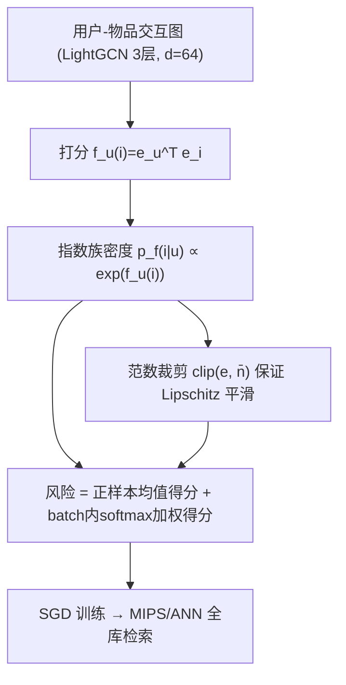
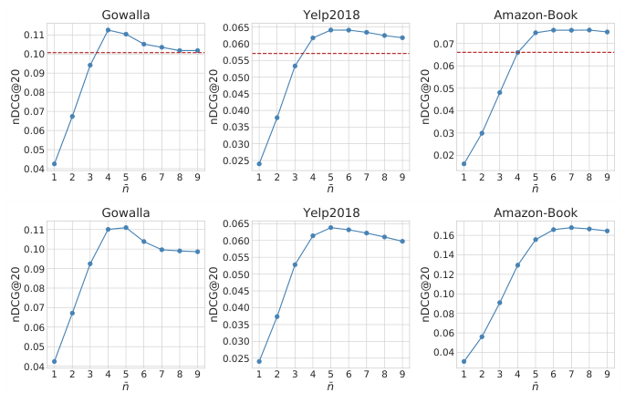
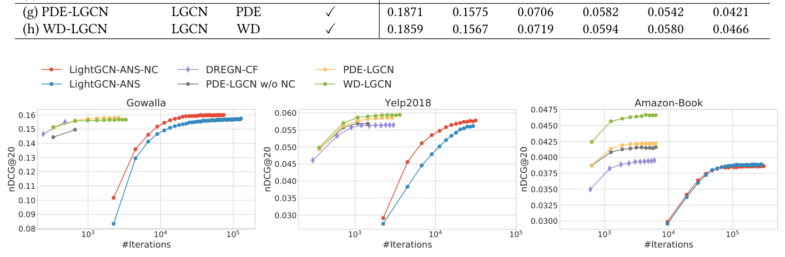

# Scalable Personalised Item Ranking through Parametric Density Estimation (基于参数密度估计的可扩展个性化物品排序)

- **会议/期刊**: SIGIR 2021
- **作者与机构**: Riku Togashi (CyberAgent / Waseda Univ.)、Masahiro Kato、Mayu Otani、Tetsuya Sakai、Shin'ichi Satoh
- **推荐链路定位**: 召回（全库 MIPS/ANN 检索，兼可做精排打分器）
- **研究方向**: 协同过滤与双塔召回 / 自监督与交互去噪（负采样理论）
- **论文原文**: [https://arxiv.org/abs/2105.04769v1](https://arxiv.org/abs/2105.04769v1)
- **开源代码**: [LightGCN 官方实现（本文骨架）](https://github.com/kuandeng/LightGCN)，作者风险函数代码未单独开源

## TL;DR (1分钟核心速览)

隐式反馈的 one-class 问题迫使主流方法依赖成对损失 + 负采样器：成对损失每用户期望风险是 $O(|\mathcal{I}|^2)$，而模型化采样器（IRGAN）还要多训一个生成器、超参难调、实测常不如 DNS。本文改走"密度估计"路线：为每用户在指数族内估计正物品密度$p_f(i|u)\propto\exp(f_u(i))$，用 KLD 惩罚 MLE 推导风险，**最优负采样分布恰为排序器自身的当前分布**，从而在点式复杂度下获得成对法的排序能力；再配范数裁剪与 Wasserstein 变体。在 Gowalla/Yelp2018/Amazon-Book 的 Full-Ranking 协议上，AMZ 上 nDCG@20 达 0.0466（DREGN-CF 0.0395，+18.0%），且 3,000–4,000 次迭代即收敛。

## Background & Motivation (背景与核心矛盾)

- **主流范式**: 点式 CPE（估计 $p(y=+1|u,i)$）训练高效但排序弱；成对 BPR 排序强，但每用户期望风险需枚举物品对，二次复杂度使其在大库上不可行。
- **前人局限**: (1) 模型化采样器路径（IRGAN）要同时训练判别器与生成器，每步还要在全库上从生成器采样，且多个文献报告其效果不如 DNS 这类 ranker-based 采样；(2) DRE 路径（DREGN-CF）虽把风险降到点式成本，但其自适应加权是启发式设计，未从生成过程推出最优采样分布。
- **核心洞察 (Key Insight)**: 直接建模 $p(i|u,y=+1)$时，归一化约束$\int p_f(i|u)\,di=1$带来"一和性质"——所有物品争夺有限概率质量，天然产生 top-$K$所需的相对性；更关键的是 KLD 惩罚项展开后恰好与不可解的 log-partition$A(f_u)$ 相消，风险只剩两项期望。
- **本文切入点**: 在指数族内做惩罚 MLE，得到一个"自身即最优采样器"的点式风险，把采样器模型整体消掉。

## Method (核心方法设计)

### 1. 整体框架 (Overall Architecture)

打分器沿用 LightGCN（3 层图卷积、$d=64$），$f_u(i)=\mathbf{e}_u^\top\mathbf{e}_i$。训练用两阶段采样：先静态采候选物品集$I_B$，再在 batch 内按$\mathrm{softmax}(f_u)$自归一化加权构造风险，SGD 逐步更新；由于$p_0$取均匀、$p_f\propto\exp(f_u(i))$，模型排序仅由内积决定，推理时可直接用 MIPS/ANN 做全库召回。范数裁剪在每步更新后逐向量施加，保证 Lipschitz 平滑性。

### 2. 关键设计拆解 (Key Designs)

1. **惩罚 MLE 抵消 log-partition（把采样器变成"隐式"）**：朴素 MLE 的 $\log\sum_{i}\exp(f_u(i))$不可解，SGD 无从下手。作者加入对均匀先验的 KLD 惩罚，利用$\mathrm{KLD}(p_f\|p_0)=\mathbb{E}_{p_f}[f_u(i)]-A(f_u)$与风险式中$+A(f_u)$相消，得$R(f)=\mathbb{E}_u\big[\hat{\mathbb{E}}_+[-f_u(i)]+\mathbb{E}_{p_f(i|u)}[f_u(i)]\big]$。直觉：第一项拉高真实正样本得分，第二项在**模型自身分布**下压低高概率物品——等价于一个每步自适应更新的 top-weighted 负项，正是 GAN 生成器想学的东西，此处有闭式解。

2. **重要性采样风险近似（点式成本、无需逐步蒙特卡洛）**：$\mathbb{E}_{p_f}[f]$依赖实时打分、逐步重采样代价高。改写为在静态$p_0$上的期望后，$\exp A(f_u)=\mathbb{E}_{p_0}[\exp(f_u(i))]$正好充当分母，得到自归一化 mini-batch 估计器：$\hat{R}=\frac{1}{|U_B|}\sum_{u}\Big[-\frac{1}{|I_u^+|}\sum_{i\in I_u^+}f_u(i)+\frac{\sum_{i\in I_B}\exp(f_u(i))f_u(i)}{\sum_{i\in I_B}\exp(f_u(i))}\Big]$。每物品一次前向、与点式同阶，且最优采样分布随参数即时更新而无需额外模型。

3. **范数裁剪 + WD 变体（稳定性与"只排未观测物品"）**：一和性质使单个物品的概率尖峰主导总量，方差爆炸导致训练不稳；要求 $|f_u(i)-f_u(i')|\le\tilde{L}$，由$\max_v\|\mathbf{e}_v\|\le\bar{n}$充分保证，故每步执行$\mathrm{clip}(\mathbf{e},\bar{n})=\min(1,\bar{n}/\|\mathbf{e}\|)\mathbf{e}$（L2 正则只惩罚平均范数而非最大范数，故不能替代）。评测只关心未观测物品，故把$I_B$替换为$I_B\setminus I_u^+$得 WD 变体；作者证明凸$\mathcal{F}_1$下该单模型目标与 IRWGAN 的强对偶解一致（最优生成器$q_u^*\propto p_0\exp(f_u)$），且它最小化成对风险 Jensen 下界的上界，误差被$\tilde{L}$ 界定，故排序效果可逼近成对法。

**训练目标与效率**：$\min_f \hat{R}(f,U_B,I_B)+\lambda\mathcal{R}_{L2}$；负采样为模型自身分布（batch 内自归一化），**免额外采样模型、免负样本枚举**；推理为标准 MIPS/ANN，与 LightGCN 完全一致。

## Experimental Setup & Evaluation Protocol (实验设置与评估协议)

| 数据集 | #Users | #Items | #Interactions | 密度 | 说明 |
| :--- | :---: | :---: | :---: | :---: | :--- |
| Gowalla | 29,858 | 40,981 | 1,027,370 | 0.00084 | LBSN 签到，物品库最小 |
| Yelp2018 | 31,668 | 38,048 | 1,561,406 | 0.00130 | 本地生活商户 |
| Amazon-Book | 52,643 | 91,599 | 2,984,108 | 0.00062 | 物品库最大、最稀疏 |

- **数据划分**: 严格复用 LightGCN / DREGN-CF 官方切分——Gowalla 为**全局时间戳切分**，Yelp2018 与 Amazon-Book 为**每用户留一（last-item 作测试）**。
- **排名评测协议**: **Full-Ranking（全库未交互物品排序）**，指标 R@20 / nDCG@20；无采样负例。
- **基线与超参**: NGCF、Mult-VAE、ENMF、LightGCN(BPR+均匀采样)、DREGN-CF；LightGCN 系统一 3 层、$d=64$，$\lambda\in\{0.01,0.05,0.1\}$，$\bar{n}\in\{1,\dots,9\}$，$|U_B|=2500$（成对变体用 4096）；显著性用 paired Tukey HSD（95% CI）+ Hedge's$g$。

## Key Experimental Results (实验关键数据)

### 1. 主实验对比 (Main Results)

| 方法 | Gowalla R@20 | Gowalla nDCG@20 | Yelp R@20 | Yelp nDCG@20 | Amazon R@20 | Amazon nDCG@20 |
| :--- | :---: | :---: | :---: | :---: | :---: | :---: |
| NGCF | 0.1567 | 0.1325 | 0.0575 | 0.0474 | 0.0342 | 0.0262 |
| Mult-VAE | 0.1644 | 0.1340 | 0.0589 | 0.0458 | 0.0413 | 0.0306 |
| ENMF | 0.1512 | 0.1306 | 0.0628 | 0.0515 | 0.0344 | 0.0272 |
| LightGCN | 0.1828 | 0.1551 | 0.0651 | 0.0532 | 0.0421 | 0.0324 |
| DREGN-CF | 0.1828 | 0.1551 | 0.0685 | 0.0564 | 0.0506 | 0.0395 |
| **PDE-LGCN** | **0.1871** | **0.1575** | 0.0706 | 0.0582 | 0.0542 | 0.0422 |
| **WD-LGCN** | 0.1859 | 0.1567 | **0.0719** | **0.0594** | **0.0580** | **0.0466** |

相对最强基线 DREGN-CF：WD-LGCN 的 nDCG@20 提升 **+5.3%**(Yelp)、**+18.0%**(Amazon)，R@20 提升 **+5.0%**/**+14.6%**；PDE-LGCN 为 +3.2%/+6.8%。Gowalla 上 WD-LGCN 仅 +1.0% 且不显著（$p=0.528$）。

### 2. 消融实验 (Ablation Study)

| 变体 | 骨架 | 风险 | NC | Gowalla nDCG@20 | Yelp nDCG@20 | Amazon nDCG@20 |
| :--- | :---: | :---: | :---: | :---: | :---: | :---: |
| (a) PDE-MF w/o NC | MF | PDE | ✗ | 0.1097 | 0.0431 | 0.0349 |
| (b) PDE-MF | MF | PDE | ✓ | 0.1224 | 0.0525 | 0.0398 |
| (c) WD-MF | MF | WD | ✓ | 0.1161 | 0.0513 | 0.0401 |
| (d) LightGCN-ANS | LGCN | Pairwise+ANS | ✗ | 0.1568 | 0.0561 | 0.0389 |
| (e) LightGCN-ANS-NC | LGCN | Pairwise+ANS | ✓ | **0.1601** | 0.0578 | 0.0386 |
| (f) PDE-LGCN w/o NC | LGCN | PDE | ✗ | 0.1493 | 0.0569 | 0.0414 |
| (g) PDE-LGCN | LGCN | PDE | ✓ | 0.1575 | 0.0582 | 0.0422 |
| (h) WD-LGCN | LGCN | WD | ✓ | 0.1567 | **0.0594** | **0.0466** |

<figure class="paper-figure" markdown="span">
  <figcaption>图 2：¯𝑛 对验证集上 PDE-LGCN 与 WD-LGCN 的 nDCG@20 的影响。上、下两图分别展示 PDE-LGCN 与 WD-LGCN 的结果。红色虚线表示未进行范数裁剪（¯𝑛 = ∞）时的性能；由于 WD-LGCN 模型训练不稳定，我们省略了该结果。</figcaption>
</figure>

### 3. 关键实验发现 (Key Findings)

1. **物品库越大、越稀疏，采样分布质量越是决定性变量**：在物品数最多（91,599）、密度最低（6.2e-4）的 Amazon-Book 上，WD-LGCN 相比 LightGCN(BPR+均匀) 的 nDCG@20 从 0.0324 提到 0.0466（+43.8%）；而在物品库最小的 Gowalla 上增益仅 +1.0% 且不显著，说明本文闭式最优采样器的收益随候选空间膨胀而放大。
2. **点式成本拿到成对法效果，且快 1–2 个数量级**：PDE-LGCN 在 Amazon 上约 3,000 迭代 / 522s 收敛，WD-LGCN 约 4,000 迭代 / 696s；而 LightGCN-ANS-NC 需 150,000 迭代 / 33,229s（约 60× 慢）。DREGN-CF 迭代数虽少（2,000）却耗时 982s——因其 ranking uLSIF 风险每用户含 6 个自归一化加权项，本文估计器只有 2 个均值项。

<figure class="paper-figure" markdown="span">
  <figcaption>图 1：LightGCN、DREGN-CF、PDE-LGCN 与 WD-LGCN 在训练效率方面的比较。</figcaption>
</figure>

3. **范数裁剪是稳定性开关，"简单骨架 + 本文风险"已能打赢神经基线**：PDE-MF 去掉裁剪后 Gowalla nDCG@20 从 0.1224 掉到 0.1097（$p<1e^{-3}, g=0.116$），WD 系列无裁剪直接发散；同时纯 MF 的 PDE-MF/WD-MF 在 Amazon 上（0.0398/0.0401）已超过 Mult-VAE（0.0306）与多数神经基线，证明增益来自风险函数而非模型容量。代价是 Gowalla 上成对+ANS+裁剪（(e) 0.1601）反超本文方法（（g) 0.1575），即小数据下成对法仍有优势。

## Highlights & Limitations (亮点、对比与审稿批判)

- **与代表作对比**: vs **LightGCN**——架构、采样流程完全相同，只换风险函数即得一致增益，归因清晰；vs **DREGN-CF**——同为 DRE 家族，但其加权是启发式的，本文由 MLE 闭式导出最优分布且估计器项数从 6 降到 2，更快更准；vs **IRGAN**——把生成器模型整体消掉（最优解有闭式），超参从一个额外模型降为 $\lambda,\bar{n}$ 两个。
- **可迁移亮点**: (1) batch 内自归一化估计器 $\sum_{I_B}e^{f}f/\sum_{I_B}e^{f}$ 可直接替换任意双塔/GNN 召回模型的 BPR 损失，几乎零工程成本；范数裁剪作为 Lipschitz 正则，对 sampled-softmax / InfoNCE 类损失同样适用。
- **审稿级局限批判**: (1) 估计器对 $I_B$的采样分布**有偏**（作者明确放弃逆概率校正以避免大方差），batch 物品集大小与构造方式直接影响近似质量，且小数据集（Gowalla）反而被成对法反超，适用边界需先摸底；(2) 推导依赖指数族 + 均匀$p_0$才得$p_f\propto\exp(f_u)$的闭式最优采样，换用非线性交互打分器后闭式解不再成立，WD 变体在无裁剪时不稳定、$\bar{n}$ 需逐数据集调（实验中随物品数增多而变大）。

## Rating (四维评分)

- **方法创新性 (Novelty)**: ⭐⭐⭐⭐ （把 IRGAN 的生成器化为闭式解、用 KLD 抵消 log-partition 得到两项目风险，是干净的理论降维；但内核仍是 softmax 密度 + 内积打分，范式不算全新，且有 Tanielian 等 MLE-softmax 前作铺垫）
- **评估协议与实验扎实度 (Protocol & Experiments)**: ⭐⭐⭐⭐ （Full-Ranking 无偏协议 + 三个真实集 + 8 组消融 + Tukey HSD 与效应量，归因链条完整；扣分在于仅离线实验、无采样排序或线上 A/B 的佐证）
- **写作与数学规范度 (Clarity & Rigor)**: ⭐⭐⭐⭐⭐ （从指数族建模到风险近似、IRWGAN 强对偶证明、与成对风险下界的误差界定，推导环环相扣，附收敛时间与 $\bar{n}$ 敏感性分析）
- **工业落地与复现价值 (Industrial & Practical Value)**: ⭐⭐⭐⭐ （推理侧与 LightGCN 完全一致可直接上 MIPS/ANN，训练侧快 1–2 个数量级；但作者未放出风险函数开源实现，且大批量自归一化分母在分布式训练下的实现成本需自行验证）

