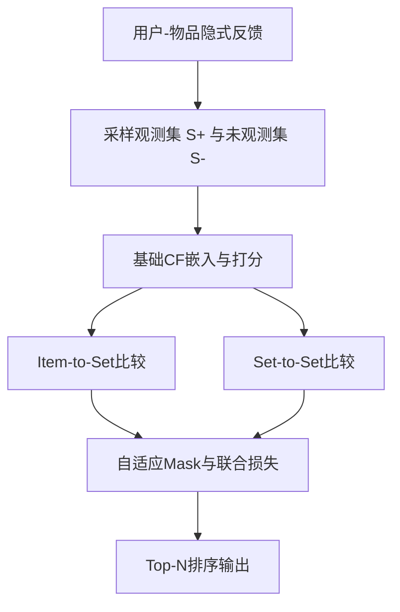
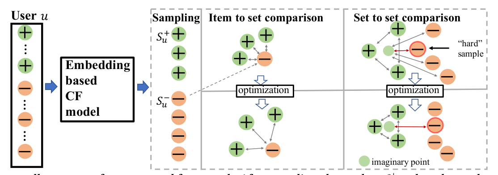

# Set2setRank: Collaborative Set to Set Ranking for Implicit Feedback based Recommendation (面向隐式反馈推荐的协同集合到集合排序)

- **会议/期刊**: SIGIR 2021
- **作者与机构**: Lei Chen, Le Wu, Kun Zhang, Richang Hong, Meng Wang；合肥工业大学等
- **推荐链路定位**: 排序优化（可插拔于召回/排序模型）
- **研究方向**: 协同过滤与双塔召回
- **论文原文**: [https://arxiv.org/abs/2105.07377v2](https://arxiv.org/abs/2105.07377v2)
- **开源代码**: 暂未开源

## TL;DR (1分钟核心速览)

隐式反馈中每个用户的观测物品极少，BPR式pairwise独立比较与SetRank式listwise top-1简化都未充分利用观测集合结构。本文提出Set2setRank：采样观测集与未观测集，设计item-to-set与set-to-set两级排序损失，并用自适应mask处理不同观测长度。在Amazon Books、MovieLens-20M、Yelp的Full-Ranking协议下，HR/NDCG@10-50领先；ML-20M的HR@10较最强基线Deep-SetRank提升约11.2%。

## Background & Motivation (背景与核心矛盾)

- **主流范式**: 隐式反馈CF多采用BPR pairwise损失、SetRank/CLiMF listwise损失，或Pop-Sampling/AoBPR等负采样策略。
- **前人局限**: pairwise将每个观测-未观测对独立处理，忽略观测物品间关联；listwise为效率多退化为top-1排列概率，难以建模整个观测集合。
- **核心洞察 (Key Insight)**: 用户观测集虽小，但集合内部与集合之间的相对距离蕴含额外自监督信号；最“难”未观测样本也值得在集合层面显式挖掘。
- **本文切入点**: 将用户反馈划分为采样观测集与未观测集，用两级集合比较同时建模“每个负样本远离观测集”和“观测集汇总距离小于最难负样本”。

## Method (核心方法设计)

### 1. 整体框架 (Overall Architecture)

给定用户$u$，先由任意embedding CF模型得到物品打分，再采样观测集$\mathcal{S}^{+}_{u}$与未观测集$\mathcal{S}^{-}_{u}$。模型先做item-to-set比较：每个未观测样本都应低于观测集中所有样本；再做set-to-set比较：观测集内部汇总距离应小于观测集到最“难”未观测样本的距离。自适应版本用随机mask删除部分观测样本，使集合长度动态变化。训练采用两级损失加权，推理仍按全库打分排序。

<figure class="paper-figure" markdown="span">
  <figcaption>图1：我们提出的框架的整体结构。采样观测集合 𝑆+𝑢 和未观测集合 𝑆−𝑢 后，我们构建两级比较，促使观测集合的排序位置先于未观测集合。物品到集合比较将每个未观测样本推离观测集合。集合到集合比较假设观测集合内部的汇总距离应小于观测样本与最“难”未观测样本之间的距离。</figcaption>
</figure>

### 2. 关键设计拆解 (Key Designs)

1. **Item-to-Set比较（打破pairwise独立性）**：pairwise一次只推远一个正负对，本文让每个未观测物品$j$远离整个观测集。定义$D(x,y)=\sigma(x-y)$、$F(X,y_j)=\sum_{i=1}^{|X|}D(x_i,y_j)$，则
$\mathcal{L}_{2}(u)=\mathbb{E}_{\mathcal{S}^{+}_{u}}\mathbb{E}_{\mathcal{S}^{-}_{u}}\left[\sum_{j=1}^{K}\ln F(\mathcal{S}^{+}_{u},\hat{r}^{-}_{uj})\right]$。
直觉是：一次更新同时利用$L$个观测样本与$K$个负样本，缓解观测集稀疏。

2. **Set-to-Set比较（显式挖掘最难负样本）**：item-to-set仍可能被简单负样本主导，本文先汇总观测集距离
$f_{pos}(\mathcal{S}^{+}_{u},\mathcal{S}^{+}_{u})=\frac{1}{L}\sum_{i=1}^{L}\ln F(\mathcal{S}^{+}_{u},\hat{r}^{+}_{ui})$，
再取最难负样本$f_{neg}=\min_{j}\ln F(\mathcal{S}^{+}_{u},\hat{r}^{-}_{uj})$，并最大化
$\mathcal{L}_{3}(u)=\mathbb{E}\ln D(f_{neg}(\mathcal{S}^{+}_{u},\mathcal{S}^{-}_{u}),\beta f_{pos}(\mathcal{S}^{+}_{u},\mathcal{S}^{+}_{u}))$。
该式把“观测集整体紧凑、负样本远离”的集合级margin写进损失。

3. **自适应Mask、训练目标与复杂度**：对观测集施加随机mask，至少保留2个样本，得到$\tilde{F}(X,y_j)=\sum_i D(x_i,y_j)\cdot Mask_i$，使不同活跃度用户共享同一框架。总损失为$\mathcal{L}=\sum_{u}[\mathcal{L}_{2}(u)+\lambda\mathcal{L}_{3}(u)]$。训练每用户采样$K$个未观测负样本，$L$个观测样本；推理用全库打分。复杂度约$O(|U|M_{avg}(K+L))$，当$L\approx K-1$时接近BPR；$\lambda=0$且$L=K=1$退化为pairwise。

## Experimental Setup & Evaluation Protocol (实验设置与评估协议)

- **数据集与预处理**:

| 数据集 | #Users | #Items | #Interactions | 稀疏度/密度 | 特征/场景说明 |
| :--- | :---: | :---: | :---: | :---: | :--- |
| Amazon Books | 52k | 91k | 3M | 约0.063% | 图书隐式反馈，沿用常用过滤 |
| MovieLens-20M | 138k | 27k | 20M | 约0.537% | 电影评分转隐式反馈 |
| Yelp | 45k | 45k | 1M | 约0.049% | 本地商家，10-core过滤 |

- **数据划分与防穿越 (Splitting Strategy)**: 用户级验证/测试切分；原文未展开切分细节，测试时仅将验证/测试记录与全库未交互候选混合排序。
- **排名评测协议 (Ranking Protocol)**: 无偏`Full-Ranking`，每个用户对所有未交互物品打分；报告HR@N与NDCG@N，$N\in\{10,20,30,40,50\}$。
- **对比基线与超参设置**: 基线含BPR、Pop-Sampling、AoBPR、CLiMF、Deep-SetRank、LR-GCCF；主实验公平设置$K=5$、$L=2$，自适应版$\beta=0.2$，非自适应$\beta=0.5$，$\lambda=1$。原文未给统一嵌入维度$d$与显著性检验细节。

## Key Experimental Results (实验关键数据)

### 1. 主实验对比 (Main Results)

| 模型 | Amazon HR@10 | Amazon NDCG@10 | ML-20M HR@10 | ML-20M NDCG@10 | Yelp HR@10 | Yelp NDCG@10 |
| :--- | :---: | :---: | :---: | :---: | :---: | :---: |
| BPR | 0.01851 | 0.01710 | 0.2380 | 0.2504 | 0.03708 | 0.02929 |
| Pop-Sampling | 0.01945 | 0.01774 | 0.2545 | 0.2707 | 0.03580 | 0.02806 |
| AoBPR | 0.01960 | 0.01787 | 0.2381 | 0.2523 | 0.03788 | 0.02951 |
| CLiMF | 0.01546 | 0.01431 | 0.1130 | 0.1268 | 0.01752 | 0.01329 |
| Deep-SetRank | 0.01950 | 0.01827 | 0.2759 | 0.2857 | 0.03801 | 0.02945 |
| LR-GCCF | 0.02209 | 0.02040 | 0.2672 | 0.2764 | 0.03919 | 0.03118 |
| Set2setRank(A)_BPR | 0.02169 | 0.01985 | **0.3067** | **0.3197** | 0.03920 | 0.03104 |
| Set2setRank(A)_GCN | **0.02264** | **0.02086** | 0.2920 | 0.3011 | **0.04058** | **0.03258** |

相对最强非本文基线：Amazon +2.49%/+2.25%，ML-20M +11.16%/+11.90%，Yelp +3.55%/+4.49%（HR@10/NDCG@10）。

### 2. 消融实验 (Ablation Study)

| 模型 | Amazon HR@10 | Amazon NDCG@10 | ML-20M HR@10 | ML-20M NDCG@10 |
| :--- | :---: | :---: | :---: | :---: |
| BPR | 0.01851 | 0.01710 | 0.2380 | 0.2504 |
| w/o set-to-set（仅item-to-set） | 0.01999 | 0.01835 | 0.2899 | 0.3047 |
| w/o item-to-set（仅set-to-set） | 0.02019 | 0.01872 | 0.2869 | 0.3057 |
| Full Set2setRank_BPR | **0.02084** | **0.01900** | **0.3072** | **0.3234** |

### 3. 关键实验发现 (Key Findings)

1. **两级比较互补，完整模型最优**：Amazon上仅item-to-set为0.01999 HR@10、仅set-to-set为0.02019，完整模型升至0.02084；ML-20M上完整模型0.3072，较仅item-to-set的0.2899提升约6.0%，说明集合级margin不是单一分支的简单加权。
2. **对强listwise基线收益更明显**：ML-20M上Set2setRank(A)_BPR的HR@10=0.3067、NDCG@10=0.3197，较Deep-SetRank的0.2759/0.2857提升约11.2%/11.9%，表明top-1排列概率确实漏掉了观测集结构信息。
3. **集合大小敏感但可调**：表2/3显示$K,L$增大先升后降；主表为公平比较固定$K=5,L=2$，而调大$K$可进一步涨点，但过大负样本集会造成观测/未观测分布不一致，需按数据密度调参。

## Highlights & Limitations (亮点、对比与审稿批判)

- **与代表作对比 (vs. Prior Work)**: 相比BPR，本文解除pairwise独立性并一次利用多个正负样本；相比SetRank/Deep-SetRank，避免只优化top-1排列概率；相比AoBPR，本文将“难负样本”嵌入集合级margin而非仅改采样分布。
- **可迁移亮点**: 两级集合排序损失可即插即用于MF/GCN等打分模型；最难负样本选择与mask式可变集合长度可迁移到序列推荐、多行为推荐。
- **审稿级局限批判**: 自适应mask在$K,L$较小时增益有限；$K,L$与$\beta$需按数据集调参，且Full-Ranking评测未给显著性检验；虽复杂度接近BPR，但每步$KL$比较与全库推理在超大规模工业场景仍需工程优化。

## Rating (四维评分)

- **方法创新性 (Novelty)**: ⭐⭐⭐⭐ （集合到集合排序与最难负样本margin设计清晰，给出pairwise/listwise退化关系）
- **评估协议与实验扎实度 (Protocol & Experiments)**: ⭐⭐⭐⭐ （三数据集Full-Ranking、多N指标与消融完整，但缺显著性检验与切分细节）
- **写作与数学规范度 (Clarity & Rigor)**: ⭐⭐⭐⭐ （损失推导紧凑，复杂度分析到位；符号略多且部分实验表存在设置差异需对照阅读）
- **工业落地与复现价值 (Industrial & Practical Value)**: ⭐⭐⭐ （模型无关、复杂度接近BPR，适合作为排序损失替换；但无开源代码且超参敏感）

