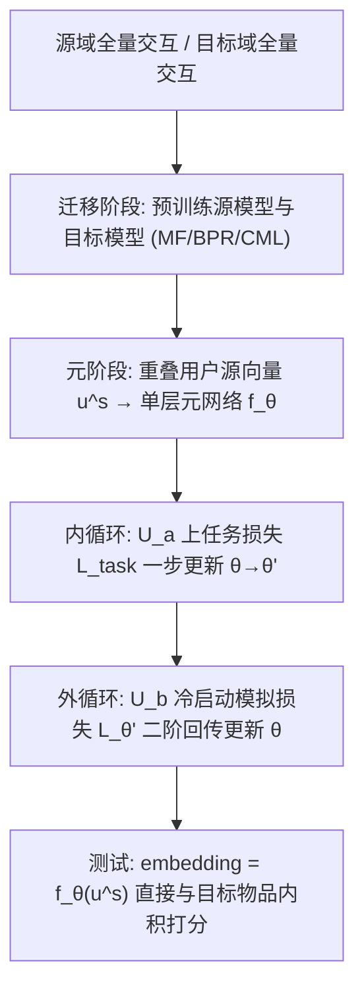
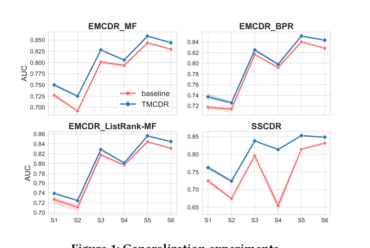

# Transfer-Meta Framework for Cross-domain Recommendation to Cold-Start Users (面向冷启动用户的迁移-元学习跨域推荐框架)

- **会议/期刊**: SIGIR 2021 (short paper, 5 pages)
- **作者与机构**: Yongchun Zhu, Kaikai Ge, Fuzhen Zhuang(通讯), Ruobing Xie, Dongbo Xi 等；中科院计算所、腾讯微信搜索应用部、北航
- **推荐链路定位**: 召回（用户表征迁移与冷启动打分）
- **研究方向**: 跨域与多场景推荐 / 冷启动与长尾推荐
- **论文原文**: [https://arxiv.org/abs/2105.04785v1](https://arxiv.org/abs/2105.04785v1)
- **开源代码**: 暂未开源

## TL;DR (1分钟核心速览)

针对 EMCDR 类方法"映射函数只用少量重叠用户训练、严重过拟合重叠用户、对目标域冷启动用户泛化差"的痛点，本文提出 TMCDR：迁移阶段直接复用源/目标域的**全量数据预训练模型**（而非仅用重叠用户从零重训），元阶段用 MAML 式情景训练学一个**任务导向**的单层元网络，把源域用户 embedding 隐式变换到目标域特征空间。在 Amazon-5cores 与 Douban 的 6 个跨域任务、留出 20% 重叠用户作冷启动测试的协议下，AUC 相对最优基线提升 0.4%–4.8%。

## Background & Motivation (背景与核心矛盾)

- **主流范式**: EMCDR 系列先用重叠用户分别训练源/目标域 embedding，再以 MSE 显式学习"源 embedding → 目标 embedding"的映射函数，冷启动时用映射结果替代目标域用户向量。
- **前人局限**: ① 映射函数的训练样本数 = 重叠用户数（本文任务中最多 37388、最少仅 894），函数**天然偏向重叠用户**，泛化到真实冷启动用户时退化；② 从零训练只用重叠用户的交互，未被重叠用户触碰过的物品 embedding 学不出来。
- **核心洞察 (Key Insight)**: EMCDR 的优化目标是"**逼近目标域 embedding**（表征对齐）"，而冷启动任务的真实目标是"**排序/评分准**（任务对齐）"；两者错位，加上样本极少，映射必然过拟合。
- **本文切入点**: 把"学映射"换成"学一个可在少量样本上快速适应新用户的元网络"，用 MAML 的 episodic 训练模拟"从重叠用户学 → 到冷启动用户用"的过程。

## Method (核心方法设计)

### 1. 整体框架 (Overall Architecture)

TMCDR 分两段。**迁移阶段**：在源域与目标域全量交互上各预训练一个 embedding 模型（MF / BPR / ListRank-MF / CML 任选），得到 $u^s,v^s,u^t,v^t$，此阶段等价于把工业界已上线的单域模型直接拿来用，无需为跨域重训。**元阶段**：冻结所有预训练 embedding，只学一个元网络$f_\theta$（单层全连接），把重叠用户的源域向量$u^s_i$变换为目标空间向量$f_\theta(u^s_i)$；用分组式 episode（学习组$U_a$+ 冷启动组$U_b$，两组用户不相交）做内外双层梯度更新。**测试阶段**：冷启动用户只需一次前向$f_\theta(u^s)$ 即可打分，无任何目标域交互。

### 2. 关键设计拆解 (Key Designs)

1. **预训练式迁移阶段（Transfer）**：EMCDR 用重叠用户从零重训，导致大量物品无 embedding；本文改为直接使用全量数据训练的现成模型。物理直觉：全量数据带来的低噪、全覆盖物品表征，是后续元学习不至于在稀疏子集上崩塌的前提。这一改动本身就贡献了主要增益（见消融）。
2. **任务导向元网络 + 分组 episode（Meta）**：与 EMCDR 最小化 $\lVert f_\theta(u^s_i)-u^t_i\rVert^2$不同，本文直接以推荐任务的损失驱动映射。内循环在学习组$U_a$的样本集$D_a$ 上做一步梯度下降：

$$\mathcal{L}_\theta=\sum_{x\in D_a}L_{\text{task}}(x),\qquad \theta'=\theta-\lambda\frac{\partial \mathcal{L}_\theta}{\partial \theta}$$

   外循环在不相交的"伪冷启动组" $U_b$（$D_b$）上评估并用二阶梯度更新元参数：

$$\theta=\theta-\alpha\nabla_\theta\sum_{U_i}\mathcal{L}_{\theta'}^{(i)},\qquad \mathcal{L}_{\theta'}=\sum_{x\in D_b}L_{\text{task}}(x)$$

   直觉：优化目标是"用 $U_a$适应后，在没见过的$U_b$ 上仍准"，因此元网络学到的是**可快速适应新用户的任务级变换**，而非对重叠用户的点对点拟合；分组策略（替代 [13] 的"交互数阈值过滤"）避免单用户样本过少导致的训练震荡。
3. **训练目标、负采样与推理效率**：$L_{\text{task}}$可即插即用替换为 MF 平方损失、BPR pairwise 损失、ListRank-MF 或 CML 损失，故 TMCDR 是**框架而非单一模型**；每个正样本随机采 4 个负样本，$d=256$，batch 1280，Adam，内循环步长固定$\lambda=0.005$。线上开销极小：元网络仅一层，冷启动用户一次矩阵乘即可上线，且无需目标域交互回流。

## Experimental Setup & Evaluation Protocol (实验设置与评估协议)

- **数据集与预处理**: Amazon-5cores（24 域中选 7 个流行类目，构造 Scenario 1–4）与 Douban（movie/music/book，构造 Scenario 5–6）。原文未逐域报告 #Users/#Items/#Interactions，仅给出重叠用户规模区间 $[894, 37388]$；评分统一二值化为隐式反馈。

| 场景 | 源域 → 目标域 | #重叠用户 | 说明 |
| :--- | :--- | :---: | :--- |
| S1 | apps_for_android → video_games | 区间内（最多 37388 / 最少 894） | Amazon 跨类目 |
| S2 | home_and_kitchen → tools_and_home_improvement | 同上 | Amazon 跨类目 |
| S3 | movies_and_tv → cds_and_vinyl | 同上 | Amazon 跨类目 |
| S4 | books → movies_and_tv | 同上 | Amazon 跨类目 |
| S5 | movie → music | 同上 | Douban，重叠用户更多、方差更小 |
| S6 | music → book | 同上 | Douban |

- **数据划分与防穿越 (Splitting Strategy)**: 每个任务随机抽取约 **20% 重叠用户作为冷启动用户**，其目标域**全部**交互留作测试，其余重叠用户参与训练——属于"模拟冷启动划分"。
- **排名评测协议 (Ranking Protocol)**: 报告 AUC 与 NDCG@10；未做全库 Full-Ranking 声明，训练期按 1:4 随机负采样，测试期沿用作者给定的候选打分流程。
- **对比基线与超参设置**: 单域组 CMF、BPR、ListRank-MF、CML；跨域冷启动组 CST、SSCDR、EMCDR_MF（另含原始版 EMCDR_MFori，即仍用重叠用户重训的版本）。$d=256$，学习率搜索$\{0.001,0.002,0.005,0.01\}$，三次随机试验取均值，配对 t 检验$p<0.05$（表中$*$）。

## Key Experimental Results (实验关键数据)

### 1. 主实验对比 (Main Results)

| 场景 | 指标 | CMF | BPR | CML | CST | SSCDR | EMCDR_MF | **TMCDR_MF** | Improv. |
| :--- | :--- | :---: | :---: | :---: | :---: | :---: | :---: | :---: | :---: |
| S1 | AUC | 0.6490 | 0.7226 | 0.6470 | 0.7240 | 0.7245 | 0.7271 | **0.7501*** | +3.2% |
| S1 | NDCG@10 | 0.1696 | 0.2182 | 0.1408 | 0.2137 | 0.0089 | 0.2103 | **0.2246*** | +2.9% |
| S2 | AUC | 0.6996 | 0.7160 | 0.6986 | 0.7124 | 0.6745 | 0.6923 | **0.7253*** | +0.3% |
| S2 | NDCG@10 | 0.2076 | 0.2379 | 0.2147 | 0.2324 | 0.0013 | 0.1985 | **0.2427*** | +2.0% |
| S3 | AUC | 0.7769 | 0.7737 | 0.8191 | 0.7995 | 0.7956 | 0.8011 | **0.8282*** | +1.1% |
| S3 | NDCG@10 | 0.3066 | 0.3065 | **0.3548** | 0.2960 | 0.3080 | 0.3055 | 0.3334 | −6.0% |
| S4 | AUC | 0.7295 | 0.7199 | 0.7857 | 0.7842 | 0.6545 | 0.7936 | **0.8056*** | +1.5% |
| S4 | NDCG@10 | 0.2349 | 0.2150 | 0.2647 | 0.2563 | 0.1628 | 0.2670 | **0.2775*** | +3.9% |
| S5 | AUC | 0.8465 | 0.8108 | 0.8466 | 0.8524 | 0.8144 | 0.8438 | **0.8589*** | +0.8% |
| S5 | NDCG@10 | 0.3420 | 0.3283 | 0.3409 | 0.3405 | 0.2925 | 0.3322 | **0.3483*** | +1.8% |
| S6 | AUC | 0.8339 | 0.8138 | 0.8405 | 0.8406 | 0.8317 | 0.8297 | **0.8442*** | +0.4% |
| S6 | NDCG@10 | 0.3764 | 0.3659 | 0.3707 | 0.3742 | 0.3644 | 0.3702 | **0.3778*** | +0.4% |

### 2. 消融实验 (Ablation Study)

原文无标准 `w/o` 消融表，但通过 EMCDR 的三个递进版本可拆出"预训练迁移"与"元网络"两级增益：

| 变体（逐级叠加） | S1 AUC | S2 AUC | S4 AUC | S6 AUC | S1 NDCG@10 | S6 NDCG@10 |
| :--- | :---: | :---: | :---: | :---: | :---: | :---: |
| EMCDR_MFori（重叠用户重训 + MSE 映射） | 0.6942 | 0.6511 | 0.7307 | 0.7627 | 0.1978 | 0.2703 |
| EMCDR_MF（全量预训练 + MSE 映射） | 0.7271 | 0.6923 | 0.7936 | 0.8297 | 0.2103 | 0.3702 |
| **TMCDR_MF（全量预训练 + 任务导向元网络）** | **0.7501** | **0.7253** | **0.8056** | **0.8442** | **0.2246** | **0.3778** |

图 1（泛化实验）进一步把元网络替换进 EMCDR_MF / EMCDR_BPR / EMCDR_ListRank-MF / SSCDR 四个基线，在 S1–S6 上蓝色（TMCDR）曲线多数高于红色（原方法）。

<figure class="paper-figure" markdown="span">
  <figcaption>图1：泛化实验。</figcaption>
</figure>

### 3. 关键实验发现 (Key Findings)

1. **预训练迁移是最大功臣、元网络是稳定增量**：S4 上仅换全量预训练就把 AUC 从 0.7307 拉到 0.7936（+8.6%），元网络再加到 0.8056；S6 NDCG@10 上迁移贡献 0.10、元网络贡献 0.008——说明"用全量模型"解决了物品覆盖与噪声问题，"元学习"解决的是映射偏差问题。
2. **EMCDR 的失效幅度与重叠用户稀缺度强相关**：S1（重叠用户最少侧）EMCDR_MF 的 AUC 0.7271 仅略高于 BPR 0.7226，而 TMCDR 提升到 0.7501（+3.2%）；S5/S6（Douban 重叠用户多、方差小）提升收窄到 0.4%–0.8%，与"样本越少、元学习收益越大"的动机完全吻合。
3. **并非全指标通吃**：S3 上 TMCDR 的 NDCG@10（0.3334）反而低于 CML（0.3548，−6.0%）——说明在 CML 这类度量学习基座本就很强的场景，单层元网络 + 任务导向损失在 top-K 排序精细度上仍会损失信息；同时也看到 SSCDR 在该数据上的 NDCG 塌陷到 0.0013–0.0089，跨域方法选型风险高。

## Highlights & Limitations (亮点、对比与审稿批判)

- **与代表作对比**: vs. EMCDR 把"映射"当成表征回归问题只用重叠用户拟合；vs. CST 只在源模型上做参数正则化微调、不显式建模"冷启动适应"；vs. SSCDR 将 CML 与 EMCDR 耦合但同样受限于重叠用户样本量。TMCDR 的关键差异是**任务导向 + 二阶 episode**，且作为框架可插拔替换上述基线中的映射模块。
- **可迁移亮点**: ① "用线上已训好的单域模型当代理预训练"这一工程假设，使跨域方案几乎零改造成本；② 分组式伪冷启动 episode（$U_a$/$U_b$ 不相交）可直接迁移到用户冷启动、新场景冷启、LLM 推荐器的用户侧个性化适配等任务。
- **审稿级局限批判**: ① 只支持**有重叠用户**的跨域，非重叠冷启动完全无解；② 元网络仅单层全连接、容量受限，且 $\lambda=0.005$ 固定未做敏感性分析；③ 评测仅 AUC/NDCG@10、单次留出 20% 重叠用户，未做全库排序与多倍划分方差报告，5 页短文亦无线上 A/B 或推理延迟实测。

## Rating (四维评分)

- **方法创新性 (Novelty)**: ⭐⭐⭐⭐ （把 MAML 的"任务导向 + 伪冷启动 episode"精确对位 EMCDR 的映射偏差，视角清晰；但模块本身为已有技术组合）
- **评估协议与实验扎实度 (Protocol & Experiments)**: ⭐⭐⭐ （6 个跨域任务 + 配对 t 检验 + 泛化实验较完整，但仅 20% 单次划分、无全库排序、缺 NDCG 落后场景的解释）
- **写作与数学规范度 (Clarity & Rigor)**: ⭐⭐⭐⭐ （双层优化公式与 Algorithm 1 表述干净，损失定义与符号一致；对元网络容量与超参缺少讨论）
- **工业落地与复现价值 (Industrial & Practical Value)**: ⭐⭐⭐⭐ （直接复用线上预训练模型、推理一次前向即可，落地成本极低；但无开源代码，需自行复现分组采样与二阶梯度）

