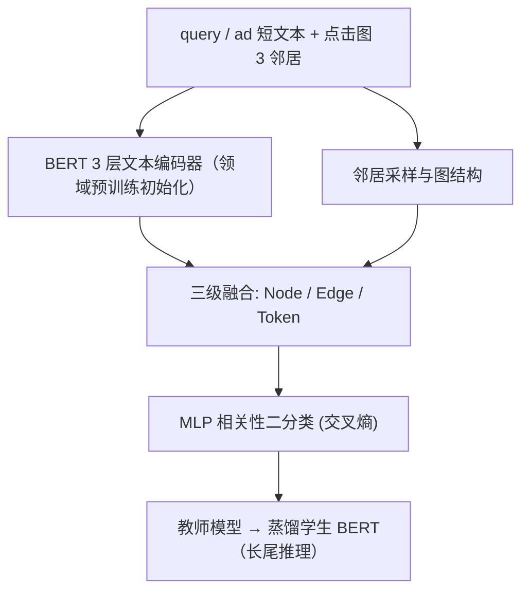
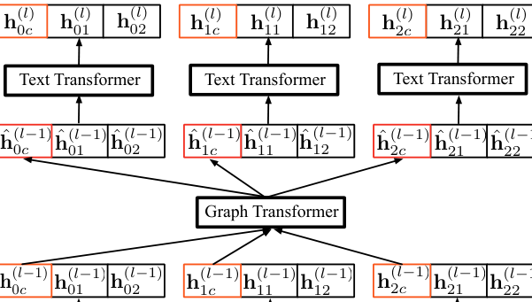

# AdsGNN: Behavior-Graph Augmented Relevance Modeling in Sponsored Search (行为图增强的搜索广告相关性建模)

- **会议/期刊**: SIGIR 2021 (Full Paper)
- **作者与机构**: Chaozhuo Li, Bochen Pang, Yuming Liu, Hao Sun, Zheng Liu, Xing Xie, Tianqi Yang, Yanling Cui, Liangjie Zhang, Qi Zhang（微软亚洲研究院 / 微软 Bing 广告）
- **推荐链路定位**: 召回与相关性粗排（query-ad 相关性判别，双塔在线服务 + 单塔精算）
- **研究方向**: CTR/CVR 预估与特征交叉 / 图神经网络与知识图谱推荐
- **论文原文**: [https://arxiv.org/abs/2104.12080v1](https://arxiv.org/abs/2104.12080v1)
- **开源代码**: [https://github.com/qwe35/AdsGNN](https://github.com/qwe35/AdsGNN)

## TL;DR (1分钟核心速览)

搜索广告 query-ad 文本极短（平均不足 4 词），纯语义模型难以还原真实搜索意图；而直接拿点击关系当相关性标签又会把"用户行为随意性噪声"和"词面重叠捷径"引入训练集。本文不把点击当标签，而是把历史点击二部图当作**互补特征源**，提出节点级、边级、Token 级三种 AdsGNN 融合算子，并补上领域预训练（NE-MLM + NP）与面向长尾广告的知识蒸馏。在 84.7 万条工业人工标注对、ROC-AUC 评测下，AdsGNN$_t$ 在 10% 训练数据时达 0.829（较 TextGNN +2.8pt），全量数据 0.881，线上 A/B RPM +1.13%、缺陷率 −1.46%。

## Background & Motivation (背景与核心矛盾)

- **主流范式**: DSSM/TwinBERT 双塔与 BERT 单塔交叉编码器，仅从 query-ad 文本内部抽取语义相关度；图侧工作（TextGNN）把预训练 BERT 输出当作**固定节点特征**，再在其上叠 GNN 聚合。
- **前人局限①（语义不足）**: 广告场景文本过短，且长尾 query/ad 样本稀少导致欠训练，单塔/双塔在低频实体上明显掉点。**局限②（标签错配）**: 若把"点击=正例、随机未点击=负例"当监督，则点击的主观性污染标签，且随机负例几乎不与 query 共享词，模型会退化为"词面重叠即相关"（如 iPad 与 iPad charger 被误判）。
- **核心洞察 (Key Insight)**: 点击图的价值在**意图补全**而非**标签替代**——`AF1` 本身语义空洞，但其历史点击邻居为 `Air Force 1`、`Nike AF 1 shoes`，邻居即意图上下文。因此语义编码器与图聚合器应在训练中**联合共演化**，而非"先冻结文本特征、再跑 GNN"。
- **本文切入点**: 在节点、边、Token 三个粒度上设计图-文融合算子，粒度越细耦合越紧、效果越好；并用蒸馏把图能力"内化"进纯语义模型以服务长尾。

## Method (核心方法设计)

### 1. 整体框架 (Overall Architecture)

输入为 query、ad 及其在点击二部图 $\mathcal{G}=\{\mathcal{Q},\mathcal{A},\mathcal{E}\}$ 中采样的 3 个邻居。文本侧用 BERT-base 前 3 层做编码器（TwinBERT 式加权平均池化），图侧按三种粒度注入邻居信息：Node 级分别聚合 query 的广告邻居与 ad 的 query 邻居后残差拼接；Edge 级把 query-ad 对当边，按输入边/一阶边/二阶边分层注意力聚合；Token 级把图 Transformer 与文本 Transformer 交替堆叠，用 [CLS] 作为跨节点信息瓶颈。融合表示进入单隐层 MLP 做二分类，交叉熵训练。此外先用 NE-MLM+NP 在行为图上做领域预热，再用已训练好的图模型作教师、纯 BERT 作学生做长尾蒸馏。在线服务时 Node 级可走双塔（ad 向量预缓存），Token 级走单塔精算。

<figure class="paper-figure" markdown="span">
  <figcaption>图4：第 푙 个 AdsGNN푡 层的细节。</figcaption>
</figure>

### 2. 关键设计拆解 (Key Designs)

1. **Node/Edge 级注意力聚合（松耦合基线）**：Node 级用 GAT 式打分区分邻居重要性，$\alpha_{qi}=\frac{\exp(\sigma(\mathbf{a}_q^\top[\mathbf{h}_q\|\mathbf{h}_{q_i}]))}{\sum_{j}\exp(\sigma(\mathbf{a}_q^\top[\mathbf{h}_q\|\mathbf{h}_{q_j}]))}$，$\mathbf{z}_q=[\mathbf{h}_q\,\|\,\sigma(\sum_i\alpha_{qi}\mathbf{h}_{q_i})]$；因 query 与 ad 的拓扑分布差异大，两侧编码器/聚合器**不共享参数**（这是相对 TextGNN 的关键修正）。Edge 级则把三类边（输入边$e_{in}$、一阶边$e_{1st}$、二阶边$e_{2nd}$）先类内注意力$\alpha_{e_i}=\text{softmax}(\tanh(\mathbf{w}_e^\top\mathbf{h}_{e_i}+b_e))$ 聚合，再类间注意力加权，刻画"连边同质、共点击相似"的先验。
2. **Token 级紧耦合图 Transformer（核心创新）**：级联结构下 Token 只能看见本节点内 Token。此处令第 $l$层先把各节点 [CLS] 组成$\mathbf{H}_c^{(l-1)}\in\mathbb{R}^{(N+1)\times d_h}$过图 Transformer$\hat{\mathbf{H}}_c^{(l-1)}=\text{softmax}(\frac{\mathbf{Q}\mathbf{K}^\top}{\sqrt{d_h}})\mathbf{V}$交换跨节点信息，再把回填的 [CLS] 与词序列一起送入文本 Transformer，实现 Token 跨节点注意力。以 [CLS] 为瓶颈使感受野从朴素的$m\times(n+1)$降为$n$（图）与$m$（文本），兼顾邻居聚合与显存/时延。
3. **训练目标、领域预训练与长尾蒸馏**：总损失为相关性交叉熵 $\mathcal{L}=\sum_{x\in\mathcal{L}}\text{cross}(\mathbf{y},\mathbf{y}')$；标签来自人工标注而非点击，无额外负采样策略。预训练两任务：NE-MLM（用邻居文本预测被 mask 的中心节点 Token，占 15%）与 NP（邻居预测，替代 NSP，建模实体级拓扑）。长尾侧固定教师$\mathbf{z}_q$，学生$\hat{\mathbf{z}}_q$用 5 层 BERT 回归：$\mathcal{L}_{kd}=\|\hat{\mathbf{z}}_q-\mathbf{z}_q\|_2^2$，把"拓扑感知映射"压进纯语义空间，推理时无需检索邻居。

## Experimental Setup & Evaluation Protocol (实验设置与评估协议)

- **数据集与预处理**: 单一商业搜索引擎工业数据集（人工标注相关性三元组），行为图从搜索日志采样（约 3 亿去重片段、10 亿+ 点击关系），每实体取 3 个邻居：

| 数据集 | #Users(概念) | #Items | #Interactions(标注对) | 稀疏度/密度 | 特征/场景说明 |
| :--- | :---: | :---: | :---: | :---: | :--- |
| Train | — | — | 594,234 (正 184,213 / 负 410,021) | 正例占比 31.0% | 短 query-ad 对 + 点击图邻居 |
| Valid | — | — | 66,026 (正 21,798) | 33.0% | 早停与超参选择 |
| Test | — | — | 186,798 (正 59,028) | 31.6% | 同分布离线评测 |

- **数据划分与防穿越 (Splitting Strategy)**: 固定 Train/Valid/Test 划分；额外做**训练比例切分**实验，从训练集随机抽取 $T_{tr}\in\{0.1,0.3,0.5,0.7,1.0\}$，重复 3 次报告平均，用于检验低资源鲁棒性。
- **排名评测协议 (Ranking Protocol)**: 未采用 Full-Ranking 或采样排序，而是把任务作为**二分类判别**并用不平衡数据下的 `ROC-AUC` 度量（原表仅报 AUC，无可比对的 Recall@K/NDCG）。
- **对比基线与超参设置**: 语义类 C-DSSM / BERT 单塔 / Twin-BERT；图类 GAT / GraphSAGE / GraphBert（静态节点特征 + GNN）；混合类 MetaBERT（邻居文本直接拼接）/ TextGNN。BERT-base-uncased 前 3 层作编码器，batch 64，lr 1e-5，epoch 3，Adam，邻居数默认 3，蒸馏学生为 5 层 BERT；未报告显著性检验（$p$ 值）。

## Key Experimental Results (实验关键数据)

### 1. 主实验对比 (Main Results)

不同训练比例下的 ROC-AUC（重复 3 次均值）：

| Model | $T_{tr}$=0.1 |$T_{tr}$=0.3 |$T_{tr}$=0.5 |$T_{tr}$=0.7 |$T_{tr}$=1.0 |
| :--- | :---: | :---: | :---: | :---: | :---: |
| GAT | 0.706 | 0.713 | 0.726 | 0.736 | 0.756 |
| GraphSAGE | 0.702 | 0.715 | 0.729 | 0.737 | 0.751 |
| GraphBert | 0.764 | 0.783 | 0.791 | 0.805 | 0.811 |
| C-DSSM (双塔) | 0.762 | 0.795 | 0.803 | 0.812 | 0.829 |
| Twin-BERT (双塔) | 0.779 | 0.814 | 0.827 | 0.835 | 0.852 |
| BERT (单塔) | 0.786 | 0.816 | 0.833 | 0.839 | 0.858 |
| MetaBERT (拼接邻居) | 0.792 | 0.823 | 0.834 | 0.846 | 0.862 |
| TextGNN (节点级共享参数) | 0.801 | 0.831 | 0.839 | 0.848 | 0.857 |
| AdsGNN$_n$ (节点级) | 0.815 | 0.843 | 0.849 | 0.855 | 0.863 |
| AdsGNN$_e$ (边级) | 0.820 | 0.846 | 0.857 | 0.863 | 0.873 |
| **AdsGNN$_t$ (Token 级)** | **0.829** | **0.852** | **0.864** | **0.869** | **0.881** |
| Improv. vs 最强基线 | +2.8 (+3.5%) | +2.1 (+2.5%) | +2.5 (+3.0%) | +2.1 (+2.5%) | +1.9 (+2.2%) |

### 2. 消融实验 (Ablation Study)

$T_{tr}$=0.1 设置下的紧凑对比（分类别列出）：

| 类别 | 配置 | ROC-AUC |
| :--- | :--- | :---: |
| 预训练任务 | None / NE-MLM / NP / NE-MLM+NP（AdsGNN$_t$） | 0.819 / 0.825 / 0.823 / **0.829** |
| 预训练任务 | None / NE-MLM / NP / NE-MLM+NP（AdsGNN$_n$） | 0.804 / 0.812 / 0.807 / **0.815** |
| Edge 类型 | $e_{in}$/$e_{in}+e_{1st}$/$e_{in}+e_{2nd}$ / 全部 | 0.786 / 0.817 / 0.804 / **0.820** |
| 聚合算子 | Mean / Max / Sum / LSTM / Self-Attention | 0.772 / 0.791 / 0.784 / 0.802 / **0.815** |
| 长尾补全 | Padding / ANN / KD | 最低 / Padding+约 3pt / **最高** |

### 3. 关键实验发现 (Key Findings)

1. **融合粒度决定上限，且与预训练层级互相印证**：Token 级比节点级稳定高约 1.4–1.8pt（0.829 vs 0.815 @0.1），而预训练消融中 Token 级 NE-MLM 增益（+0.6pt）显著大于实体级 NP（+0.3pt），说明**互补信息注入得越靠近底层语义单元越有效**；两任务混合最优（+1.0pt）。
2. **图的价值主要体现在低资源区**：$T_{tr}$=0.1 时相对最强基线提升 +3.5%，全量时收窄到 +2.2%；图基线（GAT 0.706）反而垫底，证明"冻结文本特征再叠 GNN"的范式浪费了图信号。
3. **边类型与聚合器的边际贡献可量化**：一阶边贡献 +3.1pt 而二阶边仅 +1.8pt，直连邻居信息量远高于远距邻居；自注意力聚合（0.815）显著优于 LSTM（0.802）与 Mean（0.772）。长尾侧 KD 优于 ANN 补邻居（后者已比 Padding 高约 3pt），说明学生模型学到了"潜在邻域预测"能力。

## Highlights & Limitations (亮点、对比与审稿批判)

- **与代表作对比**: ① 相对 TextGNN：同为节点级聚合，但 query/ad 编码器解耦 + 领域预训练，+1.4~1.8pt；② 相对 BERT 单塔：以双塔可服务为前提取得 0.881 vs 0.858，兼顾时延与精度；③ 相对 MetaBERT：不把邻居文本粗暴拼进输入，避免序列爆炸而保留注意力加权。
- **可迁移亮点**: （1）"[CLS] 作跨节点信息瓶颈"的图-文交替 Transformer，可低成本迁移到电商 query-item、短视频 query-video 的相关性/检索建模；（2）教师（图模型）→学生（纯语义）的 $\ell_2$ 表征蒸馏，是"图特征无法在线检索"场景的通用兜底方案。
- **审稿级局限批判**: ① 仅一个工业数据集，无公开可复现基准（MSLR/ESR 均缺行为日志），AUC 单指标、无排序指标与显著性检验，横向可比性弱；② 线上 A/B 增益仅 +1.13% RPM 且未给置信区间，Token 级模型需在线取邻居与多一次图 Transformer 前向，时延/吞吐代价未量化；③ 负例构造与人工标注协议描述简略，蒸馏学生完全丢失图结构，长尾冷启动物品（零邻居）时教师本身也无信号。

## Rating (四维评分)

- **方法创新性 (Novelty)**: ⭐⭐⭐⭐ （三级融合粒度形成"松耦合→紧耦合"的清晰谱系，Token 级 [CLS] 瓶颈设计兼顾表达力与复杂度，但各算子均为 GAT/Transformer 的组合创新）
- **评估协议与实验扎实度 (Protocol & Experiments)**: ⭐⭐⭐ （训练比例扫描、预训练/边类型/聚合算子三维消融、长尾与参数敏感性、线上 A/B 齐全，但仅单数据集 AUC、无公开基准与显著性检验）
- **写作与数学规范度 (Clarity & Rigor)**: ⭐⭐⭐⭐ （三种变体结构图与公式对应清楚，复杂度论证（感受野 $n$vs$m$）到位，部分符号沿用小写粗体与图注略有歧义）
- **工业落地与复现价值 (Industrial & Practical Value)**: ⭐⭐⭐⭐⭐ （来自 Bing 广告真实系统、已上线召回+相关性两阶段，附开源实现与蒸馏部署路径，工程参考价值高）

