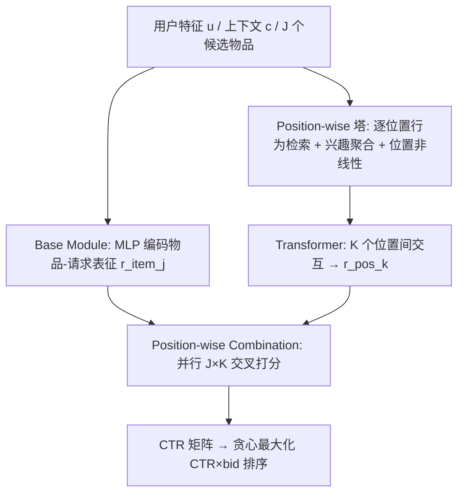
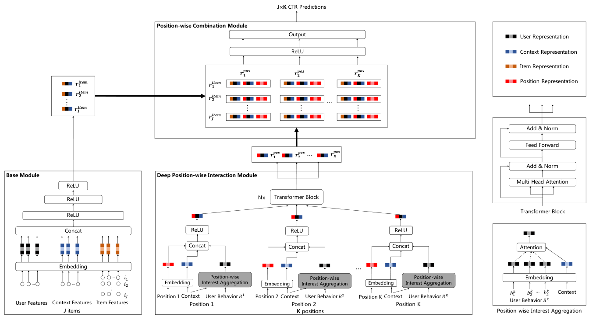

# Deep Position-wise Interaction Network for CTR Prediction (深度位置交互网络)

- **会议/期刊**: SIGIR 2021
- **作者与机构**: Jianqiang Huang, Ke Hu, Qingtao Tang, Mingjian Chen, Yi Qi, Jia Cheng, Jun Lei（美团）
- **推荐链路定位**: 精排（广告 eCPM 排序，含位置级贪心重排）
- **研究方向**: CTR/CVR 预估与特征交叉 / 去偏公平与工业架构
- **论文原文**: [https://arxiv.org/abs/2106.05482v2](https://arxiv.org/abs/2106.05482v2)
- **开源代码**: 暂未开源

## TL;DR (1分钟核心速览)

曝光日志天然向高位置倾斜，而已有做法（训练用真实位置、推理用固定位置，或 IPW）在训练与推理间造成位置处理不一致。DPIN 把 J 个候选物品与 K 个位置的打分分解为 "item 塔 + position 塔" 再浅层交叉，一次前向输出完整 $J\times K$ 的 CTR 矩阵，实现训练/推理一致并建模位置-用户-上下文非线性交互。在美团搜索广告 4 周日志（次日常规 + 5% 随机流量）上相对 DIN+PosInWide 提升 AUC 2.98%、PAUC 1.07%，线上 CTR +2.25%、RPM +2.15%。

## Background & Motivation (背景与核心矛盾)

- **主流范式**: 工业界把位置当作 wide 侧特征（训练用真实位置、线上用默认位），或采用 PAL、IPW、知识蒸馏、对抗学习、pairwise 训练来剥离位置偏置。
- **前人局限一**: 训练与推理对位置的处理不同，模型在线上看到的输入分布与离线不一致，离线调优与线上收益脱钩；PAL/PosInWide 虽让 PAUC 略升，但 AUC 从 0.7818 掉到 0.7696/0.7735，正是这种不一致的代价。
- **前人局限二**: 经典假设 $p(C=1)=p(E=1|k)\cdot p(R=1|u,c,i)$ 过度简化——它把位置仅视为乘性偏置，忽略位置与用户浏览习惯、上下文、物品之间的丰富交互，也无法刻画位置间相互影响。
- **核心洞察 (Key Insight)**: 位置偏置并非独立于物品/用户的外生噪声；若在训练时就用"真实位置 + 全部候选"打分，则无需在推理侧近似，一致性自然成立——关键在于把 $O(JK)$ 的组合打分压到可服务的复杂度。
- **本文切入点**: 用 $J+K$次塔式前向 + 一次并行浅层交叉替代$J\times K$ 次全模型前向，在时延预算内实现"逐位置预测"。

## Method (核心方法设计)

### 1. 整体框架 (Overall Architecture)

模型由三部分串联：**Base Module** 将用户特征 $\mathbf{u}$、上下文$\mathbf{c}$、第$j$个候选物品特征$\mathbf{i}_j$拼接后过 MLP，得到与位置无关的物品-请求表征$\mathbf{r}^{item}_j$；**Deep Position-wise Interaction Module** 对每个位置$k$独立检索并聚合用户行为序列，再与位置嵌入、上下文做非线性交互，并经 Transformer 建模位置间关系，输出$\mathbf{r}^{pos}_k$；**Position-wise Combination Module** 把两者与$E(k)$拼接后过两层非线性，一次并行输出全部$J\times K$个$\mathrm{CTR}_{jk}$。最终排序用贪心算法自上而下最大化$\mathrm{CTR}_{jk}\cdot bid_j$。

<figure class="paper-figure" markdown="span">
  <figcaption>图1：Deep Position-wise Interaction Network 的结构。</figcaption>
</figure>

### 2. 关键设计拆解 (Key Designs)

1. **位置解耦的可加性打分结构（避免 $J\times K$次全模型前向）**：朴素方案为每个 (物品, 位置) 组合跑一次完整 DIN，复杂度$O(JKC)$不可服务。DPIN 令物品塔只编码$\mathbf{r}^{item}_j=\mathrm{MLP}([\mathbf{u};\mathbf{c};\mathbf{i}_j])$，位置塔只编码$\mathbf{r}^{pos}_k$，再由轻量组合层融合：$\mathrm{CTR}_{jk}=\sigma(\mathrm{ReLU}([\mathbf{r}^{item}_j;\mathbf{r}^{pos}_k;E(k)]\mathbf{W}_1+\mathbf{b}_1)\mathbf{W}_2+b_2)$。直觉：重计算（长行为序列注意力）被推到$J+K$侧，$J\times K$ 侧只留一层 128 维 ReLU，故延迟几乎与候选数无关。

2. **位置感知兴趣聚合 + 位置间 Transformer（本文首个显式建模"候选位置上的用户兴趣"）**：同一用户在不同位置的点击习惯不同，长期行为序列本身即带位置偏置。DPIN 对位置 $k$单独检索行为序列$B_k$，用上下文感知注意力加权：$\alpha_{kl}=\mathrm{ReLU}([\mathbf{b}_{kl};\mathbf{c}]\mathbf{W}_a+\mathbf{b}_a)\mathbf{W}_b+b_b$，$\mathbf{b}_k=\sum_l \mathrm{softmax}(\alpha_{k\cdot})_l\,\mathbf{b}_{kl}$，再生成$\mathbf{v}_k=\mathrm{ReLU}([E(k);\mathbf{c};\mathbf{b}_k]\mathbf{W}_v+\mathbf{b}_v)$。若到此为止，各位置表征互相孤立（顶部位置会吸走全部注意力），故用 2 层多头自注意力在$K$个位置间传播信息，得到$\mathbf{r}^{pos}_k$——位置 3 的兴趣表征可借用位置 1、7 的证据。

3. **训练目标与推理开销**：以真实曝光位置为标签、点击为 1，交叉熵 $\mathcal{L}=-\frac{1}{N}\sum y\log \mathrm{CTR}_{jk}+(1-y)\log(1-\mathrm{CTR}_{jk})$端到端优化，无负采样（全曝光样本训练）。推理时$J$个 item 与$K=25$个位置各过塔一次，再做$J\times K$ 的 128 维浅层交叉。作者实测该组合模块的延迟相对 DIN 主干可忽略（DIN 中长序列注意力占大头），DPIN 的延迟随候选数增长极缓，而将候选物品塞入位置塔的 DPIN+ItemAction 则随候选数近似线性上升。

## Experimental Setup & Evaluation Protocol (实验设置与评估协议)

- **数据集与预处理**: 单一工业数据集（某购物 App 赞助搜索广告 4 周日曝光日志，约 1000 万曝光/天，其中 5% 为 top-k 随机流量）；论文未披露用户/物品基数与稀疏度，也无 `5-core` 过滤。

| 数据集 | #Users | #Items | #Interactions | 稀疏度/密度 | 特征/场景说明 |
| :--- | :---: | :---: | :---: | :---: | :--- |
| 训练集（4 周日志） | 未披露 | 未披露 | ~10M 曝光/天 | 未披露 | 241 维特征，行为序列截断 300，位置 K=25 |
| Regular 测试集（次日） | — | — | 次日常规流量 | — | 含真实位置偏置的自然流量 |
| Randomized 测试集（次日） | — | — | 次日 top-k 随机流量（5%） | — | 打散位置，用于检验是否只是拟合系统选择偏差 |

- **数据划分与防穿越 (Splitting Strategy)**: 全局时间戳切分——前 4 周训练，次日两份测试集评估（常规流量 + 随机流量），随机流量专用于位置偏置诊断。
- **排名评测协议 (Ranking Protocol)**: 非全库排序，而是在**真实曝光样本**上计算 AUC；另提出 **PAUC（position-wise AUC）**，对每个位置单独算 AUC 后按曝光量加权：$\mathrm{PAUC}=\sum_{k=1}^{K} n_k\mathrm{AUC@}k/\sum_{k=1}^{K} n_k$，用于剥离位置偏置、只衡量"同一位置内的相关性排序质量"。
- **对比基线与超参设置**: 统一 DIN 主干（241 特征、Embedding 维 8、MLP 1024-512-128、组合层 128 维），对比 DIN、DIN+PosInWide、DIN+PAL、DIN+ActualPosInWide、DIN+Combination、DPIN-Transformer、DPIN（2 层 Transformer，$d_{model}=64$，$h=2$）及上界 DPIN+ItemAction；线上 A/B 为 10% vs 10% 用户分流。

## Key Experimental Results (实验关键数据)

### 1. 主实验对比 (Main Results)

| 模型 | Regular AUC | Regular PAUC | Random AUC | Random PAUC |
| :--- | :---: | :---: | :---: | :---: |
| DIN（无位置） | 0.7818 | 0.7090 | 0.7836 | 0.7223 |
| DIN+PosInWide | 0.7696 | 0.7109 | 0.7725 | 0.7239 |
| DIN+PAL | 0.7735 | 0.7128 | 0.7763 | 0.7254 |
| DIN+ActualPosInWide | 0.7928 | 0.7109 | 0.7938 | 0.7239 |
| DIN+Combination | 0.7970 | 0.7172 | 0.7985 | 0.7294 |
| DPIN-Transformer | 0.7961 | 0.7148 | 0.7984 | 0.7283 |
| **DPIN** | **0.7994** | **0.7216** | **0.8015** | **0.7350** |
| DPIN+ItemAction（上界，不可服务） | 0.7999 | 0.7223 | 0.8019 | 0.7356 |
| **Improv. (DPIN vs. PosInWide)** | **+2.98%** | **+1.07%** | **+3.75%** | **+1.53%** |

### 2. 消融实验 (Ablation Study，Regular / Random 双测试集)

| 消融配置 | 移除/新增组件 | AUC (Reg → Rand) | PAUC (Reg → Rand) |
| :--- | :--- | :---: | :---: |
| DIN+ActualPosInWide | 有位置、无组合模块 | 0.7928 / 0.7938 | 0.7109 / 0.7239 |
| DIN+Combination | 有组合模块、无位置塔 | 0.7970 / 0.7985 | 0.7172 / 0.7294 |
| DPIN-Transformer | 去位置间 Transformer | 0.7961 / 0.7984 | 0.7148 / 0.7283 |
| **DPIN** | 完整模型 | **0.7994 / 0.8015** | **0.7216 / 0.7350** |
| DPIN+ItemAction | 位置塔注入候选物品 | 0.7999 / 0.8019 | 0.7223 / 0.7356 |

### 3. 关键实验发现 (Key Findings)

1. **"一致性"比"去偏"本身更值钱**：PosInWide/PAL 用牺牲 AUC（0.7818→0.7696/0.7735）换来 PAUC 微升；ActualPosInWide 把 AUC 拉回 0.7928，但 PAUC 仍停在 0.7109——位置只作为 wide 偏置无法改善排序质量；只有位置组合模块让二者同涨（0.7970 / 0.7172），相对 PosInWide 得 +2.74% AUC 与 +0.63% PAUC。
2. **位置间交互是第二块增量**：在 Combination 之上加 Transformer，Regular 上 AUC 0.7961→0.7994、PAUC 0.7148→0.7216（+0.95% 相对），说明不同位置的兴趣表征存在互补信息，独立建模会丢失全局上下文。
3. **$J+K$ 分解在时延约束下近乎无损**：DPIN+ItemAction 这个"暴力上界"只多出 0.0005 AUC / 0.0007 PAUC，却使延迟随候选数近似线性上升；DPIN 延迟曲线平坦，证明收益主要来自结构一致性而非物品-位置全交叉。此外，常规流量与随机流量上的方法排序完全一致，说明 DPIN 学到的是位置机制而非系统选择偏差；线上 A/B 21 天（10% vs 10%）取得 CTR +2.25%、RPM +2.15%。

## Highlights & Limitations (亮点、对比与审稿批判)

- **与代表作对比 (vs. Prior Work)**: 相比 PosInWide/PAL 的"训练看位置、推理不看位置"，DPIN 在两端都用真实位置，从根上消除不一致；相比 IPW 系方法依赖倾向分估计且不建模位置与物品的非线性交互，DPIN 直接让网络学 $p(C|u,c,i,k)$；相比暴力全交叉（ItemAction），DPIN 用塔分解把服务成本压到常数级。
- **可迁移亮点**: (1) "重塔算 $J+K$、轻层算$J\times K$" 的打分分解模板，可直接迁移到重排、多场景/多广告位联合精排、生成式召回的多位置打分；(2) PAUC 这种"按位置分层再加权"的指标构造，可用于诊断任何存在系统偏置的分层排序任务。
- **审稿级局限批判**: (1) 评估仅依赖单一工业日志，无公开数据集与多随机种子方差/显著性检验（仅线上 A/B 有显著性），PAUC 的提升幅度（1% 量级）缺乏置信区间；(2) 位置数截断为 25、行为序列截断 300，Transformer 在 $K$上的复杂度为$O(K^2)$，深翻页或超长列表场景的可扩展性未验证；且 PAUC 只衡量位置内排序，对跨位置的整体收益（如 eCPM）只能靠线上指标佐证。

## Rating (四维评分)

- **方法创新性 (Novelty)**: ⭐⭐⭐⭐ （把位置偏置从"乘性偏置估计"重构为"位置条件打分 + 双塔分解"，并用 Transformer 建模位置间交互，思路清晰且有别于 IPW/PAL 主线）
- **评估协议与实验扎实度 (Protocol & Experiments)**: ⭐⭐⭐ （引入随机流量与 PAUC 双测试集、消融链完整、线上 A/B 有显著性，但仅单数据集、无重复实验方差与公开基准）
- **写作与数学规范度 (Clarity & Rigor)**: ⭐⭐⭐⭐ （三模块与公式定义干净，复杂度与时延论证对应到位；略显不足是对 PAUC 的统计性质与理论依据仅一句带过）
- **工业落地与复现价值 (Industrial & Practical Value)**: ⭐⭐⭐⭐⭐ （已在美团搜索广告全量服务，延迟随候选数近乎平坦，塔分解与并行打分范式对工业精排极具借鉴价值；但未开源，复现需自建日志管线）

