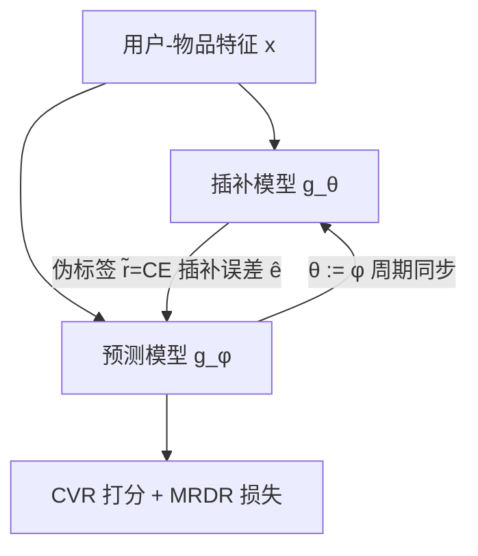
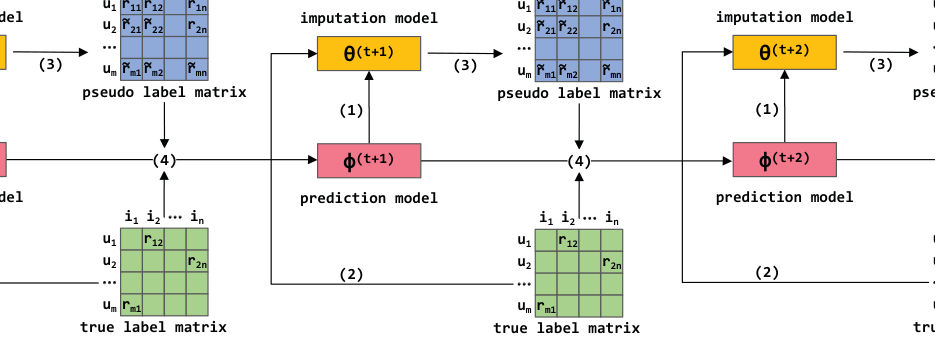

# Enhanced Doubly Robust Learning for Debiasing Post-click Conversion Rate Estimation (增强双重稳健学习：后点击转化率估计的去偏方法)

- **会议/期刊**: SIGIR 2021
- **作者与机构**: Siyuan Guo, Lixin Zou, Yiding Liu, Wenwen Ye, Suqi Cheng, Shuaiqiang Wang, Hechang Chen, Dawei Yin, Yi Chang（吉林大学符号计算与知识工程教育部重点实验室、百度公司）
- **推荐链路定位**: 精排（CVR 预估子任务）
- **研究方向**: CTR/CVR 预估与特征交叉 / 去偏公平与因果推荐
- **论文原文**: [https://arxiv.org/abs/2105.13623v3](https://arxiv.org/abs/2105.13623v3)
- **开源代码**: [https://github.com/guosyjlu/MRDR-DL](https://github.com/guosyjlu/MRDR-DL)

## TL;DR (1分钟核心速览)

CVR 只在点击样本上可观测，用户自选择导致 MNAR 选择偏差；现有 DR 估计量虽双稳健，却在插补不准时方差反超 IPS，且插补模型与预测模型解耦、无法拟合"动态梯度方向"。本文先推导 DR 的偏差与方差闭式解，把插补学习目标重写为**最小化 DR 方差**得到 MRDR（权重 $1/\hat{p}\to(1-\hat{p})/\hat{p}^2$），再用**双学习**把误差插补转成伪标签 CVR 二分类并周期同步参数。在半合成 ML-100K 上 RE 降至 0.0013（DR 为 0.0081），Coat Shopping 上 Full-Ranking DCG@2 相对 DR-JL 提升 6.6%。

## Background & Motivation (背景与核心矛盾)

- **主流范式**: 用反事实无偏估计量替换朴素点击样本损失——EIB（插补未点击误差）、IPS（按 CTR 倒数加权）、DR（二者结合，任一准确即无偏）。
- **前人局限**: ① EIB 的启发式插补偏差极大；IPS 因点击率 $\hat{p}$极小导致方差爆炸；② DR 的方差项含$(\hat{e}-e)^2/\hat{p}^2$，插补一旦失真其方差可超过 IPS；③ 更关键的是 DR 的插补模型（线性回归/MF/MLP）对预测模型**不可知**，而插补误差本质是预测模型的梯度方向，应随训练动态变化。
- **核心洞察 (Key Insight)**: 既然插补学习只是回归任务，那它的目标函数可以**自由重设计**——作者选择直接最小化 DR 估计量的方差而非误差平方和，从而在保留双稳健性的前提下压低方差。
- **本文切入点**: 方差重加权（MRDR）+ 双模型交替自举（Double Learning），把插补从回归问题转为普通 CVR 二分类问题。

## Method (核心方法设计)

### 1. 整体框架 (Overall Architecture)

输入用户-物品特征 $\mathbf{x}_{u,i}$，两个同构 FM 分别承担预测模型$g_\phi$与插补模型$g_\theta$。每轮迭代先用$g_\theta$为全库样本生成伪标签$\tilde{r}_{u,i}=g_\theta(\mathbf{x}_{u,i})$，再以$g_\phi$的输出与伪标签的交叉熵作为"插补误差"$\hat{e}_{u,i}$，在 MRDR 估计量损失下更新$\phi$；随后把$\theta\leftarrow\phi$周期同步并继续训练插补模型。两模型互为正则，交替收敛，推理阶段仅部署$g_\phi$，无额外线上开销。

<figure class="paper-figure" markdown="span">
  <figcaption>图1：双重学习方法的工作流程。</figcaption>
</figure>

### 2. 关键设计拆解 (Key Designs)

1. **MRDR：把插补目标换成方差最小化**：DR 的方差为 $V_O[\mathcal{L}_{DR}]=\frac{1}{|\mathcal{D}|^2}\sum_{(u,i)}\frac{p_{u,i}(1-p_{u,i})}{\hat{p}_{u,i}^2}(e_{u,i}-\hat{e}_{u,i})^2$。对其取期望并用$\hat{p}$ 近似，可得新的插补损失
$$\mathcal{L}_e^{MRDR}=\sum_{(u,i)\in\mathcal{O}}\frac{1-\hat{p}_{u,i}}{\hat{p}_{u,i}^2}(e_{u,i}-\hat{e}_{u,i})^2,$$
权重由 DR 的 $1/\hat{p}$变为$(1-\hat{p})/\hat{p}^2$：当$\hat{p}<1/2$时惩罚被进一步放大，当$\hat{p}>1/2$ 时反而减弱。直觉是**低倾向样本贡献的方差最大**，应重点校准其插补误差，而高倾向样本已由真实点击标签监督、无需重复加权。

2. **Double Learning：把误差插补改写为 CVR 二分类**：令 $\hat{e}_{u,i}=\mathrm{CE}(\tilde{r}_{u,i},\hat{r}_{u,i})=\mathrm{CE}(g_\theta(\mathbf{x}_{u,i}),g_\phi(\mathbf{x}_{u,i}))$，则插补学习变为
$$\mathcal{L}_e^{MRDR}(\theta)=\sum_{(u,i)\in\mathcal{O}}\frac{1-\hat{p}_{u,i}}{\hat{p}_{u,i}^2}\mathrm{CE}\big(r_{u,i},g_\theta(\mathbf{x}_{u,i})\big)+\lambda\|\theta\|_F^2 .$$
相比平方损失，交叉熵与伪标签的伯努利本质匹配，且 $g_\phi$ 进入插补误差的构造使插补量随预测模型演化而动态更新——这正是"模型相关梯度方向"的近似。

3. **训练目标、负采样与推理效率**：预测模型损失为 $\mathcal{L}_r^{MRDR}(\phi)=\sum_{(u,i)\in\mathcal{D}}\big[\hat{e}_{u,i}+\frac{o_{u,i}(e_{u,i}-\hat{e}_{u,i})}{\hat{p}_{u,i}}\big]+\mu\|\phi\|_F^2$，点击样本处用真实标签$r_{u,i}$计算$e_{u,i}$，未点击样本用伪标签插补；由于插补侧同样存在$1/\hat{p}$类高方差，作者在每轮训练插补模型前执行$\theta\leftarrow\phi$强制校正。训练用 mini-batch Adam，CTR 辅助任务负采样比固定为 4，未点击:点击采样比在$\{2,4,6,8\}$ 网格搜索。

## Experimental Setup & Evaluation Protocol (实验设置与评估协议)

- **数据集与预处理**:

| 数据集 | #Users | #Items | #Interactions | 稀疏度/密度 | 特征/场景说明 |
| :--- | :---: | :---: | :---: | :---: | :--- |
| ML-100K (半合成) | 943 | 1,682 | 100,000 | 全观测 $R$| 由评分经 MF 补全 + Bernoulli 采样生成$o_{u,i}$、$r_{u,i}$，可算 Ideal Loss |
| Coat Shopping | 290 | 300 | 6,960 (MNAR) + 4,640 (MAR) | 8.0% / 5.3% | 含随机 MAR 测试集，可做真无偏评测 |
| Yahoo! R3 | 15,400 | 1,000 | 311,704 (MNAR) + 54,000 (MAR) | 2.0% / 0.35% | 同上，规模更大、更稀疏 |

- **数据划分与防穿越 (Splitting Strategy)**: 真实数据采用 `比例划分`——MNAR 部分随机切 90% 训练 / 10% 验证；MAR 部分整体作为测试集（不参与任何训练），并过滤测试集中无转化记录的用户。
- **排名评测协议 (Ranking Protocol)**: `Full-Ranking`——在 MAR 测试集上对全部候选物品打分排序，报告 per-user 的 DCG@K 与 Recall@K（$K\in\{2,3,4,5,6\}$），Coat 重复 100 次、Yahoo! 重复 20 次取均值±标准差。半合成实验则以相对误差$\mathrm{RE}=|\mathcal{L}_{ideal}-\mathcal{L}_{est}|/\mathcal{L}_{ideal}$ 衡量估计量精度。
- **对比基线与超参设置**: Naive / IPS / DR-JL（DR 联合学习，SOTA），EIB 因偏差过大未纳入真实数据对比；CTR 与 CVR 均用 FM，Embedding $d=64$，batch 1024，学习率 0.001，$L_2$在$\{10^{-5},...,1\}$ 网格搜索，5 epoch 不提升即早停。

## Key Experimental Results (实验关键数据)

### 1. 主实验对比 (Main Results)

**半合成数据集上的损失估计精度（RE，越小越好）**：

| 估计量 | ONE | THREE | FIVE | SKEW | CRS |
| :--- | :---: | :---: | :---: | :---: | :---: |
| Naive | 0.0686 | 0.0792 | 0.1023 | 0.0255 | 0.1773 |
| EIB | 0.5427 | 0.5869 | 0.6152 | 0.3574 | 0.0610 |
| IPS | 0.0346 | 0.0401 | 0.0515 | 0.0124 | 0.0888 |
| DR | 0.0131 | 0.0172 | 0.0138 | 0.0081 | 0.0551 |
| **MRDR** | **0.0073** | **0.0047** | **0.0119** | **0.0013** | **0.0503** |

**真实数据 CVR 去偏排序效果（加粗为最优）**：

| 数据集 | 方法 | DCG@2 | DCG@4 | DCG@6 | Recall@2 | Recall@4 | Recall@6 |
| :--- | :--- | :---: | :---: | :---: | :---: | :---: | :---: |
| Coat | Naive | 0.6694 | 0.9432 | 1.1321 | 0.8054 | 1.3903 | 1.8991 |
| Coat | IPS | 0.7093 | 0.9552 | 1.1248 | 0.8249 | 1.3520 | 1.8078 |
| Coat | DR-JL | 0.6771 | 0.9266 | 1.0962 | 0.7949 | 1.3286 | 1.7849 |
| Coat | **MRDR-DL** | **0.7219** | **0.9905** | **1.1696** | **0.8499** | **1.4249** | **1.9060** |
| Yahoo! | Naive | 0.5469 | 0.7466 | 0.8714 | 0.6479 | 1.0745 | 1.4098 |
| Yahoo! | IPS | 0.5502 | 0.7520 | 0.8751 | 0.6545 | 1.0797 | 1.4168 |
| Yahoo! | DR-JL | 0.5310 | 0.7273 | 0.8512 | 0.6292 | 1.0495 | 1.3822 |
| Yahoo! | **MRDR-DL** | **0.5561** | **0.7549** | **0.8811** | **0.6595** | **1.0846** | **1.4237** |
| | *Improv. (vs DR-JL)* | +6.6% | +6.9% | +6.7% | +6.9% | +7.3% | +6.8% |

### 2. 消融实验 (Ablation Study)

| 数据集 | 变体 | DCG@2 | DCG@4 | DCG@6 | Recall@2 | Recall@4 | Recall@6 |
| :--- | :--- | :---: | :---: | :---: | :---: | :---: | :---: |
| Coat | **MRDR-DL** | **0.7219** | **0.9905** | **1.1695** | **0.8499** | **1.4249** | **1.9060** |
| Coat | w/o MRDR 权重 (DR-DL) | 0.7205 | 0.9806 | 1.1601 | 0.8438 | 1.4004 | 1.8827 |
| Coat | w/o 参数同步 (MRDR-JL) | 0.6948 | 0.9613 | 1.1442 | 0.8227 | 1.3935 | 1.8852 |
| Coat | w/o 交叉熵 (改用 SL) | 0.7255 | 0.9871 | 1.1651 | 0.8504 | 1.4107 | 1.8892 |
| Yahoo! | **MRDR-DL** | **0.5561** | **0.7549** | **0.8811** | **0.6595** | **1.0846** | **1.4237** |
| Yahoo! | w/o MRDR 权重 (DR-DL) | 0.5463 | 0.7459 | 0.8714 | 0.6484 | 1.0752 | 1.4123 |
| Yahoo! | w/o 参数同步 (MRDR-JL) | 0.5546 | 0.7544 | 0.8786 | 0.6584 | 1.0862 | 1.4199 |
| Yahoo! | w/o 交叉熵 (改用 SL) | 0.5321 | 0.7287 | 0.8538 | 0.6298 | 1.0503 | 1.3863 |

### 3. 关键实验发现 (Key Findings)

1. **参数周期同步 $\theta\leftarrow\phi$ 是收益最大项**：去掉该步（MRDR-JL）在 Coat 上 DCG@2 由 0.7219 掉至 0.6948（−3.8%），Recall@2 由 0.8499 掉至 0.8227，说明插补学习自身的高方差才是主瓶颈，权重重设计只是次要修正（DR-DL 仅差 0.0019）。
2. **方差重加权在半合成实验中收益最显著**：SKEW 设定下 MRDR 的 RE 为 0.0013，较 DR 的 0.0081 降低约 84%，较 IPS 的 0.0124 降低约 90%，且 CRS 设定下同样最优，直接验证了定理 3.2 的方差闭式解可被实际优化掉。
3. **伪标签必须配交叉熵而非平方损失**：改用 SL 后 Coat 上几乎持平（0.7255 vs 0.7219），但 Yahoo! 上 DCG@2 从 0.5561 暴跌至 0.5321（−4.3%），说明在更稀疏的大规模数据上，回归式误差拟合会被伪标签的伯努利噪声主导；此外作者在采样比实验中观察到 ratio=0（只用点击样本）与 ratio=All 均为最差，最优区间为 4–8，即未点击样本既必要又不可滥用。

## Highlights & Limitations (亮点、对比与审稿批判)

- **与代表作对比 (vs. Prior Work)**: 对比 ESMM/$\text{ESM}^2$ 这类在**有偏数据上**训练与评测的多任务启发式方法，本文坚持反事实无偏估计并在 MAR 真值集上验证；对比 GMCM（仅 IPS）与 Multi-DR/DR-JL（DR 但插补模型与预测模型解耦），本文首次把插补目标从"拟合误差"改为"最小化估计量方差"，并用双学习实现模型相关的动态插补。
- **可迁移亮点**: ① "把辅助模型的学习目标写成主估计量的方差闭式解"这一思路可平移到 IPS 加权排序、Uplift 建模与延迟反馈纠偏；② 用伪标签把回归型辅助任务转为二分类，可缓解稀疏场景下辅助模型的不稳定训练。
- **审稿级局限批判**: ① 偏差与方差推导仍假设倾向 $\hat{p}$由 CTR 辅助任务准确给出，当$\hat{p}\to 0$时$(1-\hat{p})/\hat{p}^2$方差放大风险未被理论上界约束，真实工业场景极端倾向下可能不稳；② 双模型交替训练 + 周期同步使训练成本约翻倍，且$\theta\leftarrow\phi$ 的收敛性仅有经验证据、无收敛性证明；③ 真实数据评测仅两个带 MAR 集的小规模数据集，Yahoo! 提升幅度约 1.7%（相对 Naive），统计显著性检验缺失。

## Rating (四维评分)

- **方法创新性 (Novelty)**: ⭐⭐⭐⭐ （把插补学习目标重构为"最小化 DR 方差"并给出权重 $(1-\hat{p})/\hat{p}^2$ 的闭式推导，双学习借鉴 Double DQN 迁移自然，但整体仍是 DR 框架内的一次精巧算子改良）
- **评估协议与实验扎实度 (Protocol & Experiments)**: ⭐⭐⭐⭐ （同时给出半合成 RE 与两个 MAR 真值集的 Full-Ranking 评测，重复 100/20 次报标准差并做三组消融与采样比敏感性，唯缺显著性检验与更大规模工业数据）
- **写作与数学规范度 (Clarity & Rigor)**: ⭐⭐⭐⭐ （定理 3.1 偏差与定理 3.2 方差的推导链条清晰、$p<1/2$与$p>1/2$ 的分段解释直观，算法伪代码完整；但 MRDR 的方差降低仅为期望意义下、缺少有限样本界）
- **工业落地与复现价值 (Industrial & Practical Value)**: ⭐⭐⭐⭐ （代码开源、推理仅需单个 FM 无额外线上开销、直接兼容现有 CTR/CVR 双塔精排链路，代价是离线训练需维护两个模型与周期性参数拷贝）

