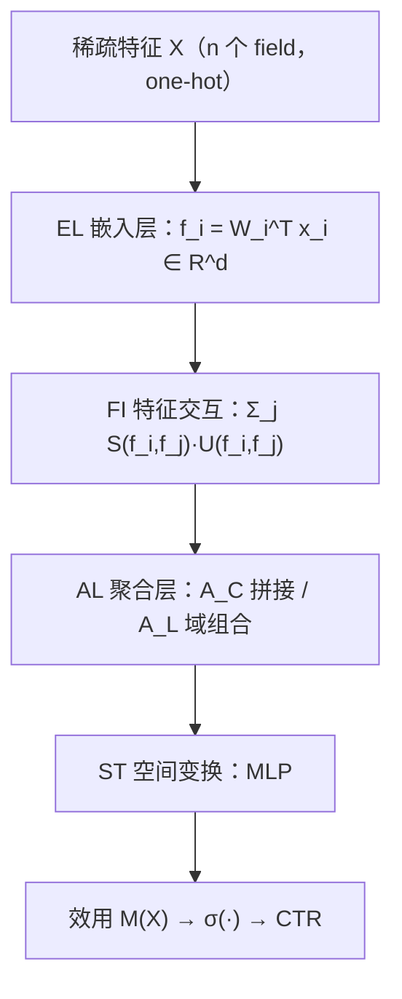
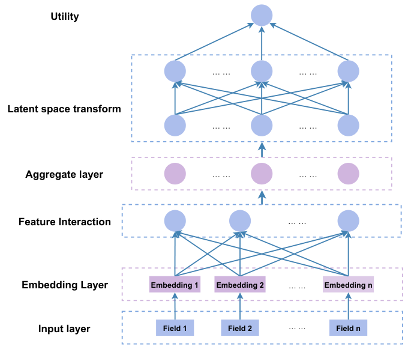
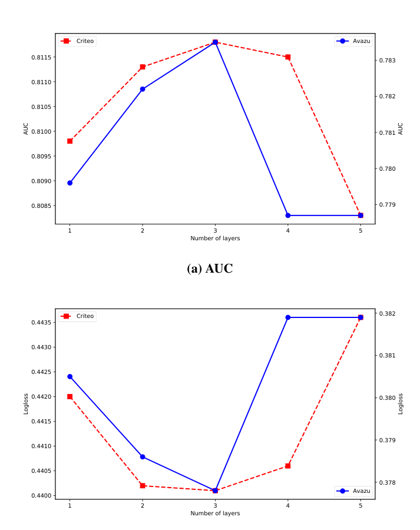

# Looking at CTR Prediction Again: Is Attention All You Need? (重审 CTR 预估：注意力真的就是全部吗？)

- **会议/期刊**: SIGIR 2021
- **作者与机构**: Yuan Cheng, Yanbo Xue（Career Science Lab, BOSS 直聘）
- **推荐链路定位**: 精排（CTR 预估）
- **研究方向**: CTR/CVR 预估与特征交叉
- **论文原文**: [https://arxiv.org/abs/2105.05563v1](https://arxiv.org/abs/2105.05563v1)
- **开源代码**: 暂未开源

## TL;DR (1分钟核心速览)

本文不再追逐 SOTA，而是追问"CTR 模型为何有效"：用经济学离散选择模型把 CTR 重写为个体二元选择 $w_{i,j}=\sigma(M(X))$，并给出统一骨架$M(X)=\mathrm{ST}\circ\mathrm{AL}\circ\mathrm{FI}\circ\mathrm{EL}$，证明 LR/FM/FFM/FwFM/IPNN/DCN/DeepFM/XDeepFM/AFM/AutoInt 全部是"相似度函数$S$× 效用函数$U$"这一二阶注意力算子的特例。据此提出 SAM 族扩展并在 Criteo/Avazu 全样本 AUC 上验证：SAM2E 取得 0.8115 / 0.7891，超越 AutoInt 等 12 个基线，同时揭示高阶交互收益有限、注意力层数 3 层即饱和。

## Background & Motivation (背景与核心矛盾)

- **主流范式**: 从 LR → FM/FFM/FwFM 手工二阶交叉，到 Wide&Deep、DeepFM、DCN、XDeepFM、AutoInt 用 DNN 或显式网络堆高阶交叉，评价标准几乎只剩"是否刷到更高 AUC"。
- **前人局限**: 其一，模型越堆越深，但缺乏统一视角解释各模型本质差异，深度学习的收益来源仍是黑箱；其二，高阶（≥3 阶）交叉的实际贡献被质疑（文献指出二阶以上收益有限），而深度模型的高分常被归因于数据分布与调参而非结构合理性。
- **核心洞察 (Key Insight)**: CTR 本质是"用户在候选集 {不点, 点} 上的二元离散选择"，可用 Logit 型离散选择模型刻画；此时模型的全部职能就是估计一个非线性效用 $M(X)$，而"特征交叉"恰好等价于自注意力中"相似度加权 × 效用聚合"的形式。
- **本文切入点**: 不做新 SOTA，而是先建统一框架把既有模型归类为三种 FI 类型，再用"表达力偏序 + 复杂度分析"指导出轻量扩展 SAM 族。

## Method (核心方法设计)

### 1. 整体框架 (Overall Architecture)

输入 n 个特征域经 one-hot 后由嵌入层映射到 $d$维"效用空间"，得到$\mathbf{f}=[\mathbf{f}_1,\dots,\mathbf{f}_n]$；特征交互层（FI）以注意力算子对每对特征做二阶加权汇聚，得到 n 个效用向量；聚合层（AL）用拼接$A_C$或域线性组合$A_L$压成单向量；最后经 MLP 空间变换（ST）输出标量效用$M(X)$，过 sigmoid 得点击概率并以 BCE 训练。整个模型被形式化为$M(X)=\mathrm{ST}\circ\mathrm{AL}\circ\mathrm{FI}\circ\mathrm{EL}(x)$。

<figure class="paper-figure" markdown="span">
  <figcaption>图1：CTR预测通用框架概览。</figcaption>
</figure>

### 2. 关键设计拆解 (Key Designs)

1. **离散选择模型重构目标（把 CTR 变成一个"效用估计"问题）**：痛点是把 CTR 当纯二分类，损失与用户决策机理脱节。作者设效用 $u_{i,j}=H(X_{p_i},X_{q_j})-\theta_{i,j}+k_i\epsilon_i$，$\epsilon_i$服从 Gumbel 分布，导出 Logit 形式$w_{i,j}=\sigma\big((H(X)-\theta_i)/k_i\big)=\sigma(M(X))$。直觉上：噪声水平$k_i$与期望效用$\theta_i$ 一起被网络吸收，模型只需学"相对效用"而非绝对概率标定，因此任何 BCE 训练的 CTR 网络都可视为一个效用代理。

2. **统一的二阶注意力交互算子（把 10 个模型压成一个公式）**：设 $b_{S,U,v}(\mathbf{f}_i)=S(\mathbf{f}_i,v)\cdot U(\mathbf{f}_i,v)$、$B_{S,U,V}(\mathbf{f}_i)=\sum_{v\in V}S(\mathbf{f}_i,v)U(\mathbf{f}_i,v)$，其中$S$为相似度（内积/常数/softmax 归一化内积），$U$为效用函数（常数 1、标量权重$w_{ij}$、或向量$V\mathbf{f}_j$）。当$V=\{\mathbf{f}_1,\dots,\mathbf{f}_n\}$时退化为自注意力。由此 LR =$B_{1,I,\{\mathbf{f}_i\}}$（一阶退化），FM/FFM/FwFM/IPNN/XDeepFM/AFM 属"内积相似 + 标量效用"类，AutoInt 属"QKV 相似 + 向量效用"类，差异仅在$(S,U,V,\mathrm{AL},\mathrm{ST})$ 五元组取值。

3. **SAM 族扩展与训练/推理开销**：针对 $U$只能取标量或单变量向量的表达瓶颈，提出$U(\mathbf{f}_i,\mathbf{f}_j)=W_{i,j}$（SAM-A，全可训练）与$U(\mathbf{f}_i,\mathbf{f}_j)=\mathbf{f}_i\odot\mathbf{f}_j$（SAM-E，逐元素积），配$S=\langle\mathbf{f}_i,\mathbf{f}_j\rangle$ 得 SAM2A/E，配 softmax 内积得多层 SAM3A/E：
   $$\mathrm{FI}_{\text{SAM2E}}(\mathbf{f}_i)=\sum_{j}\langle\mathbf{f}_i,\mathbf{f}_j\rangle\,(\mathbf{f}_i\odot\mathbf{f}_j),\qquad \mathrm{FI}_{\text{SAM3E}}(\mathbf{f}_i)=\sum_{j}\langle Q\mathbf{f}_i,K\mathbf{f}_j\rangle_{\text{softm}}(\mathbf{f}_i\odot\mathbf{f}_j)$$
   总损失为 $\mathcal{L}=-\frac{1}{N}\sum_{i,j}[y\log w+(1-y)\log(1-w)]$，全批量曝光样本训练、无需负采样（样本即曝光未点击）。复杂度上 SAM2 约$O(2dn^2)$时间/参数$O(dn^2)$，SAM3A 每层$O(d^2n+2dn^2)$，与 AutoInt 同量级；表达力偏序为$\text{SAM3A}\succeq_M\text{SAM2A}\succeq_M\text{FM}\succeq_M\text{SAM1}=_M\text{LR}$。

## Experimental Setup & Evaluation Protocol (实验设置与评估协议)

- **数据集与预处理**:

| 数据集 | #样本数 | #特征域 | #类别基数 | 划分方式 | 特征/场景说明 |
| :--- | :---: | :---: | :---: | :---: | :--- |
| Criteo | 45,840,617 | 39 | 1,086,810 | 随机 80/10/10 | 13 数值域 + 26 类别域，数值经 $\lfloor 2\log x\rfloor$ 离散化 |
| Avazu | 40,428,967 | 22 | 2,018,012 | 随机 80/10/10 | 移动广告点击日志，移除无信息量的 sample id 域 |

- **数据划分与防穿越**: 随机 **比例划分**（80% 训练 / 10% 验证 / 10% 测试），未做全局时间戳切分，存在同分布偏乐观风险；无 `5-core` 过滤，全量曝光样本参与训练。
- **排名评测协议**: 非排名式评测，采用 **AUC**（阈值无关，越大越好）与 **log-loss**（标定质量，越小越好）双指标；未使用 Full-Ranking 或 Sampled Ranking，也未报告 NDCG/HR 类排序指标。
- **对比基线与超参设置**: 12 个基线覆盖一阶（LR）、二阶（FM/FFM/FwFM/IPNN/AFM/AFN/HOFM）、高阶（DCN/DeepFM/XDeepFM/AutoInt）及单层单头 Transformer 编码器；嵌入维度 $d=16$，隐层 3 层 × 32 单元、ReLU，Adam（lr=0.001），batch=1024，$L_2=10^{-5}$，dropout=0.5，Xavier 初始化；每模型 10 次独立运行取均值，显著性$p<0.05$。

## Key Experimental Results (实验关键数据)

### 1. 主实验对比 (Main Results)

| 模型 | Criteo AUC ↑ | Criteo log-loss ↓ | Avazu AUC ↑ | Avazu log-loss ↓ |
| :--- | :---: | :---: | :---: | :---: |
| LR | 0.7949 | 0.4555 | 0.7584 | 0.3921 |
| FM | 0.8078 | 0.4443 | 0.7858 | 0.3777 |
| FwFM | 0.8089 | 0.4427 | 0.7778 | 0.3810 |
| IPNN | 0.8107 | 0.4408 | 0.7818 | 0.3791 |
| DCN | 0.8074 | 0.4439 | 0.7798 | 0.3800 |
| DeepFM | 0.8030 | 0.4487 | 0.7798 | 0.3799 |
| XDeepFM | 0.8104 | 0.4414 | 0.7809 | 0.3798 |
| AutoInt | 0.8106 | 0.4411 | 0.7834 | 0.3780 |
| Transformer (1L1H) | 0.7942 | 0.4566 | 0.7693 | 0.3866 |
| SAM1 | 0.7925 | 0.4572 | 0.7720 | 0.3848 |
| SAM3A | 0.8098 | 0.4420 | 0.7796 | 0.3805 |
| **SAM2E (本文)** | **0.8115** | **0.4404** | **0.7891** | **0.3755** |
| SAM2A | 0.8098 | 0.4420 | 0.7885 | 0.3756 |
| Improv.% (vs 最强基线) | +0.10% (vs IPNN) | −0.09% | +0.73% (vs AutoInt) | −0.66% |

### 2. 消融实验 (Ablation Study)

| 变体 / 维度 | Criteo AUC | Criteo log-loss | Avazu AUC | Avazu log-loss |
| :--- | :---: | :---: | :---: | :---: |
| SAM1（一阶，等价 LR） | 0.7925 | 0.4572 | 0.7720 | 0.3848 |
| SAM2E（逐元素积效用） | 0.8115 | 0.4404 | **0.7891** | **0.3755** |
| SAM2A（全可训练效用 $W_{ij}$） | 0.8098 | 0.4420 | 0.7885 | 0.3756 |
| SAM3E（softmax 注意力，1 层） | 0.8071 | 0.4451 | 0.7805 | 0.3821 |
| SAM3A（1 层） | 0.8098 | 0.4420 | 0.7796 | 0.3805 |
| SAM3A（3 层，最优深度） | **0.8118** | **0.4401** | 0.7835 | 0.3778 |
| SAM3A（5 层） | 下降 | 上升 | 下降 | 上升 |

<figure class="paper-figure" markdown="span">
  <figcaption>图2：SAM3A中性能随层数的变化。</figcaption>
</figure>

### 3. 关键实验发现 (Key Findings)

1. **二阶交叉是主要收益来源，高阶收益有限**: IPNN（0.8107）与 FM（Avazu 0.7858）已逼近甚至超过 XDeepFM（0.8104/0.7809），而单层单头 Transformer（0.7942/0.7693）甚至不如 LR 与 FM——说明盲目堆高阶/注意力结构在 CTR 上性价比极低。
2. **效用函数"向量化"比"相似度复杂化"更划算**: 同为二阶，SAM2E 用 $U=\mathbf{f}_i\odot\mathbf{f}_j$ 在 Avazu 上比 AutoInt 提升 +0.73% AUC、log-loss 降低 0.66%；而把相似度换成 softmax 注意力的 SAM3E 反而退化到 0.7805/0.3821（低于 SAM2E 近 0.9 个 AUC 点），归因于 LayerNorm 引入的特征相关性在浅层无法被消化。
3. **深度呈"倒 U"型且参数越多越稳**: SAM3A 层数 1→3 时 Criteo AUC 由 0.8098 升至 0.8118、log-loss 降至 0.4401，5 层后回落；同时 SAM3A（全可训练）恒优于 SAM3E，印证"过参数化模型在充分训练下潜力更大"这一与表达力偏序一致的观察。

## Highlights & Limitations (亮点、对比与审稿批判)

- **与代表作对比 (vs. Prior Work)**: 相比 AutoInt（用多头自注意力刷高阶交叉）、XDeepFM（CIN 显式高阶）、AFM（注意力加权池化），本文不新增重型结构，而是把这些模型重写成同一 $(S,U,V,\mathrm{AL},\mathrm{ST})$元组的不同取值，进而只在$U$上做最小增量（$W_{ij}$或$\mathbf{f}_i\odot\mathbf{f}_j$），因此参数量与 AutoInt 同级却能给出"为何有效"的机理解释。
- **可迁移亮点**: ① "$S\times U$ 二阶算子 + 五元组抽象"可作为模型归因/设计检查清单，快速判断一个新交叉模块相对 FM 到底增益在相似度还是效用函数；② "效用函数向量化（逐元素积）"这一零参数改动可直接插入现有 DeepFM/DCN 的交叉层，成本几乎为零。
- **审稿级局限批判**: ① 实验仅两个公开广告数据集、随机切分且无时间切分与冷启动划分，仅有 AUC/log-loss，缺少排序指标与线上 A/B，SOTA 声明较弱（Criteo 仅 +0.10%）；② 表达力命题（Prop 4.3–4.5）以"线性算子参数可吸收"一笔带过未给完整证明，且深度扫描仅针对 SAM3A，缺少对 SAM2 系与超参（$d$、正则、dropout）的敏感性分析，未开源代码复现成本较高。

## Rating (四维评分)

- **方法创新性 (Novelty)**: ⭐⭐⭐⭐ （以离散选择模型重定义 CTR + 自注意力统一 10 个模型的抽象视角颇具洞察，但 SAM 扩展本身只是二阶算子的轻量变体）
- **评估协议与实验扎实度 (Protocol & Experiments)**: ⭐⭐⭐ （12 基线 + 10 次重复 + $p<0.05$ 较规范，但仅 2 个数据集、随机切分、仅 AUC/log-loss，缺排序与线上验证）
- **写作与数学规范度 (Clarity & Rigor)**: ⭐⭐⭐⭐ （框架-分类-偏序-复杂度层层递进、表 1 归约清晰，但表达力命题证明从简、符号在 SAM 各节略有重复定义）
- **工业落地与复现价值 (Industrial & Practical Value)**: ⭐⭐⭐ （SAM2E 改动零额外参数、复杂度与 FM 同级易上线；但未开源，且作者自述不以 SOTA 为目标，实战增益需自行验证）

