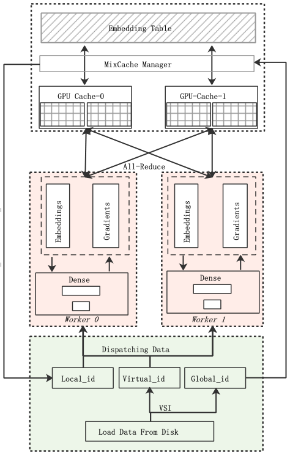
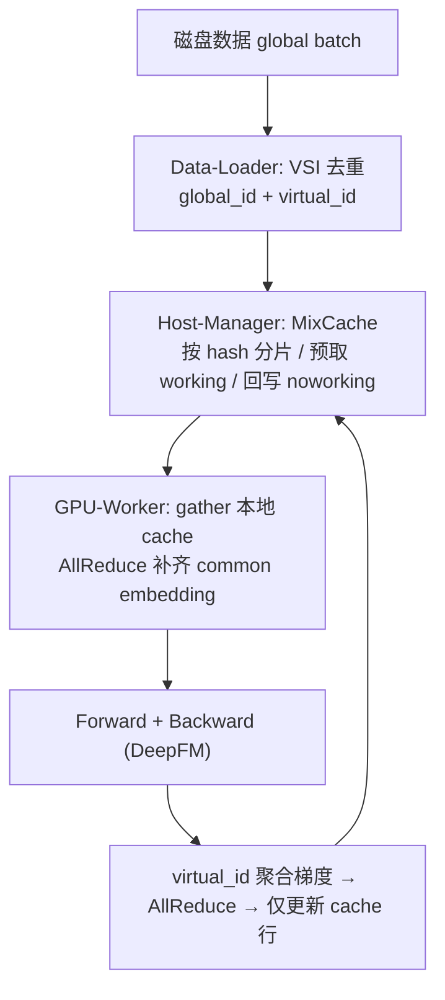
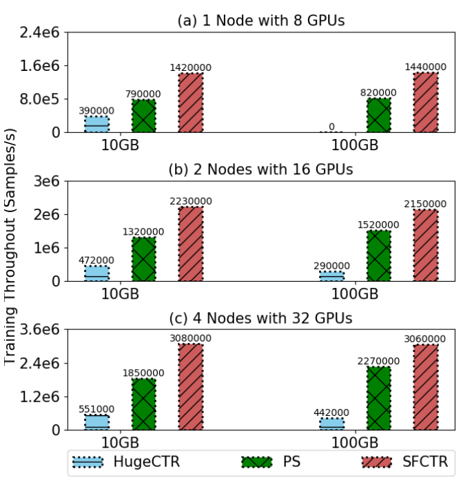

# ScaleFreeCTR: MixCache-based Distributed Training System for CTR Models with Huge Embedding Table (面向超大 Embedding 表 CTR 模型的 MixCache 分布式训练系统)

- **会议/期刊**: SIGIR 2021（10 页， Applied/System Track）
- **作者与机构**: Huifeng Guo†, Wei Guo†, Yong Gao, Ruiming Tang*, Xiuqiang He, Wenzhi Liu（华为诺亚方舟实验室，†同等贡献，*通讯作者）
- **推荐链路定位**: 离线训练系统（服务于召回/精排 CTR 模型的批量训练加速，不改变线上推理链路）
- **研究方向**: CTR 预估与特征交叉 / 工业级架构与系统
- **论文原文**: [https://arxiv.org/abs/2104.08542v2](https://arxiv.org/abs/2104.08542v2)
- **开源代码**: 暂未开源（论文声明后续将基于 MindSpore 开源；文中给出的 HugeCTR 链接为对比基线）

## TL;DR (1分钟核心速览)

深度 CTR 模型的 Embedding 表动辄数百 GB 甚至 TB，单卡 HBM 装不下，只能走"Host 存表 + GPU 算稠密层"的模型并行；而 PS/DES/HierPS 都被 **Host↔GPU 的 pull&push 延迟** 与 **CPU 端参数同步** 两个瓶颈拖住。SFCTR 提出三项改动：Data-Loader 端 **VSI 虚拟稀疏 ID 去重**（压缩 Host↔GPU 与 GPU↔GPU 通信量）、Host-Manager 端 **MixCache**（工作参数缓存在 GPU HBM，提前预取并延迟回写）、以及 **三阶段流水线** 把磁盘/CPU/GPU 三阶段完全重叠。在 Criteo-TB（10GB / 100GB 表）、32×V100 + 100Gb RDMA 上，吞吐分别为优化版 MXNet PS 的 1.6×/1.3×、HugeCTR 的 5.6×/6.9×，logloss 不劣化。

## Background & Motivation (背景与核心矛盾)

- **主流范式**: 所有深度 CTR 模型遵循 Embedding & MLP 范式（图 1），参数体量 99% 集中在稀疏 Embedding 层；分布式训练因此普遍采用模型并行——CPU Host 内存存表、GPU 做前向反向。
- **前人局限 1（存不下）**: HugeCTR / DLRM 把 Embedding 切块塞进各卡 HBM，但 HBM ≤ 32GB，训练 100GB 表（含 Adam 一阶/二阶矩共 300GB 参数）需数十上百张卡，成本不可行。
- **前人局限 2（搬得慢）**: DES / HierPS 把表放 Host，于是每次迭代都要 Host↔GPU 拉取推送；DES 只优化 GPU 间通信，HierPS 的 Big-Batch 只把延迟摊到批与批之间，批间同步仍是不可忍受的空转。
- **核心洞察 (Key Insight)**: 推荐数据有两个可利用性质——(a) **工作参数集很小**：单 batch 涉及的稀疏特征数量有限，MLP 参数也不大；(b) **特征服从幂律分布**：极少数高频特征被反复命中，导致 batch 内大量重复 ID。
- **本文切入点**: 性质 (a) 使"把工作参数缓进 GPU HBM"成为可能（消除 Host↔GPU 延迟），性质 (b) 使"批内去重 + 按频次换入换出"成为可能（削减通信量）。

## Method (核心方法设计)

### 1. 整体框架 (Overall Architecture)

SFCTR 按数据流拆成三个解耦模块，对应算法 1 的三段：**Data-Loader** 从磁盘读入 global batch，执行 VSI 去重，产出 `global_id`（去重后的唯一特征表）与每个样本内的 `virtual_id`（指向 global_id 的指针）；**Host-Manager** 依据 global_id 向 MixCache 查询命中情况，把下一 batch 的 working 参数预取进各 GPU 的 cache buffer、把 noworking 参数逐回 Host，并把数据分片、把 global_id 翻译成卡内 `local_id`；**GPU-Worker** 执行 Embedding gather、跨卡 AllReduce 补齐、前向/反向与稀疏行更新。三者构成生产者-消费者关系，配合三阶段流水线实现训练零等待。

<figure class="paper-figure" markdown="span">
  <figcaption>图3：ScaleFreeCTR 的架构，包括 Data-Loader（算法1第2-3行，如第4节所述）、Host-Manager（算法1第4-7行，如第5节详述）和 GPU-Worker（算法1第9-14行，如第6节所述）。</figcaption>
</figure>

### 2. 关键设计拆解 (Key Designs)

1. **VSI 虚拟稀疏 ID（把"通信量"从重复次数降为唯一特征数）**：幂律分布下一个 batch 内同一特征重复出现几十次，若按原始 ID 搬运则同一条 Embedding 被反复 Host→GPU 传输、反复参与 AllReduce。VSI 在 global batch 粒度去重，只保留一份 `global_id`，样本内改用 `virtual_id` 指针重建：$\text{virtual\_id}\rightarrow\text{global\_id}$，可无损还原原始样本。通信规模由$\sum_{i\in\mathcal{B}}|f_i|$压缩到$|U_{\mathcal{B}}|=\big|\bigcup_{i\in\mathcal{B}}\{f_i\}\big|$；更关键的副产品是**各卡特征顺序被统一到同一 global_id 排序**，这才让跨卡 AllReduce 能逐位对齐（否则只能 All2All 点对点）。
2. **MixCache（用"可预测的下一 batch"消除 Host↔GPU 延迟）**：核心是把"每 batch 拉取"变成"提前一拍的命中"。用取模哈希把特征划分为不相交分组，每张 GPU 的 cache buffer 只负责一组工作参数，非重叠存放；当前 batch 在 GPU 上训练的同时，Host-Manager 预测下一 batch 的 working 集并预取。回写需同时满足两个条件：**该行已更新完毕** 且 **后续短窗口内不再被使用**。由此延迟被隐藏在计算之下，单步传输比可写为 $r_t=\big|\mathcal{W}_{t+1}\setminus\mathcal{C}_{g}\big|/\big|\mathcal{W}_{t+1}\big|$，$\mathcal{C}_g$为 GPU 缓存内容——幂律头部特征常驻使得$r_t$ 远小于 1。
3. **前反向同步与训练目标**：前向各卡用 global_id 位置零填充得到 Local Common Embedding，做 AllReduce 求和得到 $\mathbf{E}^{\text{global}}[u]=\sum_{g}\mathbf{E}^{\text{local}}_{g}[u]$，再用 virtual_id gather 回样本；反向先用 `unsorted_segment_sum` 按 virtual_id 把分散梯度聚成与 forward 同序的 Local Common Gradients，AllReduce 后仅对 cache 内命中行做$\mathbf{e}_u\leftarrow\mathbf{e}_u-\eta\,\mathbf{g}^{\text{global}}_u$。一次 AllReduce 即可同时完成"跨卡补齐"与"参数服务器式更新"，无需 CPU 参与同步。目标函数即标准二分类 logloss（无负采样概念，稠密全样本训练）：$\mathcal{L}=\frac{1}{n}\sum_{i=1}^{n}\log\big(1+\exp(-y_i\hat{y}_i)\big)$。推理侧不改动：训练收敛后 Embedding 表照常导出，线上打分链路与原生 DeepFM 完全一致。

## Experimental Setup & Evaluation Protocol (实验设置与评估协议)

- **数据集与预处理**: 公开 Criteo-TB（24 天连续点击日志，26 类别 + 13 数值特征），通过频次阈值构造两档表规模（阈值 10 / 1，类似按频次截断的长尾过滤）：

| 数据集 | #Users | #Items (类别特征) | #Interactions | 稀疏度/密度 | 特征/场景说明 |
| :--- | :---: | :---: | :---: | :---: | :--- |
| Criteo-TB (10GB) | 匿名 | 33 M | 十亿级样本 | 极高稀疏 | Embedding 表 33M×4B×80≈10GB；含 Adam 状态共 30GB |
| Criteo-TB (100GB) | 匿名 | 330 M | 十亿级样本 | 更高稀疏 | 表 100GB，训练参数 300GB > 8×32GB HBM |

- **数据划分与防穿越 (Splitting Strategy)**: 系统级评测，按 `全局时间戳` 顺序流式读取（不做随机 shuffle 划分，亦不做 Leave-One-Out），关注的是**训练吞吐**而非泛化切分；同步语义严格采用 **BSP**（作者明确拒绝 ASP/SSP，因其损害收敛）。
- **排名评测协议 (Ranking Protocol)**: 本文非排序评测论文，**不使用** Full-Ranking 或 Sampled Ranking；评价指标为 (i) 训练吞吐（examples/s，可扩展性）与 (ii) logloss（精度不劣化验证）。
- **对比基线与超参设置**: 骨干模型 DeepFM，Embedding 维 $d=80$，Adam 优化器；基线为 NVIDIA **HugeCTR**（纯 GPU HBM 存表）与**优化版 MXNet Parameter Server**（重写 PS 支持大表 + 流水线重叠 + 批内 unique 去重，属加强版对手）。硬件：4 节点 × 8×Tesla V100(32GB)、2×Xeon Gold-5118、约 1TB Host 内存、100Gb RDMA/InfiniBand，分别测 1/2/4 节点（8/16/32 卡）。

## Key Experimental Results (实验关键数据)

### 1. 主实验对比 (Main Results)

原文以图 7 呈现吞吐曲线，下表按正文报告的 32 卡加速比归一化（PS = 1.00）：

| 系统 | 10GB 表 (32 GPU) | 100GB 表 (32 GPU) | 说明 |
| :--- | :---: | :---: | :--- |
| PS (优化版 MXNet) | 1.00 | 1.00 | Host 存表 + push/pull，瓶颈在同步与延迟 |
| HugeCTR (NVIDIA) | 0.29 | N/A | 300GB 参数放不进 8×32GB HBM，无法训练 |
| **SFCTR (本文)** | **1.60** (`+60%` vs PS) | **1.30** (`+30%` vs PS) | 相对 HugeCTR 分别 **5.6×** / **6.9×** |

<figure class="paper-figure" markdown="span">
  <figcaption>图7：SFCTR、HugeCTR 和 PS 的训练吞吐量比较。</figcaption>
</figure>

### 2. 消融实验 (Ablation Study)

| 消融配置 | 度量指标 | 结果 |
| :--- | :--- | :--- |
| w/o VSI（保留原始重复 ID） | Host↔GPU 传输量 | 基准 100% |
| **w/ VSI** | Host↔GPU 传输量 | **↓94%**（32 卡） |
| w/o VSI | GPU↔GPU 通信时间 | 基准 100% |
| **w/ VSI** | GPU↔GPU 通信时间 | **↓88%** |
| Host（无预取） | 训练效率 / 收敛 | 最慢，但 logloss 正常 |
| Prefetch（仅预取，无一致性保证） | 训练效率 / 收敛 | 较快，但 **收敛明显变慢** |
| **MixCache** | 训练效率 / 收敛 | **最快且 logloss 曲线与 Host 重合** |
| Cache 2GB / 0.5GB / 0.25GB | 单步平均传输比 | **12% / 27% / 29%**（2GB 可将回写推迟 1000+ step） |
| w/o 三阶段流水线（单节点，100GB） | 总训练时间 | 150 s（三阶段串行相加） |
| **w/ 三阶段流水线** | 总训练时间 | **75 s（≈2×）** |

### 3. 关键实验发现 (Key Findings)

1. **VSI 是最大杠杆，且收益是"双重"的**：32 卡下它把 Host↔GPU 传输量砍掉 94%、GPU↔GPU 通信时间砍掉 88%——前者来自批内去重避免同一行反复搬运，后者来自 global_id 统一排序使 AllReduce 可对齐；没有这层顺序统一，跨卡同步只能退化为 All2All 点对点，这是"HugeCTR 在 10GB 表下被拉开 5.6×"的主因。
2. **缓存容量直接决定扩展性上限**：2GB/0.5GB/0.25GB 缓存对应 12%/27%/29% 的平均单步传输比，2GB 可将 GPU→Host 回写推迟 1000+ step，说明幂律头部的命中率就是收益天花板的物理来源——表越大（330M 特征）反而越依赖头部集中度，故 100GB 场景仍能保持 1.3× 于 PS 的近线性扩展。
3. **"快"不等于"对"，朴素预取是反例**：Prefetch 策略同样重叠了通信，但因无法保证参数一致性导致收敛速度明显慢于 Host/Cache；MixCache 通过"已更新完 + 未来不再用"双条件维持 BSP 语义，logloss 曲线与不缓存的 Host 基线完全重合，证明 6.9× 加速未以任何精度为代价。

## Highlights & Limitations (亮点、对比与审稿批判)

- **与代表作对比 (vs. Prior Work)**: 与 **HugeCTR/DLRM** 的本质区别是"表放哪"——它们纯 HBM 存表，参数一超 32GB/卡就不可训练；与 **DES/HierPS** 的本质区别是"延迟怎么处理"——DES 只优化 GPU-GPU、HierPS 用 Big-Batch 摊薄批间延迟，而 SFCTR 用 GPU 侧缓存直接把 Host↔GPU 延迟**隐藏到计算之下**（Hiding 而非 Large/Small）。同时它把"参数更新"从 CPU 服务器搬到 GPU AllReduce，绕开了 PS 的第二瓶颈。
- **可迁移亮点**: (1) **批内 ID 去重 + 统一排序** 这一 trick 可无痛迁移到任何"稀疏 ID + 跨卡通信"的训练框架（如大模型 MoE 的 token 去重、图推荐的邻居采样通信压缩）；(2) "先算工作集、再决定预取/回写"的 **双条件换出判据** 可复用到 KV-Cache、特征缓存的任何 LRU 变体中，避免"刚换出又换入"的抖动。
- **审稿级局限批判**: (1) **基线覆盖不全**：只与 HugeCTR 和自改的 MXNet PS 对比，未实测最相关的 DES / HierPS，而这恰是论文立论的两个靶子，说服力打折；(2) **场景与规模局限**：仅测 DeepFM + Criteo 一个数据集，未含 DIN 等序列结构（其 batch 内特征分布更长尾、working set 更大），也未给出 Host 内存耗尽（>1TB 表）时的多机 Host 分片方案与线上 A/B 收益；此外 cache 大小、哈希分片数、预取窗口三个超参均无双因素敏感度分析，且承诺的 MindSpore 开源实现尚未见仓库，复现成本高。

## Rating (四维评分)

- **方法创新性 (Novelty)**: ⭐⭐⭐⭐ （VSI 去重与 MixCache 均为"利用数据幂律性"的巧思，工程贡献扎实，但本质是缓存/流水线经典思想的领域化组合，缺乏新的理论刻画）
- **评估协议与实验扎实度 (Protocol & Experiments)**: ⭐⭐⭐⭐ （两组表规模 × 三档集群规模的扩展性曲线 + 四组消融完整，但缺 DES/HierPS 直接对比、仅单数据集单骨干模型，且无重复实验与方差报告）
- **写作与数学规范度 (Clarity & Rigor)**: ⭐⭐⭐⭐ （三模块 + 算法 1 伪代码 + 前反向同步示例讲得非常清楚，公式克制；但对通信复杂度与 cache 命中率缺少形式化上界分析）
- **工业落地与复现价值 (Industrial & Practical Value)**: ⭐⭐⭐⭐⭐ （直击工业界"百 GB 大表训不动"的真痛点，6.9× 吞吐与 94% 通信削减可直接折算成算力成本；代价是需要 1TB 级 Host 内存与 RDMA 集群，且开源缺失是落地门槛）

