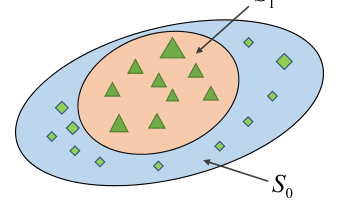
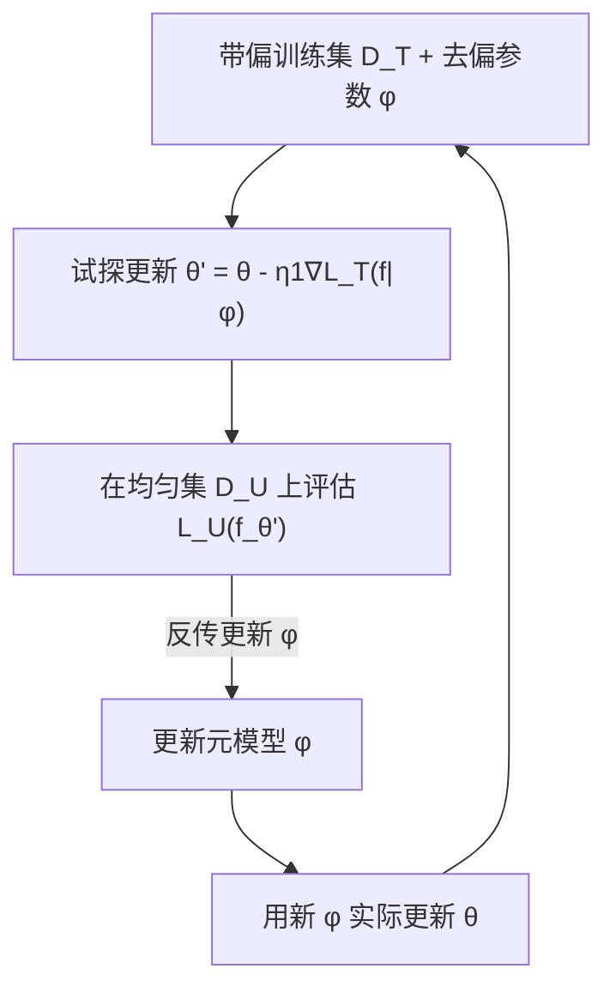
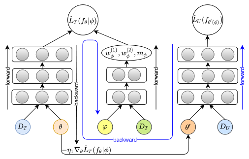

# AutoDebias: Learning to Debias for Recommendation (面向推荐的自动去偏学习)

- **会议/期刊**: SIGIR 2021
- **作者与机构**: Jiawei Chen, Hande Dong, Yang Qiu, Xiangnan He 等（中国科学技术大学、格拉斯哥大学、中山大学、阿里巴巴）
- **推荐链路定位**: 召回（矩阵分解为主干，可替换为任意打分模型）
- **研究方向**: 去偏公平、可信隐私与工业架构
- **论文原文**: [https://arxiv.org/abs/2105.04170v5](https://arxiv.org/abs/2105.04170v5)
- **开源代码**: [https://github.com/DongHande/AutoDebias](https://github.com/DongHande/AutoDebias)

## TL;DR (1分钟核心速览)

现有去偏方法（IPS、数据插补、点击模型）各自只针对一两种特定偏置，且倾向性/伪标签等配置需人工调参、难以适配混合或未知偏置。本文把选择偏置、从众偏置、曝光偏置、位置偏置统一刻画为「经验风险与真实风险之间的风险差异 (risk discrepancy)」，给出一个含重加权 $w^{(1)}$、插补权重$w^{(2)}$与伪标签$m$的通用经验风险式（可复原 IPS/DR/负样本加权等），再用一小份均匀数据 (uniform data) 以元学习求解双层优化自动学出$\phi=\{w^{(1)},w^{(2)},m\}$。在 Yahoo!R3/Coat 的显式反馈全库排序协议下，NLL 较最优基线再降 5.6%，NDCG@5 提升 11.2%。

## Background & Motivation (背景与核心矛盾)

- **主流范式**: 以 IPS 重加权、数据插补（伪标签）、生成式点击模型（PBM/Heckman）三类手段修正训练分布，均依赖对某一具体偏置的建模假设。
- **前人局限**: ① **缺乏普适性**——IPS 只解选择偏置、点击模型只解位置偏置，真实数据往往是多偏置叠加；② **缺乏自适应性**——倾向分/伪标签/生成过程必须由领域专家指定，且随用户-物品分布漂移而失效。
- **核心洞察 (Key Insight)**: 所有偏置的共同本质是 $p_T(u,i,r)\neq p_U(u,i,r)$导致$\mathbb{E}_{p_T}[\hat{L}_T]\neq L(f)$，即便数据无穷多，最优解仍停留在$f_T$而与$f^*$相差$\Delta_L$。更关键的是：训练分布只覆盖$p_U$支撑集的$S_1$子空间，$S_0$（$p_T=0,p_U>0$）完全空白，仅靠重加权无法填补。
- **本文切入点**: 既然偏置可归约为「一组待定去偏参数」，那就不要人工设定，而是用一份随机日志策略采集的均匀数据当监督信号，把去偏参数当作超参数用元学习学出来。

<figure class="paper-figure" markdown="span">
  <figcaption>图2：训练数据分布仅覆盖理想数据分布一部分的示意图。需要向空白区域𝑆0填补伪数据（以菱形标记），其中标记大小反映其权重。</figcaption>
</figure>

## Method (核心方法设计)

### 1. 整体框架 (Overall Architecture)

框架分两层：**基础学习器**在带偏训练集 $D_T$上、以当前去偏参数$\phi$为"超参"优化推荐模型$\theta$；**元学习器**把刚更新一步的$\theta'(\phi)$放到均匀集$D_U$上评估，用该损失对$\phi$反传（沿$\hat{L}_U\to\theta'\to\nabla_\theta\hat{L}_T\to\phi$链式求导），再回到$D_T$用更新后的$\phi$真正更新$\theta$。为防止小规模$D_U$上过拟合，$\phi$由一个线性元模型重参数化（输入用户/物品 one-hot、反馈与曝光指示），只需学三组$d$维向量$\varphi_1,\varphi_2,\varphi_3$。

<figure class="paper-figure" markdown="span">
  <figcaption>图3：AutoDebias的工作流程，包含三个步骤：（1）在训练数据𝐷𝑇上使用当前𝜙将𝜃暂更新为𝜃′（黑色箭头）；（2）在均匀数据上基于𝜃′更新𝜙（蓝色箭头）；（3）使用更新后的𝜙实际更新𝜃（黑色箭头）。</figcaption>
</figure>

### 2. 关键设计拆解 (Key Designs)

1. **通用去偏经验风险（把 IPS/插补/DR/负加权统一为特例）**：针对 $p_T$与$p_U$的支撑集差异，把真实风险拆成$S_1$上的重加权项与$S_0$ 上的插补项，得到
$\hat{L}_T(f|\phi)=\frac{1}{|D_T|}\sum_{k}w^{(1)}_k\delta(f(u_k,i_k),r_k)+\sum_{u,i}w^{(2)}_{ui}\delta(f(u,i),m_{ui})$，
当 $w^{(1)}_k=p_U(u_k,i_k,r_k)/p_T(u_k,i_k,r_k)$、$m_{ui}=\mathbb{E}_{p_U(r|u,i)}[r\mathbb{I}[p_T(u,i,r)=0]]$时该式是$L(f)$的无偏估计。直觉上：$w^{(1)}$修正"已观测但被过度采样"的样本，$m$填补"根本没机会被观测"的空白区域，二者互补才能覆盖整个支撑集；令$w^{(2)}=0$退化为 IPS，令$w^{(1)}$常数、$m$取启发式值退化为数据插补，加入位置特征$e_{p_k}$ 即复原位置偏置 IPS。
2. **元学习双层优化与线性重参数化**：$\phi$无法从带偏数据学到（该数据本身不含"偏在哪里"的信号），故以均匀数据为目标：$\min_\phi \hat{L}_U(f_{\theta^*(\phi)})$。为避免在数千条$D_U$上直接学$|D_T|+|U||I|$个自由参数而崩溃，令$w^{(1)}_k=\exp(\varphi_1^\top[x_{u_k}\circ x_{i_k}\circ e_{r_k}])$（同理$w^{(2)}$、$m_{ui}=\sigma(\varphi_3^\top[e_{r}\circ e_{O}])$），用低容量元模型引入归纳偏置、降低方差；作者证明即便$\Phi$不含最优$\phi^*$，泛化误差仍被$\varepsilon_1+\varepsilon_2+(\Delta^{(1)}+\Delta^{(2)})\rho+\Delta_m\rho_d$ 界定。
3. **训练目标与开销**：基础模型用 SGD、元模型用 Adam，交替一阶近似（每步只做一次虚拟更新，非完整内循环），总开销约为普通训练的 2–3 倍；推理阶段 $\phi$ 已固定，**与标准 MF 完全同构，零额外延迟**。

## Experimental Setup & Evaluation Protocol (实验设置与评估协议)

- **数据集与预处理**: 显式反馈取 Yahoo!R3 与 Coat，评分以阈值 3 二值化为 $r\in\{+1,-1\}$；另构造 Simulation 模拟"位置偏置 + 选择偏置"共现的列表反馈。隐式反馈版本直接丢弃$D_T$ 中的负反馈。

| 数据集 | #Users | #Items | #Training | #Uniform | #Valid | #Test |
| :--- | :---: | :---: | :---: | :---: | :---: | :---: |
| Yahoo!R3 | 15,400 | 1,000 | 311,704 | 2,700 | 2,700 | 48,600 |
| Coat | 290 | 300 | 6,960 | 232 | 232 | 4,176 |
| Simulation | 500 | 500 | 12,500 | 3,750 | 3,750 | 67,500 |

- **数据划分与防穿越**: 带偏数据全部作训练集；无偏数据按 **5% 均匀集 / 5% 验证集 / 90% 测试集** 切分，均匀集只用于元梯度，测试集严格隔离，不存在穿越。
- **排名评测协议**: 在无偏测试集上做 **Full-Ranking 全库排序**（对每个用户对其全部 1,000/300/500 个物品打分排序），指标为 NLL（负对数似然，越大越好）、AUC、NDCG@5；无负采样。
- **对比基线与超参**: MF(biased)/MF(uniform)/MF(combine)、IPS（朴素贝叶斯估计倾向）、DR、CausE、KD-Label；隐式反馈对比 WMF/RI-MF/AWMF；列表反馈对比 DLA/HeckE。主干统一为 MF，学习率与权重衰减在 $\{10^{-4},10^{-3},10^{-2},10^{-1}\}$ 网格搜索。

## Key Experimental Results (实验关键数据)

### 1. 主实验对比 (Main Results)

显式反馈（Yahoo!R3 / Coat）：

| 方法 | Yahoo NLL | Yahoo AUC | Yahoo NDCG@5 | Coat NLL | Coat AUC | Coat NDCG@5 |
| :--- | :---: | :---: | :---: | :---: | :---: | :---: |
| MF(biased) | -0.587 | 0.727 | 0.550 | -0.539 | 0.747 | 0.500 |
| MF(uniform) | -0.513 | 0.573 | 0.449 | -0.623 | 0.580 | 0.358 |
| MF(combine) | -0.580 | 0.730 | 0.554 | -0.538 | 0.750 | 0.504 |
| IPS | -0.448 | 0.723 | 0.549 | -0.515 | 0.759 | 0.509 |
| DR | -0.444 | 0.723 | 0.552 | -0.512 | 0.765 | 0.521 |
| CausE | -0.579 | 0.731 | 0.551 | -0.529 | 0.762 | 0.500 |
| KD-Label | -0.632 | 0.740 | 0.580 | -0.593 | 0.748 | 0.504 |
| **AutoDebias** | **-0.419** | **0.741** | **0.645** | **-0.512** | **0.766** | **0.522** |
| Improv. | 5.6% | 0.1% | 11.2% | 0.0% | 0.1% | 0.2% |

跨偏置类型验证：隐式反馈（Yahoo-Im/Coat-Im）上 AUC 0.730/0.746、NDCG@5 0.635/0.527，全面优于 WMF(0.635/0.547)、RI-MF(0.673/0.554)、AWMF(0.675/0.578)；列表反馈 Simulation 上 NLL -0.667、AUC 0.634、NDCG@5 0.707，优于 DLA(0.567/0.593) 与 HeckE(0.587/0.648)。

### 2. 消融实验 (Ablation Study)

| 变体 | $w^{(1)}$|$m$|$w^{(2)}$ | Yahoo NDCG@5 | Coat NDCG@5 |
| :--- | :---: | :---: | :---: | :---: | :---: |
| MF | × | × | × | 0.550 | 0.500 |
| AutoDebias-w1 | ✓ | × | × | 0.573 | 0.510 |
| AutoDebias-w1m | ✓ | ✓ | × | 0.581 | 0.526 |
| **AutoDebias** | ✓ | ✓ | ✓ | **0.645** | 0.521 |

### 3. 关键实验发现 (Key Findings)

1. **提升主要来自"补空白"而非"调权重"**：仅加 $w^{(1)}$时 Yahoo NDCG@5 只从 0.550 升到 0.573，加入插补$m$后跳到 0.581，再加$w^{(2)}$才跃至 0.645——说明$S_0$ 空区域的伪标签覆盖是主要增益源，仅靠重加权（即 IPS 路线）天花板很低。
2. **元学习学到的参数具有可解释的物理意义**：学到的 $m$对正/缺失/负样本分别为 -0.992/-0.913/0.227，即"随机抽取的未交互物品大概率被用户讨厌"，印证了负采样插补的必要性；学到的$w^{(1)}_i$ 随物品流行度单调下降，且流行物品权重方差更大（高质 vs. 从众效应混杂），使曝光向长尾倾斜，图 5 显示增益几乎全部来自后 80% 非热门物品，具备公平性收益。
3. **对均匀数据规模极不敏感**：$D_U$比例从 100% 降到 1% 时 AutoDebias 仍稳定优于全部基线，而 KD-Label 在 1% 时已退化到接近甚至劣于 MF(biased)——因为蒸馏需要先在小数据上训一个高方差教师，而元学习只把$D_U$ 当作"超参梯度信号"，样本效率高一个量级。

## Highlights & Limitations (亮点、对比与审稿批判)

- **与代表作对比 (vs. Prior Work)**: 相比 IPS/DR，本文不指定任何倾向分或插补模型，而是把二者作为同一风险式中的可学习参数；相比同源的 KD-Label，不训练高方差教师模型、不做知识蒸馏，而是直接把均匀数据作为元目标，兼具理论界与对 1% 小样本的鲁棒性。
- **可迁移亮点**: ① "风险差异 + 重加权/插补双通道"的统一写法，可直接套用到曝光偏置、流行度偏置、延迟反馈等新场景，只需扩展特征 $e$；② 用小份无偏数据做元梯度、并对去偏参数做低容量重参数化，是解决"配置难调"的通用范式。
- **审稿级局限批判**: ① 仍假设均匀集可由随机日志策略采集，真实工业系统中"均匀曝光"本身代价高昂且往往只是近均匀（如随机位次而非随机物品），假设偏离时无偏性保证失效；② 元模型为线性、且特征仅为 ID 与反馈 one-hot，无法建模用户-物品交互层面的异质倾向（如按品类分层的曝光机制），而本文仅以 MF 作主干，未验证在深度模型上的收益与 2–3 倍训练开销的可接受性。

## Rating (四维评分)

- **方法创新性 (Novelty)**: ⭐⭐⭐⭐ （把 IPS/插补/DR/负加权统一进一个风险差异框架，再用元学习求解去偏参数，视角新颖且给出泛化界）
- **评估协议与实验扎实度 (Protocol & Experiments)**: ⭐⭐⭐⭐ （显式+隐式+模拟三类偏置、无偏测试集 Full-Ranking、含消融与均匀数据规模敏感性分析，但仅两个真实数据集且缺乏显著性检验）
- **写作与数学规范度 (Clarity & Rigor)**: ⭐⭐⭐⭐ （框架推导清晰、四个引理层层递进，符号稍密但自洽；归纳偏置界的实用指导性强）
- **工业落地与复现价值 (Industrial & Practical Value)**: ⭐⭐⭐⭐ （代码开源、推理阶段零额外开销，仅训练端约 2–3 倍成本，适合已有小流量随机实验的工业系统直接接入）

