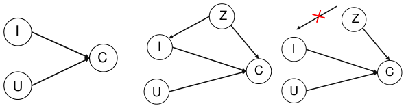
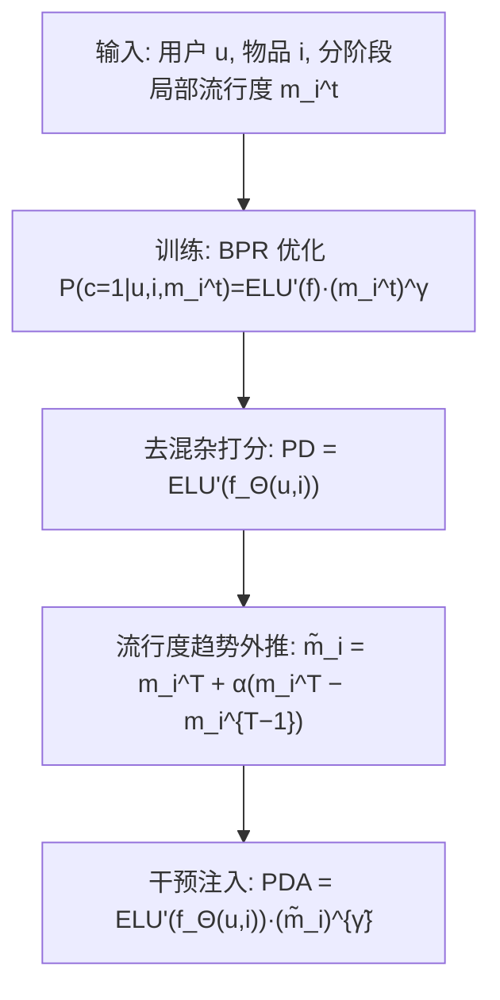
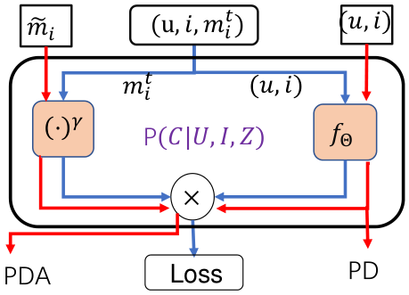

# Causal Intervention for Leveraging Popularity Bias in Recommendation (因果干预：把流行度偏差“为我所用”)

- **会议/期刊**: SIGIR 2021
- **作者与机构**: Yang Zhang, Fuli Feng, Xiangnan He, Tianxin Wei, Chonggang Song, Guohui Ling, Yongdong Zhang（中科大、NUS、腾讯）
- **推荐链路定位**: 召回（矩阵分解打分层）
- **研究方向**: 去偏公平、可信隐私与工业架构 / 协同过滤
- **论文原文**: [https://arxiv.org/abs/2105.06067v1](https://arxiv.org/abs/2105.06067v1)
- **开源代码**: [https://github.com/zyang1580/PDA](https://github.com/zyang1580/PDA)

## TL;DR (1分钟核心速览)

现有工作把流行度偏差当作“必须消除的噪声”（IPS 重加权、因果嵌入、启发式重排），本文反其道而行：把物品流行度 $Z$建模为“曝光$I$”与“交互$C$”的**混杂因子**，用$P(C|do(U,I))=\sum_z P(C|U,I,z)P(z)$做去混杂训练（PD），再在推理期用干预$do(Z=\tilde{z})$ 注入“期望的”流行度漂移（PDA）。在 Kwai/Douban/Tencent 三个工业数据集的全库排序协议下，PD 相对最强基线在 Top-20 上平均相对提升 119%/34%/24%，完整 PDA 相对 BPRMF 在 Kwai 上 Recall 提升 488%。

## Background & Motivation (背景与核心矛盾)

- **主流范式**: IPS 重加权、因果嵌入（DICE 用无偏均匀数据解耦兴趣与从众）、以及 xQuad/BPR-PC 类重排或正则，目标都是“消除”流行度偏差。
- **前人局限**: ① IPS 的倾向分难以准确估计且方差大；② 因果嵌入依赖小规模随机曝光数据，学习不稳定，且“一刀切”消除偏差会误伤真正高质量/当季爆款；③ 重排类方法只保证长尾占比上升，不保证被抬升的物品真合用户兴趣，缺乏理论依据。
- **核心洞察 (Key Insight)**: 流行度漂移（DP 用 JSD 度量）真实存在且随时间累积（图 2），说明“未来阶段的流行度”与“历史阶段”不同——因此模型目标不应是无偏，而是**剔除坏的放大效应、保留（并预测式注入）好的从众信号**。
- **本文切入点**: 用因果图区分 $Z\to C$（合理的从众效应）与$Z\to I\to C$（曝光机制造成的虚假相关），只切断后者。

<figure class="paper-figure" markdown="span">
  <figcaption>图1：描述推荐过程的因果图。U：用户，I：曝光物品，C：交互概率，Z：物品流行度。我们将 Z 识别为 I 与 C 之间的混杂因子，并提出以 𝑃(𝐶|𝑑𝑜(𝑈, 𝐼)) 作为兴趣匹配的去混杂训练。带有流行度偏置的兴趣。通过这种去混杂训练，𝑃(𝐶|𝑑𝑜(𝑈, 𝐼)) 比 𝑃(𝐶|𝑈, 𝐼) 更准确地估计用户对物品的兴趣匹配，消除由混杂因子 Z 导致的 I 与 C 之间的虚假相关。在推理阶段，我们将排序分数推断为 𝑃(𝐶|𝑑𝑜(𝑈, 𝐼),𝑑𝑜(𝑍))，并对 ite 进行干预。</figcaption>
</figure>

## Method (核心方法设计)

### 1. 整体框架 (Overall Architecture)

框架分训练/推理两段：训练阶段把用户 $u$、物品$i$与该阶段局部流行度$m_i^t$一起喂入参数化打分函数$P_\Theta(c=1|u,i,m_i^t)=ELU'(f_\Theta(u,i))\cdot(m_i^t)^\gamma$，用 BPR 成对损失优化；推理阶段先剥离流行度项得到去混杂打分 PD$=ELU'(f_\Theta(u,i))$，再把由时间序列外推得到的期望流行度$\tilde{m}_i$ 以干预形式乘回，得到 PDA 打分。由于流行度项被显式解耦为乘子，推理期调整偏差无需重新训练整个模型。

<figure class="paper-figure" markdown="span">
  <figcaption>图3：我们方法的流程。蓝色箭头表示训练阶段，红色箭头表示推理阶段。</figcaption>
</figure>

### 2. 关键设计拆解 (Key Designs)

1. **去混杂训练 PD（切断 $Z\to I$的虚假路径）**：传统 MF 只估$P(C|U,I)$，其展开式多出一项$P(I|Z)$，使“热门→更易曝光→更易被观测”被二次放大。作者对图 1(b) 施加$do(I)$，由后门准则得$P(C|do(U,I))=\sum_z P(C|U,I,z)P(z)$；把参数化式代入后$z^\gamma$可提出求和号，得到$P(C|do(U,I))=ELU'(f_\Theta(u,i))\cdot E(Z^\gamma)$，而期望是常数、不改变排序，故最终只需用$ELU'(f_\Theta(u,i))$ 排序。直觉是：训练信号中所有物品的流行度加成被“平均化抹平”，模型只能靠兴趣匹配解释交互。
2. **可解耦概率参数化与 $\gamma$平滑**：$P_\Theta(c{=}1|u,i,m_i^t)=ELU'(f_\Theta(u,i))\cdot(m_i^t)^\gamma$，其中$ELU'(x)=e^x(x\le 0),\,x+1(x>0)$保证匹配分恒正，从而与恒正的$(m_i^t)^\gamma$相乘后保持单调性；$\gamma$控制从众效应强度（$\gamma=0$ 即完全无偏）。乘性解耦带来两个工程好处：可套用任意 CF 匹配模型，且推理期调偏差只改乘子。
3. **推理期干预 PDA（把偏差“加回去”）**：$P(C|do(U{=}u,I{=}i),do(Z{=}\tilde z))=ELU'(f_\Theta(u,i))\cdot(\tilde m_i)^{\tilde\gamma}$，其中$\tilde m_i=m_i^T+\alpha(m_i^T-m_i^{T-1})$用一阶差分外推下一阶段流行度；$\tilde\gamma=0$即退化为 PD，实测取$\tilde\gamma=\gamma$ 已足够。
4. **训练目标与开销**：$\max_\Theta\sum_{(u,i,j)\in\mathcal{D}}\log\sigma\big(P_\Theta(c{=}1|u,i,m_i^t)-P_\Theta(c{=}1|u,j,m_j^t)\big)$，均匀负采样 +$L_2$；推理只多一次标量乘，无额外 ANN 或图传播开销。

## Experimental Setup & Evaluation Protocol (实验设置与评估协议)

- **数据集与预处理**:

| 数据集 | #Users | #Items | #Interactions | 稀疏度 | 特征/场景说明 |
| :--- | :---: | :---: | :---: | :---: | :--- |
| Kwai | 37,663 | 128,879 | 7,658,510 | 0.158% | 快手短视频点击，10-core，约两周 |
| Douban | 47,890 | 26,047 | 7,174,218 | 0.575% | 豆瓣电影评分(≥2010)，10-core，十余年 |
| Tencent | 80,339 | 27,070 | 1,816,046 | 0.083% | 腾讯短视频点赞，5-core，11 天 |

- **数据划分与防穿越**: 按交互时间**全局时间戳切分**为 10 个等时长阶段；最后一个阶段按用户 30%/70% 划为验证/测试，测试集中不含新用户与新物品。
- **排名评测协议**: 无偏 `Full-Ranking`（全部未交互物品作候选），报告 $K=20,50$ 下的 Recall / Precision / HR / NDCG。
- **对比基线与超参设置**: 训练去混杂对比 MostPop、BPRMF、xQuad、BPR-PC、DICE（IPS 类已被 DICE 超越故略）；偏差注入对比 MostRecent、BPRMF(t)-pop、BPRMF-A、DICE-A。MF 隐维度沿用 BPRMF 默认设置，Adam、batch 2048、lr 0.001、$L_2$在$\{10^{-6},\dots,0.01\}$搜索，$\gamma\in[0.02,0.25]$ 步长 0.02，Recall@20 早停（100 epoch 不升）。

## Key Experimental Results (实验关键数据)

### 1. 主实验对比 (Main Results)

| 方法 | Kwai R@20 | Kwai N@50 | Douban R@20 | Douban N@50 | Tencent R@20 | Tencent N@50 | Top-20 平均 RI |
| :--- | :---: | :---: | :---: | :---: | :---: | :---: | :---: |
| MostPop | 0.0014 | 0.0036 | 0.0218 | 0.0406 | 0.0145 | 0.0135 | 632.4% / 75.4% / 340.8% |
| BPRMF | 0.0054 | 0.0089 | 0.0274 | 0.0475 | 0.0553 | 0.0497 | 146.3% / 47.0% / 27.1% |
| xQuad | 0.0054 | 0.0090 | 0.0274 | 0.0473 | 0.0552 | 0.0497 | 145.0% / 48.3% / 27.3% |
| BPR-PC | 0.0070 | 0.0092 | 0.0282 | 0.0457 | 0.0556 | 0.0500 | 125.0% / 51.6% / 26.5% |
| DICE | 0.0053 | 0.0090 | 0.0273 | 0.0460 | 0.0516 | 0.0486 | 147.8% / 46.2% / 32.8% |
| **PD (本文)** | **0.0143** | **0.0218** | **0.0453** | **0.0686** | **0.0715** | **0.0641** | — |

（RI 为 PD 相对该基线在 Top-20 四项指标上的平均相对提升，顺序对应 Kwai/Douban/Tencent；PD 在所有数据集、所有指标上均为最优。）

### 2. 消融实验 (Ablation Study)

| 变体 | Kwai R@20 | Douban R@20 | Tencent R@20 | 说明 |
| :--- | :---: | :---: | :---: | :--- |
| BPRMF (w/o 去混杂) | 0.0054 | 0.0274 | 0.0553 | 混杂未处理 |
| PD (w/o 偏差注入) | 0.0143 | 0.0453 | 0.0715 | 仅去混杂 |
| PD-G (全局流行度替代局部) | 显著低于 PD | 显著低于 PD | 显著低于 PD | 图 5，$Z$ 单点样本难学习 |
| BPRMF-A (b) | 0.0201 | 0.0486 | 0.1072 | 带偏训练 + 注入 |
| DICE-A (b) | 0.0245 | 0.0494 | 0.1249 | 因果嵌入 + 注入 |
| **PDA (b)** | **0.0288** | **0.0565** | **0.1398** | 去混杂 + 趋势外推注入 |

### 3. 关键实验发现 (Key Findings)

1. **“去混杂 + 再注入”两段式必须成套使用**：单纯 PD 已使 Kwai R@20 从 0.0054 升至 0.0143（+165%），再叠加趋势外推注入的 PDA 进一步升到 0.0288（相对 BPRMF，Recall/NDCG 平均提升 488%/532%）；若只在带偏模型上外挂注入（BPRMF-A、DICE-A）则分别仅到 0.0201/0.0245，证明因果解耦是收益的主要来源。
2. **偏差越剧烈，去混杂收益越大**：Kwai 的阶段间漂移 $DP(t,t{+}1)$ 明显高于 Douban/Tencent，其 RI 也最高（119%+ vs 34%/24%）；反之 Douban 时间跨度十余年、漂移难外推，用上一阶段流行度 (a) 与线性外推 (b) 效果几乎相同（0.0564 vs 0.0565），而 Kwai/Tencent 上 (b) 稳定优于 (a)。
3. **推荐率 (RR) 分布揭示 DICE 的“过度矫正”**：按流行度分 10 组统计，BPRMF 的 RR 随组号近乎线性下滑（放大偏差），DICE 呈先升后降——头部组被过度压制、中部“次热门”被过度放大；PD 的 RR 曲线最平坦且跨组标准差最小，说明它只抹平了虚假曝光增益而非否认内在质量。

## Highlights & Limitations (亮点、对比与审稿批判)

- **与代表作对比 (vs. Prior Work)**: 相较 IPS/DICE 的“彻底去偏”，本文首次把偏差拆成“可去除的曝光混杂”与“应保留的质量/趋势信号”，并用一个乘性解耦把两者在训练/推理阶段分离；相较 BPR-PC、xQuad 的启发式重排，其推理期调整有明确的干预概率语义与理论推导支撑。
- **可迁移亮点**: ① “把混淆变量参数化为可分离乘子 $(\cdot)^\gamma$” 这一技巧可直接套到位置偏差、曝光偏差等其他混杂因子上，只需替换混杂因子取值；② 用 JSD 定义的漂移度量 DP 可作为判断“何时值得做去偏/再加偏”的先验诊断指标。
- **审稿级局限批判**: ① 流行度预测仅用一阶差分线性外推，Douban 上的收益几乎完全来自 PD 而非注入，端到端可学习的漂移预测缺失；② 实验仅限 MF 打分层，未验证在 LightGCN/序列模型上的增益与额外开销，且 $m_i^t$依赖按阶段切分，在线场景的阶段划分粒度与$\gamma$ 敏感度需要额外调参成本。

## Rating (四维评分)

- **方法创新性 (Novelty)**: ⭐⭐⭐⭐⭐ （把流行度从“噪声”重构为“混杂因子 + 可注入先验”，do-calculus 推导简洁且给出可落地乘子形式，视角转变极具启发性）
- **评估协议与实验扎实度 (Protocol & Experiments)**: ⭐⭐⭐⭐ （三个真实工业数据集 + 时间切分 + Full-Ranking 全库排序，主/消融/推荐率分布分析完整；但缺显著性检验与轻量基线如 LightGCN）
- **写作与数学规范度 (Clarity & Rigor)**: ⭐⭐⭐⭐⭐ （因果图—后门准则—参数化—化简链条清晰，$P(C|U,I)$与$P(C|do(U,I))$ 的对比推导一针见血）
- **工业落地与复现价值 (Industrial & Practical Value)**: ⭐⭐⭐⭐⭐ （代码开源，仅需在打分函数上加一个流行度乘子，PDA 调参不重训，天然适配周期性重训的工业召回链路）

