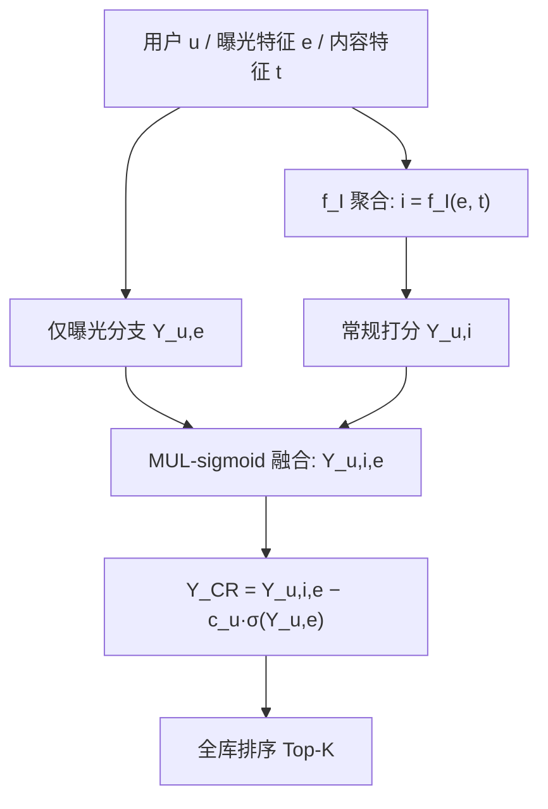

# Clicks can be Cheating: Counterfactual Recommendation for Mitigating Clickbait Issue（点击可能是欺骗：缓解标题党问题的反事实推荐）

- **会议/期刊**: SIGIR 2021
- **作者与机构**: Wenjie Wang, Fuli Feng, Xiangnan He, Hanwang Zhang, Tat-Seng Chua（NUS / Sea-NExT Joint Lab / USTC / NTU）
- **推荐链路定位**: 精排（打分阶段去偏 + 推理端重打分）
- **研究方向**: 去偏公平、可信隐私与工业架构 / 多任务学习与列表级重排
- **论文原文**: [https://arxiv.org/abs/2009.09945v4](https://arxiv.org/abs/2009.09945v4)
- **开源代码**: [https://github.com/WenjieWWJ/Clickbait](https://github.com/WenjieWWJ/Clickbait)

## TL;DR (1分钟核心速览)

CTR 目标把"被标题/封面骗来的点击"当作正反馈，导致越标题党越被推的马太效应。本文指出传统推荐因果图缺失了 $E\to Y$ 的直连边，据此在反事实世界（物品只有曝光特征）中估计曝光特征的**自然直接效应 NDE**，并从事实打分中减去它。评估刻意只保留"以点赞结束的点击"作为测试正样本、采用**全库排序**协议，在 Tiktok / Adressa 上以 MMGCN 为主干把 N@10 相对提升 11.11% / 7.47%，且**训练全程只用点击、不使用任何后验反馈**。

## Background & Motivation (背景与核心矛盾)

- **主流范式**: 以 CTR/BPR 为唯一目标的精排模型（如多模态 MMGCN）把曝光特征（标题、封面）与内容特征（视频、正文）拼接进特征聚合函数，再统一打分；一旦引入后验信号，则采用 CT（只用点赞样本训练）或 NR（对 skip 样本重加权）。
- **前人局限**: ① 曝光特征是点击的**因果因**而非内容质量的因，模型在点击数据上最优解自然是放大曝光特征、忽视内容特征，形成恶性螺旋；② CT/NR 依赖稀疏后验反馈——Tiktok 中点赞仅占点击的 39.44%，CT 的 N@10 反而比 NT 掉 11.71%；IPW 需要对复杂、多变的特征模式做准确倾向估计，实际失效。
- **核心洞察 (Key Insight)**: 现有模型的因果图只有 $E\to I\to Y$与$U\to Y$，与实际数据生成过程（用户可仅因封面而点击）不匹配；这条缺失的$E\to Y$ 直连边正是标题党利用的"捷径"。
- **本文切入点**: 补上直连边后，用因果效应分解 $\text{TE}=\text{NDE}+\text{TIE}$，把"纯被曝光吸引的那部分得分"显式减掉，从而只保留内容特征贡献。

## Method (核心方法设计)

### 1. 整体框架 (Overall Architecture)

输入为用户特征 $u$、物品曝光特征$e$（点击前可见）与内容特征$t$（点击后可见）；特征聚合函数$f_I$输出$i=f_I(E=e,T=t)$。打分被拆成双分支 late-fusion：常规打分$Y_{u,i}$与"仅曝光特征"打分$Y_{u,e}$经 sigmoid 后相乘得到事实世界得分；同一模型用多任务损失同时拟合事实与反事实两个预测。推理时以全库平均分$c_u$充当"内容特征缺失"时的$Y_{u,i^*}$，从事实得分中扣除该项得到$Y_{CR}$ 并排序。

### 2. 关键设计拆解 (Key Designs)

1. **因果补边 + 反事实去直接效应（核心）**: 痛点是对 $E\to Y$捷径的忽视。定义$\text{NDE}=Y_{u,i^*,e}-Y_{u,i^*,e^*}$，因参考项$Y_{u,i^*,e^*}$对所有物品是同一常数、不影响排序，CR 打分即$Y_{CR}=Y_{u,i,e}-Y_{u,i^*,e}$。直觉：若某物品只能靠封面吸引点击，其反事实得分$Y_{u,i^*,e}$很高，相减后被显著压低；内容与曝光一致的物品则因$I$的增量而保留，从而把$s_\theta(u,i)<s_\theta(u,j)$翻转为$Y_{u,i}<Y_{u,j}$。

2. **在 $T=t^*$条件下估 NDE（防泄漏）**: 若用$T=t$（内容实值）估 NDE，封面图可能本身是视频的一帧，曝光信息会经$E\to I$中介泄漏回内容通道，使减法失效。故强制把中介置为参考值$t^*$，即"想象该物品只有曝光特征"。消融中 Adressa R@20 由 0.1667 升至 0.1712，支持该推测。

3. **训练目标、负采样与推理开销**: $\mathcal{L}=\sum_{\bar D}\big[l(Y_{u,i,e},\bar Y_{u,i})+\alpha\, l(Y_{u,e},\bar Y_{u,i})\big]$，第二项即让模型学会反事实世界的预测；负采样为每正样本随机 1 个未交互物品（Uniform，免硬负采样）；$\alpha\in[1,2]$最优。推理时$c_u=\frac{1}{|\mathcal{I}|}\sum_{i\in\mathcal{I}}Y_{u,i}$，需一次全库前向（可按用户缓存），比标准精排多一条曝光分支的前向成本。

## Experimental Setup & Evaluation Protocol (实验设置与评估协议)

- **数据集与预处理**（无 5-core 过滤，保留原始交互）：

| 数据集 | #Users | #Items | #Interactions (Clicks) | #Likes | 特征/场景说明 |
| :--- | :---: | :---: | :---: | :---: | :--- |
| Tiktok | 18,855 | 34,756 | 1,493,532 | 589,008 | 微视频；caption=曝光特征，audio/video=内容特征；like/favorite/finish 作后验正反馈 |
| Adressa | 31,123 | 4,895 | 1,437,540 | 998,612 | 新闻；title+description=曝光，正文经 Multilingual BERT 取 768 维=内容；dwell>30s 视为 like |

- **数据划分与防穿越 (Splitting Strategy)**: 每用户随机抽取 **10% 的"以点赞结束的点击"** 构成测试集（不足 10% 则全取），剩余为训练集；再从训练集随机抽 10% 作验证/早停。属**按点赞过滤的随机比例划分**，非全局时间戳切分（非序列模型，时序泄漏风险有限），也非严格冷启动划分。
- **排名评测协议 (Ranking Protocol)**: 无偏 **Full-Ranking 全库排序**，候选为除训练集已点击物品外的全部物品，非采样排序；负采样仅用于训练（1:1 随机未交互）。
- **对比基线与超参设置**: 基线含 NT（标准 CTR 训练）、CFT（仅内容特征）、IPW（曝光偏置重加权）、CT（仅点赞样本训练）、NR（skip 样本重加权）、RR（按全局 like/click 比重排，属用后验反馈的强基线）；主干统一为 MMGCN，$d=64$，lr=0.001，BPR 损失，多次运行取均值。原文**未报告显著性检验**，仅以星号/下划线标注最优基线。

## Key Experimental Results (实验关键数据)

### 1. 主实验对比 (Main Results)

| 数据集 | 方法 | P@10 | R@10 | N@10 | P@20 | R@20 | N@20 |
| :--- | :--- | :---: | :---: | :---: | :---: | :---: | :---: |
| Tiktok | NT | 0.0256 | 0.0357 | 0.0333 | 0.0231 | 0.0635 | 0.0430 |
| Tiktok | CFT | 0.0253 | 0.0356 | 0.0339 | 0.0226 | 0.0628 | 0.0437 |
| Tiktok | IPW | 0.0230 | 0.0334 | 0.0314 | 0.0210 | 0.0582 | 0.0406 |
| Tiktok | CT | 0.0217 | 0.0295 | 0.0294 | 0.0194 | 0.0520 | 0.0372 |
| Tiktok | NR | 0.0239 | 0.0346 | 0.0329 | 0.0216 | 0.0605 | 0.0424 |
| Tiktok | RR | 0.0264 | 0.0383 | 0.0367 | 0.0231 | 0.0635 | 0.0430 |
| Tiktok | **CR** | **0.0269** | **0.0393** | **0.0370** | **0.0242** | **0.0683** | **0.0476** |
| Tiktok | Improv.% | +5.08% | +10.08% | +11.11% | +4.76% | +7.56% | +10.70% |
| Adressa | NT | 0.0501 | 0.0975 | 0.0817 | 0.0415 | 0.1612 | 0.1059 |
| Adressa | CFT | 0.0482 | 0.0942 | 0.0780 | 0.0405 | 0.1573 | 0.1021 |
| Adressa | IPW | 0.0419 | 0.0804 | 0.0663 | 0.0361 | 0.1378 | 0.0883 |
| Adressa | CT | 0.0493 | 0.0951 | 0.0799 | 0.0418 | 0.1611 | 0.1051 |
| Adressa | NR | 0.0499 | 0.0970 | 0.0814 | 0.0415 | 0.1610 | 0.1058 |
| Adressa | RR | 0.0521 | 0.1007 | 0.0831 | 0.0415 | 0.1612 | 0.1059 |
| Adressa | **CR** | **0.0532** | **0.1045** | **0.0878** | **0.0439** | **0.1712** | **0.1133** |
| Adressa | Improv.% | +6.19% | +7.18% | +7.47% | +5.78% | +6.20% | +6.99% |

### 2. 消融实验 (Ablation Study)

| 变体 | Tiktok R@20 | Tiktok N@20 | Adressa R@20 | Adressa N@20 |
| :--- | :---: | :---: | :---: | :---: |
| NT（无 $E\to Y$ 边、无反事实） | 0.0635 | 0.0430 | 0.1612 | 0.1059 |
| CR-TE（仅补因果边，推理不减 NDE） | 0.0665 | 0.0461 | 0.1698 | 0.1122 |
| CR, NDE 取 $T=t$（内容泄漏） | 0.0671 | 0.0465 | 0.1667 | 0.1093 |
| **CR（完整，NDE@$T=t^*$，MUL-sigmoid）** | **0.0683** | **0.0476** | **0.1712** | **0.1133** |
| CR, SUM-linear 融合 | — | — | 0.1196 | 0.0780 |
| CR, SUM-tanh 融合 | — | — | 0.1744 | 0.1150 |

### 3. 关键实验发现 (Key Findings)

1. **因果补边与反事实减法各自独立有效且可分**: 仅补 $E\to Y$ 边（CR-TE）已在 Tiktok N@20 上取得 +7.2%（0.0430→0.0461），再由减法贡献 +3.3%（0.0461→0.0476），定量证实"曝光捷径"存在且可被显式剥离。
2. **NDE 的估计条件决定成败**: 用 $T=t^*$而非$T=t$ 估 NDE，Adressa R@20 提升 2.7%（0.1667→0.1712），验证封面作为视频帧泄漏进内容通道的机制。
3. **越"脏"的数据收益越大、且不依赖后验反馈**: 图 7 显示当剔除高 like/click 比物品的比例超过 0.4 后，CR 相对 NT 的增益迅速扩大；图 6 显示 CR 显著降低 like/click $\le 0.6$物品的曝光频次、并加大对$[0.8,1]$ 区间物品的推荐；同时 Tiktok 上仅用点击的 CR 已超过使用全局 like/click 比的 RR（N@10 0.0370 vs 0.0367）。

## Highlights & Limitations (亮点、对比与审稿批判)

- **与代表作对比 (vs. Prior Work)**: 与 IPW 一类的样本重加权去偏不同，本文不改数据分布，而是在**打分端做反事实减法**；与 CT/NR/RR 依赖点击后反馈不同，本文**训练完全不用后验信号**，规避了点赞稀疏问题；与仅改进主干的 MMGCN/VBPR 不同，本文是**模型无关的外挂模块**，只需增加一条曝光分支与融合函数。
- **可迁移亮点**: ① "事实得分 − 反事实得分" 的减法模板可直接套用于任何存在捷径特征的场景（位置偏置、BGM 洗脑短视频、直播封面党）；② late-fusion 双分支设计让任意成熟精排模型几行代码即可接入因果图改造。
- **审稿级局限批判**: ① $c_u$以全库平均分近似$Y_{u,i^*}$的期望，与真实反事实量存在系统性偏差，且推理需全库前向，召回链路难以部署；② 测试集只保留"以点赞结束的点击"，指标天然偏向后验满意度，且 Adressa 的 like 以 dwell>30s 粗定义，评估鲁棒性存疑，全文亦无显著性检验与方差报告；③ 融合函数未调优——表 5 显示 SUM-tanh（0.1744/0.1150）反而优于作者所选 MUL-sigmoid（0.1712/0.1133），且性能对$\alpha$ 敏感（图 5，仅 1–2 最优）。

## Rating (四维评分)

- **方法创新性 (Novelty)**: ⭐⭐⭐⭐ （首次把 clickbait 形式化为因果图中缺失的 $E\to Y$ 直连捷径，并用 TE/NDE 分解给出干净可证的去偏算子，理论动机与物理直觉自洽）
- **评估协议与实验扎实度 (Protocol & Experiments)**: ⭐⭐⭐ （全库排序 + 后验满意度测试集值得肯定，但仅 2 个数据集、无显著性检验、测试集构造本身带偏且缺序列/冷启动分桶）
- **写作与数学规范度 (Clarity & Rigor)**: ⭐⭐⭐⭐⭐ （因果图、干预、反事实四联图对照清晰，NDE 公式与 $T=t^*$防泄漏论证严谨，$c_u$ 近似这一强假设也交代得坦白）
- **工业落地与复现价值 (Industrial & Practical Value)**: ⭐⭐⭐⭐ （代码开源、模块与主干解耦、无需后验反馈即可上线；但双分支打分与全库 $c_u$ 估计带来额外推理开销，需缓存优化）

