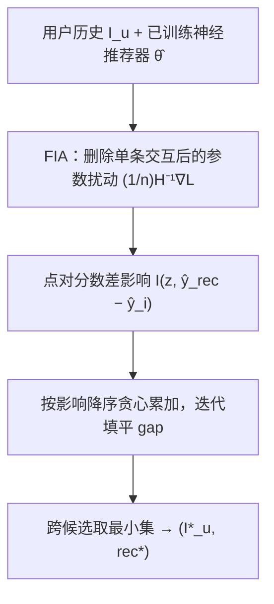
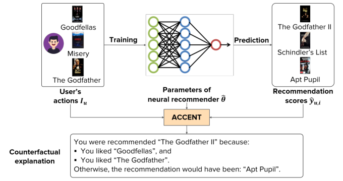

# Counterfactual Explanations for Neural Recommenders (神经推荐模型的反事实解释)

- **会议/期刊**: SIGIR 2021 (Short Paper, 5 页)
- **作者与机构**: Khanh Hiep Tran, Azin Ghazimatin, Rishiraj Saha Roy (MPI for Informatics, Germany)
- **推荐链路定位**: 精排后处理 —— 对已产出推荐结果生成解释（不改变排序本身）
- **研究方向**: 去偏公平、可信隐私与工业架构 / 对话推荐与智能体仿真（解释理由生成）
- **论文原文**: [https://arxiv.org/abs/2105.05008v1](https://arxiv.org/abs/2105.05008v1)
- **开源代码**: [https://github.com/hieptk/accent](https://github.com/hieptk/accent)

## TL;DR (1分钟核心速览)

神经推荐器（NCF/RCF）是黑盒，现有解释要么依赖注意力权重（其解释合法性本身受质疑），要么依赖外部评论/图像元数据（常不可得）；而基于用户自身行为的反事实解释方法 Prince 仅适用于图模型。本文提出 ACCENT：用 Fast Influence Analysis 估计「删除某条交互」对模型参数的扰动，进而把影响函数从**单点分数**扩展到**推荐项与替代项的分数差**，迭代填平 gap 直至推荐翻转，取最小解释集。在 MovieLens-100K 子集（452 用户）上以**重训验证**为协议，ACCENT 的反事实成功率 57.3%（NCF）/81.9%（RCF），解释集规模比直接使用 FIA 缩小 1.5–1.7 倍且统计显著。

## Background & Motivation (背景与核心矛盾)

- **主流范式**: 神经推荐解释多基于注意力分布（重要词/评论/图像区域）、用户-物品连接路径，或外挂评论与视觉元数据生成解释。
- **前人局限**: 注意力权重作为解释的合法性仍存争议（"Attention is not Explanation"）；连接路径不可行动且有隐私风险；元数据在很多场景缺失。真正可行的是「用户自身行为构成的反事实集」，但代表作 Prince 依赖 Personalized PageRank 贡献分与图上的理论最优性保证，无法迁移到任意深度模型。
- **核心洞察 (Key Insight)**: 影响函数可直接回答「若删掉这条交互，参数与预测会怎么变」；但要产生反事实，关键不是「谁让 $rec$分数变高」，而是「谁能让$rec$ 与替代项的**分数差**被填平」——这是单点影响排序做不到的。
- **本文切入点**: 把 FIA 的影响估计从单点推广到点对（pairwise score gap），并用贪心累加迭代求出最小反事实集。

## Method (核心方法设计)

### 1. 整体框架 (Overall Architecture)

给定用户 $u$、其历史$I_u$、当前推荐$rec$与候选替代集$I_{rep}$（原 top-$k$列表，$k\in\{5,10,20\}$），ACCENT 先训练好神经推荐器并计算 Hessian 逆的近似；随后对每个候选替代项$i\in I_{rep}$，计算$I_u$中每条交互对「$rec$与$i$分数差」的影响值并降序排列，逐条加入解释集直到 gap 转负（推荐被翻转）；遍历所有候选后返回**规模最小**的那一组$(I^{*}_u, rec^{*})$。输出是形如「若你没有看过《好家伙》和《教父》，系统就会给你推《纳粹追凶》而不是《教父 II》」这种用户可自行核验的行为级解释。

<figure class="paper-figure" markdown="span">
  <figcaption>图 1：在神经推荐系统设置中定位 Accent。以用户行为、神经推荐器参数以及物品预测分数为输入，Accent 生成简洁的反事实解释。</figcaption>
</figure>

### 2. 关键设计拆解 (Key Designs)

1. **神经推荐器上的删除式参数影响估计**：痛点是不存在闭式贡献分。作者沿用 Koh & Liang 的上加权近似，删除训练点 $z$等价于以$\epsilon=-1/n$ 上加权，故
$\hat{\theta}_{-z}-\hat{\theta}=\frac{1}{n}H_{\hat{\theta}}^{-1}\nabla L(z,\hat{\theta})$，
其中对非凸神经网络给 Hessian 对角加阻尼 $\lambda$（RCF 取$\lambda=0.01$）保证可逆。物理直觉：只需梯度与 Hessian，因此对**任意**可微推荐器通用，这是相对 Prince 的根本解放。

2. **从单点影响升级为「点对分数差」影响（核心增量）**：若只按 $I(z,\hat{y}_{u,rec})$ 排序，会挑出「让推荐分数整体抬高/降低」的交互，与替代项无关，导致解释集膨胀。本文定义
$I(z,\hat{y}_{u,i}-\hat{y}_{u,j})=I(z,\hat{y}_{u,i})-I(z,\hat{y}_{u,j})$，
即影响的可加性使得点对影响可由两次单点影响相减得到；集合影响近似为 $\sum_k I(z_k,\cdot)$（集合小时误差可控）。

3. **迭代填空与最小集选择**：需要
$\sum_{k}I(z_k,\hat{y}_{u,rec}-\hat{y}_{u,rec^{*}})>\hat{y}_{u,rec}-\hat{y}_{u,rec^{*}}$，
按影响降序加点到不等式成立为止；由于影响单调可累加，贪心即为该代理目标下的最优。复杂度 $O(|I_{rep}|\times|I_u|\log|I_u|)$次排序加$O(|I_{rep}|\times|I_u|)$ 次 FIA 调用；无需额外负采样，推理开销集中在 Hessian 逆与逐点梯度（可用 FIA 的近似做批量加速）。

## Experimental Setup & Evaluation Protocol (实验设置与评估协议)

- **数据集与预处理**: MovieLens-100K，评分二值化（$\ge 3$ 为正），并**过滤掉正/负交互均少于 10 条的用户**，以满足 RCF 的隐式反馈设定；RCF 另用官方提供的 4 类 item-item 关系（97,209 对）。

| 数据集 | #Users | #Items | #Interactions | 稀疏度/密度 | 特征/场景说明 |
| :--- | :---: | :---: | :---: | :---: | :--- |
| ML-100K (subset) | 452 | 1,654 | 61,054 | 密度 ≈ 8.2% | 影评二值化 + 4 类 item-item 关系 |

- **数据划分与防穿越 (Splitting Strategy)**: 本文**不做常规 train/test 划分**——全量交互用于训练推荐器与计算影响；评估时**把解释集 $I^{*}_u$从训练集删除后重训模型**，检验$rec^{*}$是否真的顶替$rec$（这是一种忠实性/反事实性验证，天然抗穿越）。
- **排名评测协议 (Ranking Protocol)**: 不涉及 Full-Ranking 或 Sampled Ranking 的排序指标；报告 **CF percentage**（重训后替换真实发生的比例）与 **CF set size**（平均解释集大小）。统计检验：CF 百分比用 McNemar 配对二项检验，集合规模用单侧配对 $t$检验，$\alpha=0.05$。
- **对比基线与超参设置**: 四类基线——`pure attention` / `attention`（RCF 注意力权重排序，仅适用于 RCF）、`pure FIA` / `FIA`（单点影响排序）；RCF 侧 dropout 设 0、ReLU 换 GELU 以规避不可微问题，并做**原则性负采样**（每个正例配一个共享关系最多的负例），使每条交互对应一个训练点。

## Key Experimental Results (实验关键数据)

### 1. 主实验对比 (Main Results)

| 推荐器 | 解释方法 | CF% (k=5) | Size (k=5) | CF% (k=10) | Size (k=10) | CF% (k=20) | Size (k=20) |
| :--- | :--- | :---: | :---: | :---: | :---: | :---: | :---: |
| NCF | pure FIA | 54.20 | 9.08 | 56.19 | 9.46 | 55.75 | 9.50 |
| NCF | FIA | 55.97 | 7.98 | 56.19 | 7.80 | 55.75 | 7.84 |
| NCF | **ACCENT** | **57.30** | **4.73\*** | **57.74** | **4.69\*** | **57.08** | **4.62\*** |
| RCF | pure attention | 73.01 | 9.36 | 73.45 | 7.94 | 74.34 | 7.75 |
| RCF | attention | 76.99 | 3.55 | 76.99 | 3.53 | 76.99 | 3.51 |
| RCF | pure FIA | 80.75 | 4.85 | 81.19 | 4.62 | 81.86 | 4.72 |
| RCF | FIA | 81.64 | 4.15 | 81.86 | 4.10 | 81.86 | 4.10 |
| RCF | **ACCENT** | **81.86†** | **2.83\*†** | **82.08†** | **2.75\*†** | **82.08†** | **2.74\*†** |

（`*` 表示相对 FIA、`†` 表示相对 attention 的统计显著优势；提升幅度：RCF 上集合规模相对 FIA 缩小 **31.8%**，相对 attention 缩小 **20.3%**。）

### 2. 消融实验 (Ablation Study)

| 消融/变体 | CF% (RCF, k=5) | 平均 CF 集大小 | 说明 |
| :--- | :---: | :---: | :--- |
| ACCENT 完整版 | 81.86 | 2.83 | 点对影响 + 迭代填空 |
| 去掉点对影响（= FIA） | 81.64 | 4.15 | 仅看单点分数影响 |
| 去掉 gap 校验（pure 变体） | 76.99 | 3.55 | 加入交互不看是否缩小 gap |
| 纯注意力（去掉影响函数） | 73.01 | 9.36 | 完全依赖 attention 权重 |
| pairwise → one-versus-all | 82.08 (+0.22) | 更大 | 成功率微升但解释更冗长 |
| 集合影响估计误差 (RMSE) | — | RCF 1.17 / NCF 0.36 | 对照真影响标准差 3.7 / 0.34 |

### 3. 关键实验发现 (Key Findings)

1. **「点对」是绝对核心**：把 FIA 的单点影响换成推荐项-替代项分数差影响后，RCF 上解释集从 4.15 缩到 2.83（−31.8%）、NCF 上从 7.98 缩到 4.73（−40.7%），成功率不降反升，直接证明「影响推荐分数」≠「影响推荐决策」。
2. **注意力不是解释**：两种 attention 基线 CF% 至少低 5 个百分点，解释集规模是 ACCENT 的 1.3–3.3 倍；即 RCF 内部的注意力权重与真实因果删除效应严重脱钩。
3. **近似精度决定成功率上限**：FIA 只更新被删交互对应的用户/物品嵌入，NCF 上估计影响与真实分数降幅相关性仅 $\rho=0.77$，导致 NCF 的 CF% 只有约 57%；RCF 因估计 RMSE 相对标准差更小，CF% 达 82%。$k$ 从 5 增到 20 时性能波动 < 1%，且集合规模略降——候选池越大，可选的「最小翻转路径」越多，与 Prince 的图场景观察一致。

## Highlights & Limitations (亮点、对比与审稿批判)

- **与代表作对比 (vs. Prior Work)**: 相比 Prince（图推荐 + PageRank 贡献分 + 理论最优性保证），ACCENT 放弃最优性证明换取模型无关性，只需梯度与 Hessian；相比基于注意力的 RCF 解释 [Xin et al. 2019]，它给出可重训验证的因果式解释；相比 FIA [Bhalla et al.]，它把影响从单点推广到点对，才是产生「反事实」的关键一步。
- **可迁移亮点**: (1) 「解释目标应是决策边界 gap 而非绝对分数」这一思路可直接迁移到 LLM 重排的删-改归因、以及曝光去偏中的「若移除某类曝光样本，排序如何反转」的因果审计；(2) 重训验证（delete-and-retrain）作为解释忠实度协议，比注意力可视化更硬。
- **审稿级局限批判**: (1) 只在 **452 用户子集**上验证，且无 train/test 划分、无排序精度指标，评估规模与代表性偏弱，$k$与 top-$k$ 候选池的选择缺乏敏感性分析；(2) 集合影响用线性累加近似，集合变大时误差累积会**高估**影响而提前停止，对梯度/Hessian 的显存与计算开销在大模型上不可忽视（每个候选替代项都要重算排序），工业级部署需额外的批量/低秩近似。

## Rating (四维评分)

- **方法创新性 (Novelty)**: ⭐⭐⭐⭐ （把影响函数从单点推广到点对分数差是概念上干净且必要的一步，虽无理论最优性证明，但模型无关性换来更广适用面）
- **评估协议与实验扎实度 (Protocol & Experiments)**: ⭐⭐⭐ （删除-重训的反事实验证协议很硬核、并有 McNemar/配对 t 检验，但仅 452 用户、无排序精度与更大规模数据集验证）
- **写作与数学规范度 (Clarity & Rigor)**: ⭐⭐⭐⭐ （从影响函数到 gap 填充的不等式推导链条清晰，算法伪码与复杂度交代完整，5 页短文信息密度高）
- **工业落地与复现价值 (Industrial & Practical Value)**: ⭐⭐⭐ （代码开源、无需元数据即可给出用户可核验的行为级解释，但 Hessian 逆与逐点梯度开销使其更适合离线解释/审计而非在线实时生成）

