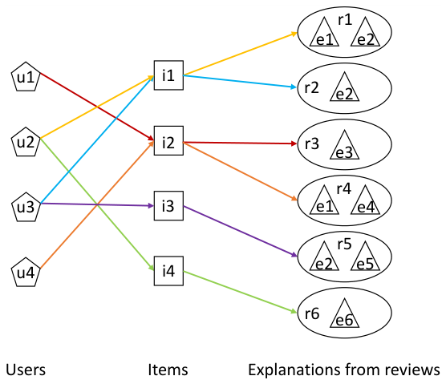
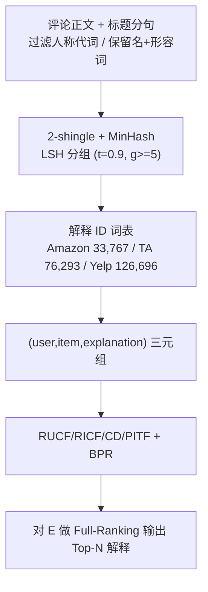

# EXTRA: Explanation Ranking Datasets for Explainable Recommendation (面向可解释推荐的可解释排序基准数据集)

- **会议/期刊**: SIGIR 2021 (Resource Track)
- **作者与机构**: Lei Li, Li Chen（香港浸会大学）；Yongfeng Zhang（Rutgers University）
- **推荐链路定位**: 重排（解释层：给定 $(u,i)$对解释候选库做 top-$N$ 排序）
- **研究方向**: 去偏公平、可信隐私与工业架构 / 对话推荐与智能体仿真（可解释理由生成）
- **论文原文**: [https://arxiv.org/abs/2102.10315v3](https://arxiv.org/abs/2102.10315v3)
- **开源代码**: [https://github.com/lileipisces/EXTRA](https://github.com/lileipisces/EXTRA)

## TL;DR (1分钟核心速览)

可解释推荐（XRS）长期缺乏统一评测：模板、自由生成文本、KG 路径各自用不同指标，模型间不可比。本文把"解释"形式化为可从有限解释库中召回的检索对象，用 $n=2$shingle + MinHash-LSH 把跨评论的近重复句子折叠成全局解释 ID，从而首次构造出用户–物品–解释三元组，发布 Amazon / TripAdvisor / Yelp 三个 EXTRA 基准。在 70/30 随机划分、对解释库$|\mathcal{E}|$ 做 **Full-Ranking** 的协议下，10 万–90 万用户规模的数据上 PITF 取得 NDCG@10 = 2.352 / 1.239 / 0.712（%），相对最强邻域 CF 对照提升 +464.0% / +376.5% / +1680%。

## Background & Motivation (背景与核心矛盾)

- **主流范式**: XRS 用预定义模板、NLG 生成句子或知识图谱决策路径生成解释，评估则依赖人工打分、个案展示或生成指标（BLEU/困惑度）。
- **前人局限**: ①解释天然"多正确解"，生成式指标无法判定解释是否贴合具体 $(u,i)$；作者在自身生成工作中发现，生成模型大量复述训练集高频句（如 "the food is good"），本质是拟合样本而非创造解释。②真实系统中$(u,i,e)$三元组几乎不存在——两条评论/句子几乎不可能完全相同，每条句子只出现一次（图 1 的$r_1$–$r_6$），导致无法做协同学习。
- **核心洞察 (Key Insight)**: 现实中人们用**高度相似的短语**表达同类偏好（"Great service" 在 Yelp 出现 46,413 次），因此近重复句检测能在解释与用户/物品之间建立多对多连接；同时有限解释库让排序式指标（NDCG/Pre/Rec/F1）成为可能。
- **本文切入点**: 不做单个解释模型，而是做**数据基础设施**——用 LSH 亚线性近重复分组把句子折叠为解释 ID，将可解释性评测转化为标准 Learning-to-Rank 任务。

<figure class="paper-figure" markdown="span">
  <figcaption>图1：用户-物品-评论交互可转换为用户-物品-解释交互，从而在解释与用户/物品之间建立联系。图中，𝑟∗表示一条评论，𝑒∗表示评论中的一句解释性句子。</figcaption>
</figure>

## Method (核心方法设计)

### 1. 整体框架 (Overall Architecture)

原始记录 (userID, itemID, rating, review) 先拼接评论正文与标题/tip，分句后剔除含第一人称代词（"I"/"me"）的句子、并仅保留同时含名词与形容词的句子，以保证解释客观且描述物品属性。随后对全库句子做 $n=2$shingle 编码 → MinHash 签名 → LSH 桶查询，相似度阈值$t=0.9$，仅保留组内句子数$\ge 5$的组，每组分配一个解释 ID，组内任一句作为代表句存入 `id2exp.txt`；用户评论中命中的句子即把该$(u,i)$与若干解释 ID 相连，得到$(u,i,e)$三元组。下游排序模型（RUCF/RICF 邻域扩展、CD/PITF 张量分解）以 BPR 训练，推理时对解释库（全局级$\mathcal{E}$或物品级$\mathcal{E}_i$）逐条打分取 top-$N$。

### 2. 关键设计拆解 (Key Designs)

1. **近重复句分组 → 解释 ID 词表（把"生成"变成"检索"）**：痛点是无 $(u,i,e)$监督信号；本文用 MinHash 估计句子 Jaccard 相似度，$\Pr\left[h(s)=h(s')\right]=\mathrm{J}(s,s')=\frac{|\mathcal{S}_s\cap\mathcal{S}_{s'}|}{|\mathcal{S}_s\cup\mathcal{S}_{s'}|}$，取$t=0.9$合并，$g\ge 5$过滤长尾。直觉：$n=2$ shingle 保留词序且区分 "is good"/"not good" 情感极性；保留高频句既保证可读性（群体智慧），又把候选空间压缩到可穷举规模，使全库排序可行。
2. **LSH 亚线性分组算法（避免二次复杂度）**：朴素两两比较是 $O(|\mathcal{S}|^2)$（图 3a）。算法 1 在每轮查询后把已分组句从 LSH 索引**删除并加入已查询集合**$\mathcal{Q}$，未匹配句子不再参与后续比对；LSH 单次查询期望亚线性，整体把分组从二次降为近似线性—亚线性，使 90 万用户规模数据集可自动构建（图 3b–e）。
3. **训练目标、负采样与推理开销**：两种排序形式化为 $\text{Top}(u,i,N):=\underset{e\in\mathcal{E}}{\arg\max}^N \hat{r}_{u,i,e}$（全局级）与$\underset{e\in\mathcal{E}_i}{\arg\max}^N \hat{r}_{u,i,e}$（物品级，避免把 "Moneyball is a great movie…" 这类物品专属解释推给无关物品）。PITF 与 CD 的 BPR 目标为

$$\mathcal{L}=\sum_{u\in\mathcal{U}}\sum_{i\in\mathcal{I}_u}\sum_{e\in\mathcal{E}_{u,i}}\sum_{e'\in\mathcal{E}\setminus\mathcal{E}_{u,i}}-\ln\sigma\left(\hat{r}_{u,i,e}-\hat{r}_{u,i,e'}\right)+\lambda\|\Theta\|_F^2$$

其中 $e'$从**未交互解释中均匀采样**（免负采样不适用，库中正例极稀），PITF 打分$\hat{r}_{u,i,e}=\mathbf{p}_u^{\top}\mathbf{o}^{U}_{e}+\mathbf{q}_i^{\top}\mathbf{o}^{I}_{e}$用两组独立解释因子缓解稀疏，CD 则用$\sum_{k}p_{u,k}q_{i,k}o_{e,k}$。推理仅需一次矩阵乘 + 对$|\mathcal{E}|$ 的全库打分排序，无自回归解码开销。

## Experimental Setup & Evaluation Protocol (实验设置与评估协议)

- **数据集与预处理**: 领域为电影 / 酒店 / 餐厅；每行格式 `userID::itemID::rating::timeStamp::expID:expID::senID:senID`，多解释用单冒号分隔；密度 = 三元组数 / (用户×物品×解释)。

| 数据集 | #Users | #Items | #Explanations | #(u,i) 对 | #(u,i,e) 三元组 | 解释/对 | 密度(×10⁻¹⁰) |
| :--- | :---: | :---: | :---: | :---: | :---: | :---: | :---: |
| Amazon Movies & TV | 109,121 | 47,113 | 33,767 | 569,838 | 793,481 | 1.39 | 45.71 |
| TripAdvisor | 123,374 | 200,475 | 76,293 | 1,377,605 | 2,618,340 | 1.90 | 13.88 |
| Yelp | 895,729 | 164,779 | 126,696 | 2,608,860 | 3,875,118 | 1.49 | 2.07 |

- **数据划分与防穿越**: 三元组级别**随机 70%/30% 划分**（非 Leave-One-Out、非全局时间戳切分），重复 5 次取均值，并强制训练集对每个 user / item / explanation 至少保留 1 条三元组（保证可学习）。
- **排名评测协议**: **Full-Ranking（无偏全解释库排序）**——对给定 $(u,i)$在全部$|\mathcal{E}|$（最多 12.7 万条）上打分取 Top-10，不使用采样候选集；指标 NDCG@10、Precision@10、Recall@10、F1@10。训练阶段负例为 BPR 的未交互解释均匀采样。
- **对比基线与超参**: RAND（非个性化下界）、CD（三因子逐元素乘）、RUCF / RICF（Jaccard 用户/物品邻域扩展，邻域不设上限）、PITF（SOTA 类）。张量分解统一 $d=20,\lambda=0.01,\gamma=0.01,T=500$（网格搜索$d\in[10,50]$、$\lambda,\gamma\in[0.001,0.1]$）。原文未报告显著性检验。

## Key Experimental Results (实验关键数据)

### 1. 主实验对比 (Main Results)

| 方法 | Amazon NDCG@10 | Amazon F1@10 | TripAdvisor NDCG@10 | TripAdvisor F1@10 | Yelp NDCG@10 | Yelp F1@10 |
| :--- | :---: | :---: | :---: | :---: | :---: | :---: |
| CD | 0.001 | 0.002 | 0.001 | 0.001 | 0.000 | 0.001 |
| RAND | 0.004 | 0.006 | 0.002 | 0.004 | 0.001 | 0.002 |
| RUCF | 0.341 | 0.301 | 0.260 | 0.242 | 0.040 | 0.033 |
| RICF | 0.417 | 0.433 | 0.031 | 0.030 | 0.037 | 0.042 |
| **PITF** | **2.352** | **3.149** | **1.239** | **1.788** | **0.712** | **1.068** |
| Improv.% (vs 最强对照) | +464.0% | +627.3% | +376.5% | +638.8% | +1680% | +2443% |

（PITF 的 Pre@10 / Rec@10 分别为 1.824 / 14.125（Amazon）、1.111 / 5.851（TripAdvisor）、0.635 / 4.172（Yelp）。）

### 2. 消融与退化配置对照 (Ablation / Degenerate Comparison)

本文为数据集论文，未提供逐模块消融；下表汇总文中报告的模型容量退化对照（NDCG@10，%）与数据处理配置的定性效应。

| 配置 | Amazon | TripAdvisor | Yelp | 说明 |
| :--- | :---: | :---: | :---: | :--- |
| 完整 EXTRA + PITF | **2.352** | **1.239** | **0.712** | 最优配置 |
| 换 CD（三因子同乘） | 0.001 | 0.001 | 0.000 | 稀疏下三因子共乘梯度全塌缩，低于 RAND |
| 换 RICF（仅物品邻域） | 0.417 | 0.031 | 0.037 | 物品侧解释共现稀疏时崩坏 |
| 换 RUCF（仅用户邻域） | 0.341 | 0.260 | 0.040 | 域间差异明显 |
| 无 LSH 分组（原句当解释） | — | — | — | 每句仅出现一次，解释库 = 句子数，无共现 → 无法协同训练 |
| LSH 阈值 $t<0.9$（0.5–0.8） | — | — | — | 分组混杂/近重复漏检，论文实测$t=0.9$ 最优 |
| 去掉 $g\ge5$ 频次门槛 | — | — | — | 长尾一次性句进入解释库，噪声↑、共现信号↓ |

### 3. 关键实验发现 (Key Findings)

1. **稀疏性而非模型容量是主要瓶颈**：CD 在三数据集 NDCG@10 均 ≈0.001/0.000，甚至低于随机基线 RAND（0.004/0.002/0.001），而 PITF 仅通过把解释因子拆成 $\mathbf{o}^{U}_e$与$\mathbf{o}^{I}_e$两组，就从 0.001 跃到 2.352（Amazon，+2350×），说明密度低至$2.07\times10^{-10}$ 时只有"双线性分解 + 成对排序"才能获得有效梯度。
2. **邻域方法的域敏感性由数据分布决定**：Amazon 上 RICF > RUCF（0.417 vs 0.341），但 TripAdvisor 上 RUCF 是 RICF 的 **8.4 倍**（0.260 vs 0.031），Yelp 上二者接近（0.040 vs 0.037）——与 TripAdvisor "解释/(u,i) 对" 高达 1.90（物品侧共现解释最密集但物品维度 200,475 最大）相关，说明选择 CF 侧向必须先看解释在用户侧还是物品侧的共现密度。
3. **绝对指标仍极低但已具备判别力**：PITF 在 Yelp 的 NDCG@10 仅 0.712（TripAdvisor 的 57%），与其密度仅为 TripAdvisor 的 1/6.7 一致；而案例层面（表 5）PITF 把真值 "The cast is first rate" 排到第 2，Top-5 其余均为 "acting / character" 语义近邻，Bottom-5 则为 "Dead alive" 等无关短语，证明排序式指标能区分语义相关度而非仅拟合流行度。

## Highlights & Limitations (亮点、对比与审稿批判)

- **与代表作对比 (vs. Prior Work)**: 相较于模板式 XRS（如 EFM 系列，解释与评分共享隐因子但只能输出预定义短语）与 NLG 式解释生成（BLEU/人工评估、无法判定事实性），EXTRA 首次给出**可复现、可全库排序**的解释评测协议；相较于 user-item-tag 数据，句子级解释能表达"评价 + 属性"的完整语义（单词 tag "food" 无法说明味道好坏）。
- **可迁移亮点**: ①"近重复折叠为有限语义词表"的范式可直接迁移到 LLM 推荐理由库构建、prompt/模板去重、以及语义 ID 码本的候选去冗余；②把自由文本生成评价降维成固定库 ranking，可作为 LLM 解释生成的客观离线评测沙盒。
- **审稿级局限批判**: ①解释模型完全忽略解释文本本身（只用解释 ID 的隐因子），未验证语义内容对排序的增益，且自动构建残留少量无信息句（如 "the first time"）；②仅 5 个弱基线、无显著性检验、划分采用三元组随机 70/30 而非时间切分，存在高频解释流行度偏置；③离线 NDCG 绝对值 <3%，与线上用户满意度（CTR、信任度）的关联尚未验证，作者亦承认需工业 A/B 补足。

## Rating (四维评分)

- **方法创新性 (Novelty)**: ⭐⭐⭐ （贡献在"任务重定义 + 数据构造范式"，LSH 近重复分组解决三元组缺失的思路巧妙，但排序模型本身沿用 PITF/BPR 无新机制）
- **评估协议与实验扎实度 (Protocol & Experiments)**: ⭐⭐⭐ （Full-Ranking 无采样 + 四指标 + 5 次划分取均值值得肯定，但基线仅 5 个、缺显著性检验与逐模块消融）
- **写作与数学规范度 (Clarity & Rigor)**: ⭐⭐⭐⭐ （问题—挑战—方案链条清晰，两种排序形式化与 BPR/张量分解公式定义完整，算法 1 与图 3 的效率说明直观）
- **工业落地与复现价值 (Industrial & Practical Value)**: ⭐⭐⭐⭐ （数据与代码全开源、格式对齐 MovieLens 易加载、LSH 构库可增量更新，但解释库需预构建、跨域迁移需重跑分组）

