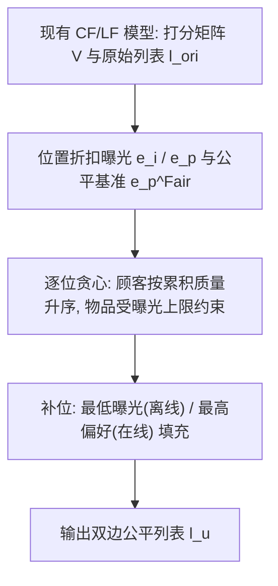
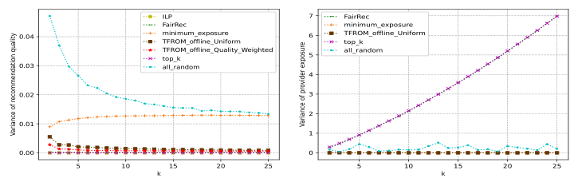

# TFROM: A Two-sided Fairness-Aware Recommendation Model for Both Customers and Providers (面向顾客与服务提供者双边公平的推荐模型)

- **会议/期刊**: SIGIR 2021 (第 44 届 ACM SIGIR)
- **作者与机构**: Yao Wu, Jian Cao, Guandong Xu, Yudong Tan（上海交通大学 / UTS / 携程机票事业部）
- **推荐链路定位**: 重排（Post-processing Re-ranking）
- **研究方向**: 去偏公平、可信隐私与工业架构 / 多任务学习与列表级重排
- **论文原文**: [https://arxiv.org/abs/2104.09024v1](https://arxiv.org/abs/2104.09024v1)
- **开源代码**: [https://zenodo.org/record/4527725](https://zenodo.org/record/4527725)

## TL;DR (1分钟核心速览)

只优化顾客偏好会让少数提供者（航司/商户/品牌）垄断曝光，而强行公平又会伤害顾客体验。本文用「位置折扣曝光 + NDCG 方差」分别刻画提供者组公平与顾客个体公平，证明三条不可兼得定理后，提出无参数后处理贪心 TFROM：逐位填列表、顾客按已获质量升序（水填式均摊损失）、物品须满足提供者累积曝光上限。在 Ctrip/Google/Amazon 上按列表级全量评测（$k=5\sim25$），TFROM 在总 NDCG 相对 Top-k 仅损失约 7% 的前提下把提供者曝光方差压到 Top-k 的约 1/8，并显著优于 FairRec 与 ILP 方法。

## Background & Motivation (背景与核心矛盾)

- **主流范式**: 公平推荐研究分为顾客侧（消除性别/年龄歧视）、提供者侧（曝光/收益公平）与双边公平；本文属**后处理重排**，对已有推荐列表做二次分配。
- **前人局限**: ①代表工作 FairRec 假设「一个提供者只对应一个物品」，与航司/品牌多 SKU 的真实场景不符，暴露了 item 级公平无法聚合为 provider 级公平；②FairRec 视列表内各位置曝光相同，忽略 Top 位注意力显著更高的事实，导致曝光计量失真。
- **核心洞察 (Key Insight)**: 作者用三条定理锁定优化方向：定理 1（除直接输出原始列表外必损失质量）、定理 2（质量下降时顾客公平只降不升，但可通过**均摊**损失使其不降）、定理 3（提供者公平上升时顾客公平不升）。因此可"牺牲少量质量换提供者公平，并把损失摊薄到所有顾客身上"。
- **本文切入点**: 把双边公平写成带分组曝光上限的背包问题，用逐位贪心启发式近似求解，并给出离线/在线两种工业形态。

## Method (核心方法设计)

### 1. 整体框架 (Overall Architecture)

TFROM 完全复用系统现有打分矩阵 $V$与原始列表$l^{ori}$，不做任何表征学习：先由$V$与位置折扣核算每个提供者的当前曝光$e_p$与理论公平基准$e_p^{Fair}$（Uniform 或 Quality-Weighted 两种口径）；再从第 1 位到第$k$ 位逐位填充，每位内按顾客「已获累积质量」升序依次挑物品，候选物品必须不突破其提供者的曝光上限，故低曝光提供者自然被优先提位；跳跃位在最后按「最低曝光 / 最高偏好」补位。在线版把曝光与质量改为跨请求累积量并动态重算基准。

### 2. 关键设计拆解 (Key Designs)

1. **位置敏感曝光与两类公平基准**：痛点是把列表内所有位置视为等曝光、且不聚合多物品提供者。改法为 $e_i=\sum_{u\in U}\mathbb{1}_{l_u}(i)/\log_2(r_{u,i}+1)$、$e_p=\sum_{i\in I_p}e_i$，并设$e_p^{Fair}=E_{total}\cdot|I_p|/\sum_{p'}|I_{p'}|$（Uniform）或按质量分$v_{u,i}$加权（Quality-Weighted），其中$E_{total}=m\sum_{r=1}^{k}1/\log_2(r+1)$。直觉：位置折扣函数与 NDCG 折扣同构，使"公平"与"质量"落在同一可加尺度上，且组级聚合让多 SKU 提供者不被系统性偏袒。
2. **逐位水填 + 曝光上限的离线贪心**：双边公平本质是 NP 完全的背包问题，故用启发式。填充第 $rank$位时要求$e_p+\frac{1}{\log_2(rank+1)}\le e_p^{Fair}$，否则沿$l^{ori}_u$ 向下顺延；同时把顾客按当前累积质量**升序**处理——已获高质量者先承担损失。直觉：约束作用于累积曝光而非单次曝光，等价于把各提供者曝光"拉平"到基准线；质量升序则是对 NDCG 方差的贪心最小化（水填）。
3. **在线版与推理开销**：在线场景单轮公平无意义，改为累积量 $E_R=c\_num\cdot\sum_{r}1/\log_2(r+1)$随请求数动态重算基准，并用平均质量而非累计质量排序；空位直接取偏好最高者，避免单次响应被过度牺牲。冷启动期$e_p^{Fair}$小于单次曝光上限时算法自动退化为输出$l^{ori}$，天然兼容系统上线初期。**无训练目标、无负采样、无参数**，复杂度离线$O(knm^2\log m)$、在线$O(2kn)$。

## Experimental Setup & Evaluation Protocol (实验设置与评估协议)

- **数据集与预处理**:

| 数据集 | #Users | #Items | #Interactions | 密度 | 特征/场景说明 |
| :--- | :---: | :---: | :---: | :---: | :--- |
| Ctrip Flight | 3,814 | 6,006 | 25,190 | 0.11% | 上海–首尔航线机票；同航司+同舱位+同起飞时段为同一物品，**航司=提供者** |
| Google Local | 3,335 | 4,927 | 97,658 | 0.59% | 加州本地商户，滤除评论 <10 的用户/物品；商户=提供者（1:1 特例） |
| Amazon Review | 1,851 | 7,538 | 24,658 | 0.18% | Clothing Shoes and Jewelry，滤除 <10 条；随机聚合 1–100 物品模拟 161 个多 SKU 提供者 |

- **数据划分与防穿越**: 无显式训练/测试切分；论文直接调用现成模型（Ctrip 用 CF、Google 用 location-based LF、Amazon 用 MF）产出的 $V$与$l^{ori}$ 作为"偏好参照"，原始列表即质量上界。
- **排名评测协议**: 列表级全量比较，$k\in\{5,10,15,20,25\}$；不涉及负采样，指标为 ΣNDCG、Var(NDCG)、Var($e_p$)、Var($e_p$/relevance)（归一化到$[0,1]$ 后取方差）。离线一次性为全部用户出表，在线按随机到达请求序列（长度 = 10×用户数）滚动评测。
- **对比基线与超参**: Top-k、All random、Minimum exposure、FairRec（贪心、item 级）、ILP-based fair ranking；列表长度 $k$为唯一自由参数（$5\sim25$）。**原文未报告显著性检验**。

## Key Experimental Results (实验关键数据)

### 1. 主实验对比 (Main Results)

Ctrip 离线场景、$k=15$（原文以折线图呈现，表中为按图 1 坐标轴读取的近似值，用于趋势对比）：

| 方法 | ΣNDCG ↑ | Var(NDCG) ↓ | Var($e_p$) ↓ | Var($e_p$/rel.) ↓ |
| :--- | :---: | :---: | :---: | :---: |
| Top-k | **≈2050** | ≈0.030 | ≈4.2 | ≈7000 |
| All random | ≈900 | ≈0.008 | ≈0.7 | ≈300 |
| Minimum exposure | ≈780 | **≈0.004** | **≈0.4** | — |
| FairRec | ≈1950 | ≈0.020 | ≈2.6 | — |
| ILP-based | ≈1550 | ≈0.015 | — | ≈8500 |
| TFROM-offline-Uniform | ≈1900 (−7.3% vs Top-k) | ≈0.012 | ≈0.5 | — |
| TFROM-offline-QW | ≈1450 (−29% vs Top-k) | **≈0.010** | — | **≈200** |

<figure class="paper-figure" markdown="span">
  <figcaption>图1：离线场景下 Ctrip 数据集上的实验结果</figcaption>
</figure>

### 2. 消融实验 (Ablation Study)

原文未做严格模块消融，下表由作者给出的两种公平口径、在线/离线变体及退化情形重构归因：

| 变体 / 退化设置 | ΣNDCG 损失 | Var($e_p$) | Var(NDCG) | 归因 |
| :--- | :---: | :---: | :---: | :--- |
| w/o 位置折扣（列表内等曝光，≈FairRec 假设） | 小 | 高（item 级公平不聚合到 provider） | 中 | 位置折扣是多 SKU 场景必需项 |
| w/o 曝光上限 $e_p^{Fair}$（即 Top-k） | 0 | 随$k$ 近指数增长 | 最低 | 公平须显式约束，不能靠排序副作用 |
| TFROM-Uniform | −7.3% | ≈0.5 | ≈0.012 | 均等口径对质量最友好 |
| TFROM-Quality-Weighted | −29%（$k=15$，$k$ 越小越差） | 低 | ≈0.010 | 质量加权口径在短列表下代价过高 |
| TFROM-online | 单次损失可忽略 | 低 | 先升后降 | 冷启动期方差剧增后收敛 |

### 3. 关键实验发现 (Key Findings)

1. **Top-k 的提供者不公随 $k$近指数恶化**（Ctrip 上 Var($e_p$) 从$k=5$到$k=25$增长数倍），而 Minimum exposure 虽把 Var($e_p$) 压到最低（≈0.4），代价是 ΣNDCG 从 ≈2050 跌到 ≈780——这解释了它 Var(NDCG) 极低的假象：并非分配均匀，而是"人人质量都低"。
2. **FairRec 在"一提供者多物品"下失效**：其 item 级公平无法聚合到 provider 级，Ctrip 上 Var($e_p$)≈2.6，明显劣于 TFROM-Uniform 的 ≈0.5；ILP 方法则因预过滤压缩了解空间，质量加权方差 ≈8500 反而差于基线。
3. **公平口径决定成本结构**：Uniform 口径质量损失稳定在 ≈7%（多数设置 <10%），Quality-Weighted 在 $k=5$时因需为低相关物品提位而损失骤增，$k\ge20$ 后收敛；在线版 Var(NDCG) 呈现"先升后降"（冷启动期顾客质量从 0 跳变），在 10×用户数请求后趋于稳定。

## Highlights & Limitations (亮点、对比与审稿批判)

- **与代表作对比**: 相比 FairRec（单提供者单物品、位置无关曝光），本文把公平单元提升到 provider 组并引入位置折扣，天然覆盖 FairRec 为特例；相比 ILP 公平排序（目标为曝光/相关性绝对差、依赖求解器与解空间），TFROM 是无参数启发式、可嵌入任意现有系统且支持在线流式。
- **可迁移亮点**: ①"按已获效用升序填位"的水填式贪心，可直接迁移到多任务重排中的效用均摊与多样性约束；②在线版"累积量 + 动态重基准 + 冷启动自动退化"的设计范式，适合任何需要长期配额控制的流量分配场景。
- **审稿级局限批判**: ①质量基准取"原始列表"为理想值，一旦底层 CF 本身有偏，则公平-质量权衡的量化会被系统性高估；②离线复杂度 $O(knm^2\log m)$在$m$ 上万时不可行，且实验仅在 3 千级用户量级、无 A/B 与显著性检验，实际线上时延与收益仍待验证。

## Rating (四维评分)

- **方法创新性 (Novelty)**: ⭐⭐⭐ （首次把提供者多物品聚合与位置折扣纳入双边公平，但本质仍是贪心启发式 + 定性定理，无近似比或最优性证明）
- **评估协议与实验扎实度 (Protocol & Experiments)**: ⭐⭐⭐ （三域真实数据 + 离线/在线双场景 + 四维指标较完整，但缺训练/测试切分、缺显著性检验、缺严格模块消融）
- **写作与数学规范度 (Clarity & Rigor)**: ⭐⭐⭐⭐ （曝光、NDCG、三定理与伪代码链条清晰自洽，复杂度分析完整；三条定理仅给文字论证而无形式化证明）
- **工业落地与复现价值 (Industrial & Practical Value)**: ⭐⭐⭐⭐ （无参数后处理、可插拔、代码与数据已开源，在线版复杂度 $O(2kn)$适合实时，唯离线版扩展性受限于$m^2$ 项）

