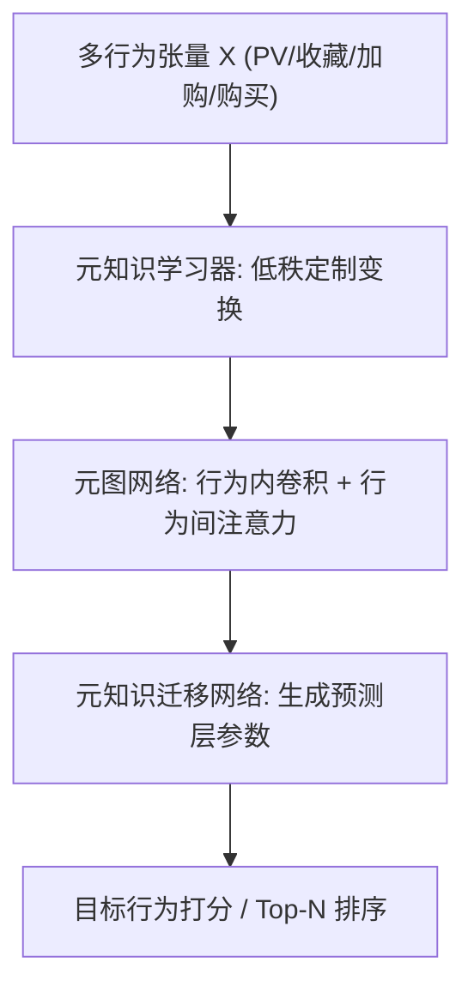
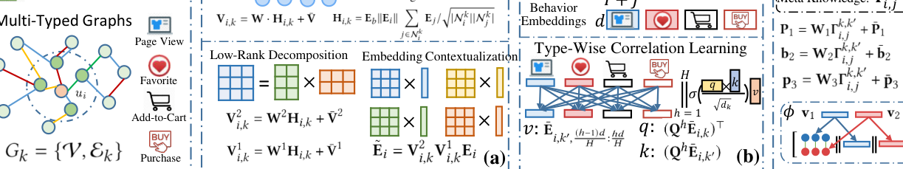

# Graph Meta Network for Multi-Behavior Recommendation (面向多行为推荐的图元网络)

- **会议/期刊**: SIGIR 2021 (Full Paper)
- **作者与机构**: Lianghao Xia, Yong Xu (华南理工大学); Chao Huang, Peng Dai, Liefeng Bo (京东金融美国)
- **推荐链路定位**: 召回 (Top-N 候选生成)
- **研究方向**: 图神经网络与知识图谱推荐 / 多任务学习与列表级重排
- **论文原文**: [https://arxiv.org/abs/2110.03969v1](https://arxiv.org/abs/2110.03969v1)
- **开源代码**: [https://github.com/akaxlh/MB-GMN](https://github.com/akaxlh/MB-GMN)

## TL;DR (1分钟核心速览)

真实电商中用户行为天然多类型（PV、收藏、加购、购买），但主流 CF/GNN 只建单一交互图，忽略行为异质性与"每个用户多行为依赖模式各不相同"的个性化差异。MB-GMN 把多行为模式建模嵌入元学习范式：元知识学习器为每个 (用户, 行为类型) 生成定制低秩变换矩阵，元图网络在 K 张行为子图上做定制化消息传播并跨行为注意力互refine，元预测网络再为 (源行为→目标行为) 动态生成预测层参数。在 Beibei/Taobao/IJCAI 三数据集上，Leave-One-Out + 1:99 负采样排序协议下 HR@10 分别达 0.691/0.491/0.532，最高相对 SOTA 提升 31.3%。

## Background & Motivation (背景与核心矛盾)

- **主流范式**: NGCF/MBGCN 类工作把多行为压成统一图或参数共享的消息传递，NMTR 做行为级联式多任务，DIPN/MATN 用注意力对行为表示加权求和。
- **前人局限**: (i) 共享参数空间无法表达"PV→收藏→加购→购买"中每类行为独有的语义与两两依赖；(ii) 行为间的相关强度因人而异（有人收藏即买，有人收藏几十件只买一件），全局共享的注意力权重/级联假设抹平了个体差异。
- **核心洞察 (Key Insight)**: 用户的多行为模式应当作为"上下文元知识"来**生成**模型参数而非仅仅作为输入特征；这样同一套 GNN 就能在不同用户身上"实例化"出不同的行为融合算子。
- **本文切入点**: 用低秩元网络生成变换权重 + 用元学习生成预测层参数，把行为异质性与交互多样性一并塞进元学习框架。

## Method (核心方法设计)

### 1. 整体框架 (Overall Architecture)

输入为三阶交互张量 $\mathbf{X}\in\mathbb{R}^{I\times J\times K}$（购买为目标行为，其余为上下文行为）。先由元知识学习器基于用户自身的多行为邻居聚合向量$\mathbf{H}_{i,k}$生成定制变换，把 ID 嵌入语境化为$\tilde{\mathbf{E}}_i$；随后元图神经网络在 K 张行为子图上逐层执行"行为内图卷积 + 行为间多头注意力"的双重传播，输出 K 个类型专属表示与 1 个全局表示；最后元知识迁移网络以 (源行为$k$, 目标行为$k'$) 的联合元知识$\Gamma^{k,k'}_{i,j}$ 动态生成预测层权重，输出目标行为打分。训练端为多任务成对 margin loss 联合优化。

<figure class="paper-figure" markdown="span">
  <figcaption>图1：MB-GMN的模型架构。(a) 针对行为异质性，利用元知识学习器进行多行为模式建模；(b) 通过高阶连通性保留行为语义的元图神经网络；(c) 定制预测层参数以捕捉跨类型行为依赖的元知识迁移网络。</figcaption>
</figure>

### 2. 关键设计拆解 (Key Designs)

1. **元知识学习器与低秩分解 (Meta-Knowledge Learner)**：痛点是把多行为压进同一参数空间；本文用用户自身行为上下文生成个性化变换矩阵 $\mathbf{V}_{i,k}=\mathbf{W}\cdot\mathbf{H}_{i,k}+\bar{\mathbf{V}}$，其中$\mathbf{H}_{i,k}=\mathbf{E}_b\|\mathbf{E}_i\|\sum_{j\in\mathcal{N}^k_i}\mathbf{E}_j/\sqrt{|\mathcal{N}^k_i||\mathcal{N}^k_j|}$。为避免$d\times d$变换过参数化，进一步分解为$\tilde{\mathbf{E}}_i=\mathbf{V}^2_{i,k}\mathbf{V}^1_{i,k}\mathbf{E}_i$（$d'=4\ll d=16$），实测小$d'$ 兼具正则与降本效果。

2. **元图网络的双重传播 (Behavior Semantic + Relation Learning)**：行为内沿用无线性变换的 LightGCN 式归一化聚合 $\bar{\mathbf{E}}^{(u)}_k=\mathbf{E}^{(u)}+\sigma(\mathbf{D}_{u,k}^{-1/2}\mathbf{X}_k\mathbf{D}_{v,k}^{-1/2}\mathbf{E}^{(v)})$；行为间用无 value 变换的切片多头点积注意力互 refine，$\beta^h_{k,k'}=\mathrm{softmax}\big((\mathbf{Q}^h\bar{\mathbf{E}}_{i,k})^\top(\mathbf{Q}^h\bar{\mathbf{E}}_{i,k'})/\sqrt{d/H}\big)$。直觉：切片共享$\mathbf{Q}^h$ 既保留跨行为相关性建模能力，又把开销压到与普通 GCN 同阶。

3. **元知识迁移预测与训练目标**：预测层参数不再全局共享，而是由 $\Gamma^{k,k'}_{i,j}=\sigma(\mathbf{W}_1\phi(\mathbf{Z}^k_{i,j},\mathbf{Z}^{k'}_{i,j}))$（$\phi(\mathbf{v}_1,\mathbf{v}_2)=\mathbf{v}_1\circ\mathbf{v}_2\|\mathbf{v}_1\|\mathbf{v}_2$）生成$\mathbf{P}_1,\mathbf{b}_2,\mathbf{p}_3$，打分为$\hat{x}^{(k)}_{i,j,k'}=\mathbf{p}_3^\top\sigma(\mathbf{P}_1\phi(\hat{\mathbf{E}}_{i,k},\hat{\mathbf{E}}_{j,k})+\mathbf{b}_2)$。总损失为跨 (源, 目标) 行为对的成对 margin 多任务损失$\mathcal{L}=\sum_i\sum_{k=1}^{K+1}\sum_{k'=1}^{K}\sum_{s=1}^{S}\max(0,1-\hat{x}^{(k)}_{i,p_s,k'}+\hat{x}^{(k)}_{i,n_s,k'})+\lambda\|\Theta\|_F^2$；每用户采样$S$正样本 +$S$负样本（均匀负采样），Adam、lr=$1e-3$、$L\le 3$ 层，复杂度与图卷积基线同阶。

## Experimental Setup & Evaluation Protocol (实验设置与评估协议)

| 数据集 | #Users | #Items | #Interactions | 稀疏度/密度 | 特征/场景说明 |
| :--- | :---: | :---: | :---: | :---: | :--- |
| Taobao | 147,894 | 99,037 | 7,658,926 | 5.2e-4 | 4 类行为：PV/收藏/加购/购买 |
| Beibei | 21,716 | 7,977 | 3,338,068 | 1.9e-2 | 3 类行为：PV/加购/购买（母婴） |
| IJCAI-Contest | 423,423 | 874,328 | 36,203,512 | 9.8e-5 | 4 类行为，B2C 平台最稀疏 |

- **数据划分与防穿越**: `Leave-One-Out`——每用户最后一次购买作测试正样本，其余入训练；未见显式时间戳切分的描述，存在弱穿越风险。
- **排名评测协议**: `Sampled Ranking`，每用户 1 正 : 99 随机未交互负样本，报 HR@10 / NDCG@10（另在 Beibei 上扫 N∈{1,3,5,7}）；**未使用 Full-Ranking 全库排序**。
- **对比基线与超参**: 覆盖 MF(BiasMF)、神经 CF(NCF 三变体/DMF)、自编码(CDAE/AutoRec)、自回归(NADE/CF-UIcA)、图模型(ST-GCN/NGCF/NGCF$_M$)、多行为(NMTR/DIPN/MATN/MBGCN)；默认$d=16$、$d'=4$、$H=2$、$\lambda\in\{1e\text{-}4,\dots,5e\text{-}2\}$。

## Key Experimental Results (实验关键数据)

### 1. 主实验对比 (Main Results)

| 数据集 | 指标 | BiasMF | NCF-M | CF-UIcA | NGCF | NMTR | MATN | MBGCN | **MB-GMN** | Improv. |
| :--- | :---: | :---: | :---: | :---: | :---: | :---: | :---: | :---: | :---: | :---: |
| Beibei | HR@10 | 0.588 | 0.595 | 0.610 | 0.611 | 0.613 | 0.626 | 0.642 | **0.691** | +7.63% |
| Beibei | NDCG@10 | 0.333 | 0.332 | 0.346 | 0.375 | 0.349 | 0.385 | 0.376 | **0.410** | +4.06% |
| Taobao | HR@10 | 0.262 | 0.319 | 0.332 | 0.302 | 0.332 | 0.354 | 0.369 | **0.491** | +33.06% |
| Taobao | NDCG@10 | 0.153 | 0.191 | 0.198 | 0.185 | 0.179 | 0.209 | 0.222 | **0.300** | +35.14% |
| IJCAI | HR@10 | 0.285 | 0.449 | 0.429 | 0.461 | 0.481 | 0.489 | 0.463 | **0.532** | +8.79% |
| IJCAI | NDCG@10 | 0.185 | 0.284 | 0.260 | 0.292 | 0.304 | 0.309 | 0.277 | **0.345** | +11.65% |

### 2. 消融实验 (Ablation Study)

| 变体 | Beibei HR | Beibei NDCG | Taobao HR | Taobao NDCG | IJCAI HR | IJCAI NDCG |
| :--- | :---: | :---: | :---: | :---: | :---: | :---: |
| w/o LowR | 0.6825 | 0.4083 | 0.4385 | 0.2656 | 0.4931 | 0.3195 |
| w/o MFeat | 0.6813 | 0.4049 | 0.3878 | 0.2315 | 0.4865 | 0.3138 |
| w/o MTask | 0.6068 | 0.3401 | 0.4577 | 0.2782 | 0.5301 | 0.3392 |
| w/o MetaC | 0.6791 | 0.4046 | 0.4647 | 0.2852 | 0.5026 | 0.3199 |
| w/o MetaP | 0.6605 | 0.4036 | 0.4868 | 0.2968 | 0.5302 | 0.3399 |
| **MB-GMN** | **0.6907** | **0.4103** | **0.4906** | **0.2997** | **0.5319** | **0.3447** |

### 3. 关键实验发现 (Key Findings)

1. **行为异质性建模是最大增益源，且在稀疏数据上被放大**：Taobao（密度 5.2e-4）上 HR@10 相对最强基线 MBGCN 提升 33.1%，远超 Beibei（1.9e-2）的 7.6%；图 3 的分桶实验进一步显示在交互数 <36 的最稀疏用户群上 MB-GMN 仍保持最高 HR@10，说明上下文行为可实质缓解稀疏性。
2. **多任务监督比结构改造更"便宜且关键"**：移除 w/o MTask 后 Beibei HR 由 0.6907 骤降至 0.6068（-12.2%），是消融中最大跌幅；而 Taobao 上 w/o MetaP 仅降 0.8%，表明在稠密数据上元预测层参数定制边际收益有限，跨行为监督信号才是主贡献。
3. **低秩与行为关系注意力均提供稳定正则**：去掉低秩分解（w/o LowR）Taobao HR 掉 10.6%、NDCG 掉 11.4%；去掉行为间注意力（w/o MFeat）掉 21.0% HR，且案例研究显示 PV 在多数用户中对其他行为的"源偏置"贡献最大，与其数据量占比最高一致。

## Highlights & Limitations (亮点、对比与审稿批判)

- **与代表作对比**: 相较 MBGCN/NGCF$_M$ 的"多行为统一图 + 参数共享"，本文以元网络**生成**参数实现用户级定制，本质是把"行为融合权重"从静态超参变成输入的函数；相较 NMTR 的级联式固定顺序多任务，本文对所有 (源, 目标) 行为对建元知识，允许非级联、非对称依赖（如收藏→加购强于反向）。
- **可迁移亮点**: (i) 用低秩 $d'\!\ll\!d$分解约束元网络生成的大矩阵，是通用的"元学习防过拟合 + 降本"技巧；(ii) 无 value 变换的切片多头注意力共享$\mathbf{Q}^h$，可低成本嵌入任意多关系图传播。
- **审稿级局限批判**: (i) 评测仅用 1:99 采样的 HR/NDCG，未给 Full-Ranking，且负样本均匀采样，对热门偏置与排序一致性缺乏验证，绝对数值偏乐观；(ii) 每用户每 (源, 目标) 行为对都要生成 $\mathbf{P}_1\in\mathbb{R}^{d\times 3d}$并在推理时逐对计算，线上 K=4 时打分开销约为主线 GNN 的数倍，文中未报实际延迟；此外$d'$、层数$L$的敏感度较高（$L>2$ 即因过平滑退化）。

## Rating (四维评分)

- **方法创新性 (Novelty)**: ⭐⭐⭐⭐ （把多行为模式建模完全重构为"元知识生成参数"，行为内卷积与行为间注意力双通道设计有清晰物理直觉，但图传播本身沿用 LightGCN 无本质突破）
- **评估协议与实验扎实度 (Protocol & Experiments)**: ⭐⭐⭐⭐ （三数据集 + 17 个基线 + 五组消融/稀疏度/超参/可解释性齐全，扣分在仅采样排序、无 Full-Ranking 与显著性检验）
- **写作与数学规范度 (Clarity & Rigor)**: ⭐⭐⭐⭐ （三阶段公式链条完整、复杂度分析给出同阶论证，但部分符号（如 $\mathbf{W}$与$\mathbf{W}_1$ 在不同阶段复用）易混淆）
- **工业落地与复现价值 (Industrial & Practical Value)**: ⭐⭐⭐⭐ （代码开源、复杂度与 GCN 同阶、消融指明"多任务监督"性价比最高，但元预测层逐对生成参数对线上推理预算不友好）

