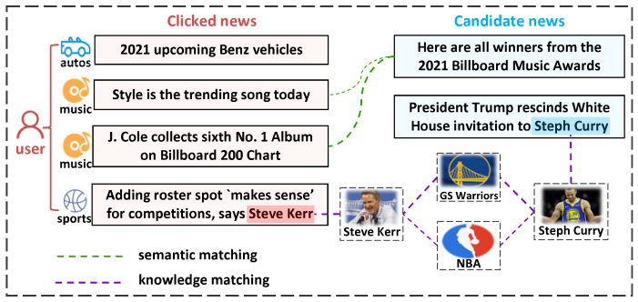
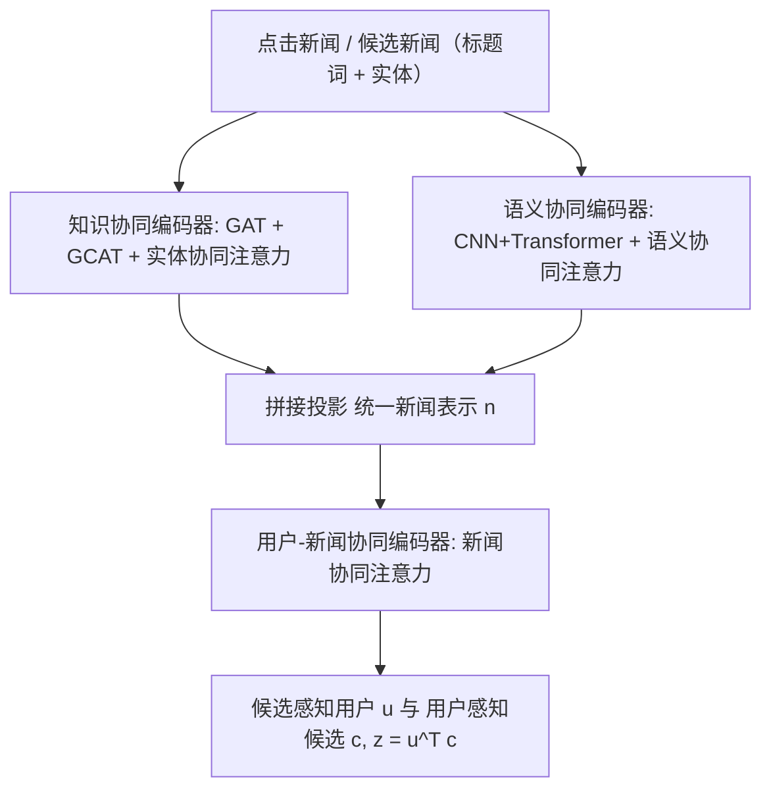
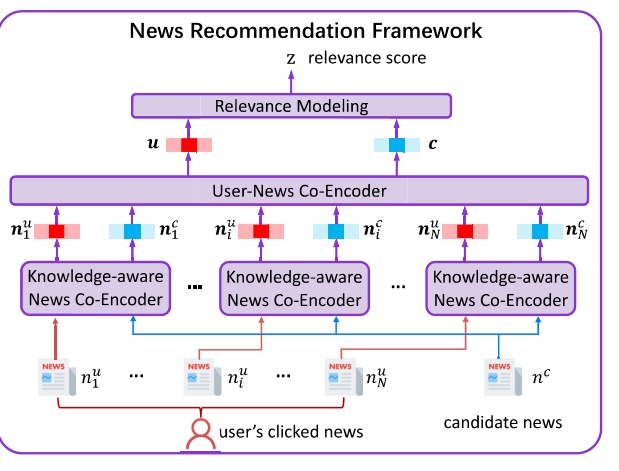

# Personalized News Recommendation with Knowledge-aware Interactive Matching (知识感知交互式匹配的个性化新闻推荐)

- **会议/期刊**: SIGIR 2021
- **作者与机构**: Tao Qi, Fangzhao Wu, Chuhan Wu, Yongfeng Huang（清华大学电子工程系 / 微软亚洲研究院）
- **推荐链路定位**: 精排（候选新闻级匹配排序）
- **研究方向**: 图神经网络与知识图谱推荐
- **论文原文**: [arXiv:2104.10083v3](https://arxiv.org/abs/2104.10083v3)
- **开源代码**: [KIM-SIGIR-2021](https://github.com/JulySinceAndrew/KIM-SIGIR-2021)

## TL;DR (1分钟核心速览)

传统新闻推荐用双塔**独立**编码候选新闻与用户点击历史再内积匹配，忽略二者在语义与实体层面的细粒度关联。KIM 提出知识感知交互匹配框架：知识协同编码器用图协同注意力 (GCAT) 与实体协同注意力交互编码点击/候选新闻的实体，语义协同编码器用文本协同注意力对齐语义，最后由用户-新闻协同编码器生成「候选感知的用户表示」与「用户感知的候选表示」做点积。在 **impression 级候选排序**协议下，MIND 上 AUC 65.61→**67.13**、nDCG@5 33.80→**35.49**（相对 +5.0%），全面超越 KRED 等 SOTA。

## Background & Motivation (背景与核心矛盾)

- **主流范式**: NAML/NRMS/LSTUR 等双塔方法分别用注意力/GRU/Transformer 独立编码候选新闻与用户历史，再做内积；DKN/KRED 引入知识图谱实体增强新闻表示，FIM 从文本层面建模用户-候选项相关性。
- **前人局限**: (1) 候选新闻常含多切面多实体、用户兴趣多面向，独立建模导致只有「局部对局部」能匹配，细粒度关联丢失；(2) 候选感知方法（DKN/DAN/FIM）只从候选侧聚合历史，候选新闻本身未以目标用户建模，且点击新闻与候选新闻仍各自独立编码。
- **核心洞察 (Key Insight)**: 真正决定匹配的是「候选的哪个实体/切面」与「用户历史的哪条新闻」之间的关联，需在语义+知识两个层面**双向**对齐，而非事后内积。
- **本文切入点**: 用协同编码器把点击新闻与候选新闻放在同一交互过程中联合表示，再用用户-新闻协同编码器做二次交互。

<figure class="paper-figure" markdown="span">
  <figcaption>图 1：一个示例用户及其四条已点击新闻，以及两条用于推荐的示例候选新闻。</figcaption>
</figure>

## Method (核心方法设计)

### 1. 整体框架 (Overall Architecture)

KIM 由两级协同编码器构成。**第一级知识感知新闻协同编码器**：把每条新闻的标题词与实体分别送入知识协同编码器（GAT 聚合 K 跳邻居 → GCAT 做匹配感知聚合 → 实体协同注意力交互）与语义协同编码器（CNN 抓局部 + Transformer 抓全局 → 语义协同注意力交互），拼接投影得统一新闻表示 $\mathbf{n}=\mathbf{P}_n[\mathbf{t};\mathbf{k}]$。**第二级用户-新闻协同编码器**：把所有点击新闻表示与候选新闻表示做新闻级协同注意力，输出候选感知用户向量$\mathbf{u}$与用户感知候选向量$\mathbf{c}$。最终$\mathbf{z}=\mathbf{u}^\top\mathbf{c}$ 排序，NCE 损失 + 同 impression 负采样训练。

<figure class="paper-figure" markdown="span">
  <figcaption>图 2：KIM 的整体框架。</figcaption>
</figure>

### 2. 关键设计拆解 (Key Designs)

1. **GCAT + 实体协同注意力（知识协同编码器）**：实体邻居众多但多数与匹配无关。GCAT 用**对方新闻实体**引导邻居聚合——先算相关性矩阵 $I^u=M_c^\top W_{cc}\hat{G}^l$，再以$\mathbf{v}^u=\mathbf{q}_e^\top\tanh(W_{cs}\hat{G}^l+W_{ch}M_c f(I^u))$加权聚合$\hat{g}^l=\sum_i\lambda^u_i\hat{g}^l_i$；实体层再用 affinity$C_e=S_c^\top W_{kc}S_u$交互聚合得$\mathbf{k}_u,\mathbf{k}_c$。直觉：只放大与候选实体有 KG 关联的点击实体，噪声邻居被抑制。

2. **语义协同编码器 + 用户-新闻协同编码器**：文本侧用 CNN+Transformer 叠加得词表示 $H$，语义协同注意力$C_t=H_c^\top W_{tc}H_u$对齐「Apple 计划」对「耳机榜单」这类切面。用户侧新闻协同注意力$C_n=N_c^\top W_{nc}N_u$，加权得$\mathbf{u}=\sum_i\gamma^u_i\mathbf{n}^u_i,\ \mathbf{c}=\sum_i\gamma^c_i\mathbf{n}^c_i$，使表示互相知晓对方。

3. **训练目标、负采样与推理效率**：NCE 损失 $\mathcal{L}=-\frac{1}{|S|}\sum\log\frac{e^{z_i^+}}{e^{z_i^+}+\sum_j e^{z_{ij}}}$，每正样本从**同一 impression** 采 4 个负样本。推理需对每个用户-候选对在线交互编码，但词/实体嵌入可离线缓存，这是相较纯双塔的额外延迟来源。

## Experimental Setup & Evaluation Protocol (实验设置与评估协议)

- **数据集与预处理**:

| 数据集 | #Users | #Items | #Interactions | 稀疏度/密度 | 特征/场景说明 |
| :--- | :---: | :---: | :---: | :---: | :--- |
| MIND (small) | 94,057 | 65,238 | 230,117 impressions / 347,727 clicks | 极稀疏 | 标题词 + WikiData 实体，Avg 1.43 实体/标题 |
| Feeds (私有) | 50,605 | 1,126,508 | 210,000 impressions / 473,697 clicks | 极稀疏 | 商业 Feeds App 日志，Avg 0.99 实体/标题 |

- **数据划分与防穿越**: MIND 为**时间切分**（第 5 周训练+验证 / 第 6 周测试）；Feeds 前 10 周随机采 100k+10k 训练验证、后 3 周采 100k 测试，属时间切分。
- **排名评测协议**: **Impression 级候选排序**——每个 impression 内正例=点击、负例=同曝光未点击，训练每正例采 4 负；指标 AUC/MRR/nDCG@5/nDCG@10（非全库 ranking）。
- **对比基线与超参**: 9 个基线（EBNR/DKN/DAN/NAML/NPA/LSTUR/NRMS/FIM/KRED），词嵌入 300d GloVe、实体 100d TransE、dropout 0.2、Adam $5\times10^{-5}$，5 次重复，$t$检验$p<0.01$。

## Key Experimental Results (实验关键数据)

### 1. 主实验对比 (Main Results)

| Method | MIND AUC | MRR | nDCG@5 | nDCG@10 | Feeds AUC | MRR | nDCG@5 | nDCG@10 |
| :--- | :---: | :---: | :---: | :---: | :---: | :---: | :---: | :---: |
| EBNR | 61.28 | 27.77 | 30.10 | 36.75 | 63.44 | 27.97 | 32.01 | 37.57 |
| DKN | 64.08 | 29.06 | 31.82 | 38.52 | 62.91 | 28.08 | 32.20 | 37.75 |
| NAML | 64.21 | 29.71 | 32.51 | 39.00 | 64.24 | 28.81 | 33.06 | 38.52 |
| NRMS | 65.36 | 30.02 | 33.11 | 39.61 | 65.15 | 29.29 | 33.78 | 39.24 |
| LSTUR | 65.51 | 30.22 | 33.26 | 39.76 | 64.66 | 29.04 | 33.44 | 38.82 |
| KRED | 65.61 | 30.63 | 33.80 | 40.23 | 65.47 | 29.59 | 34.15 | 39.69 |
| **KIM** | **67.13** | **32.08** | **35.49** | **41.79** | **66.45** | **30.27** | **35.04** | **40.43** |
| Improv.% (vs 最佳基线) | +2.3% | +4.7% | +5.0% | +3.9% | +1.2% | +2.3% | +2.6% | +1.9% |

### 2. 消融实验 (Ablation Study)

| 变体 | 移除/替换内容 | MIND 表现（图 6–9） |
| :--- | :--- | :--- |
| w/o Text | 移除标题文本语义通道 | 显著下降（降幅最大） |
| w/o Knowledge | 移除实体与邻居 | 明显下降 |
| w/o News Co-Att. | 用户-新闻协同注意力→普通注意力 | 下降 |
| w/o Semantic Co-Att. | 语义协同注意力→独立编码 | 下降 |
| w/o Graph+Entity Co-Att. | 移除图/实体协同注意力 | 下降 |
| Avg（邻居均值） | 均值替代 GCAT | 三者中最差 |
| KCNN（DKN 式） | 无邻居间关系建模 | 优于 Avg，弱于 KGAT |
| KGAT（KRED 式） | 独立建模实体 | 弱于 KIM |

### 3. 关键实验发现 (Key Findings)

1. **语义是主信息源，知识是互补增益**：移除文本的降幅大于移除知识，但 KIM 仍显著优于同用实体的 KRED/KGAT（nDCG@5 +1.69≈5%），说明增益来自「交互」而非单纯引入实体。
2. **协同注意力是核心增益点**：把用户-新闻协同注意力换回普通注意力即掉点，印证「候选感知用户 + 用户感知候选」双向表示的必要性；这正是 KIM 与双塔 KRED 的本质差异。
3. **GCAT 层数 K=1 最优**：K 增大反而下降（多跳邻居引入噪声），实体稀疏（MIND 仅 1.43 实体/标题）场景下 1 跳即可覆盖有效匹配。

## Highlights & Limitations (亮点、对比与审稿批判)

- **与代表作对比**: vs **KRED**（独立知识编码+双塔）——KIM 在实体层做双向交互而非事后内积；vs **FIM**（仅文本匹配）——KIM 引入语义+知识双通道协同注意力；vs **DKN/DAN**（仅候选侧聚合历史）——KIM 还对候选新闻做用户感知逆编码。
- **可迁移亮点**: (1) GCAT 用对方实体相关性矩阵引导 GAT 邻居聚合，可迁移到任意 KG 增强的 query-doc 匹配；(2) 双向协同注意力输出对称表示再点积，可直接套用到对话检索/推荐。
- **审稿级局限批判**: (1) 交互编码需对每个用户-候选对在线计算、无法像双塔预计算，候选量大时延迟显著（仅嵌入可缓存）；(2) 仅 MIND 小版 + 私有 Feeds、实体稀疏（<2/标题），未做全库排序与线上 A/B，KG 增益在大规模稀疏场景的鲁棒性存疑。

## Rating (四维评分)

- **方法创新性 (Novelty)**: ⭐⭐⭐⭐ （双向协同编码 + 图/实体协同注意力较新颖，但本质是 co-attention 在 KG 新闻推荐的组合，缺理论/谱分析）
- **评估协议与实验扎实度 (Protocol & Experiments)**: ⭐⭐⭐⭐ （两数据集 + 5 次重复 + $p<0.01$，主实验扎实；但消融以图呈现缺表、无全库排序、单用 MIND 小版）
- **写作与数学规范度 (Clarity & Rigor)**: ⭐⭐⭐⭐ （对称 co-attention 公式与符号清晰一致；复杂度分析偏简略）
- **工业落地与复现价值 (Industrial & Practical Value)**: ⭐⭐⭐⭐ （开源代码齐全、Feeds 线上验证；但交互编码不可预计算且私有数据难复现）

