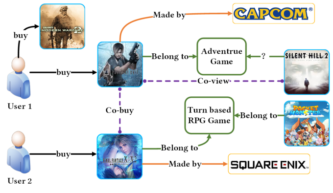
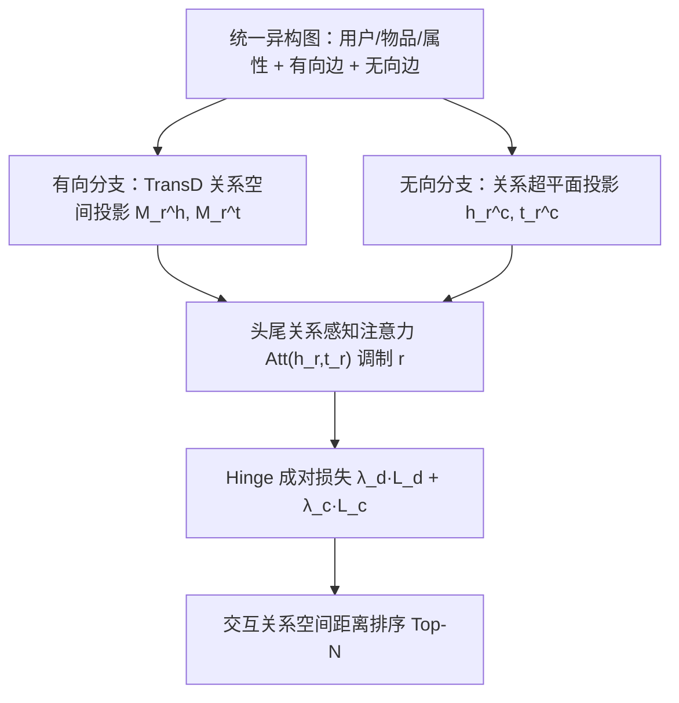
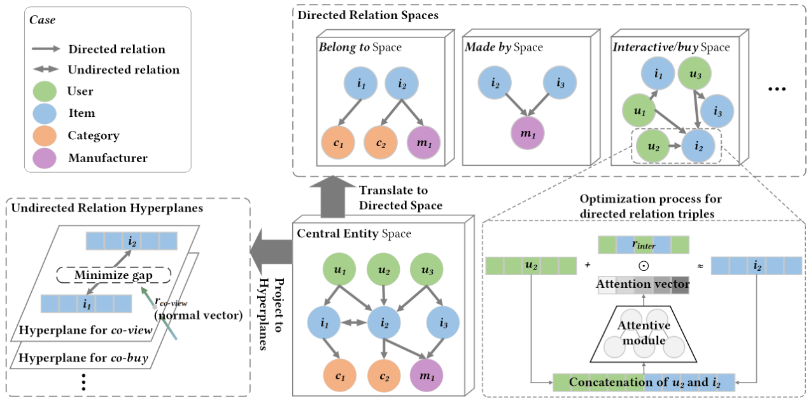

# UGRec: Modeling Directed and Undirected Relations for Recommendation (统一建模有向与无向关系用于推荐)

- **会议/期刊**: SIGIR 2021 (长文)
- **作者与机构**: Xinxiao Zhao, Zhiyong Cheng, Lei Zhu, Jiecai Zheng, Xueqing Li（山东大学、齐鲁工业大学（山东省科学院）、山东师范大学、山东体育学院）
- **推荐链路定位**: 召回（图嵌入式用户/物品表征 + 度量学习排序）
- **研究方向**: 图神经网络与知识图谱推荐 / 冷启动与长尾推荐
- **论文原文**: [https://arxiv.org/abs/2105.04183v1](https://arxiv.org/abs/2105.04183v1)
- **开源代码**: [https://github.com/garfieldcat1985/ugrec](https://github.com/garfieldcat1985/ugrec)

## TL;DR (1分钟核心速览)

针对交互稀疏场景下协同过滤退化的问题，本文指出知识图谱（KG）的有向属性关系与物品共现（co-buy/co-view）的无向关系具有互补性，但二者**语义方向性本质不同**，不能像 CFKG/KTUP 那样一律用 TransE/TransH 处理。UGRec 在统一异构图上有向关系走"关系空间投影 + 头尾感知注意力"，无向关系走"关系专属超平面投影后做度量学习"，联合多任务训练。在 Amazon 三数据集、`Leave-One-Out` + 全库排序协议下，HR@20 相对最强基线（CFKG/KTUP）提升 **3.70% / 5.36% / 3.94%**。

## Background & Motivation (背景与核心矛盾)

- **主流范式**: KG 增强推荐（CKE、CFKG、KTUP、KGAT）把用户-物品交互、物品属性统一视作三元组，套用 TransE/TransH 等平移嵌入学实体表征；共现信息（RCF 等）则多用 DistMult/BPR 单独建模。
- **前人局限 1（语义错配）**: 共现关系天然**对称**，若照搬 TransE，对 $\langle e_1,e_2,r\rangle$与$\langle e_2,e_1,r\rangle$同时要求$\mathbf{e}_1+\mathbf{r}\approx\mathbf{e}_2$且$\mathbf{e}_2+\mathbf{r}\approx\mathbf{e}_1$，会推出$\mathbf{r}\approx\mathbf{0},\mathbf{e}_1\approx\mathbf{e}_2$ 的**平凡解**，关系信息完全失效。DistMult 虽对称但点积度量与平移模型的欧氏度量不兼容，实验表现反而更差。
- **前人局限 2（信息不互补）**: KG 有向关系无法刻画"互补购买"（iPhone 与 AirPods）这类隐式共性；KG 属性缺失时（如 Silent Hill 2 缺类目）也无法建立同类目物品之间的连接，而共现恰好能补桥。
- **核心洞察 (Key Insight)**: 有向关系需要"头尾角色区分 + 关系空间平移"，无向关系只需"对称等距 + 抑制平凡解"，二者必须用**两套算子**在同一实体空间内共存。
- **本文切入点**: 构建含用户、物品、属性的统一图，有向边用 TransD 关系空间投影、无向边用**每个三元组独有的超平面**投影降维后最小化距离，两类损失多任务加权求和。

<figure class="paper-figure" markdown="span">
  <figcaption>图1：我们统一图的简单示例，该图同时包含有向关系和无向关系。图中实线和虚线分别表示有向关系和无向关系。</figcaption>
</figure>

## Method (核心方法设计)

### 1. 整体框架 (Overall Architecture)

UGRec 将用户-物品交互也视为一种有向关系 $r_{inter}$，与 `belong to`、`made by` 等 KG 关系共同构成有向关系集$\mathcal{R}_d$；`co-buy`、`co-view` 构成无向关系集$\mathcal{R}_c$。所有实体（用户、物品、属性）共享**同一中心实体空间**（维度$k=64$），有向关系各自拥有独立关系子空间，无向关系则以法向量定义实体空间中的超平面。训练时对每类关系分别用 hinge 成对损失做度量学习，再按$\lambda_d,\lambda_c$加权求和；推荐阶段在$r_{inter}$ 关系空间内按距离升序对全库未交互物品排序。

<figure class="paper-figure" markdown="span">
  <figcaption>图2：我们的 UGRec 模型的示意图：1）将有向关系转换到对应的关系空间中进行优化；2）无向共现关系在由实体空间投影得到的超平面上进行优化。</figcaption>
</figure>

### 2. 关键设计拆解 (Key Designs)

1. **有向关系的关系空间投影（TransD 式动态映射）**：固定平移向量无法区分同一关系下不同实体对的差异，故映射矩阵由实体与关系各自的投影向量共同生成：$\mathbf{M}^h_r=\mathbf{r}_p\mathbf{h}_p^{\top}+\mathbf{I}_{k\times k}$，$\mathbf{M}^t_r=\mathbf{r}_p\mathbf{t}_p^{\top}+\mathbf{I}$，得到$\mathbf{h}^d_r=\mathbf{M}^h_r\mathbf{h}$、$\mathbf{t}^d_r=\mathbf{M}^t_r\mathbf{t}$。$+I$ 项使空间变换在恒等映射附近做低秩扰动，既保证训练稳定又避免过拟合；由此每个实体在不同关系下获得**定制化表征**。

2. **头尾关系感知注意力（打破"一关系一向量"）**：同一 $r_{inter}$下，两个用户与同一物品交互的动机可能完全不同，全局共享的$\mathbf{r}$无法区分。将$\mathbf{z}=\mathrm{ReLU}(\mathbf{W}[\mathbf{h}^d_r:\mathbf{t}^d_r]+\mathbf{b})$过 softmax 得逐维注意力$\mathrm{Att}^d$，并对关系向量做**逐元素调制**：
$f^d_r(h,t)=\lVert \mathbf{h}^d_r+\mathbf{r}\odot \mathrm{Att}^d(\mathbf{h}^d_r,\mathbf{t}^d_r)-\mathbf{t}^d_r\rVert_2^2$
即关系向量在语义相近的维度被放大、无关维度被抑制，实现三元组级别的细粒度关系建模。

3. **无向关系的关系超平面投影（治平凡解的根）**：把两实体投影到以 $\mathbf{r}$为法向的超平面上：$\mathbf{h}^c_r=\mathbf{h}-\frac{\mathbf{r}^{\top}\mathbf{h}}{\lVert\mathbf{r}\rVert_2^2}\mathbf{r}$，同理得$\mathbf{t}^c_r$，然后$f^c_r(h,t)=f^c_r(t,h)=\lVert\mathbf{h}^c_r-\mathbf{t}^c_r\rVert_2^2$。由于投影后两实体只保留**共同超平面分量**，对称性天然满足；同时去除法向分量，避免$\mathbf{h}\approx\mathbf{t}$ 的坍缩，且迫使实体在空间中更均匀分布（优于 DistMult 的点积度量）。

**训练目标、负采样与推理**：$\min_{\Theta}\mathcal{L}=\lambda_d\sum_{r_i\in\mathcal{R}_d}\mathcal{L}^D_{r_i}+\lambda_c\sum_{r_j\in\mathcal{R}_c}\mathcal{L}^C_{r_j}$，单关系损失为 hinge 形式$\sum_{\langle h,t,r\rangle}\sum_{\langle h,t',r\rangle}[m+f_r(h,t)-f_r(h,t')]_+$。负采样沿用 CML/TransD 的"采样$N=20$个再取最硬负例"策略；全部嵌入约束在单位超球内。超参$\lambda_d=\lambda_c=1$，交互关系 margin$m=1.8$（Games 为 1.5）、其余关系$m=1$，AdaGrad 优化。推理时为纯向量距离计算，无图传播，开销与 CML 同阶。

## Experimental Setup & Evaluation Protocol (实验设置与评估协议)

- **数据集与预处理**: Amazon 三个子类，保留交互数 ≥ 4 的用户与物品（4-core 式过滤）；有向关系抽取 `belong to` / `made by`，无向关系抽取 `co-buy` / `co-view`。

| 数据集 | #Users | #Items | #Interactions | 稀疏度 | #$r_{total}$（KG+共现三元组） |
| :--- | :---: | :---: | :---: | :---: | :--- |
| Games | 91,568 | 21,820 | 620,361 | 99.96% | 274,795 |
| CDs & Vinyls | 41,690 | 32,601 | 338,296 | 99.98% | 189,360 |
| Movies & TVs | 33,680 | 25,185 | 257,432 | 99.97% | 148,104 |

- **数据划分与防穿越 (Splitting Strategy)**: `Leave-One-Out` —— 每用户最后一条交互为测试、倒数第二条为验证、其余为训练，属严格时间序切分，无未来信息泄漏。
- **排名评测协议 (Ranking Protocol)**: 无偏 `Full-Ranking`，即对每个用户将其**全部未交互物品**与留出正例共同排序，指标 HR@20 与 NDCG@20，显著性问题用双尾配对 t 检验（$p<0.05$，表中 `*` 标注）。
- **对比基线与超参设置**: 仅交互基线 NeuMF / LightGCN（2 层传播）/ CML / LRML（20 个 memory block）；KG 增强基线 CFKG（TransE）、KTUP（TransH，$\lambda=0.7$）。所有模型嵌入维度$d=64$，学习率搜索$\{0.001,\dots,0.1\}$，$L_2$权重$\{10^{-4},\dots,10^{1}\}$，训练 1000 epoch、每 10 epoch 评测。

## Key Experimental Results (实验关键数据)

### 1. 主实验对比 (Main Results)

| 数据集 | 指标 | NeuMF | LightGCN | CML | LRML | CFKG | KTUP | **UGRec** | Improv. |
| :--- | :--- | :---: | :---: | :---: | :---: | :---: | :---: | :---: | :---: |
| Games | HR@20 | 20.22 | 20.64 | 22.91 | 23.00 | 24.03 | 23.47 | **24.92\*** | +3.70% |
| Games | NDCG@20 | 9.60 | 9.38 | 13.40 | 13.38 | 13.51 | 13.16 | **13.99\*** | +3.55% |
| CDs & Vinyls | HR@20 | 17.98 | 18.13 | 19.83 | 19.89 | 21.77 | 21.84 | **23.01\*** | +5.36% |
| CDs & Vinyls | NDCG@20 | 8.56 | 9.11 | 12.13 | 12.19 | 11.93 | 12.24 | **12.57\*** | +2.70% |
| Movies & TVs | HR@20 | 20.18 | 20.90 | 21.16 | 21.21 | 23.52 | 23.85 | **24.79\*** | +3.94% |
| Movies & TVs | NDCG@20 | 9.73 | 10.99 | 14.40 | 14.41 | 14.34 | 14.43 | **14.60\*** | +1.18% |

（`Improv.` 为相对最强基线的 HR@20 相对提升，全部通过 $p<0.05$ 显著性检验。）

### 2. 消融实验 (Ablation Study)

| 变体 | Games HR | Games NDCG | CDs HR | CDs NDCG | Movies HR | Movies NDCG |
| :--- | :---: | :---: | :---: | :---: | :---: | :---: |
| o/dc（仅交互关系） | 23.02 | 13.07 | 20.37 | 11.23 | 21.93 | 13.13 |
| o/c（去无向共现） | 24.27 | 13.64 | 22.47 | 12.25 | 23.94 | 14.10 |
| o/d（去有向 KG） | 24.21 | 13.59 | 22.10 | 12.06 | 23.77 | 14.02 |
| o/att（去注意力） | 24.35 | 13.68 | 22.83 | 12.43 | 24.44 | 14.44 |
| **UGRec (full)** | **24.92** | **13.99** | **23.01** | **12.57** | **24.79** | **14.60** |

### 3. 关键实验发现 (Key Findings)

1. **两类关系互补而非冗余**：o/c 与 o/d 均优于 o/dc（Games 上 24.27/24.21 vs. 23.02），但二者缺一都掉点；值得注意的是共现三元组数量远多于 KG（Games 上 216K vs. 58K）时 o/c 仍只领先 o/d 约 0.06，说明**KG 提供的是高价值语义信号，共现提供的是协同信号**，不能以数量替代质量。
2. **注意力带来"零成本"增益且可独立于侧信息生效**：去掉注意力（o/att）在 Movies 上 HR 掉 0.35；更关键的是仅用交互的 o/dc（23.02）已超过完整 CML（22.91），证明头尾感知注意力本身就是一种有效的通用度量学习增强件。
3. **稀疏用户组收益更大**：按训练交互数分桶（≤5、≤10、≤15、>15）后，UGRec 在 **≤5 的最稀疏组**上相对无侧信息模型的领先幅度最大，且随交互数增加各模型差距收敛，直接印证两类关系对冷启动/稀疏场景的缓解作用；共现比例从 0 增至 1.0 时 UGRec 曲线斜率始终最陡（$ratio=0$ 时已优于 CFKG/KTUP）。

## Highlights & Limitations (亮点、对比与审稿批判)

- **与代表作对比 (vs. Prior Work)**: 与 **CFKG** 的本质差别是拒绝用 TransE 一把梭处理无向共现，改用超平面投影规避平凡解；与 **KTUP** 的差别在于不依赖推荐-KG 补全双任务互增强，而是靠注意力做三元组级关系精调；与 **RCF** 相比则额外引入了有向 KG 语义，而非只做纯共现正则。
- **可迁移亮点**: (1) "对称关系 → 超平面投影 + 欧氏距离"这一算子可直接搬进社交好友、同会话共现等对称图建模；(2) 用 $\mathbf{r}\odot\mathrm{Att}$ 对关系向量逐维调制，是把"一关系一向量"升级为"一三元组一向量"的轻量做法（仅增加一个 2 层 MLP）。
- **审稿级局限批判**: 其一，$\lambda_d,\lambda_c$被直接固定为 1，未探索不同关系重要性加权（作者自己也承认留作未来工作），在 KG/共现比例极不均衡的数据上可能次优；其二，实验仅在 Amazon 三子类上以 HR/NDCG@20 单点评估，缺少更大$N$ 与 MRR 等排序深度指标，也未报告训练耗时与共现矩阵构图成本，工业可扩展性论证偏弱。

## Rating (四维评分)

- **方法创新性 (Novelty)**: ⭐⭐⭐⭐ （"有向走关系空间、无向走超平面"的双算子统一建模切中 TransE 平凡解这一真实病灶，注意力调制关系向量的做法简洁有效，但整体仍是平移嵌入框架内的改良）
- **评估协议与实验扎实度 (Protocol & Experiments)**: ⭐⭐⭐⭐ （三数据集 + 全库排序 + 配对 t 检验 + 共现比例/稀疏分桶/消融四重分析较完整，扣分在于仅单一 top-20 指标与固定超参）
- **写作与数学规范度 (Clarity & Rigor)**: ⭐⭐⭐⭐ （两类关系公式推导清晰、平凡解论证直观、复杂度与约束条件交代到位，但注意力公式符号与有向/无向复用略显拥挤）
- **工业落地与复现价值 (Industrial & Practical Value)**: ⭐⭐⭐⭐ （代码开源、推理为纯距离计算无图传播、易接入现有度量学习召回链路，主要门槛在于共现图与 KG 的在线维护成本）

