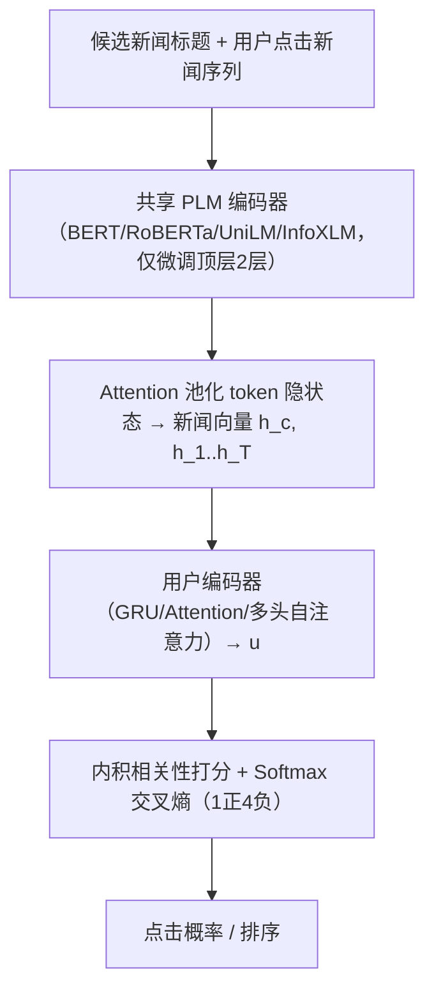
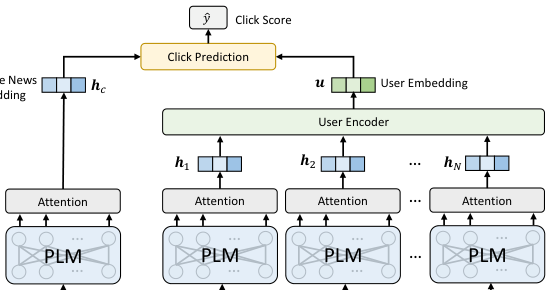
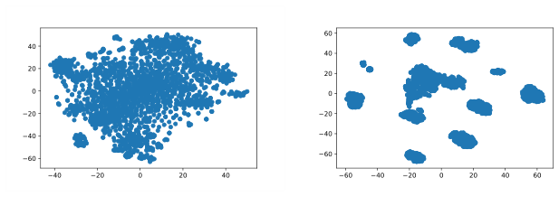

# Empowering News Recommendation with Pre-trained Language Models (以预训练语言模型赋能新闻推荐)

- **会议/期刊**: SIGIR 2021
- **作者与机构**: Chuhan Wu, Fangzhao Wu, Tao Qi, Yongfeng Huang（清华大学电子工程系 / BNRist；微软亚洲研究院）
- **推荐链路定位**: 召回（新闻内容编码 + 用户兴趣编码 + 点击打分）
- **研究方向**: 大语言模型推荐 / 序列推荐
- **论文原文**: [https://arxiv.org/abs/2104.07413v1](https://arxiv.org/abs/2104.07413v1)
- **开源代码**: [https://github.com/wuch15/PLM4NewsRec](https://github.com/wuch15/PLM4NewsRec)

## TL;DR (1分钟核心速览)

新闻推荐长期用 CNN / 单层自注意力从零学新闻文本表征，监督信号仅来自点击日志，学到的嵌入判别力弱、用户兴趣建模被"劣质新闻向量"拖累。本文把新闻编码器整体换成预训练语言模型（BERT/RoBERTa/UniLM，多语言场景用 Unicoder/InfoXLM），用 Attention 池化 token 隐状态、仅微调最后两层 Transformer，在 MIND 与自建 7 语言 MSN 数据集上以曝光内负采样排序协议评估，AUC 相对提升 3.6%，并在微软新闻线上取得点击 +8.53%~+10.68%。

## Background & Motivation (背景与核心矛盾)

- **主流范式**: 新闻推荐采用「新闻编码器 → 用户编码器（GRU / 加性注意力 / 多头自注意力）→ 内积点击打分」三件套，新闻侧普遍用词向量 + CNN（EBNR、NAML）或浅层自注意力（NRMS）。
- **前人局限**: ① 浅层文本模型参数少、层数浅，难以解析长程上下文与深层语义；② 这些文本参数**只由点击监督驱动**，缺乏通用语言知识，嵌入空间拥挤、类间不可分（图 5 的 NRMS 嵌入几乎糊成一团）。
- **核心洞察 (Key Insight)**: 新闻编码器是整条链路的"地基"——用户向量由点击新闻向量聚合而来，新闻表征若不可分，用户兴趣必然失真；而 PLM 在大规模无监督语料上预训练，天然提供可判别的语义先验与更好的微调初始化。
- **本文切入点**: 不改动推荐框架本身（仍是"新闻编码—用户编码—点击预测"），只做**编码器替换 + 池化设计 + 部分层微调**，验证"PLM 即插即用"的增益上限与工程代价。

## Method (核心方法设计)

### 1. 整体框架 (Overall Architecture)

模型沿用通用新闻推荐骨架（图 1）：一条候选新闻 $D_c$与用户历史点击序列$[D_1,\dots,D_T]$分别送入**同一套 PLM+Attention 新闻编码器**，得到$h_c$与$[h_1,\dots,h_T]$；用户编码器（原文实例化为 GRU / 注意力 / 多头自注意力）把点击序列聚合为$u$；点击预测模块以相关性函数（内积或 MLP）输出$\hat{y}$。训练端从原始曝光日志做负采样构造"1 正 + 4 负"的分类样本，用交叉熵反向传播，梯度可一路回传到 PLM 顶层，实现"推荐任务微调语言模型"的端到端闭环；推理端新闻向量可离线预计算并缓存，线上只做向量检索与打分。相比原框架，唯一结构改动就是新闻编码器内部被 PLM 替换。

<figure class="paper-figure" markdown="span">
  <figcaption>图2：PLM 赋能的新闻推荐框架。</figcaption>
</figure>

### 2. 关键设计拆解 (Key Designs)

1. **Attention 池化替代 CLS / Average（把"句子向量"从 1 个 token 变成可加权求和）**：痛点是 BERT 惯例取 `[CLS]` 表示作句向量，但该 token 未经句子级监督、且丢弃了其余 $M-1$个位置的语义；本文对 PLM 输出的 token 隐状态序列$[r_1,\dots,r_M]$做加性注意力聚合$h=\sum_{j=1}^{M}\alpha_j r_j$，$\alpha_j=\frac{\exp(\boldsymbol{q}^{\top}\tanh(\mathbf{W}r_j))}{\sum_{k}\exp(\boldsymbol{q}^{\top}\tanh(\mathbf{W}r_k))}$。直觉：新闻标题中实体词与虚词的信息量差异极大，可学习的$\alpha_j$ 起到"软实体抽取"作用，因而稳定优于等权平均与 CLS（图 4）。
2. **仅微调最后两层 Transformer（精度几乎不掉、显存与吞吐大幅改善）**：痛点是 BERT-Base 有 12 层 / 109M 参数，全量微调 + 每用户 $T$ 条点击新闻的前向使训练与线上推理都过于笨重；作者实测全层微调与只调顶层 2 层"差异极小"，故冻结底部 10 层——底层保留通用语法/语义先验（避免小数据过拟合），顶层承担新闻域适配，形成"通用表征 + 任务特化"的解耦。
3. **多语言统一编码器（InfoXLM/Unicoder 混合语料联合训练）**：痛点是按市场各训一个单语模型（Single）会导致线上维护 7 套模型、内存与算力开销线性增长；本文把 7 种语言的曝光日志混合训练一个跨语言 PLM，共享参数空间。效果上既利用语言间共性（EN-US/DE-DE 等共享兴趣模式），又把线上模型数从 7 降到 1（表 3）。
4. **训练目标、负采样与推理开销**：损失为曝光内 softmax 交叉熵
$$\mathcal{L}=-\log\frac{\exp(\hat{y}^{+})}{\exp(\hat{y}^{+})+\sum_{k=1}^{K}\exp(\hat{y}^{-}_{k})},\qquad \hat{y}=u^{\top}h_c$$
负样本为**曝光内均匀采样**（每条正样本配 $K=4$ 条同曝光未点击新闻，非全库随机负采样）；推理时新闻向量离线缓存在 ANN 索引中，线上仅需用户侧轻量编码 + 内积检索，PLM 前向不进入在线关键路径，因此延迟可控。

## Experimental Setup & Evaluation Protocol (实验设置与评估协议)

- **数据集与预处理**: 新闻仅用**标题**建模（未用正文/摘要/类别），沿用 MIND 官方处理；多语言集自建，每市场随机采样 20 万曝光。

| 数据集 | #Users | #Items(News) | #Interactions(Impressions) | 稀疏度/密度 | 特征/场景说明 |
| :--- | :---: | :---: | :---: | :---: | :--- |
| MIND (EN) | 1,000,000 | 161,013 | 15,777,377（点击 24,155,470） | 极稀疏，平均每用户约 15.8 次曝光 | 微软新闻 6 周英文点击日志，单语基准 |
| Multilingual (MSN) | 1,392,531 | 4,378,487 | 1,400,000（点击 1,814,927） | 极稀疏，7 市场各 20 万曝光 | EN-US/DE-DE/FR-FR/IT-IT/JA-JP/ES-ES/KO-KR 七语言，跨语种迁移场景 |

- **数据划分与防穿越 (Splitting Strategy)**: **全局时间戳切分**——最后一周日志作测试集，其余按 9:1 切分为训练/验证，严格避免未来曝光泄漏到训练；测试样本来自真实曝光序列，符合线上分布。
- **排名评测协议 (Ranking Protocol)**: **Sampled Ranking（曝光内负采样排序）**——每条正样本配 4 条同曝光未点击负样本做 softmax 分类，报告 AUC、MRR、nDCG@5、nDCG@10 的曝光级平均。注意：该协议下未交互新闻被大量丢弃，AUC 绝对值相对 Full-Ranking 偏乐观，跨论文比较时需谨慎。
- **对比基线与超参设置**: 基线含 EBNR（知识感知 CNN）、NAML（多视角 CNN）、NPA（个性化注意力）、LSTUR（GRU + 用户 ID 嵌入）、NRMS（多头自注意力），每者再分别配 BERT/RoBERTa/UniLM；多语言侧对比 MUSE 词向量、Unicoder、InfoXLM 及每市场独立训练的 Single。统一用 Base 版 PLM，Adam，学习率 $1\times10^{-5}$，batch 128（4 卡 ×32），每实验独立重复 5 次取均值，$t$-test 显示提升$p<0.001$。

## Key Experimental Results (实验关键数据)

### 1. 主实验对比 (Main Results)

MIND 单语基准（AUC / MRR / nDCG@5 / nDCG@10，%），保留 8 组代表结果：

| 方法 | AUC | MRR | nDCG@5 | nDCG@10 |
| :--- | :---: | :---: | :---: | :---: |
| EBNR (CNN) | 66.54 | 32.43 | 35.38 | 40.09 |
| NAML (CNN) | 67.78 | 33.24 | 36.19 | 41.95 |
| LSTUR (GRU) | 68.04 | 33.31 | 36.28 | 42.10 |
| NRMS (自注意力) | 68.18 | 33.29 | 36.31 | 42.20 |
| NRMS-BERT | 69.50 | 34.75 | 37.99 | 43.72 |
| NAML-UniLM | 70.50 | 35.26 | 38.60 | 44.27 |
| LSTUR-UniLM | 70.56 | 35.29 | 38.67 | 44.31 |
| **NRMS-UniLM** | **70.64** | **35.39** | **38.71** | **44.38** |
| **Improv.% (vs. NRMS)** | **+3.61%** | **+6.31%** | **+6.61%** | **+5.16%** |

多语言基准（AUC / %，7 市场抽样）：

| 方法 | EN-US | JA-JP | KO-KR | 7 市场均值 |
| :--- | :---: | :---: | :---: | :---: |
| NRMS-Single（各市场独立训） | 62.11 | 61.57 | 63.64 | 61.07 |
| NRMS-MUSE（多语词向量） | 62.33 | 61.90 | 63.93 | 61.21 |
| NRMS-Unicoder | 63.41 | 62.81 | 64.79 | 62.15 |
| **NRMS-InfoXLM** | **64.34** | **63.40** | **65.58** | **62.83** |

### 2. 消融实验 (Ablation Study)

| 替换组件 (以 NRMS 为骨架) | 评估集 | AUC | 相对骨架 |
| :--- | :--- | :---: | :---: |
| w/o PLM（浅层自注意力，MIND） | MIND | 68.18 | — |
| 冻结底层，仅微调最后 2 层 BERT | MIND | 69.50 | +1.32 |
| 冻结底层，仅微调最后 2 层 UniLM | MIND | **70.64** | **+2.46** |
| 池化 w/ CLS（单 token） | MIND | 最差（图 4 曲线） | 负增益 |
| 池化 w/ Average（等权平均） | MIND | 次优（图 4 曲线） | 正但弱于 Attention |
| 池化 w/ Attention（本文） | MIND | 最优 | 默认配置 |
| 文本编码器 MUSE → Unicoder | 7 市场均 | 61.21 → 62.15 | +0.94 |
| 文本编码器 MUSE → InfoXLM | 7 市场均 | 61.21 → 62.83 | +1.62 |
| Single（单语独立）→ 多语联合 | 7 市场均 | 61.07 → 62.83 | +1.76 |

（池化与 PLM 规模两项原文仅给曲线，此处标注趋势；其余为原文表 2/表 3 数值或由其计算所得。）

<figure class="paper-figure" markdown="span">
  <figcaption>图5：NRMS 与 NRMS-UniLM 学习到的新闻嵌入可视化。</figcaption>
</figure>

### 3. 关键实验发现 (Key Findings)

1. **PLM 增益是"编码器级"而非"推荐结构级"的**：五个基线换上同一 PLM 后 AUC 齐刷刷从 66–68 升至 69.4–70.6，各模型间差距（70.50/70.52/70.56/70.64）被压缩到 0.14 以内——说明瓶颈长期在新闻文本建模，而非用户编码器或打分函数的设计精巧度。
2. **更强的预训练目标 > 更大的语料规模**：RoBERTa 仅比 BERT 高约 0.1 AUC（69.56 vs 69.50），而 UniLM（同时含理解+生成自监督）再高出约 1.1 AUC（70.64），表明预训练**任务多样性**对新闻语义判别力的贡献大于语料量。
3. **多语言联合训练是"零成本"的线上收益**：单语独立模型均值 61.07 → 跨语言 InfoXLM 62.83（+1.76 AUC），同时把线上模型数从 7 降到 1；但语种间收益不均（KO-KR +1.94 vs ES-ES +1.14），说明语言亲缘性与数据量差异仍影响迁移效果。线上 A/B 进一步验证：英文市场点击 +8.53%、页面浏览 +2.63%；其余 43 个市场点击 +10.68%、页面浏览 +6.04%。

## Highlights & Limitations (亮点、对比与审稿批判)

- **与代表作对比 (vs. Prior Work)**: 相比 EBNR/NAML 用词向量 + CNN、NRMS 用单层多头自注意力，本文并未发明新的推荐结构，而是把"文本编码器"这一被低估的组件换成 12 层 Transformer 并端到端微调；相比同期多语言工作 MUSE/Unicoder，本文首次把跨语言 PLM 放进真实推荐链路并给出线上 A/B 证据，工程价值大于算法新颖度。
- **可迁移亮点**: ① "仅微调顶层 $k$ 层 + 冻结底部 + 注意力池化"是可复用到任何"预训练模型离线编码 + 缓存向量检索"场景的轻量模板；② 用跨语言共享编码器替代多市场独立模型，可在几乎不掉点前提下把线上模型数压缩一个数量级。
- **审稿级局限批判**: ① 仅用**新闻标题**（截断至 $M$token），正文、图片、类别等强信号被丢弃，PLM 增益可能被低估也可能被标题的"标题党"噪声放大；② 评估全程为**曝光内 4 负采样排序**，没有 Full-Ranking 结果，AUC 与工业真实排序差距未知；③ 未报告 PLM 编码的离线吞吐/显存/训练耗时与推理延迟数字，"已上线"结论难以被第三方复现验证；④ 池化与模型规模实验仅有曲线、无表格数值，且缺少 PLM 冻结层数$k$ 的系统敏感性分析。

## Rating (四维评分)

- **方法创新性 (Novelty)**: ⭐⭐⭐ （本质是"编码器替换 + 池化对比"的实证型工作，机制新颖度有限，但首次给出 PLM 在新闻推荐链路的系统性证据与线上验证）
- **评估协议与实验扎实度 (Protocol & Experiments)**: ⭐⭐⭐⭐ （MIND + 7 语言自建集 + 微软新闻线上 A/B，5 次重复与 $p<0.001$ 显著性检验齐全；扣分在于全程 Sampled Ranking、无 Full-Ranking 与正文/多模态特征消融）
- **写作与数学规范度 (Clarity & Rigor)**: ⭐⭐⭐⭐ （框架与损失交代干净、结论直给；但部分关键实验只给曲线不给数表，负采样比例与截断长度等细节略欠）
- **工业落地与复现价值 (Industrial & Practical Value)**: ⭐⭐⭐⭐⭐ （代码开源、仅微调顶层两层的成本控制、跨语言统一模型与真实线上点击/页面浏览双指标增益，对大厂新闻/内容推荐落地参考价值极高）

