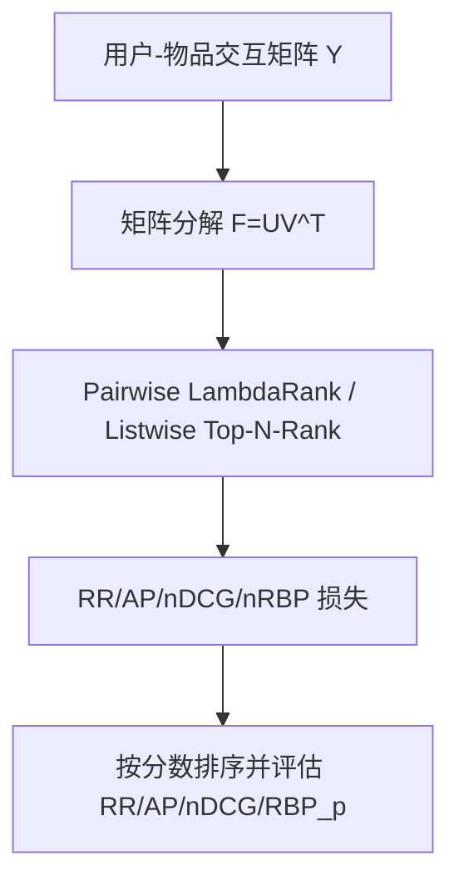
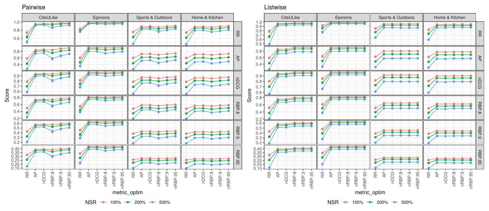

# New Insights into Metric Optimization for Ranking-based Recommendation (面向排序推荐的指标优化新洞察)

- **会议/期刊**: SIGIR 2021
- **作者与机构**: Roger Zhe Li, Julián Urbano, Alan Hanjalic; Delft University of Technology
- **推荐链路定位**: 重排 / 学习排序（LTR）
- **研究方向**: 多任务学习与列表级重排 / 协同过滤
- **论文原文**: [https://arxiv.org/abs/2106.02545v1](https://arxiv.org/abs/2106.02545v1)
- **开源代码**: [https://github.com/roger-zhe-li/sigir21-newinsights](https://github.com/roger-zhe-li/sigir21-newinsights)

## TL;DR (1分钟核心速览)

本文质疑“优化与评估必须使用同一 IR 指标”的惯例，在矩阵分解 + LambdaRank/Top-N-Rank 框架下系统比较 RR、AP、nDCG、RBP 四类损失。作者提出 RBP 启发的 pairwise/listwise 损失，其中 listwise 损失与持久度 $p$ 无关。四数据集、采样排序、3 次划分实验显示：优化 nRBP.95 至少不逊于 AP/nDCG，且 listwise nRBP 在多个场景显著更优；优化 RR 最差，即使评估 RR 也如此。

## Background & Motivation (背景与核心矛盾)

- **主流范式**: 排序推荐常直接把评估指标转成 LTR 损失，默认“优化 $X$就能最大化$X$”。
- **前人局限**: RR 只关注首个相关项，信息量低；不同指标的信息量与相关性不同，同指标优化未必最优。RBP 虽在传统 IR 中重要，却很少作为推荐训练目标。
- **核心洞察 (Key Insight)**: RBP 的持久度 $p$可调节“用户愿 exploration 到多深”；nRBP.95 与高信息量指标更相关。listwise RBP 经 Jensen 下界可化为“把所有相关项推向顶部”的秩位置优化，且不依赖$p$。
- **本文切入点**: 统一比较 4 指标 × 2 范式，并补齐 RBP 的 pairwise/listwise 目标函数。

## Method (核心方法设计)

### 1. 整体框架 (Overall Architecture)

模型以二值交互矩阵 $Y$为输入，用矩阵分解$F=UV^\top$得到用户-物品打分。Pairwise 分支用 LambdaRank 计算交换相关/不相关物品带来的指标增益；listwise 分支用 sigmoid 近似排序位置并对整条列表优化。训练采用 SGD 与按用户正样本数比例采样的负样本；推理解码按$f_{ui}$ 降序排列，在采样候选集上计算 RR/AP/nDCG/RBP。

### 2. 关键设计拆解 (Key Designs)

1. **Pairwise nRBP 的 λ 梯度**：LambdaRank 只定义交换增益，本文把 nRBP 增益代入 λ。对物品对 $(i,j)$，有
$\lambda_{uij}=S_{uij}\left|\frac{Z(p,m_u)(1-p)(y_{ui}p^{R_{ui}-1}-y_{uj}p^{R_{uj}-1})}{1+e^{S_{uij}o_{uij}}}\right|$，
其中 $o_{uij}=f_{ui}-f_{uj}$，$Z(p,m_u)=1/(1-p^{m_u})$。直觉是$p$ 越大，越能把深位相关项纳入训练信号，故 nRBP.95 通常优于 nRBP.8/0.9。

2. **Listwise nRBP 的 $p$无关损失**：直接用$\tilde R_{ui}=1+\sum_{j\ne i}\sigma(f_{uj}-f_{ui})$ 近似位置。由 Jensen 不等式，
$\ln(RBP/m_u)\ge \ln(1-p)+\frac1{m_u}\sum_i y_{ui}(\tilde R_{ui}-1)\ln p$。
因 $\ln p<0$，最大化等价于最小化相关项位置；再减去$\sum_{j=1}^{m_u}(j-1)$ 调节用户间下界，得到
$\mathcal L_{nRBP}(u)=\sum_i y_{ui}(\tilde R_{ui}-1)-\sum_{j=1}^{m_u}(j-1)$。
该损失不出现 $p$，一个模型可服务多个$p$；但损失上界随$m_u$ 增大，天然更偏向高活跃用户。

3. **训练目标、负采样与推理**：总损失为各用户损失之和；pairwise 用 LambdaRank，listwise 用 sigmoid 平滑且不设 cutoff。训练负采样比例 NSR 取 100%/200%/500%，测试同分布采样；在线推理需对候选集排序，复杂度约 $O(N\log N)$/用户。

## Experimental Setup & Evaluation Protocol (实验设置与评估协议)

- **数据集与预处理**: Amazon 评分 4/5 记正，其余及缺失记负；所有数据集仅保留至少 25 个相关交互的用户。

| 数据集 | #Users | #Items | #Interactions | 密度 | 说明 |
| :--- | :---: | :---: | :---: | :---: | :--- |
| CiteULike-a | 2,465 | 16,702 | 157,527 | 0.383% | 一元交互 |
| Epinions | 4,690 | 32,592 | 325,154 | 0.213% | 一元交互 |
| Sports & Outdoors | 9,123 | 119,404 | 342,311 | 0.031% | Amazon 评分 |
| Home & Kitchen | 20,531 | 222,472 | 795,845 | 0.017% | Amazon 评分 |

- **数据划分与防穿越**: 按用户分层随机 `80/20`，训练/测试均保证每用户至少 20/5 个正交互；每数据集 3 次独立 Monte Carlo 划分。
- **排名评测协议**: `Sampled Ranking`，非全库 Full-Ranking。测试集为 20% 正样本 + 与正样本等量/2 倍/5 倍负样本；训练负采样同比例。指标为 RR、AP、nDCG、RBP@$p\in\{0.8,0.9,0.95\}$。
- **对比基线与超参**: 基线是 6 种 metric loss：RR、AP、nDCG、nRBP.8、nRBP.9、nRBP.95，分别接入 LambdaRank 与 Top-N-Rank 式 listwise。MF 维度固定 $d=32$，SGD 学习率网格搜索，训练 3,000 epochs，按各评估指标选最佳 epoch；显著性用 EMM 的 95% 置信/预测区间判断。

## Key Experimental Results (实验关键数据)

### 1. 主实验对比 (Main Results)

> 原文以图 1/3/4 呈现结果，下表为按图读出的标准化 EMM 均值（四数据集平均，近似值；精确值见原文与开源仓库）。`Improv.` 为 nRBP.95 相对 AP 的相对提升。

| 优化目标 | Pairwise AP | Pairwise nDCG | Pairwise RBP.95 | Listwise AP | Listwise nDCG | Listwise RBP.95 |
| :--- | :---: | :---: | :---: | :---: | :---: | :---: |
| RR | 0.08 | 0.09 | 0.07 | 0.30 | 0.30 | 0.30 |
| AP | 0.46 | 0.47 | 0.48 | 0.44 | 0.45 | 0.44 |
| nDCG | 0.48 | 0.50 | 0.51 | 0.45 | 0.46 | 0.45 |
| nRBP.8 | 0.36 | 0.37 | 0.35 | 0.42 | 0.43 | 0.42 |
| nRBP.9 | 0.57 | 0.58 | 0.57 | 0.48 | 0.49 | 0.49 |
| nRBP.95 | **0.67** | **0.68** | **0.69** | **0.50** | **0.51** | **0.52** |
| Improv. vs AP | +45.7% | +44.7% | +43.8% | +13.6% | +13.3% | +18.2% |

<figure class="paper-figure" markdown="span">
  <figcaption>图1：pairwise 与 listwise 方法的总体性能。metric_optim 表示用于优化的基于指标的损失，每个面板行表示一个评价指标。所有结果均为 3 个数据划分上的平均值。注意每行的 y 轴不同。</figcaption>
</figure>
图1：pairwise/listwise 各 metric_optim 在四个数据集与不同 NSR 下的总体性能（原文图1）。

### 2. 消融实验 (Ablation Study)

| 因素/变体 | Pairwise RBP.95 | Listwise RBP.95 | 结论 |
| :--- | :---: | :---: | :--- |
| nRBP.95（完整） | **0.69** | **0.52** | 两类范式均最优/近最优 |
| nRBP.9 | 0.57 | 0.49 | pairwise 明显下降；listwise 较稳 |
| nRBP.8 | 0.35 | 0.42 | 过早截断深位信号，最差 |
| w/o RBP（AP） | 0.48 | 0.44 | RBP 损失在多数评估指标更优 |
| w/o RBP（nDCG） | 0.51 | 0.45 | nDCG 强但不及 nRBP.95 |
| w/o RBP（RR） | 0.07 | 0.30 | RR 优化显著最差，甚至评估 RR 亦差 |
| NSR 100%→500% | 分数下降 | 分数下降 | 测试更难；相对排序结论稳定 |

### 3. 关键实验发现 (Key Findings)

1. **同指标优化不是最优策略**：优化 RR 在评估 RR 时仍显著落后；优化 AP/nDCG/nRBP.95 的 RR 分数反而更高。说明 RR 信息量低，且与其他指标相关性弱。
2. **nRBP.95 是稳定强目标**：pairwise 下在 6 个评估指标上均取得最高 EMM；listwise 下 $p$ 无关损失对 RBP.8/0.9/0.95 同时有效，且在 CiteULike 等数据集上相对 AP/nDCG 的预测区间不重叠。
3. **listwise nRBP 存在活跃度偏置但非零和**：NSR=500% 时，listwise nRBP.95 相对 AP/nDCG 的增益随用户正样本数增加而增大；但非活跃用户未被牺牲，部分数据集全体用户均受益，呈现“强者多受益、弱者不受伤”的模式。

## Highlights & Limitations (亮点、对比与审稿批判)

- **与代表作对比 (vs. Prior Work)**: TFMAP/CLiMF/Top-N-Rank 多优化 AP/RR/nDCG 且常默认同指标评估；LambdaRank 比较多集中于 web search。本文补齐 RBP 的 pairwise λ 与 listwise 下界损失，并在推荐场景做 4 指标 × 2 范式 × 4 数据集 × 3 NSR 的系统对照。
- **可迁移亮点**: $p$ 无关 listwise RBP 可当作“相关项秩位置正则项”；EMM + 标准化分析可用于指标/损失选择的统计比较，避免单次划分误判。
- **审稿级局限批判**: 仅用 MF，未验证 GNN/Transformer/生成式推荐；用户过滤为 ≥25 相关交互，冷启动与长尾极不活跃用户结论未知；listwise nRBP 损失上界随 $m_u$ 增大，活跃用户偏置需业务约束；3,000 epochs 与多 NSR 网格成本较高，且缺少线上 A/B。

## Rating (四维评分)

- **方法创新性 (Novelty)**: ⭐⭐⭐⭐ （RBP 的 pairwise/listwise 损失推导扎实，listwise $p$ 无关化有理论美感）
- **评估协议与实验扎实度 (Protocol & Experiments)**: ⭐⭐⭐⭐ （四数据集、3 划分、3 NSR、EMM 区间完整；但采样排序非全库，模型单一）
- **写作与数学规范度 (Clarity & Rigor)**: ⭐⭐⭐⭐ （Jensen 下界与损失推导清晰；部分结论依赖读图，精确表格不足）
- **工业落地与复现价值 (Industrial & Practical Value)**: ⭐⭐⭐⭐ （代码开源；listwise RBP 易接入现有 LTR，但活跃度偏置与训练开销需工程控制）

