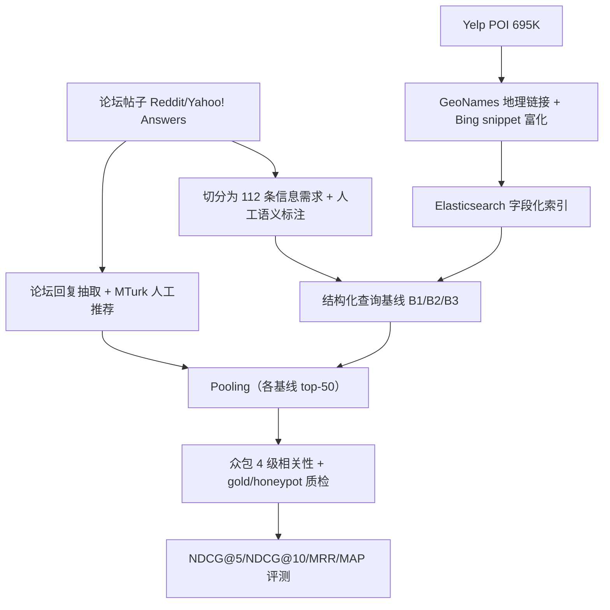

# POINTREC: A Test Collection for Narrative-driven Point of Interest Recommendation (叙事驱动兴趣点推荐测试集)

- **会议/期刊**: SIGIR 2021 (Research and Development in Information Retrieval)
- **作者与机构**: Jafar Afzali, Aleksander Mark Drzewiecki, Krisztian Balog (University of Stavanger)
- **推荐链路定位**: 召回（检索式候选生成，无协同信号）
- **研究方向**: 时空轨迹与 POI 本地生活推荐 / 冷启动与长尾推荐
- **论文原文**: [https://arxiv.org/abs/2105.09204v1](https://arxiv.org/abs/2105.09204v1)
- **开源代码**: [https://github.com/iai-group/sigir2021-pointrec](https://github.com/iai-group/sigir2021-pointrec)

## TL;DR (1分钟核心速览)

现有 POI 推荐依赖 LBSN 的 user-POI 交互矩阵，在游客/一次性出行这类**零历史、需求以自然语言长文表达**的场景下完全失效；TREC Contextual Suggestions 又要求从用户画像"推断"上下文，导致参赛系统难以真正用上 context。本文提出 POINTREC 测试集：695,053 个跨 23 国的 Yelp POI（链接 GeoNames、Bing snippet 富化）+ 112 条真实论坛需求（人工标注类目/群体/带权约束/正负例），并用「论坛回复 + MTurk + 3 个查询基线 top-50」池化做 4 级众包相关性标注。在池化候选上以 NDCG@5 为主指标，最强结构化查询基线达 0.6784。

## Background & Motivation (背景与核心矛盾)

- **主流范式**: LBSN 上的 POI 推荐以矩阵分解/embedding 建模 user-POI check-in 矩阵，再叠加地理、时间、社交信号；评估数据多为研究者自行爬取的 Gowalla / Foursquare 快照。
- **前人局限 1（场景失效）**: 用户-POI 矩阵极度稀疏，且当用户是首次到访的游客时交互数为零，协同过滤在原理上不可用。
- **前人局限 2（上下文不可用）**: TREC-CS 只给出 city / trip type / duration 等 5 个维度，偏好需从画像推断，官方总结直言"很少有成功队伍真正把 context 用起来"。
- **核心洞察 (Key Insight)**: 与其让系统"猜"上下文，不如把上下文与约束**显式写进自然语言叙事**并结构化标注出来——困难从"偏好推断"转移到"自然语言理解 + 约束满足"。
- **本文切入点**: 以真实论坛帖子为信息需求源、以富元数据 POI 库为候选库，构造可复用的 narrative-driven 冷启动 POI 检索/推荐评测资源，并给出可复现的内容检索基线。

## Method (核心方法设计)

### 1. 整体框架 (Overall Architecture)

整个资源构建是一条"需求—物品—标注"三段式流水线：先从 Reddit（88 条）与 Yahoo! Answers（24 条）抓取真实求推荐帖，按主类目切分为 112 条独立信息需求并做人工语义标注（主/子类目、Group、Constraints、正负例、Request、City）；并行地从 Yelp Fusion API 采集 695K POI，用 RestCountries/GeoNames 补齐国家-城市编码、用 Bing Web Search 为需求涉及城市生成 snippet 短描述；随后把 POI 每个属性建成独立字段索引进 Elasticsearch，以三种结构化查询生成"自动推荐"，与论坛回复、MTurk 人工推荐一起池化，交给众包做 4 级相关性判定，最终形成可算 NDCG/MRR/MAP 的测试集。

### 2. 关键设计拆解 (Key Designs)

1. **带权约束本体 (Weighted Qualifier Schema)**：自由文本偏好无法直接参与计算，本文将其规范化为 $(\text{qualifier},\text{constraint})$对，qualifier 取固定 6 档并赋权$w\in\{3,2,1,-1,-2,-3\}$（MUST=3、SHOULD=2、NICE_TO=1、NICE_TO_NOT=−1、SHOULD_NOT=−2、MUST_NOT=−3），例如"can't cost an arm and leg"被归一为 `MUST_NOT too expensive`。这一层的价值在于把"硬约束 / 软偏好 / 负向偏好"变成可加权、可学习排序的监督信号，同时为后续自动抽取（LLM 信息抽取）提供现成 schema。

2. **双源池化 + 抗噪众包标注**：分级相关性若只池化自动结果会低估人工推荐，只池化人工结果又会让基线"必胜"。本文池化为 $\mathcal{P}(q)=\text{Forum}(q)\cup\text{MTurk}(q)\bigcup_{k\in\{B1,B2,B3\}}\text{Top50}_{k}(q)$，每个「需求-POI」对由 ≥3 名工人打 0–3 分（3=位置/类目/约束全满足），分歧达 2 分则追加 2 人，最终$\text{rel}(d,q)=\operatorname{mode}\{r_1,\dots,r_n\}$。质量上用 gold answer + honeypot（注入异类目错项）双重校验，错误率 >30% 的工人整批作废，并要求 >1000 HITs、通过率 >95%。

3. **三档结构化查询基线与评测口径**：基于 Elasticsearch 的字段化索引构造三档查询，可抽象为
$s_{\text{B1}}(d,q)=\mathbb{I}[\text{cat}_{\text{main}}(d)=c_q]\cdot\big(1+\alpha\,\mathbb{I}[\text{sub}(d)\in S_q]\big)\cdot\big(1+\beta\,\mathbb{I}[\text{city}(d)=\text{city}_q]\big)$，
B2 丢弃类目、仅把 Request 与 Constraints 文本 match 到 snippet 字段，B3 为二者叠加（最严格）。三者共用 city 奖励项 $\beta$；本文未引入任何可学习参数，训练与负采样不适用，推理即一次倒排检索，开销可忽略。

## Experimental Setup & Evaluation Protocol (实验设置与评估协议)

- **资源与预处理**:

| 资源 / 子集 | 规模 | 覆盖范围 | 说明 |
| :--- | :---: | :--- | :--- |
| POI 库 | 695,053 | 23 国 / 2K+ 城市 | Yelp Fusion API，字段含类目、评分、价格、地址、邮编 |
| 信息需求 | 112 | AL 27 / AE 30 / RF 30 / NL 25 | Reddit 88 + Yahoo! Answers 24，均来自真实用户 |
| 相关性判断池 | 112 × ≈150 候选 | 4 级量表 0–3 | 3 基线 top-50 + 论坛回复 + MTurk 各 5 条 |
| 地理/文本富化 | 需求所涉城市全量 | GeoNames + Bing | 城市定义：人口 ≥1000，共识别 138,088 个城市 |

- **数据划分与防穿越 (Splitting Strategy)**: **无 train/dev/test 划分**——112 条需求整体作为测试集，POI 库整体作为候选库；因不提供任何用户历史，不存在时间戳穿越问题，但也因此无法做有监督训练。
- **排名评测协议 (Ranking Protocol)**: 采用 **Pool-based Ranking**（非严格 Full-Ranking）：候选集为池化集合，未入池的 POI 在指标计算中按不相关处理，存在 pool bias；主指标 NDCG@5（沿用 TREC-CS 惯例）与 NDCG@10 用分级增益，MAP 与 MRR 采用二值口径（**仅 relevance=3 视为相关**），因此二者系统性偏低。
- **对比基线与超参**: 仅 3 个 Elasticsearch 结构化查询基线（B1 类目、B2 文本、B3 组合），无 embedding 维度、无显著性检验，α、β 为人工设定。

## Key Experimental Results (实验关键数据)

### 1. 主实验对比 (Main Results)

| 系统 | 类目过滤 | 约束/请求匹配 | NDCG@5 | NDCG@10 | MRR | MAP |
| :--- | :---: | :---: | :---: | :---: | :---: | :---: |
| Baseline 2（纯文本） | ✗ | ✓ | 0.4109 | 0.3979 | 0.2814 | 0.0667 |
| Baseline 1（纯类目） | ✓ | ✗ | 0.6389 | 0.5812 | **0.5812** | **0.3304** |
| Baseline 3（组合） | ✓ | ✓ | **0.6784** | **0.6573** | 0.5535 | 0.2506 |
| Improv. (B3 vs B1) | | | +6.2% | +13.1% | −4.8% | −24.2% |
| Improv. (B1 vs B2) | | | +55.5% | +46.1% | +106.6% | +395.4% |

### 2. 消融实验 (Ablation / 因子分解)

论文未做常规 w/o 消融，但三档基线恰构成 2×2 因子实验（类目 × 文本约束），第四个单元「无类目且无文本」缺失：

| 配置 | 类目 | 文本约束 | NDCG@5 | Δ vs 仅类目 |
| :--- | :---: | :---: | :---: | :---: |
| 仅文本 (B2) | ✗ | ✓ | 0.4109 | −0.2280 |
| 仅类目 (B1) | ✓ | ✗ | 0.6389 | — |
| 类目 + 文本 (B3) | ✓ | ✓ | 0.6784 | +0.0395 |
| 无类目无文本 | ✗ | ✗ | 未报告 | — |

### 3. 关键实验发现 (Key Findings)

1. **类目仍是压倒性主信号**：B1 相对 B2 在 NDCG@5 上提升 55.5%（0.6389 vs 0.4109）、MAP 提升近 5 倍（0.3304 vs 0.0667），说明在零历史叙事场景中，"先按主/子类目收窄候选"比"用自然语言约束做全库文本匹配"有效得多——后者几乎只贡献噪声。
2. **约束文本匹配呈"分级指标涨、二值指标跌"的背离**：B3 相对 B1 在 NDCG@5 上 +6.2%、NDCG@10 上 +13.1%，但 MAP 由 0.3304 掉到 0.2506（−24.2%）；图 3 的逐需求差值也显示约一半需求上 B1 反而更优。归因是 Elasticsearch 的 should-match 只验证 snippet 中"提到 good service"这类表层词命中，扩大了召回却把真正的 level-3 强相关项挤出前列，**约束必须建模为满足度而非关键词命中**。
3. **头部排序质量优于尾部稳定性**：B3 的 NDCG@5 与 NDCG@10 差距（0.6784→0.6573）明显小于 B1（0.6389→0.5812），说明加入约束匹配后前 5 位排序更"扎实"；但 112 条需求、每类仅 25–30 条，per-need 波动极大（图 3 条形正负交错），任何单点结论都需要多次随机池化才能稳健复现。

## Highlights & Limitations (亮点、对比与审稿批判)

- **与代表作对比 (vs. Prior Work)**: 相对 TREC-CS，本文需求是**真实意图**而非众包虚构场景，上下文以自然语言显式给出而非从画像推断，POI 覆盖 23 国而非仅北美城市，且刻意剥离用户历史形成严格冷启动；相对 LBSN 系矩阵分解/embedding 工作，本文完全放弃协同信号，把任务重定义为「结构化约束 + 文本语义」的检索问题。
- **可迁移亮点**: (1) 六档带权 qualifier 本体可直接作为 LLM 结构化抽取或约束满足重排的 schema，把叙事文本转成可计算约束；(2) 池化标注中的 gold + honeypot 双校验与"错误率 >30% 整批作废"策略，是众包分级相关性标注的低成本质量范式。
- **审稿级局限批判**: (1) 规模与协议双重受限——112 条需求、池化候选仅约 150/需求且未入池按不相关处理，存在 pool bias，同时缺少 train/dev/test 划分，无法支撑有监督方法或显著性检验；(2) 基线过弱且缺失关键单元——仅 3 个零参数 Lucene 结构化查询，既无 BM25/稠密检索/learning-to-rank，也无任何 LLM 或约束满足求解器，0.6784 的"最强基线"不足以刻画任务天花板，约束匹配的负向效果更可能源于实现而非任务本质。

## Rating (四维评分)

- **方法创新性 (Novelty)**: ⭐⭐⭐ （作为资源型论文，创新在"叙事驱动 + 带权约束本体 + 严格冷启动"的问题定义与标注体系，而非算法机制）
- **评估协议与实验扎实度 (Protocol & Experiments)**: ⭐⭐ （众包分级标注与 hive 质检流程规范，但无划分、Pool-based 而非 Full-Ranking、仅 3 个弱基线且无显著性检验）
- **写作与数学规范度 (Clarity & Rigor)**: ⭐⭐⭐⭐ （元数据字段、标注指南、池化与指标口径交代得非常清楚，资源可直接复用，但基线查询未形式化给出）
- **工业落地与复现价值 (Industrial & Practical Value)**: ⭐⭐⭐⭐ （全量数据与基线代码开源，索引即推理、零训练开销，适合作为对话式/LLM 旅行助手的离线评测基准）

