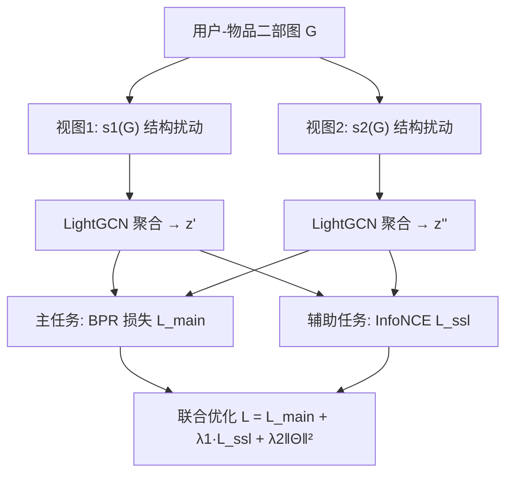
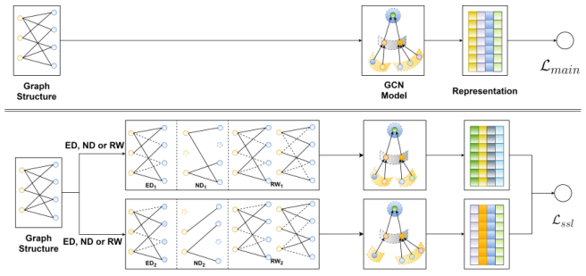
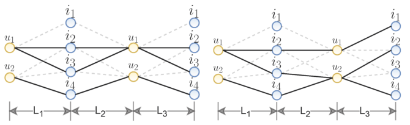

# Self-supervised Graph Learning for Recommendation (面向推荐的自监督图学习)

- **会议/期刊**: SIGIR 2021
- **作者与机构**: Jiancan Wu, Xiang Wang, Fuli Feng, Xiangnan He, Liang Chen, Jianxun Lian, Xing Xie（中科大 / 新加坡国立大学 / 中山大学 / 微软亚洲研究院）
- **推荐链路定位**: 召回（图协同过滤表征学习）
- **研究方向**: 自监督对比学习与交互去噪 / 图神经网络推荐
- **论文原文**: [arxiv.org/abs/2010.10783v4](https://arxiv.org/abs/2010.10783v4)
- **开源代码**: [github.com/wujcan/SGL](https://github.com/wujcan/SGL)

## TL;DR (1分钟核心速览)

本文针对 GCN 推荐的两大痼疾——**高度节点主导表征、长尾物品被牺牲**，以及**邻域聚合放大交互噪声**——提出 SGL：把「同一节点在不同子图视图下的表征一致性」当作辅助自监督任务，与 BPR 主任务联合优化。作者在 LightGCN 上实现三种视图算子（节点丢弃 / 边丢弃 / 随机游走），并理论证明 InfoNCE 温度 $\tau$ 会**自动挖掘困难负样本**。在 Yelp2018 / Amazon-Book / Alibaba-iFashion 三个基准上，采用 `Full-Ranking` 全库排序、Recall@20 相对最强基线提升 **5.63% / 9.13% / 4.45%**，且长尾组贡献显著回升、抗噪性明显优于 LightGCN。

## Background & Motivation (背景与核心矛盾)

- **主流范式**: 以 NGCF / LightGCN / PinSage 为代表的 GCN 协同过滤，通过邻域聚合把多跳邻居融入节点表征，在仅用 ID 特征时已取得 SOTA。
- **前人局限 1（度偏置）**: 观测交互呈幂律分布，高度物品在聚合与监督损失中出现更频繁，导致 LightGCN 严重偏向热门物品；实验显示仅占物品空间 0.22%–0.83% 的 Top-10% 热门组贡献了 39.7%–51.9% 的 Recall。
- **前人局限 2（噪声脆弱）**: 隐式反馈天然含假阳性（误点击），而邻域聚合会进一步放大单条边的影响，使表征对噪声交互高度敏感。
- **核心洞察 (Key Insight)**: 推荐只用「已观测边」做监督，而**图结构本身（邻接矩阵的扰动空间）就是一片未被利用的无标注数据**；若对同一节点生成多个结构视图并做自判别，即可在不引入额外参数的前提下补充监督信号。
- **本文切入点**: 把 CV/NLP 中成熟的对比式 SSL 迁移到二部交互图，用「子图视图一致性」同时抑制度偏置与噪声边。

## Method (核心方法设计)

### 1. 整体框架 (Overall Architecture)

SGL 是**模型无关**的双任务框架：主干仍是 LightGCN 的 $L$层邻域聚合，输出用户/物品的读出表征$\mathbf{z}_u$；在每个 epoch 开始时，对原图$\mathcal{G}$独立施加两次随机结构扰动$s_1,s_2\sim\mathcal{S}$，得到两张视图，各自跑一遍共享参数的 GCN 得到$\mathbf{z}'_u,\mathbf{z}''_u$。上层支路用 BPR 损失做推荐监督，下层支路用 InfoNCE 拉近同一节点的两视图、推远不同节点，二者按权重$\lambda_1$ 联合反向传播。推理阶段完全退化为原 LightGCN，**零额外参数、零额外推理延迟**。

<figure class="paper-figure" markdown="span">
  <figcaption>图 1：SGL 的整体系统框架。上层展示了主监督学习任务的工作流程，底层展示了带图结构增强的 SSL 任务的工作流程。</figcaption>
</figure>

### 2. 关键设计拆解 (Key Designs)

1. **三种图结构增强算子（视图生成）**：痛点在于 ID 特征离散、实例间强耦合，无法套用图像裁剪/旋转。作者改为直接在邻接矩阵上做随机掩码，统一写作 $\mathbf{Z}^{(l)}_1=H(\mathbf{Z}^{(l-1)}_1,s_1(\mathcal{G}))$、$\mathbf{Z}^{(l)}_2=H(\mathbf{Z}^{(l-1)}_2,s_2(\mathcal{G}))$。**Node Dropout** 以概率$\rho$整体删除节点及其连带边，逼迫模型不依赖个别枢纽节点，缓解度偏置；**Edge Dropout** 以概率$\rho$独立丢弃边，使表征只由部分局部连接决定，直接对冲噪声边；**Random Walk** 让掩码逐层变化（$\mathbf{M}^{(l)}_1,\mathbf{M}^{(l)}_2$ 层敏感），为低度节点在深层重新连出高阶通路——这正是稀疏数据集上 RW 优于 ED 的原因。

<figure class="paper-figure" markdown="span">
  <figcaption>图 2：三层 GCN 模型中高阶连通性的一个简单示例；左：Edge Dropout，右：Random Walk。对于 Random Walk，与 Edge Dropout 不同，图结构在各层之间持续变化。因此，节点 𝑢1 和 𝑖1 之间存在一条在 Edge Dropout 中不存在的三阶路径。</figcaption>
</figure>

2. **InfoNCE 自判别 + 困难负样本自动挖掘**：视图构造完成后，把同一节点的两个视图视为正对、任意不同节点视为负对，采用余弦相似度与温度 $\tau$：

$$\mathcal{L}^{user}_{ssl}=\sum_{u\in\mathcal{U}}-\log\frac{\exp(s(\mathbf{z}'_u,\mathbf{z}''_u)/\tau)}{\sum_{v\in\mathcal{U}}\exp(s(\mathbf{z}'_u,\mathbf{z}''_v)/\tau)}$$

对梯度做逐项展开后，单个负节点 $v$的梯度范数正比于$g(x)=\sqrt{1-x^2}\exp(x/\tau)$，其中$x=\mathbf{s}'^{\top}_u\mathbf{s}''_v\in[-1,1]$为相似度。求导可得极值点$x^*=(\sqrt{\tau^2+4}-\tau)/2$：当$\tau=0.1$时$x^*\approx0.9$且$g(x^*)\approx e^8$，即**最相似（最难区分）的负样本获得压倒性梯度**；当$\tau=1$ 时曲线平坦，易/难负样本贡献趋同。这从梯度层面解释了 SGL 为何收敛更快、表征更具判别性。

3. **训练目标、负采样与推理开销**：总损失 $\mathcal{L}=\mathcal{L}_{main}+\lambda_1\mathcal{L}_{ssl}+\lambda_2\|\Theta\|_2^2$，主任务沿用 BPR（单负样本），辅助任务以**全库其余节点**为负（实践中可用 batch 内节点近似，性能几乎无损）。训练复杂度由邻接归一化与 InfoNCE 两部分构成，全库版为$O(|\mathcal{E}|d(2+|\mathcal{V}|)s)$，batch 版降至$O(|\mathcal{E}|d(2+2B)s)$；在 Yelp2018 上实测每 epoch 由 LightGCN 的 15.2s 增至 60.6s（约 3.7×），但收敛所需 epoch 从 720 骤降至 18，**总训练时间反而大幅缩短**，推理开销不变。

## Experimental Setup & Evaluation Protocol (实验设置与评估协议)

- **数据集与预处理**: Yelp2018 与 Amazon-Book 沿用 `10-core` 过滤；Alibaba-iFashion 随机采样 30 万用户并保留其全部穿搭交互。

| 数据集 | #Users | #Items | #Interactions | 密度 | 特征/场景说明 |
| :--- | :---: | :---: | :---: | :---: | :--- |
| Yelp2018 | 31,668 | 38,048 | 1,561,406 | 0.00130 | 本地商户点评，仅 ID 特征 |
| Amazon-Book | 52,643 | 91,599 | 2,984,108 | 0.00062 | 图书购买，仅 ID 特征 |
| Alibaba-iFashion | 300,000 | 81,614 | 1,607,813 | 0.00007 | 时尚穿搭，极稀疏 |

- **数据划分与防穿越 (Splitting Strategy)**: 沿用 NGCF/LightGCN 的**比例划分 7:1:2**（训练/验证/测试），非时间戳切分。
- **排名评测协议 (Ranking Protocol)**: 采用无偏 `Full-Ranking`（对测试用户全部未交互物品排序），报告 Recall@20 与 NDCG@20，全程不采样候选集。
- **对比基线与超参设置**: 基线含 NGCF、LightGCN、Mult-VAE、DNN+SSL；SGL 三个变体 SGL-ND / SGL-ED / SGL-RW 均叠加于 LightGCN。共享超参（嵌入维度、层数、正则）继承 LightGCN 最优值，独有超参网格：$\lambda_1\in\{0.005,\dots,1.0\}$、$\tau\in\{0.1,0.2,0.5,1.0\}$、$\rho\in\{0,0.1,\dots,0.5\}$；Adam，lr=0.001，batch=2048，并做$p<0.05$ 显著性检验。

## Key Experimental Results (实验关键数据)

### 1. 主实验对比 (Main Results)

| 模型 | Yelp Recall | Yelp NDCG | Amazon Recall | Amazon NDCG | iFashion Recall | iFashion NDCG |
| :--- | :---: | :---: | :---: | :---: | :---: | :---: |
| NGCF | 0.0579 | 0.0477 | 0.0344 | 0.0263 | 0.1043 | 0.0486 |
| Mult-VAE | 0.0584 | 0.0450 | 0.0407 | 0.0315 | 0.1041 | 0.0497 |
| LightGCN | 0.0639 | 0.0525 | 0.0411 | 0.0315 | 0.1078 | 0.0507 |
| DNN+SSL | 0.0483 | 0.0382 | 0.0438 | 0.0337 | 0.0712 | 0.0325 |
| **SGL-ED** | **0.0675** | **0.0555** | **0.0478** | **0.0379** | **0.1126** | **0.0538** |
| Improv.% | +5.63% | +5.71% | +9.13% | +12.46% | +4.45% | +6.11% |
| $p$-value | 5.92e-8 | 1.89e-8 | 5.07e-10 | 3.63e-10 | 3.34e-8 | 4.68e-10 |

层数敏感性上，3 层时 SGL-ED 在 Amazon-Book 达 Recall 0.0478（+16.6%）、NDCG 0.0379（+19.2%），在 Yelp 达 0.0675（+5.6%）；且在 1→3 层加深过程中 SGL 持续受益，而 LightGCN 会出现过平滑导致的性能回落。

### 2. 消融实验 (Ablation Study)

| 变体 | Yelp Recall | Yelp NDCG | Amazon Recall | Amazon NDCG | 说明 |
| :--- | :---: | :---: | :---: | :---: | :--- |
| **SGL-ED** | **0.0675** | **0.0555** | **0.0478** | **0.0379** | 完整模型（3 层） |
| w/o ED → SGL-ND | 0.0644 | 0.0528 | 0.0440 | 0.0346 | 节点丢弃替代 |
| w/o ED → SGL-RW | 0.0667 | 0.0547 | 0.0457 | 0.0356 | 随机游走替代 |
| w/o 联合训练 → SGL-pre | 0.0653 | 0.0533 | 0.0429 | 0.0333 | 仅预训练+微调 |
| w/o 全库负样本 → SGL-ED-batch | 0.0670 | 0.0549 | 0.0472 | 0.0374 | batch 内负样本 |
| w/o 区分节点类型 → SGL-ED-merge | 0.0671 | 0.0547 | 0.0464 | 0.0368 | 用户物品混作负样本 |

### 3. 关键实验发现 (Key Findings)

1. **收益主要来自长尾而非热门**：按流行度把物品十等分后，LightGCN 的 Top-10% 热门组在三个数据集上贡献了 39.72% / 39.92% / 51.92% 的 Recall，SGL-ED 将其压至 36.27% / 29.15% / 35.07%，说明自监督信号确实为低度物品补足了稀疏监督。
2. **抗噪性可量化**：在训练集注入 5%–20% 假阳性交互后，SGL-ED 的性能下降曲线始终低于 LightGCN 且差距随噪声比例扩大；Amazon-Book 上即便注入 20% 噪声，SGL 仍优于无噪声的 LightGCN，直接验证了边丢弃视图的正则化本质。
3. **收敛加速来自困难负样本**：SGL 在 Yelp/Amazon 上分别于第 18/16 个 epoch 达最优，而 LightGCN 需 720/700 个 epoch；温度消融显示 $\tau=1.0$收敛慢、$\tau=0.1$梯度被少数负样本垄断，$\tau\in[0.1,1.0]$为推荐区间，与理论分析的$x^*(\tau)$ 曲线完全吻合。

## Highlights & Limitations (亮点、对比与审稿批判)

- **与代表作对比 (vs. Prior Work)**: 相比 NGCF/LightGCN 的纯监督范式，SGL 是正交的**训练范式增强**而非新网络，可直接插拔；相比 DNN+SSL 在 ID 嵌入上做特征掩码，SGL 把增强施加于**图结构**这一真正承载协同信号的对象，因此在无物品特征的纯 CF 场景下优势明显（Yelp 上 0.0675 vs 0.0483）。
- **可迁移亮点**: (1) 「逐层变化的结构掩码」这一 Random Walk 式增强，可迁移到任何多层 GNN 推荐模型以缓解低度节点断连；(2) 温度 $\tau$与困难负样本贡献$g(x)$ 的解析关系，可作为设计对比损失时的调参先验，避免盲搜。
- **审稿级局限批判**: (1) 全库负样本版本训练复杂度含 $O(|\mathcal{V}|)$项，尽管收敛快，但在千万级节点工业场景仍需依赖 batch 近似，而近似带来的增益损失未在大规模数据上验证；(2) 评估仅限三个 `10-core` 公开基准与离线 `Full-Ranking`，缺少线上 A/B 与真正的时序切分，对真实分布漂移下的鲁棒性证据不足；(3) 三个算子的丢弃率$\rho$ 对稀疏度差异较大的数据集（iFashion vs Yelp）较敏感，文中未给出自适应选取策略。

## Rating (四维评分)

- **方法创新性 (Novelty)**: ⭐⭐⭐⭐ （把图对比学习引入推荐，并用 $g(x)=\sqrt{1-x^2}\exp(x/\tau)$ 的梯度解析严格证明温度控制困难负样本挖掘，理论支撑扎实）
- **评估协议与实验扎实度 (Protocol & Experiments)**: ⭐⭐⭐⭐ （无偏 Full-Ranking + 三数据集 + $p$-value 显著性检验 + 长尾分桶与噪声注入两套诊断实验，消融覆盖完整；扣分在于缺少时序切分与线上验证）
- **写作与数学规范度 (Clarity & Rigor)**: ⭐⭐⭐⭐ （三种算子定义简洁统一、复杂度分析逐项列出并给出实测耗时对照，梯度推导链条清晰；$\tau$与$x^*$ 的关系图直观）
- **工业落地与复现价值 (Industrial & Practical Value)**: ⭐⭐⭐⭐⭐ （模型无关、零额外参数、推理零延迟，代码已开源，且训练 epoch 从 720 降至 18，工程性价比极高）

