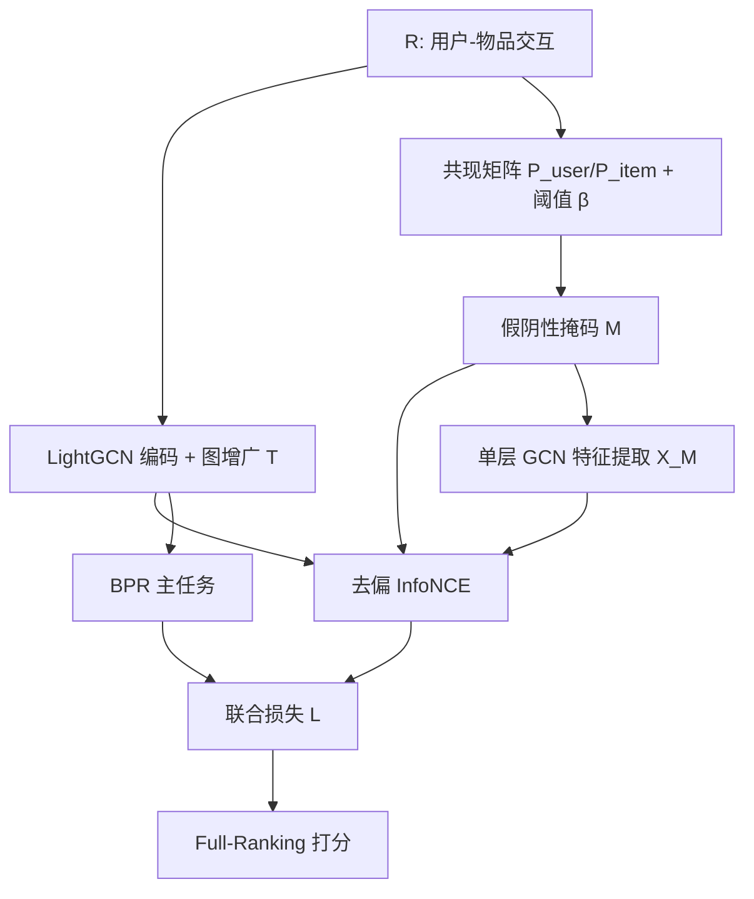
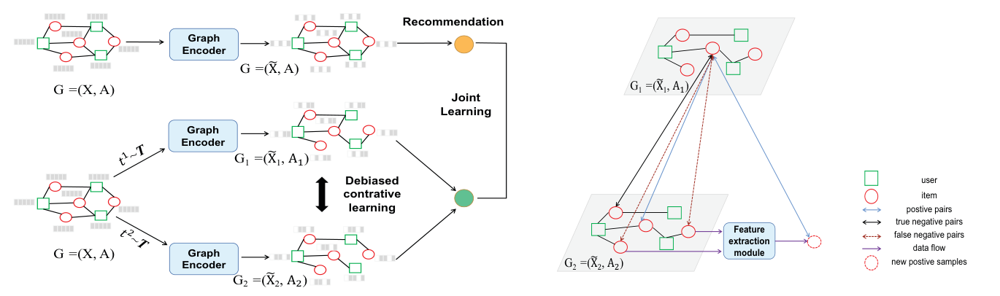

# Topology-aware Debiased Self-supervised Graph Learning for Recommendation (面向推荐的拓扑感知去偏自监督图学习)

- **会议/期刊**: SIGIR 2021
- **作者与机构**: Lei Han, Hui Yan, Zhicheng Qiao；南京理工大学
- **推荐链路定位**: 召回
- **研究方向**: 自监督对比学习与交互去噪 / 图神经网络与知识图谱推荐
- **论文原文**: [https://arxiv.org/abs/2310.15858v1](https://arxiv.org/abs/2310.15858v1)
- **开源代码**: [https://github.com/malajikuai/TDSGL](https://github.com/malajikuai/TDSGL)

## TL;DR (1分钟核心速览)

针对 SGL 类图对比学习随机负采样把语义相近用户/物品误当负样本的问题，TDSGL 用交互共现矩阵 $P_{\text{user}}=RR^{\top}$、$P_{\text{item}}=R^{\top}R$ 构造拓扑假阴性掩码，并用单层 GCN 将假阴性聚合为辅助正样本。在 Yelp2018、Movielens-1M、LastFM 的 Full-Ranking Recall@20/NDCG@20 下，相对最佳 SGL 变体 Recall 提升约 3.1%/0.6%/2.6%。

## Background & Motivation (背景与核心矛盾)

- **主流范式**: LightGCN 通过轻量图传播建模高阶协同信号，SGL 进一步引入图增广对比学习作为辅助任务，缓解稀疏与过平滑。
- **前人局限**: 随机负采样忽略用户/物品语义结构：共现高的节点被当作负样本，梯度会强行拉开本应接近的节点；同时假阴性本身蕴含潜在正样本信息，却被直接丢弃。
- **核心洞察 (Key Insight)**: 用户-物品交互共现度能反映购买意图与物品属性，比噪声嵌入空间更可靠；高共现对是潜在正样本，低共现对才是真负样本。
- **本文切入点**: 用拓扑共现掩码剔除假阴性，再把假阴性经一层 GCN 聚合为弱正样本，改造 InfoNCE 的分子与分母。

## Method (核心方法设计)

### 1. 整体框架 (Overall Architecture)

输入用户-物品二部图 $R$，主任务用 LightGCN 传播与 BPR 优化；辅助任务对图做 edge/node dropout 或 random walk 得两视图。由$R$构造用户/物品共现矩阵，以阈值$\beta$生成假阴性掩码$M$；去偏 InfoNCE 只在$M=1$的候选上归一化，并用单层 GCN 在$M$ 上聚合假阴性特征作为辅助正样本。训练联合 BPR 与去偏对比损失，推理仅保留 LightGCN 打分。

<figure class="paper-figure" markdown="span">
  <figcaption>图2. 所提 TDSGL 的框架(a)：上层展示推荐任务的工作流程，下层展示带有图结构数据增强 T 的去偏对比学习任务的工作流程。(b) 与传统基于 GCL 的 CF 相比，TDSGL 不仅有效减少了负采样过程中的假阴性（红色虚线表示 TDSGL 不再将这些样本视为负样本），还设计了一个基于 GCN 的特征提取模块，将其转化为辅助正样本。</figcaption>
</figure>

### 2. 关键设计拆解 (Key Designs)

1. **拓扑假阴性掩码**：随机负采样把共现高的用户/物品当负样本，梯度会惩罚本应接近的节点。本文用 $P_{\text{user}}=RR^{\top}$、$P_{\text{item}}=R^{\top}R$度量语义相似度，令$M_{\text{user}}(u,v)=\mathbb{I}(P_{\text{user}}(u,v)<\beta)$，只保留低相似候选入分母。去偏损失为$L_{\text{dbs\_user}}=-\log \frac{\exp(s(\mathbf{x}'_u,\mathbf{x}''_u)/\tau)}{\sum_{v\in U}M_{\text{user}}(u,v)\exp(s(\mathbf{x}'_u,\mathbf{x}''_v)/\tau)}$。物理直觉：共现拓扑比噪声嵌入更稳定，先剔除“伪负”可避免语义冲突。

2. **假阴性转辅助正样本**：仅删除假阴性会浪费相似节点信息，且各节点假阴性数量不均衡。本文把 $M_{\text{user}}$当邻接矩阵，做一层 GCN：$\mathbf{X}_{M_u}=D_M^{-1/2}M_{\text{user}}D_M^{-1/2}\mathbf{X}_u^{(0)}$，并把$s(\mathbf{x}'_u,\mathbf{x}_{M_u})$加入 InfoNCE 分子：$L_{\text{fdbs\_user}}=-\log \frac{\exp(s(\mathbf{x}'_u,\mathbf{x}''_u)/\tau+s(\mathbf{x}'_u,\mathbf{x}_{M_u})/\tau)}{\sum_{v}M_{\text{user}}(u,v)\exp(s(\mathbf{x}'_u,\mathbf{x}''_v)/\tau)}$。它把相似用户/物品的聚合特征作为弱正样本，缓解分布不均。

3. **训练目标、负采样与推理效率**：总损失 $L=L_{\text{rec}}+\lambda L_{\text{fdbs\_ssl}}+\mu\|\Theta\|_2^2$，$L_{\text{fdbs\_ssl}}=L_{\text{fdbs\_user}}+L_{\text{fdbs\_item}}$；主任务仍用随机未交互物品做 BPR 负采样，对比分支无额外可学习参数。推理只走 LightGCN，不增加打分开销；训练主要开销来自共现矩阵与单层 GCN，规模大时需稀疏化或采样。

## Experimental Setup & Evaluation Protocol (实验设置与评估协议)

- **数据集与预处理**:

| 数据集 | #Users | #Items | #Interactions | 稀疏度 | 场景说明 |
| :--- | :---: | :---: | :---: | :---: | :--- |
| Yelp2018 | 31,668 | 38,048 | 1,561,406 | 99.87% | 本地生活商户 |
| Movielens-1M | 6,022 | 3,043 | 895,699 | 95.11% | 电影评分 |
| LastFM | 1,891 | 15,438 | 92,834 | 99.68% | 音乐艺人 |

- **数据划分与防穿越**: 沿用 LightGCN/SGL 的 80/10/10 比例划分，非冷启动划分。
- **排名评测协议**: 无偏 Full-Ranking，对全部未交互物品排序，报告 Recall@20 与 NDCG@20。
- **对比基线与超参**: BPRMF、NGCF、DGCF、LightGCN、LR-GCCF、SGL-ND/ED/RW；嵌入维度 $d=64$，五次重复取最优，未报告显著性$p$ 值。

## Key Experimental Results (实验关键数据)

### 1. 主实验对比 (Main Results)

| 方法 | Yelp R@20 | Yelp N@20 | ML-1M R@20 | ML-1M N@20 | LastFM R@20 | LastFM N@20 |
| :--- | :---: | :---: | :---: | :---: | :---: | :---: |
| BPRMF | 0.0307 | 0.0237 | 0.2389 | 0.2268 | 0.2262 | 0.2345 |
| NGCF | 0.0555 | 0.0474 | 0.2361 | 0.2222 | 0.2470 | 0.2470 |
| DGCF | 0.0640 | 0.0522 | 0.2620 | 0.2481 | 0.2382 | 0.2420 |
| LightGCN | 0.0649 | 0.0530 | 0.2419 | 0.2280 | 0.2417 | 0.2463 |
| LR-GCCF | 0.0558 | 0.0343 | 0.2231 | 0.2124 | 0.2484 | 0.2540 |
| SGL-ED | 0.0674 | 0.0555 | 0.2724 | 0.2570 | 0.2674 | 0.2827 |
| SGL-RW | 0.0667 | 0.0547 | 0.2713 | 0.2559 | 0.2682 | 0.2833 |
| **TDSGL** | **0.0695** | **0.0570** | **0.2739** | **0.2587** | **0.2752** | **0.2904** |

相对最佳基线，TDSGL 在 Yelp2018/ML-1M/LastFM 的 Recall 提升约 **+3.1%/+0.6%/+2.6%**，NDCG 提升 **+2.7%/+0.7%/+2.5%**（相对值）。

### 2. 消融实验 (Ablation Study)

| 变体 | Yelp R | Yelp N | LastFM R | LastFM N |
| :--- | :---: | :---: | :---: | :---: |
| SGL | 0.0674 | 0.0555 | 0.2682 | 0.2833 |
| TDSGL(nl)：非线性 GCN | 0.0685 | 0.0563 | **0.2757** | **0.2906** |
| TDSGL(nl+w)：非线性+变换 | 0.0684 | 0.0562 | 0.2742 | 0.2900 |
| **TDSGL：线性 GCN** | **0.0695** | **0.0570** | 0.2756 | 0.2905 |

图3 中去除特征提取模块（-TF）或假阴性筛选（-GIF）均低于完整模型，但仍高于 SGL，说明两组件各自有效且互补。

### 3. 关键实验发现 (Key Findings)

1. **稠密图上增益收窄**：Yelp/LastFM Recall 相对提升 3.1%/2.6%，ML-1M 仅 0.6%，说明共现阈值在稠密图更难区分假阴性；这也解释了作者需按数据集调 $\beta$。
2. **特征空间负挖掘失效**：SGL-PGCL、SGL-DGCL、SGL-SIM 在 ML-1M 的 Recall 为 0.2187/0.2389/0.2187，均低于 SGL 0.2724；TDSGL 用交互拓扑掩码达到 0.2739，证明行为共现比嵌入相似度更稳。
3. **特征提取模块非越复杂越好**：Yelp 上线性 GCN 0.0695/0.0570 优于非线性 0.0685/0.0563 与加变换 0.0684/0.0562；LastFM 上非线性 0.2757/0.2906 略优，说明需按数据稀疏度选型。

## Highlights & Limitations (亮点、对比与审稿批判)

- **与代表作对比 (vs. Prior Work)**: SGL 把所有不同节点当负样本，TDSGL 用拓扑掩码剔除假阴性并转弱正样本；PGCL/DGCL 依赖特征空间概率或聚类伪标签，TDSGL 直接用交互共现，避免聚类开销与嵌入噪声；LightGCN 只做主任务，TDSGL 仅在训练期加去偏对比分支。
- **可迁移亮点**: 共现掩码可嵌入任意 InfoNCE 类对比损失；把假阴性经一层 GCN 聚合为弱正样本，适合稀疏交互场景的去噪训练。
- **审稿级局限批判**: $\beta$强依赖数据集且敏感，过大退化至 SGL、过小误删真负样本；共现矩阵$O(N^2)$ 存储/计算限制大规模工业图，论文仅三个公开数据集且无线上 A/B 与显著性检验。

## Rating (四维评分)

- **方法创新性 (Novelty)**: ⭐⭐⭐⭐ （拓扑掩码+假阴性转弱正样本的组合简单有效，但本质仍是 InfoNCE 分母与分子改造，理论分析偏少）
- **评估协议与实验扎实度 (Protocol & Experiments)**: ⭐⭐⭐ （三数据集 Full-Ranking 与多基线较完整，但缺少显著性检验、大规模线上验证与更细的稀疏分桶）
- **写作与数学规范度 (Clarity & Rigor)**: ⭐⭐⭐ （公式与流程清晰，但表IV与主表数值略有出入，$\beta$ 数据集相关削弱可复现性）
- **工业落地与复现价值 (Industrial & Practical Value)**: ⭐⭐⭐⭐ （代码开源、推理零额外开销；共现矩阵扩展性需工程优化后才能上大规模）

