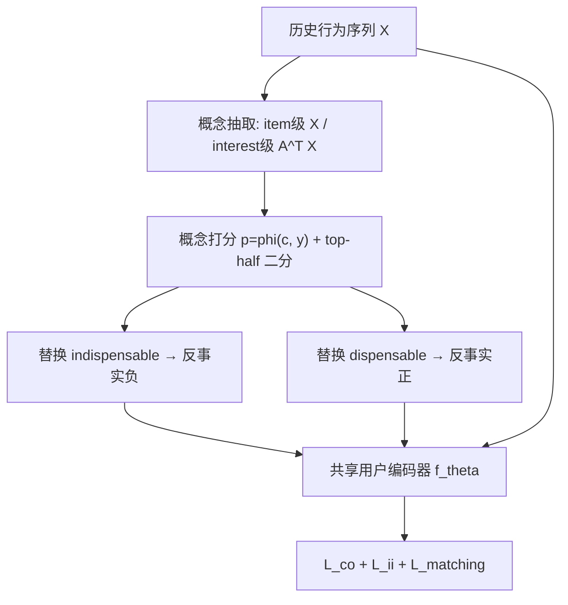

# CauseRec: Counterfactual User Sequence Synthesis for Sequential Recommendation (面向序列推荐的反事实用户序列合成)

- **会议/期刊**: SIGIR 2021
- **作者与机构**: Shengyu Zhang, Dong Yao, Zhou Zhao, Tat-seng Chua, Fei Wu (浙江大学 / 新加坡国立大学)
- **推荐链路定位**: 召回（Deep Candidate Generation / Matching）
- **研究方向**: 序列与会话推荐 / 自监督对比学习与交互去噪
- **论文原文**: [https://arxiv.org/abs/2109.05261v1](https://arxiv.org/abs/2109.05261v1)
- **开源代码**: 暂未开源

## TL;DR (1分钟核心速览)

隐式反馈序列既稀疏又含噪（标题党、促销、位置偏置），仅拟合观测序列会学到脆弱、易被噪声误导的用户表征。CauseRec 把"如果干预观测序列，用户表征会变成什么"形式化为反事实采样：在 item 级与 interest 级概念序列上按分数识别 indispensable/dispensable 概念，替换后分别合成反事实正/负样本，用三重边际损失与目标物品对比损失拉近/推远。在 Amazon Books、Yelp、Gowalla 的用户级划分 + 全库 Top-N 匹配协议下，最强变体 CauseRec-H 相对 ComiRec-SA 提升 NDCG@50 **+22.1%**（Books）、Recall@20 **+8.64%**（Gowalla）。

## Background & Motivation (背景与核心矛盾)

- **主流范式**: 序列召回从 GRU4Rec 的逐步 RNN 编码，到 MIND 用胶囊动态路由、ComiRec 用自注意力抽取多兴趣向量，均只对**观测到的行为序列**建模。
- **前人局限**: ①隐式反馈噪声使"点击 ≠ 兴趣"，严格按步编码反而放大噪声干扰；②用户序列长度远小于百万级物料库，稀疏观测只是真实兴趣分布的极小子集，单一正样本监督极易过拟合。
- **核心洞察**: 观测分布仅是反事实分布的子集。若某概念是"可弃的(dispensable)"，替换它不应改变语义；若为"必需的(indispensable)"，替换它必须造成偏好偏移——这两种替换天然提供**分布外(ood)的硬正样本与硬负样本**，恰好补足稀疏监督。
- **本文切入点**: 不做因果去偏的 re-weighting，而是直接在概念序列上做反事实增广，并把增广结果当作对比学习信号，对任意用户编码器以 model-agnostic 方式插拔。

## Method (核心方法设计)

### 1. 整体框架 (Overall Architecture)

输入用户历史行为序列经 embedding 层得到 $\mathbf{X}\in\mathbb{R}^{t\times d}$；随后两路识别概念并打分——item 级概念即各物品向量本身，interest 级概念由注意力池化得到$\mathbf{C}=\mathbf{A}^{\top}\mathbf{X}$；概念分数以目标物品$\mathbf{y}$为监督信号（无真实兴趣标签下的代理监督）。按分数排序，前半为 indispensable、后半为 dispensable。分别以替换率$r_{rep}$ 替换 indispensable / dispensable 概念，合成**反事实负 / 正**序列，并维护 first-in-first-out 概念记忆队列从当前 mini-batch 出队补齐替换概念（保持长度与相对位置不变）。三组序列共享同一用户编码器得到表征，与原序列表征、目标物品做多目标对比训练。推理阶段只保留骨干编码器，概念识别与替换全部丢弃。

### 2. 关键设计拆解 (Key Designs)

1. **双层概念识别（item 级 + interest 级）**：仅用 item 级概念会因物品语义冗余而难以刻画高阶兴趣。interest 级概念用注意力矩阵显式分组：$\mathbf{A}=\mathrm{softmax}\big(\mathbf{W}_2\tanh(\mathbf{W}_1\mathbf{X}^{\top})\big)^{\top}\in\mathbb{R}^{t\times K}$，概念序列$\mathbf{C}=\mathbf{A}^{\top}\mathbf{X}$，概念分为$\mathbf{P}_{interest}=\mathbf{A}^{\top}\phi_\theta(\mathbf{X},\mathbf{y})$。直觉：$K$个注意力槽把"巧克力与蛋糕同属甜食"这类粗粒度兴趣聚合，降低替换时的语义噪声；实验显示$K=20$最优，$K=4$过粗、$K=30$ 冗余。

2. **反事实替换而非删除**：直接 drop 概念会改变序列长度与相对位置，破坏位置语义。本文按 $r_{rep}$做等长替换：被替换概念从概念记忆队列出队采样，使合成序列既保持原序列结构，又落在观测分布之外。$r_{rep}$是关键权衡——过小则反事实扰动不足（$r_{rep}=0.2$在 Gowalla 上 N@50 降至 0.389），过大则随机替换项引入新噪声（$r_{rep}=0.8$回落至 0.399），原论文中$r_{rep}=0.5$ 时整体效果最好。

3. **训练目标、负采样与推理效率**：匹配损失沿用 sampled softmax（训练时对全库做负采样近似）。对比部分：
$\mathcal{L}_{co}=\sum_{m=1}^{M}\sum_{n=1}^{N}\max\big\{d(\mathbf{x}_q,\mathbf{x}^{+,m})-d(\mathbf{x}_q,\mathbf{x}^{-,n})+\Delta_{co},0\big\}$（L2 距离，$\Delta_{co}=1$）拉近反事实正、推远反事实负；
$\mathcal{L}_{ii}=\sum_{m}\big(1-\tilde{\mathbf{x}}^{+,m}\!\cdot\tilde{\mathbf{y}}\big)+\sum_{n}\max\big(0,\tilde{\mathbf{x}}^{-,n}\!\cdot\tilde{\mathbf{y}}-\Delta_{ii}\big)$（$\Delta_{ii}=0.5$）防止编码器对反事实序列输出平凡解；
总损失 $\mathcal{L}_{cause}=\mathcal{L}_{matching}+\lambda_1\mathcal{L}_{co}+\lambda_2\mathcal{L}_{ii}$（$\lambda_1=\lambda_2=1$，未精调）。**推理零额外开销**：CauseRec-Item 完全不改骨干网络，训练结束即插即用；interest 级变体额外增加注意力参数。

## Experimental Setup & Evaluation Protocol (实验设置与评估协议)

- **数据集与预处理**:

| 数据集 | #Users | #Items | #Interactions | 密度 | 说明 |
| :--- | :---: | :---: | :---: | :---: | :--- |
| Amazon Books | 459,133 | 313,966 | 8,898,041 | 0.00063 | 每用户保留最多 20 条时序行为 |
| Yelp | 31,668 | 38,048 | 1,561,406 | 0.00130 | 商户为 item，`10-core` 过滤 |
| Gowalla | 52,643 | 91,599 | 2,984,108 | 0.00084 | 签到数据，`10-core` 过滤 |

- **数据划分与防穿越**: **用户级 8:1:1 划分**（非 Leave-One-Out）。训练时序列内每个物品均作潜在目标；验证/测试仅用**训练期完全不可见的新用户**，且只取其**前 80% 行为**生成表征、后段行为作 ground-truth，属严格冷启风格泛化测试。
- **排名评测协议**: **Full-Ranking 全库排序**（对全部物品打分取 Top-20/50，无负采样候选集），指标 Recall / NDCG / Hit Rate @20、@50。
- **对比基线与超参**: 基线含 POP、YouTube DNN、GRU4Rec、MIND、ComiRec-DR、ComiRec-SA；物品/用户向量维度 $d=64$，用户编码器为三层 MLP（隐层 256），Adam（lr=0.003/0.005），batch=1024；CauseRec-Item/-Interest 取$N=8,M=1,r_{rep}=0.5$，CauseRec-H 取$N=16,M=2$；显著性用 one-sample t-test（$p<0.05$）。

## Key Experimental Results (实验关键数据)

### 1. 主实验对比 (Main Results)

| 数据集 | 模型 | R@20 | R@50 | N@20 | N@50 | H@20 | H@50 |
| :--- | :--- | :---: | :---: | :---: | :---: | :---: | :---: |
| Books | YouTube DNN | 0.0457 | 0.0731 | 0.0767 | 0.1208 | 0.1029 | 0.1589 |
| Books | GRU4Rec | 0.0406 | 0.0650 | 0.0680 | 0.1037 | 0.0894 | 0.1370 |
| Books | MIND | 0.0486 | 0.0764 | 0.0793 | 0.1223 | 0.1062 | 0.1610 |
| Books | ComiRec-SA | 0.0549 | 0.0847 | 0.0899 | 0.1356 | 0.1140 | 0.1720 |
| Books | ComiRec-DR | 0.0531 | 0.0811 | 0.0918 | 0.1352 | 0.1201 | 0.1758 |
| Books | **CauseRec-H** | **0.0623** | **0.1018** | **0.1051** | **0.1655** | **0.1370** | **0.2113** |
| Books | *Improv.* | *+13.5%* | *+20.2%* | *+14.5%* | *+22.1%* | *+14.1%* | *+20.2%* |
| Yelp | ComiRec-SA | 0.0534 | 0.1101 | 0.1728 | 0.3025 | 0.3249 | 0.5324 |
| Yelp | **CauseRec-H** | **0.0591** | **0.1182** | **0.1830** | **0.3210** | **0.3426** | **0.5605** |
| Yelp | *Improv.* | *+10.7%* | *+7.36%* | *+5.90%* | *+6.12%* | *+5.45%* | *+5.28%* |
| Gowalla | ComiRec-SA | 0.1277 | 0.2072 | 0.2736 | 0.4019 | 0.3838 | 0.5288 |
| Gowalla | **CauseRec-H** | **0.1359** | **0.2251** | **0.2842** | **0.4221** | **0.4042** | **0.5697** |
| Gowalla | *Improv.* | *+6.42%* | *+8.64%* | *+1.39%* | *+5.03%* | *+5.32%* | *+6.39%* |

### 2. 消融实验 (Ablation Study)

以 model-agnostic 的 CauseRec-Item 为对象（@50）：

| 变体 | Yelp R | Yelp N | Yelp H | Gowalla R | Gowalla N | Gowalla H |
| :--- | :---: | :---: | :---: | :---: | :---: | :---: |
| CauseRec-Item | **0.1163** | **0.3179** | **0.5583** | **0.2238** | **0.4123** | **0.5596** |
| w.o. $\mathcal{L}_{co}$ | 0.1169 | 0.3174 | 0.5507 | 0.2153 | 0.4055 | 0.5522 |
| w.o. $\mathcal{L}_{ii}$ | 0.1067 | 0.2983 | 0.5267 | 0.2110 | 0.3968 | 0.5445 |
| Pos Only | 0.1047 | 0.2911 | 0.5115 | 0.2090 | 0.3945 | 0.5398 |
| Neg Only | 0.1024 | 0.2909 | 0.5137 | 0.2053 | 0.3925 | 0.5368 |
| Base Model | 0.0934 | 0.2650 | 0.4692 | 0.2000 | 0.3811 | 0.5218 |

### 3. 关键实验发现 (Key Findings)

1. **$\mathcal{L}_{ii}$比$\mathcal{L}_{co}$更不可缺**：去掉$\mathcal{L}_{ii}$使 Gowalla Recall@50 从 0.2238 跌至 0.2110（跌幅约为去$\mathcal{L}_{co}$的 2.5 倍）。原因是缺少目标物品对比时，编码器可为反事实序列输出平凡表征，$\mathcal{L}_{co}$ 的三重约束退化为噪声。
2. **反事实正负样本各司其职但不对称**：Pos Only 与 Neg Only 均优于 Base（Gowalla N@50 0.3945 / 0.3925 vs 0.3811），但 Neg Only 略差于 Pos Only，说明"让表征更信任必需概念"比"消除可弃概念影响"收益更大——后者会把用户推离包括被替换项在内的所有物品。
3. **正样本宜少、负样本宜多**：$N=8,M=1$在 Yelp 取得 R@50 0.116 / N@50 0.318，优于对称的$N=M=8$（0.106 / 0.298）；而$M=8$ 单边增加正样本使 Gowalla N@50 崩至 0.361，因为随机替换项会被误标为"正"。这与"反事实负=硬负样本、反事实正需高置信"的直觉一致。

## Highlights & Limitations (亮点、对比与审稿批判)

- **与代表作对比 (vs. Prior Work)**: 相较 MIND/ComiRec 的多兴趣抽取（仍在观测分布内做分解），CauseRec 显式构造分布外样本；相较 S3-Rec/CP4Rec 的预训练+微调两阶段对比学习，本文是端到端、非侵入式、推理零开销的即插即用模块；相较 PropDCG/IPW 系列的因果去偏（重加权观测数据），本文走的是**反事实数据增广**路线。
- **可迁移亮点**: ①"以目标物品作为无标签概念重要性的代理打分"这一招可直接迁移到长序列/多行为序列的重要性筛选；②FIFO 概念记忆队列做等长替换，避免了随机替换带来的分布漂移，可用于任何序列增广。
- **审稿级局限批判**: ①概念二分固定为 top-half，缺可学习阈值，且 indispensable/dispensable 的划分本身无 ground-truth 校验；②评估只在用户级冷启划分下进行，未报告标准 Leave-One-Out 结果，也未做线上 A/B，实际噪声鲁棒性（如注入攻击行为）缺乏定量压力测试；③interest 级变体引入注意力参数与额外前向，训练成本随 $M,N$ 线性增长，论文未给出训练耗时对比。

## Rating (四维评分)

- **方法创新性 (Novelty)**: ⭐⭐⭐⭐ （把反事实干预落到"概念序列等长替换 + 概念记忆队列"，并用目标物品作弱监督定位概念重要性，思路新颖但理论分析偏直觉、缺形式化保证）
- **评估协议与实验扎实度 (Protocol & Experiments)**: ⭐⭐⭐⭐ （三数据集 + 全库排序 + 用户级冷启划分 + t 检验 + 完整消融与超参扫描，但缺 LOO 对照与噪声注入压力实验）
- **写作与数学规范度 (Clarity & Rigor)**: ⭐⭐⭐⭐ （三变体 Item/Interest/Hierarchical 定位清晰、公式简洁；但 $\mathcal{L}_{co}$中$d(\cdot)$与归一化细节、$M$/$N$ 采样分布描述略显含糊）
- **工业落地与复现价值 (Industrial & Practical Value)**: ⭐⭐⭐⭐⭐ （CauseRec-Item 完全 model-agnostic、仅在训练期生效、推理零延迟，可直接套在现有双塔召回上，工程价值极高；可惜未开源）

