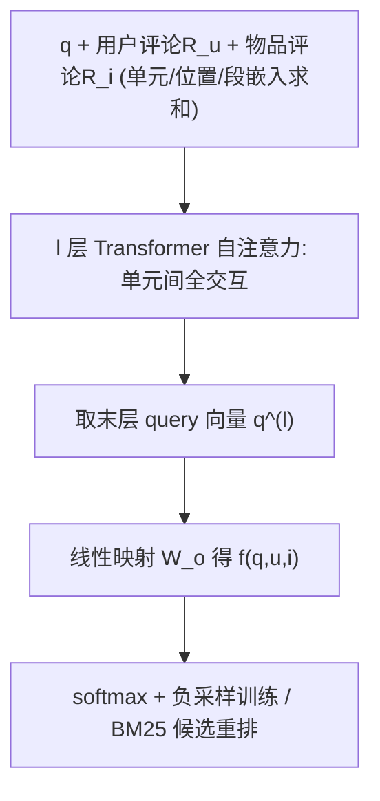
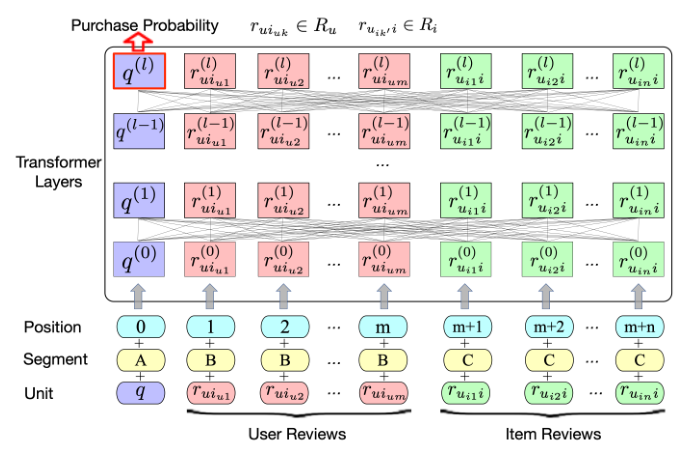

# Learning a Fine-Grained Review-based Transformer Model for Personalized Product Search (面向个性化商品搜索的细粒度评论级 Transformer 模型)

- **会议/期刊**: SIGIR 2021
- **作者与机构**: Keping Bi、W. Bruce Croft（UMass Amherst CIIR），Qingyao Ai（University of Utah）
- **推荐链路定位**: 召回候选之上的精排/重排（BM25 候选集内 re-ranking）
- **研究方向**: 序列与会话推荐 / 冷启动与长尾推荐
- **论文原文**: [https://arxiv.org/abs/2004.09424v3](https://arxiv.org/abs/2004.09424v3)
- **开源代码**: [https://github.com/kepingbi/ProdSearch](https://github.com/kepingbi/ProdSearch)

## TL;DR (1分钟核心速览)

个性化商品搜索长期沿用"user/item 各编码成静态向量 + 内积匹配"范式，导致 item 表征在所有 session 中恒定、每条评论等权，且无法解释排序理由。本文提出 RTM：把 $(q, R_u, R_i)$拼成一条序列输入 Transformer，让查询与每条用户/物品评论互相 attend，最终仅用末层 query 向量$\mathbf{q}^{(l)}$ 打分，实现评论级细粒度匹配。在 Amazon 三品类、BM25 top-100 候选重排协议（MRR/NDCG@20/R@20）下，相对 SOTA 基线 TEM 最高取得 MRR +60.0%（Sports）、NDCG@20 +32.9%（Clothing）的相对提升。

## Background & Motivation (背景与核心矛盾)

- **主流范式**: HEM/AEM/ZAM/TEM 等将 query 与用户历史购买物品通过凸组合、注意力或 Transformer 编码为动态 user 向量，item 侧则由评论词预测训练出静态向量，二者在内积空间匹配。
- **前人局限 1**: **item 表征跨 session 静态**——同一商品的评论（如"物流抱怨"与"美白功效"）在匹配任何意图时始终等权，模型无法针对 query 强调对应侧面。
- **前人局限 2**: **匹配粒度粗**——打分只反映 user/item 向量相似度，不能指出"哪条评论"促成了这次召回，可解释性止步于层级相似度。
- **核心洞察 (Key Insight)**: 商品的价值面是"多维"的，用户偏好也是"多维"的；真正需要的是偏好维度与商品维度之间的**逐条对准**，而非先压成单向量再比对。
- **本文切入点**: 放弃显式 user/item 表征，把 $q$、$R_u$、$R_i$ 作为同层基本单元塞进同一序列，用自注意力完成跨单元交互后直接出分——匹配即排序，注意力即解释。

## Method (核心方法设计)

### 1. 整体框架 (Overall Architecture)

给定 query $q$、用户$u$按时间排列的$m$条历史评论$R_u=(r_{u i_{u1}},\dots,r_{u i_{um}})$与目标物品$i$的$n$条评论$R_i=(r_{u i_1 i},\dots,r_{u i_n i})$，先按$[q;\,R_u;\,R_i]$顺序拼接，为每个单元叠加「单元嵌入 + 可选位置嵌入 + 段嵌入（A/B/C）」，送入$l$层 Transformer 做全连接式自注意力；取末层 query 位置的输出$\mathbf{q}^{(l)}$经线性映射得$f(q,u,i)$。训练以观测三元组$(q,u,i)$ 的 softmax 似然为目标、均匀负采样估计；推理时对 BM25 候选项逐项重复该序列编码并重排。

<figure class="paper-figure" markdown="span">
  <figcaption>图1：我们的基于评论的 Transformer 模型（RTM）。</figcaption>
</figure>

### 2. 关键设计拆解 (Key Designs)

1. **评论级细粒度匹配（Review-Level Matching）**：痛点是把 item 压成静态向量后，任一维度的评论都稀释成同一权重。RTM 让每个单元都能与所有其他单元交互，末层 $\mathbf{q}^{(l)}$ 实际汇集了"query 该关注哪些用户评论、哪些物品评论能回应这些偏好"的累加证据，打分函数极简：
$f(q,u,i)=\mathbf{q}^{(l)}\mathbf{W}_o,\quad \mathbf{W}_o\in\mathbb{R}^{d\times 1}$有效性直觉：$\mathbf{q}^{(l)}$ 的注意力分布天然构成"证据链"，既提升区分度（不同 item 吸引到的评论不同）又提供可读解释。

2. **单元表征与可选位置/段嵌入（On-the-fly Unit Encoding）**：为避免 BERT 逐条编码评论的巨额开销，也避免 paragraph vector 无法泛化到未见评论，作者用带非线性投影的平均词向量在训练中**在线**生成单元表示（词嵌入跨评论共享、由排序目标反传更新）：
$\mathbf{q}=\tanh\!\big(\mathbf{W}_{\phi_q}\cdot\tfrac{1}{|q|}\textstyle\sum_{w\in q}\mathbf{w}_q+\mathbf{b}_{\phi_q}\big)$位置嵌入标记评论时序（新评论更能反映当前偏好），段嵌入区分 query/用户侧/物品侧；两者以指示变量$\mathbb{I}_{pos},\mathbb{I}_{seg}\in\{0,1\}$ 开关，作者显式论证二者并非总是必要（见消融）。

3. **训练目标、负采样与推理开销**：以观测三元组似然最大化，均匀负采样 $k_{neg}=5$ 估计配分函数：
$\mathcal{L}=-\!\!\sum_{(q,u,i)}\!\!\log\frac{\exp f(q,u,i)}{\sum_{i'\in S_i}\exp f(q,u,i')}$实测 L2 正则无增益（未见过拟合），故不加。推理侧的核心代价是**无法预计算物品向量**：每个$(q,u,\cdot)$需对每个候选重新跑一次$m+n\le 40$ 条、每条截断 100 词的 Transformer，成本远高于双塔式内积检索，这是本方法落地的最大瓶颈。

## Experimental Setup & Evaluation Protocol (实验设置与评估协议)

- **数据集与预处理**: Amazon Product Search（唯一带用户评论的商品搜索公开集），采用 `5-core` 过滤（用户与物品均至少 5 条评论）：

| 数据集 | #Users | #Items | #Reviews | #Queries | #Vocab | 评论均长 | 查询均长 |
| :--- | :---: | :---: | :---: | :---: | :---: | :---: | :---: |
| Sports & Outdoors | 35,598 | 18,357 | 296,337 | 1,538 | 32,386 | 89.18 | 7.07 |
| Clothing, Shoes & Jewelry | 39,387 | 23,033 | 278,677 | 2,021 | 21,366 | 62.22 | 7.14 |
| CDs & Vinyl | 75,258 | 64,443 | 1,097,591 | 695 | 202,959 | 174.56 | 5.77 |

- **查询构造**: 从商品 meta-data 抽取多级类目词、去停用词与重复词拼成 query（如 "clothing shoe jewelry men big tall active athletic sock"），属**合成查询**而非真实日志。
- **数据划分与防穿越 (Splitting Strategy)**: 先随机抽 **70% query 仅作训练**，剩余 30% 由验证/测试共享（测试 query 训练期完全不可见）；再按用户购买时序以 `0.8:0.1:0.1` 比例切分，保证测试购买全部发生在训练购买之后——比前作随机划分更接近真实场景、也显著更难。
- **排名评测协议 (Ranking Protocol)**: **非 Full-Ranking**，而是 `Sampled/Candidate Re-ranking`——对 BM25 top-100 候选（CDs 因 BM25 Recall@100 仅 0.108，放宽到 top-1000）逐项重排；指标 MRR、NDCG@20、R@20；Fisher 随机检验 $p<0.05$。
- **对比基线与超参**: 6 个代表性基线（BM25、QEM 非个性化；HEM、AEM、ZAM、TEM 个性化）；统一 $d=128$、$k_{neg}=5$、词下采样$10^{-5}$；RTM 30 epoch / batch 128，注意力头$\{1,2,4,8\}$、层数$1\sim3$、FFN 维度$\{128,256,512\}$，Adam + 8000 步 warm-up，词向量用 Word2Vec 初始化。

## Key Experimental Results (实验关键数据)

### 1. 主实验对比 (Main Results)

| 模型 | Sports MRR | Sports NDCG@20 | Sports R@20 | Clothing MRR | Clothing NDCG@20 | Clothing R@20 | CDs MRR | CDs NDCG@20 | CDs R@20 |
| :--- | :---: | :---: | :---: | :---: | :---: | :---: | :---: | :---: | :---: |
| BM25 | 0.049 | 0.051 | 0.173 | 0.044 | 0.051 | 0.160 | 0.011 | 0.015 | 0.042 |
| QEM | 0.049 | 0.070 | 0.172 | 0.039 | 0.057 | 0.144 | 0.010 | 0.014 | 0.037 |
| HEM | 0.044 | 0.071 | 0.197 | 0.043 | 0.061 | 0.144 | 0.021 | 0.030 | 0.073 |
| AEM | 0.047 | 0.076 | 0.209 | 0.048 | 0.069 | 0.162 | 0.023 | 0.033 | 0.084 |
| ZAM | 0.052 | 0.083 | 0.220 | 0.047 | 0.069 | 0.166 | 0.025 | 0.036 | 0.086 |
| TEM (SOTA) | 0.060 | 0.094 | **0.238** | 0.052 | 0.076 | 0.182 | 0.026 | 0.038 | **0.095** |
| **RTM (最优变体)** | **0.096** | **0.123** | 0.237 | **0.071** | **0.101** | **0.224** | **0.030** | **0.042** | **0.095** |
| **Improv.% vs TEM** | **+60.0%** | **+30.9%** | −0.4% | **+36.5%** | **+32.9%** | **+23.1%** | **+15.4%** | **+10.5%** | 0.0% |

（RTM 每格取该品类最优的证据/位置/段嵌入组合，详见消融表。）

### 2. 消融实验 (Ablation Study)

| RTM 变体 | Sports MRR | Sports NDCG@20 | Clothing MRR | Clothing NDCG@20 | CDs MRR | CDs NDCG@20 |
| :--- | :---: | :---: | :---: | :---: | :---: | :---: |
| $w/o$位置 &$w/o$ 段（纯单元嵌入） | 0.065 | 0.092 | 0.061 | 0.087 | 0.027 | 0.036 |
| $w/o$ 位置，保留段 | 0.058 | 0.093 | 0.068 | 0.099 | **0.030** | **0.042** |
| 保留位置，$w/o$ 段 | **0.082** | **0.110** | **0.071** | **0.101** | 0.030 | 0.039 |
| 位置 + 段 全开 | **0.096** | **0.123** | 0.069 | 0.099 | 0.028 | 0.040 |

### 3. 关键实验发现 (Key Findings)

1. **位置嵌入是品类相关的强开关**：Sports 上从 0.058 提到 0.096（MRR +65.5%）、Clothing 从 0.068 到 0.071，因为服装风格随季节漂移、商品版本会迭代（案例中游泳耳塞新版差评直接影响排序）；而 CDs 上启用位置反而降到 0.028，印证"唱片内容与音质是静态属性，评论先后无信息量"。
2. **段嵌入不可省、位置嵌入可省**：两者全关时 Clothing MRR 仅 0.061（比全开 0.069 低 11.6%），说明模型必须知道哪段是用户侧、哪段是物品侧；反过来 CDs 单开段嵌入即达全表最优（0.030/0.042），说明在静态品类中"段信息"已足够承担序列结构。
3. **动态个性化的收益来自"按 item 变化"**：同一 $(q,u)$下，$R_u$的注意力权重会随$R_i$ 改变，故个性化强度可在 0 到全效之间随候选物品浮动；图 2b 显示即使用户历史评论仅 4–10 条，RTM 仍稳定优于所有基线，图 2c 显示其能在 BM25（最不偏流行）与 POP（最偏流行）之间取得更好的流行度-相关性平衡。
4. **层数随数据密度上移**：Sports/Clothing 单层即最优，CDs（每用户/物品评论更多、词表 20 万）需 2 层——说明多层动态评论表征的收益只在上下文更丰富时兑现。

## Highlights & Limitations (亮点、对比与审稿批判)

- **与代表作对比 (vs. Prior Work)**: 与 TEM（同为 Transformer）的本质差异在于 TEM 只编码 query+历史购买物品、item 仍是静态向量，RTM 把 item 侧评论拉进注意力场内；与 AEM/ZAM 相比，后者的个性化仅发生在 user 侧且强度由 query 单点决定，RTM 的个性化强度随候选物品变化；与 HEM 的凸组合相比，RTM 完全放弃显式 user/item 向量，也就不存在"个性化上限被 query 封顶"的问题。
- **可迁移亮点**: ① 用"末层 query 位置输出"作为唯一打分口，任何 IR/推荐重排模型都可借此低成本获得 attention-based 可解释证据链；② 单元表征采用"投影平均词向量 + 在线计算"，是替代逐条 BERT 编码的高性价比折中；③ 由于完全不使用 user/item ID，模型可零成本推广到训练中未出现但带评论的新用户/新物品（本笔记将其归入 cold_start 交叉类）。
- **审稿级局限批判**: ① **评测协议偏弱**——仅在 BM25 top-100/1000 候选内重排，绝对指标被 BM25 Recall（Sports 0.425、Clothing 0.343）封顶，未报告 full-ranking，无法排除"提升主要来自候选内精排"的可能；② **查询为类目词合成**，与真实用户 query 分布、点击/购买转化信号差异大，线上增益存疑；③ **推理成本高**：每个候选需重跑一次 40 单元序列的 Transformer，物品向量不可预计算，难以支撑在线千级候选；④ 位置/段嵌入的最优组合按品类手选，超参对品类分布敏感。

## Rating (四维评分)

- **方法创新性 (Novelty)**: ⭐⭐⭐⭐ （把"表示-匹配"范式直接换成"序列内评论级交互出分"，视角干净；但 Transformer 结构本身无改动，创新主要在问题形式化）
- **评估协议与实验扎实度 (Protocol & Experiments)**: ⭐⭐⭐ （时序切分 + 未见 query 的设计值得肯定，但候选重排协议、合成 query、缺失 full-ranking 与线上验证拉低了说服力）
- **写作与数学规范度 (Clarity & Rigor)**: ⭐⭐⭐⭐ （公式精简、符号清晰，对位置/段嵌入"何时不必要"的讨论尤其诚实，但打分函数与理论分析偏薄）
- **工业落地与复现价值 (Industrial & Practical Value)**: ⭐⭐⭐ （代码开源、可解释性对电商展示场景有直接价值；但逐候选全序列编码的推理开销是硬伤，实用化需蒸馏为双塔或缓存评论表征）

