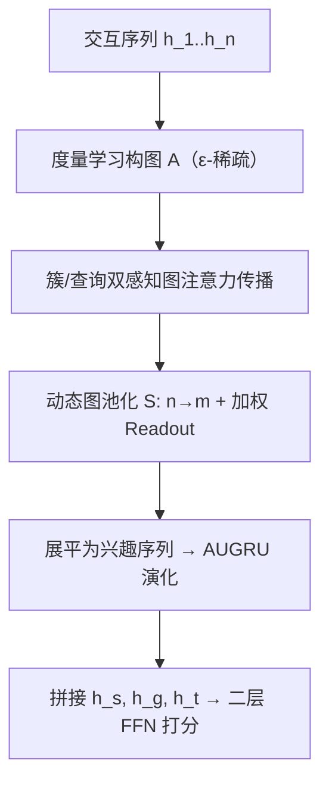
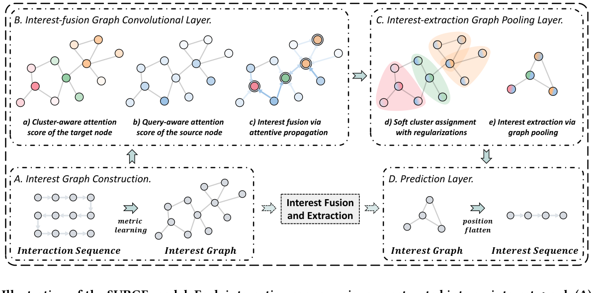

# Sequential Recommendation with Graph Neural Networks (基于图神经网络的序列推荐)

- **会议/期刊**: SIGIR 2021（CCF-A）
- **作者与机构**: Jianxin Chang, Chen Gao, Yu Zheng, Yiqun Hui, Yanan Niu, Yang Song, Depeng Jin, Yong Li（清华大学电子系 BNRist / 快手科技）
- **推荐链路定位**: 召回（用户兴趣表征 → 候选打分）
- **研究方向**: 序列与会话推荐 / 图神经网络与知识图谱推荐
- **论文原文**: [https://arxiv.org/abs/2106.14226v2](https://arxiv.org/abs/2106.14226v2)
- **开源代码**: [https://github.com/microsoft/recommenders](https://github.com/microsoft/recommenders)（基于 Microsoft Recommenders 框架实现）

## TL;DR (1分钟核心速览)

长序列中的隐式点击既是**噪声偏好信号**，用户兴趣又随时间**快速漂移**，RNN/CNN 类序列模型存在"短期记忆瓶颈"，且长短期兴趣的硬切分并不合理。SURGE 用度量学习把松散物品序列重构为**紧凑的 item-item 兴趣图**（相似兴趣成稠密簇），随后用**簇感知 + 查询感知的图注意力卷积**把弱信号融合为强信号，再用**带三重正则的动态图池化**压缩出当前"激活的核心兴趣序列"，最后用 AUGRU 建模兴趣演化。在 Taobao 与工业级 Kuaishou（平均序列长度 245.9）上，采样评估下 AUC 相对最强基线分别提升 2.8% 与 4.5%，训练收敛时间反而缩短 20% 以上。

## Background & Motivation (背景与核心矛盾)

- **主流范式**: 一条路线用时间衰减/注意力给历史物品赋权（DIN），另一条用 RNN/CNN 汇总行为序列（GRU4REC、Caser、DIEN），第三条显式拆分长短期兴趣并联合建模（SLi-Rec）。
- **前人局限**: ① 隐式反馈（点击、观看）单条记录并不代表真实偏好，长序列中大量"误点"作为噪声直接污染表征，且噪声随序列变长而线性累积；② RNN 存在短期瓶颈，DIEN 的双层 GRU 使当前步依赖上一步隐状态，长序列上误差传播显著；SLi-Rec 的"长/短期二分"是人工先验切分，在 Kuaishou 长序列上反而劣于单 GRU 的 GRU4REC。
- **核心洞察 (Key Insight)**: 真实兴趣并非均匀分布在序列中——**同一兴趣的重复出现会形成稠密子图、核心兴趣节点度数更高**。因此不必逐时刻建模，而应先把"松散的序列"重整为"紧凑兴趣簇"，再在簇级别判断哪些兴趣此刻被激活。
- **本文切入点**: 以可学习的相似度度量动态构图（而非共现构图，避免稀疏不可连通），在图上做"融合（去噪）+ 池化（提炼）"，用 $m \ll n$个簇代替$n$ 步循环。

## Method (核心方法设计)

### 1. 整体框架 (Overall Architecture)

给定用户交互序列 $\{x_1,\dots,x_n\}$，SURGE 分四段串行：**(A) 兴趣图构建**——用多头加权余弦度量学习节点相似度并按相对排名阈值稀疏化，得到每个用户专属的邻接矩阵$A\in\mathbb{R}^{n\times n}$；**(B) 兴趣融合**——在$A$上执行簇感知（谁是簇中心）与查询感知（谁与目标物品$h_t$相关）联合加权的图注意力传播，强化核心节点、抑制噪声边；**(C) 兴趣提取**——用可微软聚类分配矩阵$S\in\mathbb{R}^{n\times m}$把$n$个节点池化为$m$个簇，并对原始图做加权 readout 得到图级表征$h_g$；**(D) 预测**——将池化后的簇序列按时间序展平为短序列，用 AUGRU 建模兴趣演化得$h_s$，最终$\hat{y}=\mathrm{Predict}(h_s\|h_g\|h_t\|h_g\odot h_t)$。

<figure class="paper-figure" markdown="span">
  <figcaption>图1：SURGE 模型示意图。每条交互序列基于度量学习重构为兴趣图（A），并在图上动态执行兴趣融合（B）与提取（C）。对兴趣融合与提取后的池化图进行展平，得到当前激活的核心兴趣序列（D），可用于进一步建模与预测。建议彩色查看。</figcaption>
</figure>

### 2. 关键设计拆解 (Key Designs)

1. **度量学习兴趣图 + 相对排名稀疏化**：共现图在单用户序列上极稀疏、常常不连通；本文改为学习式构图，多头加权余弦定义为 $M_{ij}=\frac{1}{\phi}\sum_{\delta=1}^{\phi}\cos(\mathbf{w}_\delta\odot\mathbf{h}_i,\mathbf{w}_\delta\odot\mathbf{h}_j)$，再用**全图相对排名**而非绝对阈值或 top-k 邻居做稀疏：$A_{ij}=\mathbb{I}\left[M_{ij}\ge \mathrm{Rank}_{\varepsilon n^{2}}(M)\right]$。这样既保证任意长度序列都能生成连通图，又保留"稠密簇=核心兴趣、稀疏区=边缘兴趣"的度数分布先验（top-k 会强行让每节点等度，破坏该信号）。
2. **簇感知 + 查询感知的注意力融合**：融合阶段要同时回答"该节点是不是兴趣簇中心"与"该节点是否与本次预测目标相关"。前者用节点与簇均值 $\mathbf{h}_{i_c}$的交互打分$\alpha_i=\mathrm{Att}_c(\mathbf{W}_c\mathbf{h}_i\|\mathbf{h}_{i_c}\|\mathbf{W}_c\mathbf{h}_i\odot\mathbf{h}_{i_c})$，后者用与目标物品的打分$\beta_j=\mathrm{Att}_q(\mathbf{W}_q\mathbf{h}_j\|\mathbf{h}_t\|\mathbf{W}_q\mathbf{h}_j\odot\mathbf{h}_t)$，二者相加后 softmax 归一化：$E_{ij}=\mathrm{softmax}_j(\alpha_i+\beta_j)$。物理直觉是：$\alpha$决定目标节点"能收多少"、$\beta$ 决定源节点"能发多少"，无关行为在聚合中被自然丢弃。
3. **带正则的动态图池化与训练目标**：分配矩阵由一层消息传递 + softmax 生成，$S_{i:}=\mathrm{softmax}(\mathbf{W}_p\cdot\mathrm{Aggr}(A_{ij}\mathbf{h}'_j))$，簇表征$H^*=S^{\top}H'$、簇得分$\gamma^*=S^{\top}\gamma$，池化后邻接$A^*=S^{\top}AS$。仅靠推荐损失难以训练$S$，故加三项正则：同映射$\mathcal{L}_M=\|A-SS^{\top}\|_F$（强连接节点应同簇）、单归属$\mathcal{L}_A=\frac{1}{n}\sum_i H(S_{i:})$（熵最小化逼近似 one-hot）、相对位置$\mathcal{L}_P=\|P_nS-P_m\|_2$（保证池化后簇序列仍保持时间序，使后续 AUGRU 有意义）。总损失$\mathcal{L}=-\frac{1}{|\mathcal{O}|}\sum_{o}(y_o\log\hat{y}_o+(1-y_o)\log(1-\hat{y}_o))+\lambda\|\Theta\|^2+\mathcal{L}_M+\mathcal{L}_A+\mathcal{L}_P$，采用 CTR 式**负采样 pointwise 训练**（非 softmax 全库、无 in-batch 免采样设计），推理时对候选物品逐一打分。

## Experimental Setup & Evaluation Protocol (实验设置与评估协议)

- **数据集与预处理**:

| 数据集 | #Users | #Items | #Interactions | 稀疏度/密度 | 特征/场景说明 |
| :--- | :---: | :---: | :---: | :---: | :--- |
| Taobao | 36,915 | 64,138 | 1,471,155 | 密度 ≈ 6.2e-4 | 电商点击，过滤交互 < 10 的用户，平均长度 39.85 |
| Kuaishou | 60,813 | 292,286 | 14,952,659 | 密度 ≈ 8.4e-4 | 短视频工业日志，10-core 过滤，平均长度 245.88 |

- **数据划分与防穿越 (Splitting Strategy)**: 均为**全局时间戳切分**。Taobao：前 7 天训练 / 第 8 天验证 / 最后 1 天测试；Kuaishou：前 6 天训练 / 最后 1 天 12:00 前验证、12:00 后测试。
- **排名评测协议 (Ranking Protocol)**: 采用 CTR 式**采样评估（Sampled Ranking）**而非全库 Full-Ranking，指标为 AUC、GAUC（按用户点击量加权的 per-user AUC）、MRR、NDCG@2。序列最大长度 Taobao 50 / Kuaishou 250，池化簇数 $m$在$\{10,\dots,50\}$与$\{50,\dots,250\}$网格搜索，嵌入维度$d=40$，Adam lr=0.001，batch=500，正则系数搜于$[10^{-7},10^{-3}]$，显著性以$p<0.05/0.01/0.001$ 三档标注。
- **对比基线与超参设置**: 非序列 NCF / DIN / LightGCN；序列 Caser / GRU4REC / DIEN / SLi-Rec，全部统一二层 FFN（隐层 [100, 64]）预测头，保证公平。

## Key Experimental Results (实验关键数据)

### 1. 主实验对比 (Main Results)

| 方法 | Taobao AUC | Taobao GAUC | Taobao MRR | Taobao NDCG@2 | Kuaishou AUC | Kuaishou GAUC | Kuaishou MRR | Kuaishou NDCG@2 |
| :--- | :---: | :---: | :---: | :---: | :---: | :---: | :---: | :---: |
| NCF | 0.7128 | 0.7221 | 0.1446 | 0.0829 | 0.5559 | 0.5531 | 0.7734 | 0.8327 |
| DIN | 0.7637 | 0.8524 | 0.3091 | 0.2352 | 0.6160 | 0.7483 | 0.8863 | 0.9160 |
| LightGCN | 0.7483 | 0.7513 | 0.1669 | 0.1012 | 0.6403 | 0.6407 | 0.8175 | 0.8653 |
| Caser | 0.8312 | 0.8499 | 0.3508 | 0.2890 | 0.7795 | 0.8097 | 0.9100 | 0.9336 |
| GRU4REC | 0.8635 | 0.8680 | 0.3993 | 0.3422 | 0.8156 | 0.8333 | 0.9174 | 0.9391 |
| DIEN | 0.8477 | 0.8745 | 0.4011 | 0.3404 | 0.7037 | 0.7800 | 0.9030 | 0.9284 |
| SLi-Rec | 0.8664 | 0.8669 | 0.3617 | 0.2971 | 0.7978 | 0.8128 | 0.9075 | 0.9318 |
| **SURGE** | **0.8906** | **0.8888** | **0.4228** | **0.3625** | **0.8525** | **0.8610** | **0.9316** | **0.9495** |
| Improv. (vs 最强基线) | +2.8% | +1.6% | +5.4% | +5.9% | +4.5% | +3.3% | +1.5% | +1.1% |

### 2. 消融实验 (Ablation Study)

| 变体 | Taobao AUC | Taobao MRR | Kuaishou AUC | Kuaishou MRR |
| :--- | :---: | :---: | :---: | :---: |
| w/o Fusion (仅构图) | 0.8307 | 0.0317 | 0.7149 | 0.9076 |
| w/o Query-aware（只留簇感知） | 0.8720 | 0.3929 | 0.7641 | 0.9069 |
| w/o Cluster-aware（只留查询感知） | 0.8764 | 0.3973 | 0.8213 | 0.9186 |
| w/o Extraction（不池化） | 0.8513 | 0.3605 | 0.8240 | 0.9182 |
| w/o Readout | 0.8578 | 0.3720 | 0.8422 | 0.9257 |
| w/o Regularization ($\mathcal{L}_M,\mathcal{L}_A,\mathcal{L}_P$) | 0.8815 | 0.3430 | 0.8487 | 0.9291 |
| **SURGE (完整)** | **0.8906** | **0.4228** | **0.8525** | **0.9316** |

### 3. 关键实验发现 (Key Findings)

1. **长序列才是 SURGE 的主战场**：按序列长度分桶后，DIN 与 DIEN 在最长桶显著掉点（噪声淹没有限注意力与双层 GRU 隐状态），而 SURGE 在 Taobao 40–50 桶与 Kuaishou 200–250 桶仍保持 GAUC 0.8919 / 0.8502，且与基线的**差距随序列变长而扩大**，直接验证"图融合 + 池化去噪"的动机。
2. **融合比池化更关键，池化中的正则是效率与精度的双引擎**：去掉整个融合模块使 Taobao AUC 从 0.8906 崩至 0.8307（MRR 仅 0.0317，几乎失去排序能力），远大于去掉池化（0.8513）；而去掉三项正则虽 AUC 只降 0.9%，**MRR 却从 0.4228 掉到 0.3430（-19%）**，说明位置正则与单归属正则主要保障簇序列的时间序与可辨识性。
3. **池化直接带来训练加速**：把 $n$步循环压缩为$m$ 个簇后，Taobao 收敛耗时 14.96m 优于 DIEN 18.74m 与 SLi-Rec 27.82m；Kuaishou 上 22.86m 相比 Caser 的 120.26m、GRU4REC 的 73.35m 减少 20%–80%，同时池化序列可无缝替换 DIN/GRU/DIEN/Time4LSTM 等任意演化层并一致涨点。

## Highlights & Limitations (亮点、对比与审稿批判)

- **与代表作对比 (vs. Prior Work)**: 与 DIN 的本质区别是 DIN 在**原始序列**上做目标注意力、长序列易被早期间隔极远的"高注意力噪声项"劫持；SURGE 先在**学出来的图结构**上做簇级聚合再注意，噪声节点在度数稀疏区被结构性降权。与 DIEN 相比，SURGE 不靠双层 GRU 逐时刻传递，而是先压缩为 $m$ 个兴趣簇再演化，规避短期瓶颈。与 SLi-Rec 相比，其"长/短期"是人工先验切分且依赖时间戳特征，SURGE 用度量学习自动划分兴趣簇、**完全不使用时间戳**仍取得更优结果。
- **可迁移亮点**: ① "全图相对排名 ε-稀疏化"是一个通用可微图学习算子，可移植到任何需要动态构图（会话推荐、多行为融合）的场景，避免绝对阈值随 embedding 漂移而失效；② 池化前的相对位置正则 $\|P_nS-P_m\|_2$ 是让"池化后仍保有顺序"的轻量技巧，适合所有图池化 + 序列建模的级联结构。
- **审稿级局限批判**: ① 评估采用**负采样 pointwise 协议（Sampled Ranking）**而非全库 Full-Ranking，AUC/MRR 的绝对数值受负样本分布影响，SURGE 的优势是否在无偏全库排序下同样成立缺乏证据；② 每个用户需构建 $n\times n$稠密相似度矩阵并做$\varepsilon n^2$排名，Kuaishou 平均长度 245.9 时构图开销为$O(n^2d)$，论文只报告了训练总时长、未报告单 batch 构图与排序的峰值显存/延迟，工业在线部署仍需截断或近似检索；③ 池化簇数$m$与稀疏率$\varepsilon$ 需按数据集网格搜索，跨域迁移时超参敏感度未被讨论。

## Rating (四维评分)

- **方法创新性 (Novelty)**: ⭐⭐⭐⭐ （以"度量学习构图 + 簇/查询双感知融合 + 带位置正则的动态池化"三件套替代长短期硬切分，思路自洽且首次把图池化用于长序列兴趣提炼，但缺乏谱域或理论层面的收敛/表达能力分析）
- **评估协议与实验扎实度 (Protocol & Experiments)**: ⭐⭐⭐⭐ （公开 + 工业双数据集、含 $p$ 值显著性标注、序列长度分桶与训练耗时分析齐备，消融覆盖融合/提取/正则各组件；扣分点为采样评估而非全库排序、无线上 A/B）
- **写作与数学规范度 (Clarity & Rigor)**: ⭐⭐⭐⭐ （四模块拆解清晰、每个符号均给出维度与语义，注意力与池化公式推导完整；但同映射正则 $\|A-SS^{\top}\|_F$对$A$ 的 0/1 稀疏假设与软分配概率尺度不匹配，未讨论归一化尺度问题）
- **工业落地与复现价值 (Industrial & Practical Value)**: ⭐⭐⭐⭐ （基于 Microsoft Recommenders 可复现、训练收敛比 Caser/GRU4REC 快 20%–80%，池化压缩天然适配线上低延迟；主要短板是 $O(n^2)$ 构图对超长序列仍需工程裁剪）

