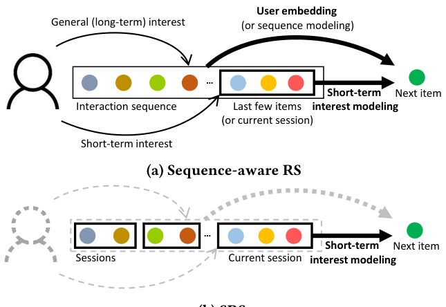
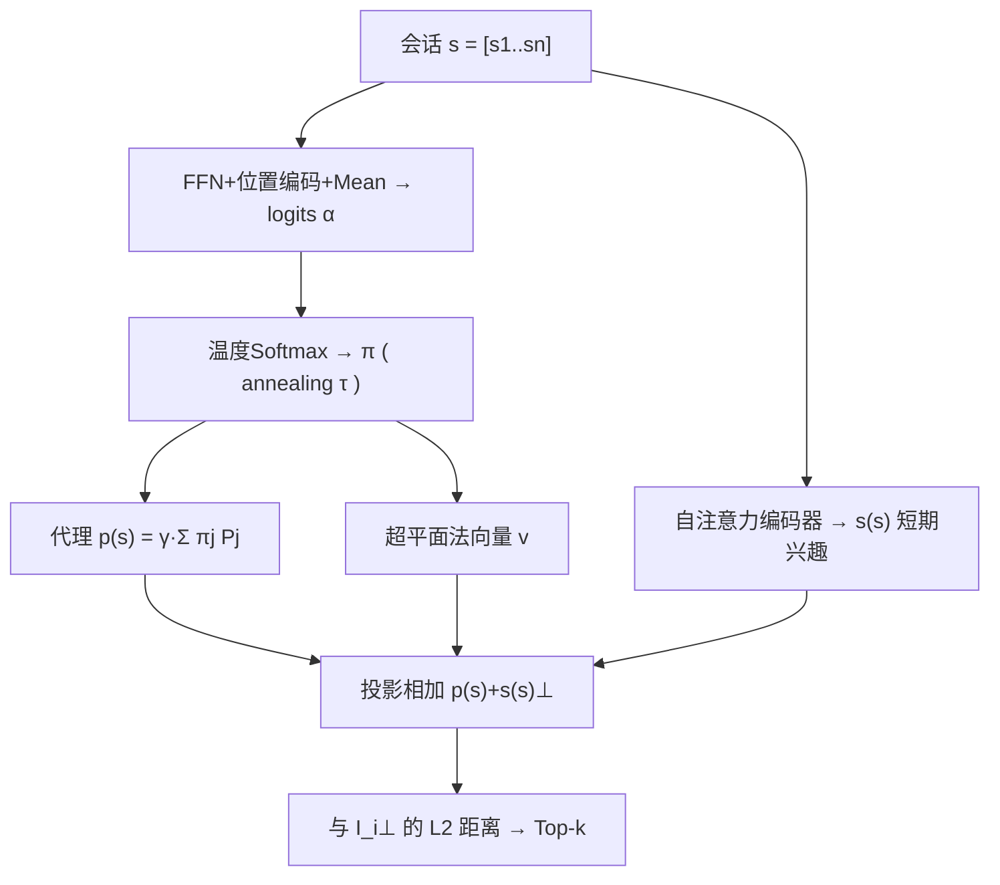
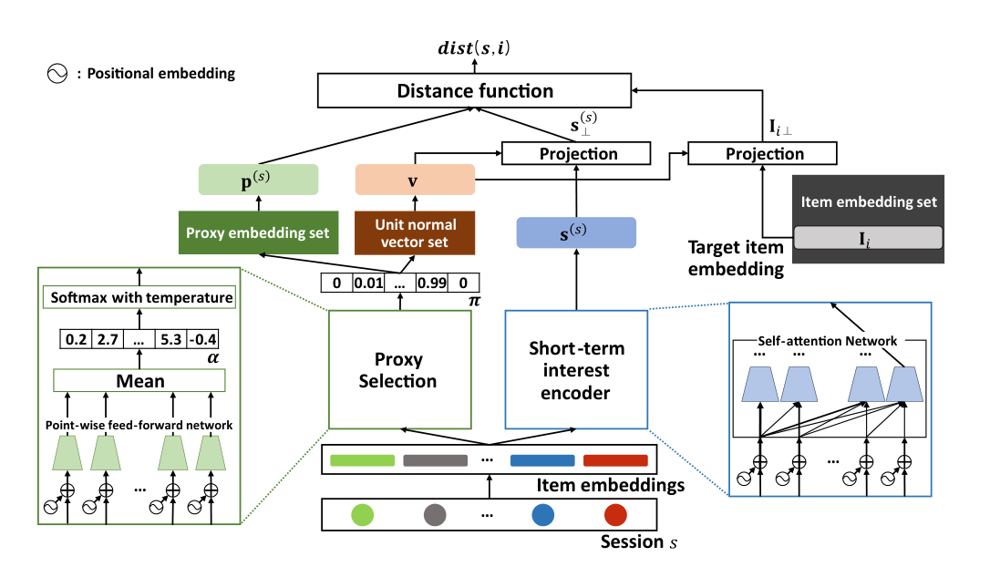

# Unsupervised Proxy Selection for Session-based Recommender Systems (面向会话推荐的無监督代理选择)

- **会议/期刊**: SIGIR 2021
- **作者与机构**: Junsu Cho, SeongKu Kang, Dongmin Hyun, Hwanjo Yu（POSTECH，韩国浦项工科大学）
- **推荐链路定位**: 召回（会话级 Next-Item 候选生成）
- **研究方向**: 序列与会话推荐 / 协同过滤度量学习
- **论文原文**: [https://arxiv.org/abs/2107.03564v1](https://arxiv.org/abs/2107.03564v1)
- **开源代码**: 暂未开源

## TL;DR (1分钟核心速览)

匿名会话推荐（SRS）只有短序列，无法像序列感知 RS 那样从用户侧得到"长期/一般兴趣"，现有方法靠 item 共现构图（CSRM/GCE-GNN）间接补信息，仍抓不住复杂的用户偏好。ProxySR 预置 $K$ 个可学习代理，用温度 Softmax 从会话无监督地**硬选**一个代理充当缺失的一般兴趣，与自注意力编码的短期兴趣相加，并在代理超平面上做投影距离度量。三个真实数据集全库排序下，Next-Unseen-Item 任务 R@20 相对最强基线最高提升 45.4%（RetailRocket）。

## Background & Motivation (背景与核心矛盾)

- **主流范式**: GRU4Rec/NARM/STAMP/SASRec/SR-GNN/FGNN 在单个会话内部建模短期兴趣；CSRM/GCE-GNN 进一步用 item 共现关系（记忆网络、全局转移图）引入跨会话信息。
- **前人局限**: ① 单会话模型完全无视会话间关系，短会话（RetailRocket 平均长度仅 3.57）信息量严重不足；② 共现式跨会话方法把"会话关系"压缩成静态 item 转移规则，而用户一般兴趣远比共现复杂，属于静态规则无法表达的隐变量。
- **核心洞察 (Key Insight)**: 一般兴趣有两个可操作性质——**被多个会话共享**（同一用户多个会话兴趣稳定）、**与短期兴趣互补**（填补预测所需但会话内没有的信息）。因此不必强行从单个会话"编码"出长期兴趣，而应让多个会话**共享同一个代表向量（代理）**。
- **本文切入点**: 把"缺失的一般兴趣"转化为"从 $K$ 个代理中选一个"的离散隐变量选择问题，选择器与代理端到端联合学习。

<figure class="paper-figure" markdown="span">
  <figcaption>图1：序列感知 RSs 与 SRSs 中可用信息量的差异。灰色虚线表示 SRSs 中不可用的信息。</figcaption>
</figure>

## Method (核心方法设计)

### 1. 整体框架 (Overall Architecture)

输入会话 $s=[s_1,\dots,s_n]$分两路并行：一路经两层 point-wise FFN + 位置编码 + 平均池化产生$K$维 logits，经温度 Softmax 得到代理选择分布并加权取代理向量$p(s)$；另一路经自注意力（残差 + 逆序位置编码）编码为短期兴趣$s(s)$。二者在代理对应超平面上做投影后相加，与目标 item 的投影向量算欧氏距离作为不相似度，最小距离 top-$k$即推荐。训练用 hinge 边际损失 + 距离正则 + 正交正则联合优化；推理时$\tau\to0.01$ 使选择近似 one-hot，仅需一次前向。

<figure class="paper-figure" markdown="span">
  <figcaption>图2：ProxySR 的整体架构。</figcaption>
</figure>

### 2. 关键设计拆解 (Key Designs)

1. **温度 Softmax 代理硬选择（而非加权混合）**：普通 Softmax 加权组合等价于"把会话再编码一次"，得到的表示对每个会话唯一，无法被多会话共享，因而不可能承载公共的一般兴趣。ProxySR 令 $\pi_j=\exp(\alpha_j/\tau)/\sum_{j'}\exp(\alpha_{j'}/\tau)$，$\tau$从 3 指数退火到 0.01，训练后期$\pi$逼近 one-hot，被选中的代理由多个会话共同梯度更新，自然收敛为"共享兴趣簇心"。早期$\tau$大时各代理相互抵消导致模长塌缩，故用$\gamma=\|\sum_j\pi_j P_j\|_2^{-1}$重缩放，保持代理$l_2$ 范数为加权均值。
2. **代理超平面投影度量**：若直接用 $p(s)+s(s)$与$I_i$算距离，同一代理下$p+s^{(1)}\approx I_i$与$p+s^{(2)}\approx I_i$会强制$s^{(1)}\approx s^{(2)}$，即把复杂三元关系压成一对一。作者把短期兴趣与物品投影到代理法向$v$的正交补：$s(s)^\perp=s(s)-v^\top s(s)\,v$，$I_i^\perp=I_i-v^\top I_i\,v$，再算$dist(s,i)=\|(p(s)+s(s)^\perp)-I_i^\perp\|_2^2$，使不同短期兴趣/物品可在同一超平面上重合，容纳多对多关系。
3. **训练目标、负采样与推理开销**：采用 hinge 损失 $\mathcal{L}=\sum_{\{s,i^+\}}\sum_{i^-\in N_I(s)}[m+dist(s,i^+)-dist(s,i^-)]_+$，负样本为均匀随机负采样集合$N_I(s)$，另加$\lambda_{dist}\cdot dist(s,i^+)$拉近正样本、$\lambda_{orthog}\cdot|v\cdot p(s)|/\|p(s)\|_2$保证法向正交；训练时预测会话内每个$s_t$均复用整段会话选出的$p(s)$（同一会话兴趣一致）。推理仅一次前向 +$N$ 次距离计算，无额外图构建开销。

### 3. 用户半监督扩展（可选分支）

真实场景约 50%–70% 用户未登录。对带 user id 的会话，在 logits 上加可学习用户偏置：$\pi^{user}_j=\exp((\alpha_j+u(s)_j)/\tau)/\sum_{j'}\exp((\alpha_{j'}+u(s)_{j'})/\tau)$，仅"提升偏好代理的概率"而非强制分配，保留柔性。

## Experimental Setup & Evaluation Protocol (实验设置与评估协议)

| 数据集 | #Users | #Items | #Interactions | 稀疏度/密度 | 特征/场景说明 |
| :--- | :---: | :---: | :---: | :---: | :--- |
| RetailRocket | 匿名 | 38,736 | 170,488 | 47,705 会话，均长 3.57 | 电商点击，按"单日"切会话后匿名化 |
| Diginetica | 匿名 | 33,950 | 713,308 | 101,691 会话，均长 7.01 | 电商搜索日志，原生 session id；item 出现 <5 次过滤，会话长度 <3 剔除 |
| LastFM | 匿名 | 33,531 | 5,103,585 | 229,760 会话，均长 22.21 | 音乐艺人收听，item <5 次过滤，长度截断至 [3,50] |

- **数据划分与防穿越**: 按会话**时间戳顺序** 8:1:1 切分 train/val/test，并过滤验证/测试集中未在训练集出现的 item（防泄漏）。
- **排名评测协议**: 无偏 **Full-Ranking**（真实下一项在全体候选 item 中排序），指标 R@{5,10,20} 与 M@{5,10,20}；主实验为 **Next-Unseen-Item** 设定（强制把会话内已出现 item 概率置零，剔除含目标项的 sub-session），另设含重复消费设定作为对照。
- **对比基线与超参**: 10 个基线覆盖 RNN（GRU4Rec/NARM）、注意力（STAMP/SASRec）、图（SR-GNN/FGNN）、跨会话（CSRM/GCE-GNN）、重复预测（RepeatNet）、卷积（GRec）；$d\in\{16,32,64,128\}$，$K\in\{3,\dots,3000\}$，$m\in\{0.1,\dots,2.0\}$，Adam，5 次独立运行取均值，以验证集 R@20 选 epoch。

## Key Experimental Results (实验关键数据)

### 1. 主实验对比 (Main Results)

Next-Unseen-Item（全库排序，节选 R@20 / M@20）：

| 数据集 | 指标 | GRU4Rec | SASRec | SR-GNN | CSRM | GCE-GNN | **ProxySR** | Improv.% |
| :--- | :---: | :---: | :---: | :---: | :---: | :---: | :---: | :---: |
| RetailRocket | R@20 | 0.1752 | 0.2781 | 0.2570 | 0.2469 | 0.2787 | **0.4053** | **+45.43%** |
| RetailRocket | M@20 | 0.0888 | 0.1245 | 0.1209 | 0.0928 | 0.1274 | **0.1622** | +27.32% |
| Diginetica | R@20 | 0.2963 | 0.3234 | 0.3386 | 0.3454 | 0.3573 | **0.4069** | +13.88% |
| Diginetica | M@20 | 0.0741 | 0.0830 | 0.0905 | 0.0895 | 0.0931 | **0.1130** | +21.37% |
| LastFM | R@20 | 0.1258 | 0.1318 | 0.1423 | 0.1341 | 0.1468 | **0.1589** | +8.24% |
| LastFM | M@20 | 0.0321 | 0.0356 | 0.0390 | 0.0334 | 0.0402 | **0.0424** | +5.47% |

含重复消费设定下，ProxySR 亦全面最优（RetailRocket R@20 0.6528 vs. CSRM 0.5774，+13.06%；Diginetica +9.10%；LastFM R@20 0.6370，+3.59%）。用户半监督（LastFM）：已知用户比例 0%→50% 时 R@20 从 0.1589 升至 0.1696，单调增益。

### 2. 消融实验 (Ablation Study)

| 变体 | RetailRocket R@20 | Diginetica R@20 | LastFM R@20 |
| :--- | :---: | :---: | :---: |
| ProxySR | **0.4053** | **0.4069** | **0.1589** |
| 仅 $p(s)$（去掉短期兴趣） | 0.1742 | 0.1795 | 0.0964 |
| 仅 $s(s)$（退化为纯会话编码） | 0.3076 | 0.3446 | 0.1417 |
| w/o $reg_{dist}$ | 0.3294 | 0.2909 | 0.1369 |
| No projection（去掉超平面投影） | 0.3202 | 0.3842 | 0.1492 |
| Encoding $p(s)$（直接编码而非选择） | 0.2701 | 0.3209 | 0.1356 |
| Weighted comb.（普通 Softmax 加权） | 0.3281 | 0.3443 | 0.1507 |
| Dot product（点积替代距离） | 0.3877 | 0.4021 | 0.1538 |

### 3. 关键实验发现 (Key Findings)

1. **代理必须"选中"而非"混合"**：把温度 Softmax 换成普通 Softmax 加权组合后 RetailRocket R@20 从 0.4053 掉到 0.3281（−19.0%），且"直接编码代理"更差（0.2701），定量证明"共享离散代理"才是一般兴趣的正确载体，逐会话唯一表示无法承载公共信息。
2. **短会话收益最大，验证互补假设**：会话均长最短的 RetailRocket 提升 +45.4%，最长的 LastFM 仅 +8.2%；说明会话本身信息越匮乏，代理填补的长期兴趣价值越高，长会话已自带部分一般兴趣信息。
3. **代理确实等价于用户身份**：将 HRNN 的 user embedding 替换为"按 ProxySR 选中的代理分组"，RetailRocket R@20 = 0.1941，**略高于真值 user id（0.1922）**，远高于随机分组（0.1275）；说明无监督代理不仅复原了用户粒度，还携带了用户内部更细粒度的兴趣（t-SNE 中同一用户可对应多个代理，不同用户也可共享代理）。$K$ 呈倒 U 型：过小则代理欠拟合（被迫共享给不相关会话），过大则单代理训练样本不足。

## Highlights & Limitations (亮点、对比与审稿批判)

- **与代表作对比 (vs. Prior Work)**: 相较 SR-GNN/FGNN 的"会话内图"，ProxySR 显式建模会话间共享隐变量；相较 CSRM/GCE-GNN 的"item 共现静态关系"，其会话关系由可学习选择器动态产生，避免共现规则的表达能力上限；相较 Proxy-NCA/SoftTriple 中"代理=类中心"的用法，本文代理是**与短期兴趣互补的缺失信息载体**，这是本质差异。
- **可迁移亮点**: ① 温度退火 + $\gamma$重缩放的"软到硬"离散选择技巧，可直接用于向量量化码本、混合专家路由的塌缩问题；② 超平面投影解耦三元关系（$p+s^\perp$vs$I^\perp$）可迁移到任何"共享偏置 + 个体表征"的度量学习场景（如跨域/多场景共享塔）。
- **审稿级局限批判**: ① $K$与退火超参敏感，$K$需随会话数量级放大，缺乏自适应确定$K$ 的机制；② 仅离线全库排序评估、无线上 A/B 与延迟报告，且三个数据集均为中小规模匿名会话，"代理=用户"的结论在用户兴趣漂移剧烈场景未验证。

## Rating (四维评分)

- **方法创新性 (Novelty)**: ⭐⭐⭐⭐ （把"缺失的长期兴趣"重构为无监督离散代理选择问题，配合温度退火与超平面投影，机制新颖且有清晰物理直觉）
- **评估协议与实验扎实度 (Protocol & Experiments)**: ⭐⭐⭐⭐ （三数据集 + 全库排序 + 两种任务设定 + 5 次均值 + 完整消融与 HRNN/t-SNE 归因分析，但缺少显著性检验与线上验证）
- **写作与数学规范度 (Clarity & Rigor)**: ⭐⭐⭐⭐ （选择/投影/损失三模块公式链条完整，Discussion 与 Ablation 一一对应，唯 $\gamma$ 重缩放的推导略显经验化）
- **工业落地与复现价值 (Industrial & Practical Value)**: ⭐⭐⭐⭐ （推理仅一次前向、无图构建，代理表仅 $K\times d$可常驻内存；但无开源代码，$K$ 需按业务会话量重调）

