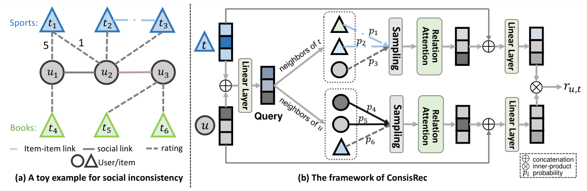
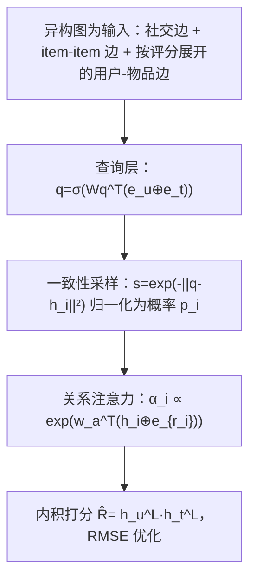
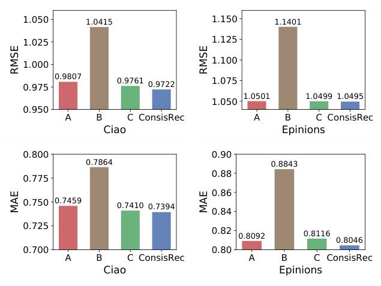

# ConsisRec: Enhancing GNN for Social Recommendation via Consistent Neighbor Aggregation (基于一致邻居聚合的社交推荐 GNN 增强)

- **会议/期刊**: SIGIR 2021 (Short Paper)
- **作者与机构**: Liangwei Yang, Zhiwei Liu, Yingtong Dou, Jing Ma, Philip S. Yu（University of Illinois at Chicago / 四川大学）
- **推荐链路定位**: 精排（评分预测 / Rating Prediction）
- **研究方向**: 社交与群组推荐 / 图神经网络推荐
- **论文原文**: [https://arxiv.org/abs/2105.02254v1](https://arxiv.org/abs/2105.02254v1)
- **开源代码**: [https://github.com/YangLiangwei/ConsisRec](https://github.com/YangLiangwei/ConsisRec)

## TL;DR (1分钟核心速览)

本文直指社交推荐中被长期忽视的**社交不一致性**：社交边并不等价于偏好一致，盲目聚合好友会引入噪声。作者在异构图上提出 ConsisRec——先用 (用户, 物品) 对生成查询向量，按查询-邻居一致性得分做概率采样，再以关系注意力对采样邻居加权聚合。评估为 60/20/20 随机划分下的评分预测（RMSE/MAE，非采样排序），在 Ciao / Epinions 上 RMSE 相对最优基线分别降 2.79% / 1.74%。

## Background & Motivation (背景与核心矛盾)

- **主流范式**: 以 GraphRec、GraphRec+、DSCF、MGNN 为代表，在用户-物品二部图与社交图上递归聚合邻居，用社交同质性缓解冷启动。
- **前人局限**: 其一，这类方法隐含"邻居共享相似上下文"的强假设，而社交关系中大量存在兴趣漂移的朋友（图 1(a) 中 u3 只评书、u2 只评运动，仍互为好友）；其二，同时建模社交图与按评分值展开的用户-物品关系时，多种关系被等权对待，无法区分"关系级"冲突（u1 给 t1 打 5 分、好友 u2 打 1 分）。
- **核心洞察 (Key Insight)**: 不一致性并非随机噪声而是**条件于查询对 (u,t)** 的——用户对不同物品会咨询不同的朋友；因此"哪些邻居该聚合"必须随查询动态变化，而非静态图结构决定。
- **本文切入点**: 用查询向量与邻居嵌入的距离构造一致性子，把 GNN 的邻居采样从"均匀/重要性采样"改造为"一致性概率采样"，再用关系注意力在关系维度做二次过滤。

<figure class="paper-figure" markdown="span">
  <figcaption>图1：一个反映社交不一致性的玩具示例及ConsisRec框架。</figcaption>
</figure>

## Method (核心方法设计)

### 1. 整体框架 (Overall Architecture)

输入为统一异构图 $\mathcal{G}=\{\mathcal{V},\mathcal{E}_r\}$，边按类型细分：1 类社交边、1 类 item-item 边（共享 >50% 邻居的物品），其余为用户-物品边按评分档位展开（Ciao 共 8 种关系）。模型先由嵌入层取节点嵌入$\mathbf{e}_v$与关系嵌入$\mathbf{e}_r$；查询层把目标 (u,t) 压成任务向量$\mathbf{q}_{u,t}$；采样层以一致性得分归一化为概率，抽取比例$\gamma|\mathcal{N}_v|$个邻居；关系注意力在采样集合上按关系类型重加权聚合；经$L$ 层传播后内积输出评分，RMSE 回归训练。

### 2. 关键设计拆解 (Key Designs)

1. **查询层：把"聚合谁"变成条件于物品的检索问题**。痛点是不一致邻居随物品而变，静态聚合无解；做法是把用户与物品嵌入拼接后线性映射，得查询向量 $\mathbf{q}_{u,t}=\sigma(\mathbf{W}_q^{\top}(\mathbf{e}_u\oplus\mathbf{e}_t))$，同一层内 u 与 t 共享该查询。物理直觉：购买不同品类时用户"求助的好友"不同，查询向量即这一求助意图的软编码。

2. **一致性邻居采样：用高斯核距离替代均匀采样**。定义邻居 i 与查询的一致性得分 $s^{(l)}(i;\mathbf{q})=\exp(-\|\mathbf{q}-\mathbf{h}_i^{(l)}\|_2^2)$，并按$p^{(l)}(i;\mathbf{q})=s^{(l)}(i;\mathbf{q})/\sum_{j\in\mathcal{N}_v}s^{(l)}(j;\mathbf{q})$归一化为采样概率，采样数随原邻居量按比例$\gamma$ 伸缩。等价于对每个 (u,t) 动态构建一个"兴趣子图"，把上下文级不一致的好友在聚合前就剔除，而非事后靠注意力降权。

3. **关系注意力与训练目标**：采样后聚合改写为 $\mathrm{AGG}^{(l)}=\sum_{i=1}^{Q}\alpha_i^{(l)}\mathbf{h}_i^{(l-1)}$，权重$\alpha_i^{(l)}=\mathrm{softmax}_j(\mathbf{w}_a^{\top}(\mathbf{h}_j^{(l-1)}\oplus\mathbf{e}_{r_j}))$，在关系维度上让"同评分语义"的边获高权重。评分$\hat{R}_{u,t}=\mathbf{h}_u^{(L)}\cdot\mathbf{h}_t^{(L)}$，损失为全评分边上的 RMSE$\mathcal{L}=\sqrt{\sum_{(u,t)}(R_{u,t}-\hat{R}_{u,t})^2/|\mathcal{E}_{rating}|}$。**无负采样**（回归任务无正负样本概念），Adam + 权重衰减 1e-4，早停（验证 RMSE 5 轮不降），仅 1 层 GNN，推理开销与普通 GNN 同阶。

## Experimental Setup & Evaluation Protocol (实验设置与评估协议)

- **数据集与预处理**: 移除无社交链接的用户（超出社交推荐范畴）；物品侧按邻居重叠 >50% 连边构建 item-item 子图。

| 数据集 | #Users | #Items | 社交边数 | 关系类型 | 说明 |
| :--- | :---: | :---: | :---: | :---: | :--- |
| Ciao | 7,317 | 104,975 | 111,781 | 8（1 社交 + 1 item-item + 6 评分档） | 评分 0–5，极度稀疏 |
| Epinions | 18,069 | 261,246 | 355,530 | 按评分档位展开 | 消费评论站点信任网络 |

- **数据划分与防穿越 (Splitting Strategy)**: `随机比例划分`，60% / 20% / 20% 训练/验证/测试（原文未采用时间戳切分，存在潜在信息泄漏但评分预测任务下为惯例做法）。
- **排名评测协议 (Ranking Protocol)**: 本文**不做 Top-N 排序**，评测的是评分预测回归误差 MAE / RMSE（越低越好），因此既非 Full-Ranking 也非 Sampled Ranking，无负采样与候选集构造环节。
- **对比基线与超参设置**: 6 个基线覆盖 MF + 社交正则（SoRec / SocialMF / SoReg）、协同图嵌入（CUNE）、GNN（GCMC+SN / GraphRec）。网格搜索：邻居比例 $\gamma\in\{0.2,\dots,1.0\}$、嵌入维度$d\in\{8,\dots,256\}$（Ciao 最优 16）、学习率$\{5\text{e-}4,\dots,0.1\}$、batch$\{32,\dots,512\}$；GNN 层数固定 1 层。

## Key Experimental Results (实验关键数据)

### 1. 主实验对比 (Main Results)

| Method | Ciao RMSE | Ciao MAE | Epinions RMSE | Epinions MAE |
| :--- | :---: | :---: | :---: | :---: |
| SoRec | 1.2024 | 0.8693 | 1.3389 | 1.0618 |
| SoReg | 1.0066 | 0.7595 | 1.0751 | 0.8309 |
| SocialMF | 1.0013 | 0.7535 | 1.0706 | 0.8264 |
| GCMC+SN | 1.0301 | 0.7970 | 1.1070 | 0.8480 |
| GraphRec | 1.0040 | 0.7591 | 1.0799 | 0.8219 |
| CUNE | 1.0002 | 0.7591 | 1.0681 | 0.8284 |
| **ConsisRec** | **0.9722** | **0.7394** | **1.0495** | **0.8046** |
| **Improv.%** | **2.79%** | **1.87%** | **1.74%** | **2.10%** |

### 2. 消融实验 (Ablation Study)

变体：A = 去掉查询层（改用用户嵌入选邻居）；B = 去掉采样（全邻居聚合）；C = 去掉关系注意力（等权聚合）。

| 变体 | Ciao RMSE | Ciao MAE | Epinions RMSE | Epinions MAE |
| :--- | :---: | :---: | :---: | :---: |
| A (w/o query layer) | 0.9807 | 0.7459 | 1.0501 | 0.8092 |
| B (w/o neighbor sampling) | 1.0415 | 0.7864 | 1.1401 | 0.8843 |
| C (w/o relation attention) | 0.9761 | 0.7410 | 1.0499 | 0.8116 |
| **ConsisRec (full)** | **0.9722** | **0.7394** | **1.0495** | **0.8046** |

<figure class="paper-figure" markdown="span">
  <figcaption>图2：ConsisRec的消融实验。</figcaption>
</figure>

### 3. 关键实验发现 (Key Findings)

1. **一致性采样是收益的主贡献项**：去掉采样（B）后 Ciao RMSE 由 0.9722 升至 1.0415（+7.1%），Epinions 由 1.0495 升至 1.1401（+8.6%），远超其他两组件的退化幅度，说明社交图中的上下文级噪声是主要矛盾，注意力式"事后降权"无法替代"事前筛除"。
2. **关系级不一致同样实质存在**：仅去掉关系注意力（C）在 Epinions 上 MAE 涨至 0.8116（+0.87%），而 Ciao 上仅 +0.2%，说明评分档位分布更分散的数据集对关系加权更敏感。
3. **采样比例存在过采样临界点**：$\gamma$ 从 0.8 抬到 1.0（即逼近全邻居聚合）时 Ciao 的 RMSE/MAE 出现明显反弹，与变体 B 的退化互为佐证——继续扩采样只会灌入不一致邻居，反证"少而一致"优于"全而嘈杂"。

## Highlights & Limitations (亮点、对比与审稿批判)

- **与代表作对比 (vs. Prior Work)**: GraphRec 用注意力区分社交邻居与物品邻居的贡献，但仍是在**全体邻居**上赋权、且查询固定为节点自嵌入；ConsisRec 的区别在于把查询变成 item-conditioned 的 $(u,t)$ 任务向量，并升级为**概率采样**（可丢弃邻居），比纯 softmax 注意力具备更强的拒绝能力。相对 CUNE 等协同图嵌入，本文显式引入多关系类型并学习关系嵌入。
- **可迁移亮点**: ① "查询对 → 一致性核 → 概率采样"这一范式可平移到跨域推荐或会话推荐中筛除无关域/无关会话邻居；② 用距离高斯核 $\exp(-\|\cdot\|_2^2)$ 将嵌入距离转为采样分布，无需额外参数、可直接插入任意 GNN 聚合层。
- **审稿级局限批判**: ① 任务与指标偏窄——仅做评分预测（RMSE/MAE），缺失 Top-N 排序（Recall/NDCG）与 Full-Ranking 协议，且小基数上的 1–2% 误差提升对排序质量的增益未被验证；② 划分方式为随机 60/20/20 而非时间切分，社交推荐中易高估性能；③ 采样引入随机性，需多次采样或固定种子才能稳定复现，且 $\gamma$、$d$、学习率三项均需网格搜索，工程调参成本偏高，线上大规模图上的邻居重采样开销论文未做复杂度与延迟分析。

## Rating (四维评分)

- **方法创新性 (Novelty)**: ⭐⭐⭐⭐ （把"社交不一致"拆成上下文级/关系级并提出查询条件化的一致性概率采样，机制新颖但仅是对采样算子的一次轻量改造）
- **评估协议与实验扎实度 (Protocol & Experiments)**: ⭐⭐⭐ （两个真实数据集 + 6 基线 + 完整消融与超参敏感性，但缺排序指标、随机划分、仅 1 层 GNN，说服力受限）
- **写作与数学规范度 (Clarity & Rigor)**: ⭐⭐⭐⭐ （四模块拆分清晰、公式紧凑无冗余，但采样-聚合的理论依据停留在直觉层面，缺一致性得分的收敛/偏差分析）
- **工业落地与复现价值 (Industrial & Practical Value)**: ⭐⭐⭐⭐ （代码开源、无负采样、与现成 GNN 框架可无缝拼装，适合作为社交召回/精排前置的轻量去噪插件，但大规模图上的采样抖动与延迟需额外工程处理）

