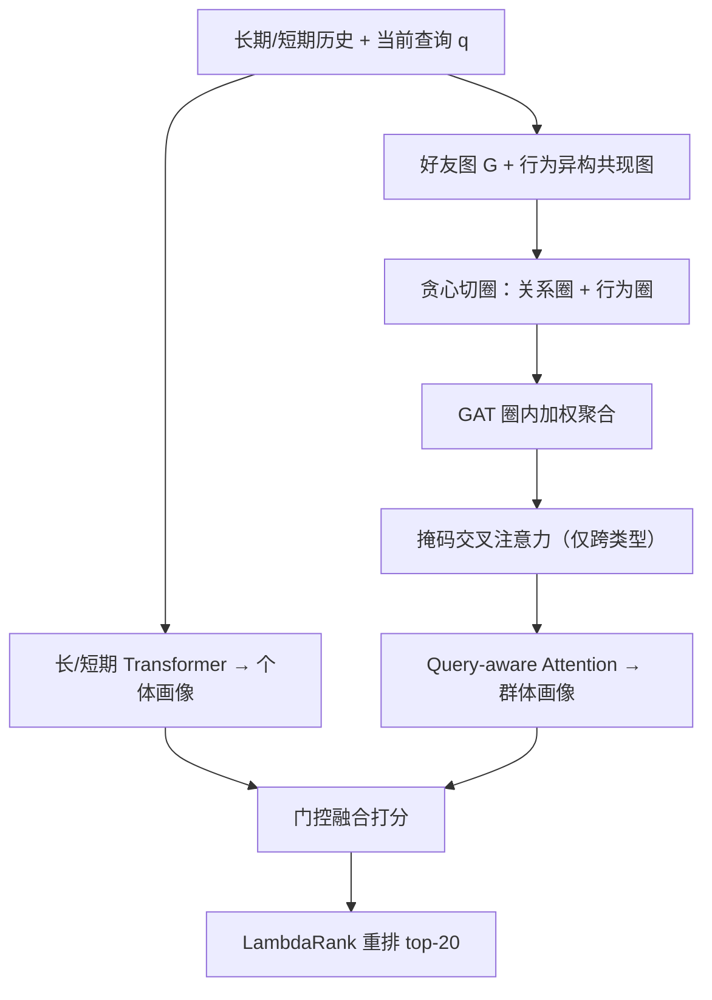
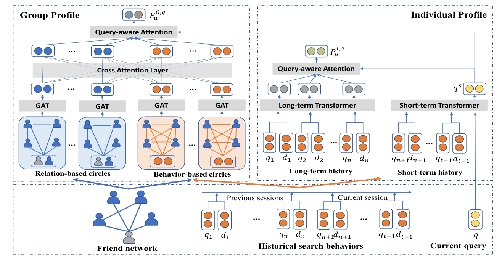

# Group based Personalized Search by Integrating Search Behaviour and Friend Network (融合搜索行为与好友网络的群组个性化搜索)

- **会议/期刊**: SIGIR 2021
- **作者与机构**: Yujia Zhou, Zhicheng Dou (通讯), Bingzheng Wei, Ruobing Xie, Ji-Rong Wen（中国人民大学高瓴人工智能学院 / 腾讯微信搜索应用部）
- **推荐链路定位**: 重排（Re-ranking，对搜索引擎 top-20 候选重排）
- **研究方向**: 社交与群组推荐 / 序列与会话推荐
- **论文原文**: [https://arxiv.org/abs/2111.12618v1](https://arxiv.org/abs/2111.12618v1)
- **开源代码**: [https://github.com/smallporridge/FNPS](https://github.com/smallporridge/FNPS)

## TL;DR (1分钟核心速览)

个性化搜索严重依赖历史行为，历史稀疏时“相似用户群体画像”是主流解法，但以往只用查询/文档的词面或 LDA 主题相似度找相似用户，噪声大且无数据时彻底失效。FNPS 首次把好友网络引入神经个性化搜索：从好友关系与搜索行为两个角度贪心切分出**多个互补好友圈**，用 GAT 圈内聚合 + 掩码交叉注意力 + 查询感知注意力构建群体画像，并与个体画像门控融合。在微信搜索真实日志（8 周历史、5 周 4:1:1 划分、top-20 候选重排）上，MAP 相对原始排序提升 **3.22%**，显著优于 HTPS 等 8 个基线。

## Background & Motivation (背景与核心矛盾)

- **主流范式**: 用长/短期历史构建个体画像后与候选文档匹配打分；对历史稀疏用户则用“相似用户”的日志扩充为群体画像（G-Click、DGF 等）。
- **前人局限**: ① 相似用户靠查询词面重合、共点击或 LDA 主题判定，同查询不同意图、热点事件导致的伪相似会引入大量噪声用户；② 这类方法本身依赖历史，当用户只剩几条记录时，找到的“相似用户”同样不可靠。
- **核心洞察 (Key Insight)**: 现实好友关系往往基于共同背景/兴趣建立，即使查询日志为空也隐含稳定画像；且“行为相似”反映信息需求、“关系亲密”反映真实亲疏，二者互补——既有共同好友又搜索行为相似的用户应获得更高权重。
- **本文切入点**: 把用户划分进**多个**好友圈（而非单一近邻集合），每个圈刻画画像的一个侧面，再按当前查询动态加权。

## Method (核心方法设计)

### 1. 整体框架 (Overall Architecture)

输入为用户好友图 $G$、长期/短期历史$H_u^l,H_u^s$与当前查询$q$。先用两个 Transformer 分别编码长期历史与当前会话意图，经注意力加权得个体画像$P_u^{I,q}$；同时在好友关系图与“查询/满意文档”行为异构图上分别执行贪心切圈算法，得到$k_r$个关系圈与$k_b$个行为圈，用 GAT 在圈内聚合好友画像，再用只保留跨类型连接的掩码 Transformer 让两类圈互补增强，最后以查询意图做圈级注意力得到群体画像$P_u^{G,q}$。个体与群体画像经门控融合后对 top-20 候选打分，LambdaRank 训练、直接重排输出。

<figure class="paper-figure" markdown="span">
  <figcaption>图1：FNPS的架构。给定用户的历史搜索行为和当前查询，利用Transformer层对查询意图和个体画像进行建模。借助好友网络，形成基于关系和基于行为的好友圈以构建群体画像。将这两种画像融合，以增强搜索结果个性化。</figcaption>
</figure>

### 2. 关键设计拆解 (Key Designs)

1. **多样性好友圈贪心划分（Algorithm 1）**：痛点是把所有好友塞进一个近邻集合，无法区分“同事/同学/球友”等不同侧面。做法是在候选节点集 $N$中反复选出与$u$共同邻居（关系图）或共享查询/满意文档（行为图）最多的节点作为圈核心，取其在$G$上的子图为圈，随后**删除该圈所有边**再重复：$f_i=\arg\max_{n\in N}\mathrm{deg}_G(n)$。删边保证圈间低重叠，使每一圈对应一个画像侧面，避免高相似好友挤占全部$k$ 个名额。

2. **GAT 圈内聚合 + 掩码交叉注意力**：圈内好友亲疏不同，用 GAT 赋权：$c_i^f=\mathrm{LeakyReLU}\big(\boldsymbol{W}\sum_{g\in c_i}\alpha_{ig}P_g\big),\ \alpha_{ig}=\mathrm{softmax}\big(\phi(f_i,P_g)\big)$，其中$f_i$为圈核心。两类圈互补：把$k_r+k_b$个圈表示拼接后送入掩码 Transformer，仅保留跨类型圈之间的注意力$M_{ij}=0$（异类且共享用户）或$-\infty$（同类或不相连）。直觉是“既在关系圈又在行为圈出现”的好友同时满足关系近与兴趣近，应被强化，而同类圈之间不必互相稀释。

3. **查询感知注意力、门控融合与训练目标**：不同圈对当前查询贡献不同，用 $P_u^{G,q}=\sum_i\alpha_i c_i^f,\ \alpha_i=\mathrm{softmax}\big(\phi([c_i^f,q_s])\big)$；个体/群体画像由门控$c=\phi([q,P_u^{I,q}])$融合：$p(d|P_I,P_G,q)=c\cdot p(d|P_I,q)+(1-c)\cdot p(d|P_G,q)$，使历史稀疏时自动向群体画像倾斜。损失为加权交叉熵形式的 LambdaRank：$\mathcal{L}=-|\Delta|\big(p_{ij}\log p_{ij}+p_{ji}\log p_{ji}\big)$，$|\Delta|$ 为交换文档位次带来的排序指标变化。负样本为同查询下“满意 vs 不相关”文档配对（停留 >30s 判为满意），无需全库负采样；推理只对候选 top-20 前向打分，开销随好友圈规模线性增长。

## Experimental Setup & Evaluation Protocol (实验设置与评估协议)

- **数据集与预处理**: 取自某大型社交平台内置搜索引擎的真实日志，采样种子用户及其好友构成好友子图；统计如下：

| 统计项 | 数值 | 说明 |
| :--- | :---: | :--- |
| 时间跨度 | 92 天 | 前 8 周作历史，后 5 周按 4:1:1 划分 |
| 种子用户 | 43,770 | 仅保留活跃 session ≥ 4 的用户 |
| 好友节点 / 好友边 | 2,195,625 / 126,860,976 | 平均好友度约 58 |
| 查询 / 去重查询 | 14,930,839 / 9,334,434 | 约 75% 为首次出现的新查询 |
| 点击 / 会话 | 15,843,926 / 8,226,296 | 30 分钟不活跃即切分会话 |

- **数据划分与防穿越 (Splitting Strategy)**: 全局时间戳切分——前 8 周固定为历史（不参与训练），后 5 周按 **4:1:1** 划分训练/验证/测试，历史与测试严格时间隔离。
- **排名评测协议 (Ranking Protocol)**: 属 **Sampled Re-ranking（候选集为引擎返回的 top-20，非全库排序）**；相关性判定用点击停留 >30s 作为 satisfied，且若该文档在后续两个查询下仍 satisfied 也记为相关。指标 MAP / MRR / P@1 / Ave.Click / NDCG@3,5,10。
- **对比基线与超参设置**: 原始排序 Ori；群组类 G-Click、DGF；社交类 PSSN、SonetRank；深度类 HRNN、RPMN、PEPS、HTPS。词向量 $\{100,300\}$，Transformer/GAT 隐层$\{128,256,512\}$，学习率$\{10^{-2},10^{-3},10^{-4}\}$；圈数按启发式$k_r=\#\text{friends}/20$、$k_b=\#\text{behaviours}/5$；显著性用 paired t-test（$p<0.05$）。

## Key Experimental Results (实验关键数据)

### 1. 主实验对比 (Main Results)

| Model | MAP | MRR | P@1 | Ave.Rank↓ | NDCG@5 | NDCG@10 |
| :--- | :---: | :---: | :---: | :---: | :---: | :---: |
| Ori. (原始排序) | .6614 | .6859 | .5766 | 3.898 | .6720 | .7148 |
| G-Click (SIGIR'08) | .6625 | .6874 | .5746 | 3.849 | .6754 | .7166 |
| DGF (CIKM'12) | .6491 | .6769 | .5583 | 3.920 | .6616 | .7069 |
| PSSN (CIKM'13) | .6642 | .6883 | .5732 | 3.812 | .6778 | .7193 |
| SonetRank (WSDM'14) | .6659 | .6898 | .5731 | 3.764 | .6796 | .7220 |
| HRNN (SIGIR'19) | .6707 | .6951 | .5800 | 3.727 | .6839 | .7258 |
| RPMN (TOIS'20) | .6724 | .6962 | .5795 | 3.642 | .6859 | .7296 |
| PEPS (TOIS'20) | .6727 | .6979 | .5811 | 3.626 | .6867 | .7303 |
| HTPS (TOIS'20) | .6749 | .6991 | .5821 | 3.615 | .6894 | .7326 |
| **FNPS (本文)** | **.6827** | **.7058** | **.5902** | **3.486** | **.6985** | **.7402** |
| Improv. vs. Ori. | **+3.22%** | **+2.90%** | **+2.36%** | **+10.57%** | **+3.91%** | **+3.55%** |

### 2. 消融实验 (Ablation Study)

| 变体 | MAP | ΔMAP | P@1 | Ave.Rank↓ |
| :--- | :---: | :---: | :---: | :---: |
| w/o RGF（去关系圈） | .6766 | -0.89% | .5838 | 3.611 |
| w/o BGF（去行为圈） | .6772 | -0.80% | .5840 | 3.604 |
| w/o GAT（圈内平均池化） | .6790 | -0.54% | .5870 | 3.585 |
| w/o CA（去交叉注意力） | .6801 | -0.37% | .5876 | 3.570 |
| w/o QA（圈级均匀加权） | .6793 | -0.49% | .5869 | 3.579 |
| **FNPS 完整模型** | **.6827** | — | **.5902** | **3.486** |

### 3. 关键实验发现 (Key Findings)

1. 双通道分组是主要增益来源：去掉关系圈或行为圈分别掉 **0.89% / 0.80% MAP**，远大于结构组件的损失；而传统群组方法 DGF 甚至比原始排序低 2.02%，说明仅靠主题相似挑“相似用户”在高质量初排下反而引入噪声。
2. 结构组件中 **GAT（-0.54%）> Query-aware（-0.49%）> 交叉注意力（-0.37%）**，即“圈内谁更重要”比“圈之间怎么交互”更关键；交叉注意力虽增益最小，但证明两类圈确实互补而非冗余。
3. 分桶实验显示群体画像的定位是“补短板”：历史长度 0–10 时 FNPS 对 HTPS 的 ΔMAP 优势最大并随历史增长收敛；好友数从 0 增至 350 时增益持续扩大、超过 350 后因噪声回落；在点击熵 ≥1 的歧义查询与占 75% 的非重复查询上提升最明显。

## Highlights & Limitations (亮点、对比与审稿批判)

- **与代表作对比 (vs. Prior Work)**: G-Click/DGF 只用共点击或 LDA 主题做静态相似用户分组，无语义、无个性化粒度；PSSN/SonetRank 只用社交链路，缺失行为语义且不能刻画多侧面兴趣；HRNN/HTPS 只建模个体历史，在稀疏场景直接失效。FNPS 的关键差异是**双源图 + 多圈细分 + 神经语义匹配**，把“谁是相似用户”从词面判定升级为关系与行为的联合判定。
- **可迁移亮点**: ① “选核心节点→取子图→删边”的贪心切分是一个通用、无参数的多样化分组算子，可直接搬到群组推荐或社区发现做去冗余；② 只允许跨源连接的 masked attention，是融合两路异构信号的轻量方案，比简单拼接/加权更可控。
- **审稿级局限批判**: ① 强依赖平台内好友关系与共同好友数，跨应用不可迁移，且每用户需对候选集反复统计度数与删边，图规模大时构图开销与隐私合规成本都高；② 评测仅限单一微信日志、候选集只有 top-20 的 sampled re-ranking，既无公开数据集复现，也未验证全库排序与线上 A/B；③ $k_r,k_b$采用$\#\text{friends}/20$、$\#\text{behaviours}/5$ 的启发式设置，缺少敏感度与最优圈数分析。

## Rating (四维评分)

- **方法创新性 (Novelty)**: ⭐⭐⭐⭐ （首次把好友网络与神经语义相似度联合用于个性化搜索，双通道多圈分组 + 掩码交叉注意力思路清晰，但各组件本身均为已有算子的组合）
- **评估协议与实验扎实度 (Protocol & Experiments)**: ⭐⭐⭐⭐ （真实工业日志、严格时间切分、8 个跨类别基线与配对 t 检验齐备，且补充历史长度/好友数/点击熵/重复查询四组切片分析；遗憾是单数据集、候选集仅 top-20）
- **写作与数学规范度 (Clarity & Rigor)**: ⭐⭐⭐⭐ （四步流程与公式定义清楚、算法 1 伪代码完整；但切圈的最优性/复杂度未给分析，$k_r,k_b$ 的启发式缺乏理论或实验论证）
- **工业落地与复现价值 (Industrial & Practical Value)**: ⭐⭐⭐⭐ （代码已开源，模块化易插拔到现有重排链路；但依赖社交图数据、构图开销与隐私约束限制了跨业务复用）

